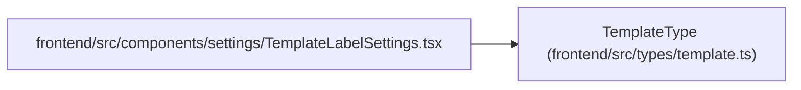

# TemplateType

**Location:** `frontend/src/types/template.ts:1`
**Kind:** Type alias
**Bases:** —
**Module:** [types_template](../modules/types_template.md)
**Target:**

```typescript
'task' | 'project' | 'triage'
```

## Description

_Auto-generated from `TemplateType` in `frontend/src/types/template.ts`._

## Attributes

*See the alias definition for its member types.*

## Methods

*See the alias definition for callable and member types.*

## Relationships

<!-- Auto-generated relationship summary. Do not edit by hand. -->


### Summary

| Module | Methods | Attributes |
|---|---:|---|
| [types_template](../modules/types_template.md) | 0 | — |

### References

| Reference | Kind | Source | Call sites |
|---|---|---|---:|
| `TemplateLabelSettings` | import | [TemplateLabelSettings](../modules/TemplateLabelSettings.md) | — |
