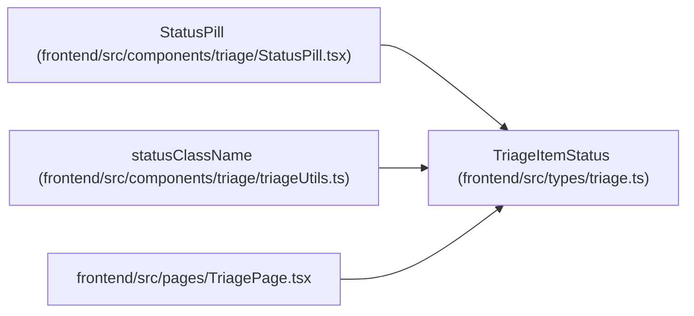

# TriageItemStatus

**Location:** `frontend/src/types/triage.ts:4`
**Kind:** Type alias
**Bases:** —
**Module:** [types_triage](../modules/types_triage.md)
**Target:**

```typescript
'new' | 'accepted' | 'declined' | 'duplicate' | 'snoozed' | 'converted'
```

## Description

_Auto-generated from `TriageItemStatus` in `frontend/src/types/triage.ts`._

## Attributes

*See the alias definition for its member types.*

## Methods

*See the alias definition for callable and member types.*

## Relationships

<!-- Auto-generated relationship summary. Do not edit by hand. -->


### Summary

| Module | Methods | Attributes |
|---|---:|---|
| [types_triage](../modules/types_triage.md) | 0 | — |

### References

| Reference | Kind | Source | Call sites |
|---|---|---|---:|
| `StatusPill` | type_reference | [StatusPill](../modules/StatusPill.md) | — |
| `statusClassName` | type_reference | [triageUtils](../modules/triageUtils.md) | — |
| `TriagePage` | import | [TriagePage](../modules/TriagePage.md) | — |
