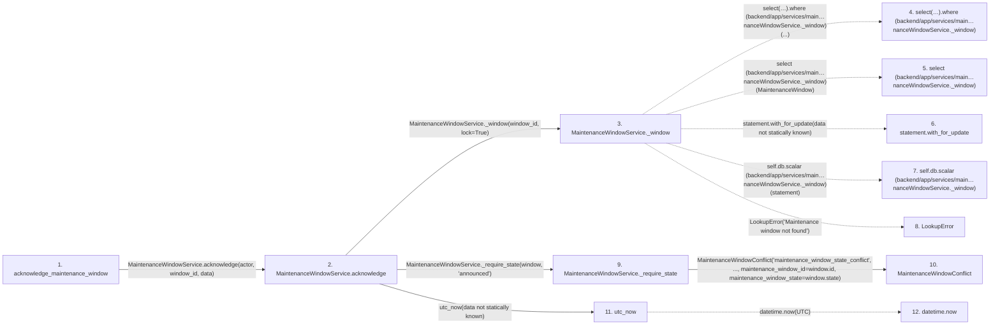

# acknowledge_maintenance_window

**Entry point:** `acknowledge_maintenance_window` (`http`)
**Source:** [routers_agent](../modules/routers_agent.md)
**Modules touched:** [authority](../modules/authority.md), [commands](../modules/commands.md), [maintenance_window_service](../modules/maintenance_window_service.md), [models_maintenance](../modules/models_maintenance.md), and 2 more

**Complete modules touched:**

- [authority](../modules/authority.md)
- [commands](../modules/commands.md)
- [maintenance_window_service](../modules/maintenance_window_service.md)
- [models_maintenance](../modules/models_maintenance.md)
- [routers_agent](../modules/routers_agent.md)
- [time](../modules/time.md)

## Call sequence

> Static overview in presentation order, not runtime execution order. Arrows retain captured callers; representative internal continuations and boundary examples precede repeated helper detail.

```mermaid
sequenceDiagram
    participant p0 as acknowledge_maintenance_window
    participant p1 as MaintenanceWindowService.acknowledge
    participant p2 as MaintenanceWindowService
    participant p3 as _handle_agent_error
    participant p4 as MaintenanceWindowService._require_state
    participant p5 as MaintenanceWindowService._add_receipt
    participant p6 as receipt_view
    participant p7 as window_view
    participant p8 as commit_or_flush
    participant p9 as MaintenanceWindowService._window
    participant p10 as utc_now
    participant p11 as MaintenanceWindowConflict
    participant p12 as MaintenanceWindowService._running_runs
    participant p13 as MaintenanceWindowReceipt
    participant p14 as _owner_key
    participant p15 as _iso
    participant p16 as internal_authority
    participant p17 as current_command
    participant p18 as isinstance (backend/app/routers/agent.py:_handle_agent_error)
    participant p19 as (…).one_or_none
    participant p20 as str
    participant p21 as HTTPException
    participant p22 as self.db.execute (backend/app/services/main…eWindowService.acknowledge)
    participant p23 as select(…).where (backend/app/services/main…eWindowService.acknowledge)
    participant p24 as select (backend/app/services/main…eWindowService.acknowledge)
    participant p25 as exc.detail
    participant p26 as secrets.compare_digest
    p0->>p1: MaintenanceWindowService.acknowledge
    p0->>p2: MaintenanceWindowService
    p0->>p3: _handle_agent_error
    p1->>p4: MaintenanceWindowService._require_state
    p1->>p5: MaintenanceWindowService._add_receipt
    p1->>p6: receipt_view
    p1->>p7: window_view
    p5->>p8: commit_or_flush
    p1->>p9: MaintenanceWindowService._window
    p1->>p10: utc_now
    p1->>p11: MaintenanceWindowConflict
    p1->>p12: MaintenanceWindowService._running_runs
    p1->>p13: MaintenanceWindowReceipt
    p1->>p14: _owner_key
    p6->>p15: _iso
    p5->>p16: internal_authority
    p8->>p17: current_command
    p3-->>p18: isinstance (backend/app/routers/agent.py:_handle_agent_error)(exc, AgentPermissionError)
    p1-->>p19: (…).one_or_none
    p3-->>p20: str(exc)
    p3-->>p20: str(exc)
    p3-->>p21: HTTPException(status_code=status.HTTP_403_FORBIDDEN, detail=detail)
    p1-->>p22: self.db.execute (backend/app/services/main…eWindowService.acknowledge)(...)
    p3-->>p18: isinstance (backend/app/routers/agent.py:_handle_agent_error)(exc, AgentRoutingConflictError)
    p1-->>p23: select(…).where (backend/app/services/main…eWindowService.acknowledge)(...)
    p3-->>p21: HTTPException(status_code=status.HTTP_409_CONFLICT, detail=exc.detail(...))
    p1-->>p24: select (backend/app/services/main…eWindowService.acknowledge)(Task.id, Task.claimed_by, Task.claim_id, Task.claim_generation, Task.claim_expires_at)
    p3-->>p25: exc.detail
    p1-->>p26: secrets.compare_digest(task.claim_id, data.claim_id)
    p3-->>p18: isinstance (backend/app/routers/agent.py:_handle_agent_error)(exc, AgentTeamSetupConflictError)
```

<!-- Auto-generated from static call edges. Dashed arrows are external or unresolved calls. Reviewed runtime conditions and side effects belong in Behavior. -->

> Call sequence diagram shows 30 of 81 interactions; 51 omitted to keep the visualization within the 30-interaction and generated-diagram limits, with uncertain identities omitted rather than inferred.

> Captured boundary calls: external 9 of 32 (23 omitted); unresolved 4 of 24 (20 omitted). These counts cover the captured static trace.

Omitted captured detail, grouped by actual caller occurrence and target module:

| Caller | Parent step | Target module | Kind | Omitted interactions |
| --- | --- | --- | --- | --- |
| `backend/app/services/maintenance_window_service.py:MaintenanceWindowService._window` | 3 | - | unresolved | 3 |
| `backend/app/services/maintenance_window_service.py:MaintenanceWindowService._window` | 3 | - | external | 2 |
| `backend/app/services/maintenance_window_service.py:MaintenanceWindowService._require_state` | 9 | [backend/app/services/maintenance_window_service.py](../modules/maintenance_window_service.md) | internal | 1 |
| `backend/app/utils/time.py:utc_now` | 11 | - | external | 1 |
| `backend/app/services/maintenance_window_service.py:MaintenanceWindowService._running_runs` | 19 | - | unresolved | 6 |
| `backend/app/services/maintenance_window_service.py:MaintenanceWindowService._running_runs` | 19 | - | external | 2 |
| `backend/app/services/maintenance_window_service.py:MaintenanceWindowService.acknowledge` | 2 | [backend/app/services/maintenance_window_service.py](../modules/maintenance_window_service.md) | internal | 1 |
| `backend/app/services/maintenance_window_service.py:MaintenanceWindowService._add_receipt` | 29 | - | unresolved | 4 |
> Omission summary shows 8 of 18 groups; 10 further groups are not expanded here. Counts above include all omitted interactions.
> Detailed flow queries retain their own coverage and limits; omitted paths may execute at runtime.

## Data flow

<!-- Auto-generated static analysis. Treat values and boundaries as best-effort hints, not runtime proof. -->

### Analysis coverage

**Effect analysis partially available.** Flow assembly and source effect analysis are separate; empty observations do not prove an empty handler body.

Source steps: 26; effect analysis evaluated: 20, partial: 1, unavailable: 5. Counts include steps omitted from the displayed trace.

Collector observations for 21 source steps with known totals: observed: 71, emitted: 67, omitted: 4. Unavailable totals are excluded.

- Callable record unavailable for one or more source steps; those steps have no represented callable body.
- Effect collector omitted observations before flow assembly; displayed effects are partial.
- Effect collector totals unavailable; observed counts cover captured records only.

| Step | Callable record | Effect analysis | Collector totals | Observed | Emitted | Omitted |
|---|---|---|---|---:|---:|---:|
| `acknowledge_maintenance_window` | `available` | `evaluated` | `available` | `5` | `5` | `0` |
| `MaintenanceWindowService.acknowledge` | `available` | `evaluated` | `available` | `4` | `4` | `0` |
| `MaintenanceWindowService._window` | `available` | `evaluated` | `available` | `4` | `4` | `0` |
| `select(…).where (backend/app/services/main…nanceWindowService._window)` | `not_applicable` | `not_applicable` | `not_applicable` | — | — | — |
| `select (backend/app/services/main…nanceWindowService._window)` | `not_applicable` | `not_applicable` | `not_applicable` | — | — | — |
| `statement.with_for_update` | `not_applicable` | `not_applicable` | `not_applicable` | — | — | — |
| `self.db.scalar (backend/app/services/main…nanceWindowService._window)` | `not_applicable` | `not_applicable` | `not_applicable` | — | — | — |
| `LookupError` | `not_applicable` | `not_applicable` | `not_applicable` | — | — | — |
| `MaintenanceWindowService._require_state` | `available` | `evaluated` | `available` | `2` | `2` | `0` |
| `MaintenanceWindowConflict` | `unavailable` | `unavailable` | `unavailable` | — | — | — |
| `utc_now` | `available` | `evaluated` | `available` | `2` | `2` | `0` |
| `datetime.now` | `not_applicable` | `not_applicable` | `not_applicable` | — | — | — |

### Step data

| Step | Inputs | Reads | Writes | Returns |
|---|---|---|---|---|
| `acknowledge_maintenance_window` | `window_id: int`, `data: MaintenanceOwnerAcknowledgement`, `actor: Annotated[AgentActor, Depends(get_agent_actor)]`, `db: Annotated[AsyncSession, Depends(get_db, scope='function')]` | - | - | `...` |
| `MaintenanceWindowService.acknowledge` | `actor: AgentActor`, `window_id: int`, `data: MaintenanceOwnerAcknowledgement` | - | - | `{...}` |
| `MaintenanceWindowService._window` | `window_id: int`, `lock: bool` | `MaintenanceWindow` | - | `window` |
| `select(…).where (backend/app/services/main…nanceWindowService._window)` | - | - | - | - |
| `select (backend/app/services/main…nanceWindowService._window)` | - | - | - | - |
| `statement.with_for_update` | - | - | - | - |
| `self.db.scalar (backend/app/services/main…nanceWindowService._window)` | - | - | - | - |
| `LookupError` | - | - | - | - |
| `MaintenanceWindowService._require_state` | `window: MaintenanceWindow`, `state: str` | - | - | - |
| `MaintenanceWindowConflict` | - | - | - | - |
| `utc_now` | - | `UTC` | - | `datetime.now(...)` |
| `datetime.now` | - | - | - | - |

### Call data

| From | To | Line | Call |
|---|---|---:|---|
| acknowledge_maintenance_window | MaintenanceWindowService.acknowledge | 1095 | `MaintenanceWindowService(db).acknowledge(actor, window_id, data)` |
| MaintenanceWindowService.acknowledge | MaintenanceWindowService._window | 432 | `self._window(window_id, lock=True)` |
| MaintenanceWindowService._window | select(…).where (backend/app/services/main…nanceWindowService._window) | 134 | `select(MaintenanceWindow).where(...)` |
| MaintenanceWindowService._window | select (backend/app/services/main…nanceWindowService._window) | 134 | `select(MaintenanceWindow)` |
| MaintenanceWindowService._window | statement.with_for_update | 136 | `statement.with_for_update(data not statically known)` |
| MaintenanceWindowService._window | self.db.scalar (backend/app/services/main…nanceWindowService._window) | 137 | `self.db.scalar(statement)` |
| MaintenanceWindowService._window | LookupError | 139 | `LookupError('Maintenance window not found')` |
| MaintenanceWindowService.acknowledge | MaintenanceWindowService._require_state | 433 | `self._require_state(window, 'announced')` |
| MaintenanceWindowService._require_state | MaintenanceWindowConflict | 493 | `MaintenanceWindowConflict('maintenance_window_state_conflict', ..., maintenance_window_id=window.id, maintenance_window_state=window.state)` |
| MaintenanceWindowService.acknowledge | utc_now | 434 | `clock.utc_now(data not statically known)` |
| utc_now | datetime.now | 13 | `datetime.now(UTC)` |

### Boundary effects

*No boundary-effect observations were captured in this static trace.*

### Static analysis gaps

| Kind | Step | Target | Line |
|---|---|---|---:|
| unresolved_call | `MaintenanceWindowService._window` | `select(MaintenanceWindow).where` | 134 |
| external_call | `MaintenanceWindowService._window` | `select` | 134 |
| unresolved_call | `MaintenanceWindowService._window` | `statement.with_for_update` | 136 |
| unresolved_call | `MaintenanceWindowService._window` | `self.db.scalar` | 137 |
| external_call | `MaintenanceWindowService._window` | `LookupError` | 139 |
| external_call | `utc_now` | `datetime.now` | 13 |
| step_limit | `acknowledge_maintenance_window` | `first 12 steps` | 0 |

## Behavior

Records the live claim owner's own acknowledgement of the bounded window for the claim's current generation. A long lease or a pause in the worker's traffic is never an acknowledgement. A coordinated control-plane maintenance window has one open window at a time. Announcing it closes admission for new work at once; work already holding a live claim keeps renewing and may finish. The operator can begin only when every live claim owner has acknowledged for the claim's current generation, each lease outlives the bounded outage plus its margin, no running run lacks a live claim and every PM has a notice receipt. A PM notice is recorded evidence of notification, never run-owner consent. Closing or cancelling reopens admission.
