# apply_agent_profile_preset

**Entry point:** `apply_agent_profile_preset` (`http`)
**Source:** [agent_catalog](../modules/agent_catalog.md)
**Modules touched:** [agent_catalog](../modules/agent_catalog.md), [agent_planning_service](../modules/agent_planning_service.md), [agent_service](../modules/agent_service.md), [commands](../modules/commands.md), and 3 more

**Complete modules touched:**

- [agent_catalog](../modules/agent_catalog.md)
- [agent_planning_service](../modules/agent_planning_service.md)
- [agent_service](../modules/agent_service.md)
- [commands](../modules/commands.md)
- [models_agent](../modules/models_agent.md)
- [routers_agent_planning](../modules/routers_agent_planning.md)
- [schemas_agent_planning](../modules/schemas_agent_planning.md)

## Call sequence

> Static overview in presentation order, not runtime execution order. Arrows retain captured callers; representative internal continuations and boundary examples precede repeated helper detail.

```mermaid
sequenceDiagram
    participant p0 as apply_agent_profile_preset
    participant p1 as AgentPlanningService.apply_profile_preset
    participant p2 as AgentPlanningService
    participant p3 as _handle_agent_error
    participant p4 as AgentPlanningService._execute
    participant p5 as require_scope
    participant p6 as AgentPlanningService._replay
    participant p7 as commit_or_flush
    participant p8 as actor_has_scope
    participant p9 as validate_idempotency_key
    participant p10 as AgentPlanningReceipt
    participant p11 as AgentIdempotencyRecord
    participant p12 as AgentPlanningService._request_hash
    participant p13 as current_command
    participant p14 as AgentPermissionError
    participant p15 as AgentConflictError
    participant p16 as actor_scopes
    participant p17 as isinstance (backend/app/routers/agent…ing.py:_handle_agent_error)
    participant p18 as TeamMemberProfileResponse.model_validate
    participant p19 as HTTPException
    participant p20 as str
    participant p21 as exc.detail
    p0->>p1: AgentPlanningService.apply_profile_preset
    p0->>p2: AgentPlanningService
    p0->>p3: _handle_agent_error
    p1->>p4: AgentPlanningService._execute
    p4->>p5: require_scope
    p4->>p6: AgentPlanningService._replay
    p4->>p7: commit_or_flush
    p5->>p8: actor_has_scope
    p4->>p9: validate_idempotency_key
    p4->>p10: AgentPlanningReceipt
    p4->>p11: AgentIdempotencyRecord
    p4->>p12: AgentPlanningService._request_hash
    p7->>p13: current_command
    p5->>p14: AgentPermissionError
    p6->>p15: AgentConflictError
    p8->>p16: actor_scopes
    p3-->>p17: isinstance (backend/app/routers/agent…ing.py:_handle_agent_error)(exc, AgentPermissionError)
    p0-->>p18: TeamMemberProfileResponse.model_validate(receipt.result)
    p3-->>p19: HTTPException(status_code=status.HTTP_403_FORBIDDEN, detail=str(...))
    p3-->>p20: str(exc)
    p3-->>p17: isinstance (backend/app/routers/agent…ing.py:_handle_agent_error)(exc, AgentRoutingConflictError)
    p3-->>p19: HTTPException(status_code=status.HTTP_409_CONFLICT, detail=exc.detail(...))
    p3-->>p21: exc.detail
    p3-->>p17: isinstance (backend/app/routers/agent…ing.py:_handle_agent_error)(exc, TaskVersionConflictError)
    p3-->>p19: HTTPException(status_code=status.HTTP_409_CONFLICT, detail=exc.detail(...))
    p3-->>p21: exc.detail
    p3-->>p17: isinstance (backend/app/routers/agent…ing.py:_handle_agent_error)(exc, AgentConflictError)
    p3-->>p19: HTTPException(status_code=status.HTTP_409_CONFLICT, detail=str(...))
    p3-->>p20: str(exc)
    p3-->>p17: isinstance (backend/app/routers/agent…ing.py:_handle_agent_error)(exc, TriageConflictError)
```

<!-- Auto-generated from static call edges. Dashed arrows are external or unresolved calls. Reviewed runtime conditions and side effects belong in Behavior. -->

> Call sequence diagram shows 30 of 76 interactions; 46 omitted to keep the visualization within the 30-interaction and generated-diagram limits, with uncertain identities omitted rather than inferred.

> Captured boundary calls: external 11 of 35 (24 omitted); unresolved 3 of 20 (17 omitted). These counts cover the captured static trace.

Omitted captured detail, grouped by actual caller occurrence and target module:

| Caller | Parent step | Target module | Kind | Omitted interactions |
| --- | --- | --- | --- | --- |
| `backend/app/services/agent_service.py:actor_scopes` | 6 | - | external | 2 |
| `backend/app/services/agent_service.py:validate_idempotency_key` | 10 | - | external | 6 |
| `backend/app/services/agent_service.py:validate_idempotency_key` | 10 | - | unresolved | 1 |
| `backend/app/services/agent_planning_service.py:AgentPlanningService._execute` | 3 | - | unresolved | 7 |
| `backend/app/services/agent_planning_service.py:AgentPlanningService._replay` | 19 | - | unresolved | 4 |
| `backend/app/services/agent_planning_service.py:AgentPlanningService._replay` | 19 | - | external | 3 |
| `backend/app/services/agent_planning_service.py:AgentPlanningService._replay` | 19 | [backend/app/services/agent_planning_service.py](../modules/agent_planning_service.md) | internal | 1 |
| `backend/app/services/agent_planning_service.py:AgentPlanningService._request_hash` | 24 | - | external | 2 |
> Omission summary shows 8 of 16 groups; 8 further groups are not expanded here. Counts above include all omitted interactions.
> Detailed flow queries retain their own coverage and limits; omitted paths may execute at runtime.

## Data flow

<!-- Auto-generated static analysis. Treat values and boundaries as best-effort hints, not runtime proof. -->

### Analysis coverage

**Effect analysis partially available.** Flow assembly and source effect analysis are separate; empty observations do not prove an empty handler body.

Source steps: 22; effect analysis evaluated: 15, partial: 1, unavailable: 6. Counts include steps omitted from the displayed trace.

Collector observations for 16 source steps with known totals: observed: 121, emitted: 117, omitted: 4. Unavailable totals are excluded.

- Callable record unavailable for one or more source steps; those steps have no represented callable body.
- Effect collector omitted observations before flow assembly; displayed effects are partial.
- Effect collector totals unavailable; observed counts cover captured records only.

| Step | Callable record | Effect analysis | Collector totals | Observed | Emitted | Omitted |
|---|---|---|---|---:|---:|---:|
| `apply_agent_profile_preset` | `available` | `evaluated` | `available` | `5` | `5` | `0` |
| `AgentPlanningService.apply_profile_preset` | `available` | `evaluated` | `available` | `4` | `4` | `0` |
| `AgentPlanningService._execute` | `available` | `evaluated` | `available` | `20` | `20` | `0` |
| `require_scope` | `available` | `evaluated` | `available` | `2` | `2` | `0` |
| `actor_has_scope` | `available` | `evaluated` | `available` | `3` | `3` | `0` |
| `actor_scopes` | `available` | `evaluated` | `available` | `3` | `3` | `0` |
| `json.loads (backend/app/services/agent_service.py:actor_scopes)` | `not_applicable` | `not_applicable` | `not_applicable` | — | — | — |
| `isinstance (backend/app/services/agent_service.py:actor_scopes)` | `not_applicable` | `not_applicable` | `not_applicable` | — | — | — |
| `AgentPermissionError` | `unavailable` | `unavailable` | `unavailable` | — | — | — |
| `validate_idempotency_key` | `available` | `evaluated` | `available` | `4` | `4` | `0` |
| `ValueError` | `not_applicable` | `not_applicable` | `not_applicable` | — | — | — |
| `value.strip` | `not_applicable` | `not_applicable` | `not_applicable` | — | — | — |

```mermaid
flowchart LR
    s1["1. apply_agent_profile_preset"]
    s2["2. AgentPlanningService.apply_profile_preset"]
    s3["3. AgentPlanningService._execute"]
    s4["4. require_scope"]
    s5["5. actor_has_scope"]
    s6["6. actor_scopes"]
    s7["7. json.loads (backend/app/services/agent_service.py:actor_scopes)"]
    s8["8. isinstance (backend/app/services/agent_service.py:actor_scopes)"]
    s9["9. AgentPermissionError"]
    s10["10. validate_idempotency_key"]
    s11["11. ValueError"]
    s12["12. value.strip"]
    s1 -->|"AgentPlanningService.apply_profile_preset(preset_key, actor, command=command)"| s2
    s2 -->|"AgentPlanningService._execute(…)"| s3
    s3 -->|"require_scope(actor, scope)"| s4
    s4 -->|"actor_has_scope(actor, scope)"| s5
    s5 -->|"actor_scopes(actor)"| s6
    s6 -. "json.loads (backend/app/services/agent_service.py:actor_scopes)(actor.scopes)" .-> s7
    s6 -. "isinstance (backend/app/services/agent_service.py:actor_scopes)(scopes, list)" .-> s8
    s4 -->|"AgentPermissionError(...)"| s9
    s3 -->|"validate_idempotency_key(command.idempotency_key, required=True)"| s10
    s10 -. "ValueError('Idempotency-Key is required')" .-> s11
    s10 -. "value.strip(data not statically known)" .-> s12
    b0["mutation self.db.add"]
    s3 -. "mutation self.db.add" .-> b0
    click s1 "../modules/agent_catalog.md"
    click s2 "../modules/agent_planning_service.md"
    click s3 "../modules/agent_planning_service.md"
    click s4 "../modules/agent_service.md"
    click s5 "../modules/agent_service.md"
    click s6 "../modules/agent_service.md"
    click s9 "../modules/agent_service.md"
    click s10 "../modules/agent_service.md"
    classDef boundary stroke:#b45309,stroke-dasharray: 4 2
    class b0 boundary
```

### Step data

| Step | Inputs | Reads | Writes | Returns |
|---|---|---|---|---|
| `apply_agent_profile_preset` | `preset_key: str`, `actor: Annotated[AgentActor, Depends(get_agent_actor)]`, `db: Annotated[AsyncSession, Depends(get_db, scope='function')]`, `command: Annotated[AgentPlanningCommandContext, Depends(get_agent_planning_command_context)]` | - | - | `TeamMemberProfileResponse.model_validate(...)` |
| `AgentPlanningService.apply_profile_preset` | `preset_key: str`, `actor: AgentActor`, `command: AgentPlanningCommandContext` | - | - | `...` |
| `AgentPlanningService._execute` | `actor: AgentActor`, `scope: str`, `operation: str`, `target_type: str`, `idempotency_target_id: int`, `command: AgentPlanningCommandContext`, `request_payload: dict[str, Any]`, `mutate: Mutation` | `self.db.info`, `self.db`, `IntegrityError`, `AgentConflictError` | `audited_request[...]` | `replay`, `receipt`, `receipt`, `replay`, `replay`, `replay` |
| `require_scope` | `actor: AgentActor`, `scope: str` | - | - | - |
| `actor_has_scope` | `actor: AgentActor`, `scope: str` | - | - | `...` |
| `actor_scopes` | `actor: AgentActor` | `json` | - | `...` |
| `json.loads (backend/app/services/agent_service.py:actor_scopes)` | - | - | - | - |
| `isinstance (backend/app/services/agent_service.py:actor_scopes)` | - | - | - | - |
| `AgentPermissionError` | - | - | - | - |
| `validate_idempotency_key` | `value: Optional[str]`, `required: bool` | - | - | `None`, `value` |
| `ValueError` | - | - | - | - |
| `value.strip` | - | - | - | - |

### Call data

| From | To | Line | Call |
|---|---|---:|---|
| apply_agent_profile_preset | AgentPlanningService.apply_profile_preset | 124 | `AgentPlanningService(db).apply_profile_preset(preset_key, actor, command=command)` |
| AgentPlanningService.apply_profile_preset | AgentPlanningService._execute | 691 | `self._execute(actor=actor, scope='team:write', operation='planning.profile_preset.apply', target_type='team_member_profile', idempotency_target_id=0, command=command, request_payload=payload, mutate=mutate)` |
| AgentPlanningService._execute | require_scope | 147 | `require_scope(actor, scope)` |
| require_scope | actor_has_scope | 86 | `actor_has_scope(actor, scope)` |
| actor_has_scope | actor_scopes | 80 | `actor_scopes(actor)` |
| actor_scopes | json.loads (backend/app/services/agent_service.py:actor_scopes) | 72 | `json.loads(actor.scopes)` |
| actor_scopes | isinstance (backend/app/services/agent_service.py:actor_scopes) | 75 | `isinstance(scopes, list)` |
| require_scope | AgentPermissionError | 87 | `AgentPermissionError(...)` |
| AgentPlanningService._execute | validate_idempotency_key | 149 | `validate_idempotency_key(command.idempotency_key, required=True)` |
| validate_idempotency_key | ValueError | 96 | `ValueError('Idempotency-Key is required')` |
| validate_idempotency_key | value.strip | 100 | `value.strip(data not statically known)` |

### Boundary effects

| Kind | Target | Step | Line |
|---|---|---|---:|
| mutation | `self.db.add` | `AgentPlanningService._execute` | 191 |

### Static analysis gaps

| Kind | Step | Target | Line |
|---|---|---|---:|
| external_call | `actor_scopes` | `json.loads` | 72 |
| external_call | `actor_scopes` | `isinstance` | 75 |
| external_call | `validate_idempotency_key` | `ValueError` | 96 |
| unresolved_call | `validate_idempotency_key` | `value.strip` | 100 |
| step_limit | `apply_agent_profile_preset` | `first 12 steps` | 0 |

## Behavior

This flow starts at `apply_agent_profile_preset` and is classified as `http`. The generated call and data-flow sections are bounded static projections; runtime conditions and side effects require source-level confirmation.
