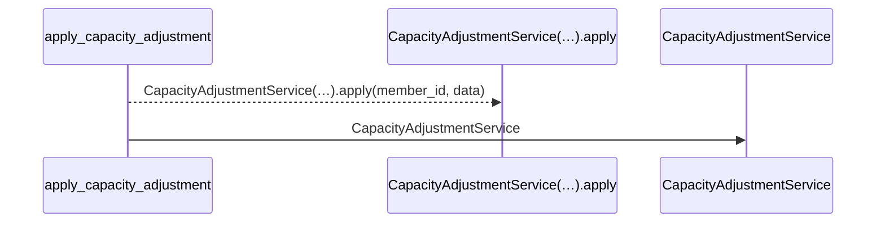
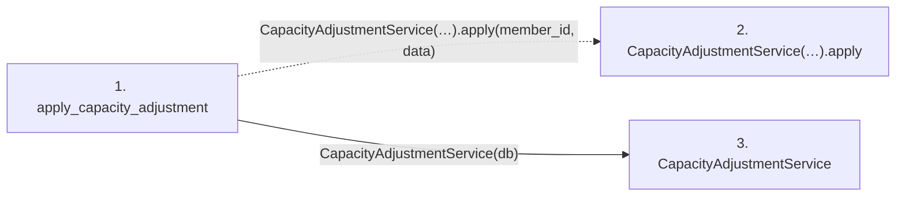

# apply_capacity_adjustment

**Entry point:** `apply_capacity_adjustment` (`http`)
**Source:** [routers_team](../modules/routers_team.md)
**Modules touched:** [capacity_adjustments](../modules/capacity_adjustments.md), [routers_team](../modules/routers_team.md)

## Call sequence

> Static overview in presentation order, not runtime execution order. Arrows retain captured callers; representative internal continuations and boundary examples precede repeated helper detail.

<!-- Auto-generated from static call edges. Dashed arrows are external or unresolved calls. Reviewed runtime conditions and side effects belong in Behavior. -->

> Call sequence diagram shows 2 of 2 interactions; 0 omitted to keep the visualization within the 30-interaction and generated-diagram limits, with uncertain identities omitted rather than inferred.

> Captured boundary calls: external 0 of 0 (0 omitted); unresolved 1 of 1 (0 omitted). These counts cover the captured static trace.
> Detailed flow queries retain their own coverage and limits; omitted paths may execute at runtime.

## Data flow

<!-- Auto-generated static analysis. Treat values and boundaries as best-effort hints, not runtime proof. -->

### Analysis coverage

**Effect analysis partially available.** Flow assembly and source effect analysis are separate; empty observations do not prove an empty handler body.

Source steps: 2; effect analysis evaluated: 1, partial: 0, unavailable: 1. Counts include steps omitted from the displayed trace.

Collector observations for 1 source steps with known totals: observed: 4, emitted: 4, omitted: 0. Unavailable totals are excluded.

- Callable record unavailable for one or more source steps; those steps have no represented callable body.
- Effect collector totals unavailable; observed counts cover captured records only.

| Step | Callable record | Effect analysis | Collector totals | Observed | Emitted | Omitted |
|---|---|---|---|---:|---:|---:|
| `apply_capacity_adjustment` | `available` | `evaluated` | `available` | `4` | `4` | `0` |
| `CapacityAdjustmentService(…).apply` | `not_applicable` | `not_applicable` | `not_applicable` | — | — | — |
| `CapacityAdjustmentService` | `unavailable` | `unavailable` | `unavailable` | — | — | — |

### Step data

| Step | Inputs | Reads | Writes | Returns |
|---|---|---|---|---|
| `apply_capacity_adjustment` | `member_id: int`, `data: CapacityAdjustmentCommand`, `db: Annotated[AsyncSession, Depends(get_db, scope='function')]` | - | - | `...` |
| `CapacityAdjustmentService(…).apply` | - | - | - | - |
| `CapacityAdjustmentService` | - | - | - | - |

### Call data

| From | To | Line | Call |
|---|---|---:|---|
| apply_capacity_adjustment | CapacityAdjustmentService(…).apply | 315 | `CapacityAdjustmentService(db).apply(member_id, data)` |
| apply_capacity_adjustment | CapacityAdjustmentService | 315 | `CapacityAdjustmentService(db)` |

### Boundary effects

*No boundary-effect observations were captured in this static trace.*

### Static analysis gaps

| Kind | Step | Target | Line |
|---|---|---|---:|
| unresolved_call | `apply_capacity_adjustment` | `CapacityAdjustmentService(db).apply` | 315 |

## Behavior

A dated capacity adjustment replaces one capacity row's availability percentage on a bounded date range only; every other date keeps the row's own value. Preview runs the real change inside a rolled-back command and returns the effective daily capacity with the change; apply records it under the observed planning revisions. A change advances the shared planning revision and the revision of each affected iteration, changes no task version and leaves issued work current. A reduction on dates where the row's issued work is scheduled is refused, and a row without an iteration cannot be adjusted.
