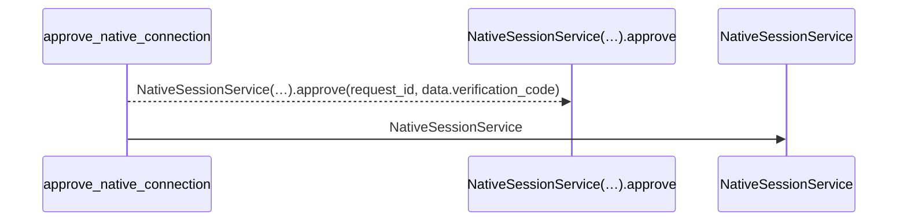
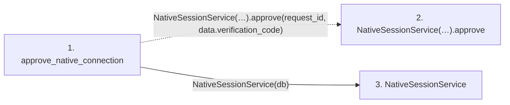

# approve_native_connection

**Entry point:** `approve_native_connection` (`http`)
**Source:** [routers_identity](../modules/routers_identity.md)
**Modules touched:** [native_session_service](../modules/native_session_service.md), [routers_identity](../modules/routers_identity.md)

## Call sequence

> Static overview in presentation order, not runtime execution order. Arrows retain captured callers; representative internal continuations and boundary examples precede repeated helper detail.

<!-- Auto-generated from static call edges. Dashed arrows are external or unresolved calls. Reviewed runtime conditions and side effects belong in Behavior. -->

> Call sequence diagram shows 2 of 2 interactions; 0 omitted to keep the visualization within the 30-interaction and generated-diagram limits, with uncertain identities omitted rather than inferred.

> Captured boundary calls: external 0 of 0 (0 omitted); unresolved 1 of 1 (0 omitted). These counts cover the captured static trace.
> Detailed flow queries retain their own coverage and limits; omitted paths may execute at runtime.

## Data flow

<!-- Auto-generated static analysis. Treat values and boundaries as best-effort hints, not runtime proof. -->

### Analysis coverage

**Effect analysis partially available.** Flow assembly and source effect analysis are separate; empty observations do not prove an empty handler body.

Source steps: 2; effect analysis evaluated: 1, partial: 0, unavailable: 1. Counts include steps omitted from the displayed trace.

Collector observations for 1 source steps with known totals: observed: 6, emitted: 6, omitted: 0. Unavailable totals are excluded.

- Callable record unavailable for one or more source steps; those steps have no represented callable body.
- Effect collector totals unavailable; observed counts cover captured records only.

| Step | Callable record | Effect analysis | Collector totals | Observed | Emitted | Omitted |
|---|---|---|---|---:|---:|---:|
| `approve_native_connection` | `available` | `evaluated` | `available` | `6` | `6` | `0` |
| `NativeSessionService(…).approve` | `not_applicable` | `not_applicable` | `not_applicable` | — | — | — |
| `NativeSessionService` | `unavailable` | `unavailable` | `unavailable` | — | — | — |

### Step data

| Step | Inputs | Reads | Writes | Returns |
|---|---|---|---|---|
| `approve_native_connection` | `request_id: str`, `data: NativeConnectionApproval`, `response: Response`, `db: Database` | - | `response.headers[...]` | `...` |
| `NativeSessionService(…).approve` | - | - | - | - |
| `NativeSessionService` | - | - | - | - |

### Call data

| From | To | Line | Call |
|---|---|---:|---|
| approve_native_connection | NativeSessionService(…).approve | 105 | `NativeSessionService(db).approve(request_id, data.verification_code)` |
| approve_native_connection | NativeSessionService | 105 | `NativeSessionService(db)` |

### Boundary effects

*No boundary-effect observations were captured in this static trace.*

### Static analysis gaps

| Kind | Step | Target | Line |
|---|---|---|---:|
| unresolved_call | `approve_native_connection` | `NativeSessionService(db).approve` | 105 |

## Behavior

Requires a human session and the matching displayed code. Normal HTTP cookie mutations retain CSRF and Origin checks. A conditional update binds the request to the approving session; another session cannot replace that approval.
