# attest_my_retained_output

**Entry point:** `attest_my_retained_output` (`http`)
**Source:** [routers_agent](../modules/routers_agent.md)
**Modules touched:** [agent_planning_service](../modules/agent_planning_service.md), [agent_routing_policy](../modules/agent_routing_policy.md), [agent_routing_service](../modules/agent_routing_service.md), and 23 more

**Complete modules touched:**

- [agent_planning_service](../modules/agent_planning_service.md)
- [agent_routing_policy](../modules/agent_routing_policy.md)
- [agent_routing_service](../modules/agent_routing_service.md)
- [agent_service](../modules/agent_service.md)
- [agent_team_setup_service](../modules/agent_team_setup_service.md)
- [agent_work_service](../modules/agent_work_service.md)
- [authority](../modules/authority.md)
- [commands](../modules/commands.md)
- [config](../modules/config.md)
- [delivery_dependency_service](../modules/delivery_dependency_service.md)
- [discussion_service](../modules/discussion_service.md)
- [execution_planning_window](../modules/execution_planning_window.md)
- [github_links](../modules/github_links.md)
- [identity_service](../modules/identity_service.md)
- [models_agent](../modules/models_agent.md)
- [models_outbound_webhook](../modules/models_outbound_webhook.md)
- [mutation_versions](../modules/mutation_versions.md)
- [planning_window_reconciliation](../modules/planning_window_reconciliation.md)
- [retained_planning_output](../modules/retained_planning_output.md)
- [review_provenance](../modules/review_provenance.md)
- [routers_agent](../modules/routers_agent.md)
- [schemas_agent](../modules/schemas_agent.md)
- [snapshot_service](../modules/snapshot_service.md)
- [task_brief_service](../modules/task_brief_service.md)
- [task_service](../modules/task_service.md)
- [time](../modules/time.md)

## Call sequence

> Static overview in presentation order, not runtime execution order. Arrows retain captured callers; representative internal continuations and boundary examples precede repeated helper detail.

```mermaid
sequenceDiagram
    participant p0 as attest_my_retained_output
    participant p1 as attest_retained_output
    participant p2 as _handle_agent_error
    participant p3 as require_scope
    participant p4 as command_transaction
    participant p5 as AgentWorkService._idempotent_replay
    participant p6 as _retained_witness
    participant p7 as _require_original_private_fence
    participant p8 as AgentWorkService._record_idempotency
    participant p9 as actor_has_scope
    participant p10 as DeliveryDependencyService.reconcile
    participant p11 as _unverified
    participant p12 as source_receipt_id
    participant p13 as DiscussionService.enqueue
    participant p14 as _planning_proof
    participant p15 as authority_stamp
    participant p16 as actor_provenance
    participant p17 as _authenticate_checkpoint
    participant p18 as _authority_basis
    participant p19 as parse_github_url
    participant p20 as DeliveryDependencyService.validate_cycles
    participant p21 as SnapshotService._task_to_export
    participant p22 as DiscussionService.recipient_authorized
    participant p23 as AgentRoutingService._profile_revision
    participant p24 as TaskService.reserve_task_version
    participant p25 as clear_execution_evidence
    participant p26 as _snapshot_task
    participant p27 as DeliveryDependencyService.graph
    participant p28 as lock_iterations
    participant p29 as isinstance (backend/app/routers/agent.py:_handle_agent_error)
    participant p30 as data.model_dump
    p0->>p1: attest_retained_output
    p0->>p2: _handle_agent_error
    p1->>p3: require_scope
    p1->>p4: command_transaction
    p1->>p5: AgentWorkService._idempotent_replay
    p1->>p6: _retained_witness
    p1->>p7: _require_original_private_fence
    p1->>p8: AgentWorkService._record_idempotency
    p3->>p9: actor_has_scope
    p4->>p10: DeliveryDependencyService.reconcile
    p6->>p11: _unverified
    p6->>p12: source_receipt_id
    p4->>p13: DiscussionService.enqueue
    p6->>p14: _planning_proof
    p6->>p15: authority_stamp
    p6->>p16: actor_provenance
    p6->>p17: _authenticate_checkpoint
    p15->>p18: _authority_basis
    p17->>p19: parse_github_url
    p10->>p20: DeliveryDependencyService.validate_cycles
    p14->>p21: SnapshotService._task_to_export
    p13->>p22: DiscussionService.recipient_authorized
    p16->>p23: AgentRoutingService._profile_revision
    p10->>p24: TaskService.reserve_task_version
    p10->>p25: clear_execution_evidence
    p14->>p26: _snapshot_task
    p20->>p27: DeliveryDependencyService.graph
    p24->>p28: lock_iterations
    p2-->>p29: isinstance (backend/app/routers/agent.py:_handle_agent_error)(exc, AgentPermissionError)
    p1-->>p30: data.model_dump(mode='json')
```

<!-- Auto-generated from static call edges. Dashed arrows are external or unresolved calls. Reviewed runtime conditions and side effects belong in Behavior. -->

> Call sequence diagram shows 30 of 750 interactions; 720 omitted to keep the visualization within the 30-interaction and generated-diagram limits, with uncertain identities omitted rather than inferred.

> Captured boundary calls: external 1 of 223 (222 omitted); unresolved 1 of 376 (375 omitted). These counts cover the captured static trace.

Omitted captured detail, grouped by actual caller occurrence and target module:

| Caller | Parent step | Target module | Kind | Omitted interactions |
| --- | --- | --- | --- | --- |
| `backend/app/services/agent_service.py:actor_has_scope` | 4 | [backend/app/services/agent_service.py](../modules/agent_service.md) | internal | 1 |
| `backend/app/services/agent_service.py:actor_scopes` | 5 | - | external | 2 |
| `backend/app/services/agent_service.py:require_scope` | 3 | [backend/app/services/agent_service.py](../modules/agent_service.md) | internal | 1 |
| `backend/app/services/retained_planning_output.py:attest_retained_output` | 2 | [backend/app/services/agent_service.py](../modules/agent_service.md) | internal | 3 |
| `backend/app/services/agent_service.py:validate_idempotency_key` | 9 | - | external | 6 |
| `backend/app/services/agent_service.py:validate_idempotency_key` | 9 | - | unresolved | 1 |
| `backend/app/commands.py:command_transaction` | 18 | [backend/app/commands.py](../modules/commands.md) | internal | 2 |
| `backend/app/commands.py:current_command` | 19 | - | external | 2 |
> Omission summary shows 8 of 151 groups; 143 further groups are not expanded here. Counts above include all omitted interactions.
> Detailed flow queries retain their own coverage and limits; omitted paths may execute at runtime.

> Trace truncated at the depth limit; deeper calls are omitted.

## Data flow

<!-- Auto-generated static analysis. Treat values and boundaries as best-effort hints, not runtime proof. -->

### Analysis coverage

**Effect analysis partially available.** Flow assembly and source effect analysis are separate; empty observations do not prove an empty handler body.

Source steps: 152; effect analysis evaluated: 109, partial: 5, unavailable: 38. Counts include steps omitted from the displayed trace.

Collector observations for 114 source steps with known totals: observed: 591, emitted: 571, omitted: 20. Unavailable totals are excluded.

- Callable record unavailable for one or more source steps; those steps have no represented callable body.
- Effect collector omitted observations before flow assembly; displayed effects are partial.
- Effect collector totals unavailable; observed counts cover captured records only.

| Step | Callable record | Effect analysis | Collector totals | Observed | Emitted | Omitted |
|---|---|---|---|---:|---:|---:|
| `attest_my_retained_output` | `available` | `evaluated` | `available` | `6` | `6` | `0` |
| `attest_retained_output` | `available` | `evaluated` | `available` | `11` | `11` | `0` |
| `require_scope` | `available` | `evaluated` | `available` | `2` | `2` | `0` |
| `actor_has_scope` | `available` | `evaluated` | `available` | `3` | `3` | `0` |
| `actor_scopes` | `available` | `evaluated` | `available` | `3` | `3` | `0` |
| `json.loads (backend/app/services/agent_service.py:actor_scopes)` | `not_applicable` | `not_applicable` | `not_applicable` | — | — | — |
| `isinstance (backend/app/services/agent_service.py:actor_scopes)` | `not_applicable` | `not_applicable` | `not_applicable` | — | — | — |
| `AgentPermissionError` | `unavailable` | `unavailable` | `unavailable` | — | — | — |
| `validate_idempotency_key` | `available` | `evaluated` | `available` | `4` | `4` | `0` |
| `ValueError (backend/app/services/agen…:validate_idempotency_key)` | `not_applicable` | `not_applicable` | `not_applicable` | — | — | — |
| `value.strip` | `not_applicable` | `not_applicable` | `not_applicable` | — | — | — |
| `len (backend/app/services/agen…:validate_idempotency_key)` | `not_applicable` | `not_applicable` | `not_applicable` | — | — | — |

```mermaid
flowchart LR
    s1["1. attest_my_retained_output"]
    s2["2. attest_retained_output"]
    s3["3. require_scope"]
    s4["4. actor_has_scope"]
    s5["5. actor_scopes"]
    s6["6. json.loads (backend/app/services/agent_service.py:actor_scopes)"]
    s7["7. isinstance (backend/app/services/agent_service.py:actor_scopes)"]
    s8["8. AgentPermissionError"]
    s9["9. validate_idempotency_key"]
    s10["10. ValueError (backend/app/services/agen…:validate_idempotency_key)"]
    s11["11. value.strip"]
    s12["12. len (backend/app/services/agen…:validate_idempotency_key)"]
    s1 -->|"attest_retained_output(service.db, actor, run_id, data, idempotency_key=idempotency_key)"| s2
    s2 -->|"require_scope(actor, 'work:execute')"| s3
    s3 -->|"actor_has_scope(actor, scope)"| s4
    s4 -->|"actor_scopes(actor)"| s5
    s5 -. "json.loads (backend/app/services/agent_service.py:actor_scopes)(actor.scopes)" .-> s6
    s5 -. "isinstance (backend/app/services/agent_service.py:actor_scopes)(scopes, list)" .-> s7
    s3 -->|"AgentPermissionError(...)"| s8
    s2 -->|"validate_idempotency_key(idempotency_key, required=True)"| s9
    s9 -. "ValueError (backend/app/services/agen…:validate_idempotency_key)('Idempotency-Key is required')" .-> s10
    s9 -. "value.strip(data not statically known)" .-> s11
    s9 -. "len (backend/app/services/agen…:validate_idempotency_key)(value)" .-> s12
    click s1 "../modules/routers_agent.md"
    click s2 "../modules/retained_planning_output.md"
    click s3 "../modules/agent_service.md"
    click s4 "../modules/agent_service.md"
    click s5 "../modules/agent_service.md"
    click s8 "../modules/agent_service.md"
    click s9 "../modules/agent_service.md"
```

### Step data

| Step | Inputs | Reads | Writes | Returns |
|---|---|---|---|---|
| `attest_my_retained_output` | `run_id: int`, `data: AgentRetainedOutputAttestation`, `actor: Annotated[AgentActor, Depends(get_agent_actor)]`, `service: Annotated[AgentWorkService, Depends(get_agent_work_service)]`, `idempotency_key: Annotated[str, Header(alias='Idempotency-Key')]` | - | - | `...` |
| `attest_retained_output` | `db`, `actor`, `run_id`, `data: AgentRetainedOutputAttestation`, `idempotency_key` | `AgentRun`, `OPERATION`, `OPERATION` | `result[...]` | `replay[...]`, `result` |
| `require_scope` | `actor: AgentActor`, `scope: str` | - | - | - |
| `actor_has_scope` | `actor: AgentActor`, `scope: str` | - | - | `...` |
| `actor_scopes` | `actor: AgentActor` | `json` | - | `...` |
| `json.loads (backend/app/services/agent_service.py:actor_scopes)` | - | - | - | - |
| `isinstance (backend/app/services/agent_service.py:actor_scopes)` | - | - | - | - |
| `AgentPermissionError` | - | - | - | - |
| `validate_idempotency_key` | `value: Optional[str]`, `required: bool` | - | - | `None`, `value` |
| `ValueError (backend/app/services/agen…:validate_idempotency_key)` | - | - | - | - |
| `value.strip` | - | - | - | - |
| `len (backend/app/services/agen…:validate_idempotency_key)` | - | - | - | - |

### Call data

| From | To | Line | Call |
|---|---|---:|---|
| attest_my_retained_output | attest_retained_output | 1049 | `attest_retained_output(service.db, actor, run_id, data, idempotency_key=idempotency_key)` |
| attest_retained_output | require_scope | 294 | `require_scope(actor, 'work:execute')` |
| require_scope | actor_has_scope | 113 | `actor_has_scope(actor, scope)` |
| actor_has_scope | actor_scopes | 95 | `actor_scopes(actor)` |
| actor_scopes | json.loads (backend/app/services/agent_service.py:actor_scopes) | 87 | `json.loads(actor.scopes)` |
| actor_scopes | isinstance (backend/app/services/agent_service.py:actor_scopes) | 90 | `isinstance(scopes, list)` |
| require_scope | AgentPermissionError | 114 | `AgentPermissionError(...)` |
| attest_retained_output | validate_idempotency_key | 295 | `validate_idempotency_key(idempotency_key, required=True)` |
| validate_idempotency_key | ValueError (backend/app/services/agen…:validate_idempotency_key) | 123 | `ValueError('Idempotency-Key is required')` |
| validate_idempotency_key | value.strip | 127 | `value.strip(data not statically known)` |
| validate_idempotency_key | len (backend/app/services/agen…:validate_idempotency_key) | 128 | `len(value)` |

### Boundary effects

*No boundary-effect observations were captured in this static trace.*

### Static analysis gaps

| Kind | Step | Target | Line |
|---|---|---|---:|
| external_call | `actor_scopes` | `json.loads` | 87 |
| external_call | `actor_scopes` | `isinstance` | 90 |
| external_call | `validate_idempotency_key` | `ValueError` | 123 |
| unresolved_call | `validate_idempotency_key` | `value.strip` | 127 |
| step_limit | `attest_my_retained_output` | `first 12 steps` | 0 |
| truncated_flow | `attest_my_retained_output` | `depth limit` | 0 |

## Behavior

This flow starts at `attest_my_retained_output` and is classified as `http`. The generated call and data-flow sections are bounded static projections; runtime conditions and side effects require source-level confirmation.
