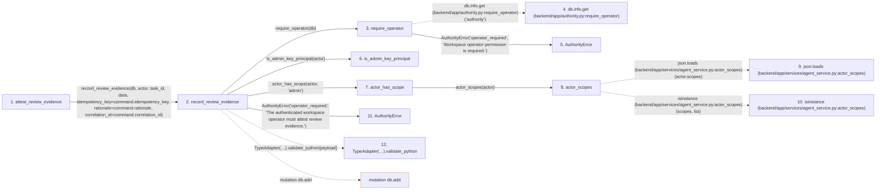

# attest_review_evidence

**Entry point:** `attest_review_evidence` (`http`)
**Source:** [agent_catalog](../modules/agent_catalog.md)
**Modules touched:** [agent_catalog](../modules/agent_catalog.md), [agent_routing_policy](../modules/agent_routing_policy.md), [agent_routing_service](../modules/agent_routing_service.md), and 22 more

**Complete modules touched:**

- [agent_catalog](../modules/agent_catalog.md)
- [agent_routing_policy](../modules/agent_routing_policy.md)
- [agent_routing_service](../modules/agent_routing_service.md)
- [agent_service](../modules/agent_service.md)
- [authority](../modules/authority.md)
- [commands](../modules/commands.md)
- [config](../modules/config.md)
- [delivery_dependency_service](../modules/delivery_dependency_service.md)
- [discussion_service](../modules/discussion_service.md)
- [github_links](../modules/github_links.md)
- [identity_service](../modules/identity_service.md)
- [models_agent](../modules/models_agent.md)
- [models_outbound_webhook](../modules/models_outbound_webhook.md)
- [mutation_versions](../modules/mutation_versions.md)
- [query_limits](../modules/query_limits.md)
- [retained_planning_output](../modules/retained_planning_output.md)
- [review_provenance](../modules/review_provenance.md)
- [routers_agent_planning](../modules/routers_agent_planning.md)
- [schemas_agent_planning](../modules/schemas_agent_planning.md)
- [services_review_evidence](../modules/services_review_evidence.md)
- [task_brief_service](../modules/task_brief_service.md)
- [task_replacement_service](../modules/task_replacement_service.md)
- [task_service](../modules/task_service.md)
- [time](../modules/time.md)
- [url_policy](../modules/url_policy.md)

## Call sequence

> Static overview in presentation order, not runtime execution order. Arrows retain captured callers; representative internal continuations and boundary examples precede repeated helper detail.

```mermaid
sequenceDiagram
    participant p0 as attest_review_evidence
    participant p1 as record_review_evidence
    participant p2 as _handle_agent_error
    participant p3 as require_operator
    participant p4 as actor_has_scope
    participant p5 as digest
    participant p6 as command_transaction
    participant p7 as AgentRoutingService._lock_task
    participant p8 as _conflict (backend/app/services/review_evidence.py)
    participant p9 as select_reviewer
    participant p10 as different_publisher_required
    participant p11 as AgentRoutingService.lock_selection_inputs
    participant p12 as _conflict (backend/app/services/review_provenance.py)
    participant p13 as canonical_routing_json_bytes
    participant p14 as review_history
    participant p15 as DeliveryDependencyService.reconcile
    participant p16 as actor_provenance
    participant p17 as DiscussionService.enqueue
    participant p18 as resolve
    participant p19 as _attempt_history
    participant p20 as _event
    participant p21 as _validate_json_native
    participant p22 as carried_contributors
    participant p23 as history_digest
    participant p24 as require_project
    participant p25 as _issuer_identity
    participant p26 as DeliveryDependencyService.validate_cycles
    participant p27 as DiscussionService.recipient_authorized
    participant p28 as AgentRoutingService._profile_revision
    participant p29 as isinstance (backend/app/routers/agent…ng.py:_handle_agent_error)
    participant p30 as TypeAdapter(…).validate_python
    p0->>p1: record_review_evidence
    p0->>p2: _handle_agent_error
    p1->>p3: require_operator
    p1->>p4: actor_has_scope
    p1->>p5: digest
    p1->>p6: command_transaction
    p1->>p7: AgentRoutingService._lock_task
    p1->>p8: _conflict (backend/app/services/review_evidence.py)
    p1->>p9: select_reviewer
    p9->>p10: different_publisher_required
    p7->>p11: AgentRoutingService.lock_selection_inputs
    p9->>p12: _conflict (backend/app/services/review_provenance.py)
    p5->>p13: canonical_routing_json_bytes
    p9->>p14: review_history
    p6->>p15: DeliveryDependencyService.reconcile
    p9->>p16: actor_provenance
    p6->>p17: DiscussionService.enqueue
    p9->>p18: resolve
    p14->>p19: _attempt_history
    p18->>p20: _event
    p13->>p21: _validate_json_native
    p14->>p22: carried_contributors
    p18->>p23: history_digest
    p11->>p24: require_project
    p18->>p25: _issuer_identity
    p15->>p26: DeliveryDependencyService.validate_cycles
    p17->>p27: DiscussionService.recipient_authorized
    p16->>p28: AgentRoutingService._profile_revision
    p2-->>p29: isinstance (backend/app/routers/agent…ng.py:_handle_agent_error)(exc, AgentPermissionError)
    p1-->>p30: TypeAdapter(…).validate_python(payload)
```

<!-- Auto-generated from static call edges. Dashed arrows are external or unresolved calls. Reviewed runtime conditions and side effects belong in Behavior. -->

> Call sequence diagram shows 30 of 753 interactions; 723 omitted to keep the visualization within the 30-interaction and generated-diagram limits, with uncertain identities omitted rather than inferred.

> Captured boundary calls: external 1 of 204 (203 omitted); unresolved 1 of 353 (352 omitted). These counts cover the captured static trace.

Omitted captured detail, grouped by actual caller occurrence and target module:

| Caller | Parent step | Target module | Kind | Omitted interactions |
| --- | --- | --- | --- | --- |
| `backend/app/authority.py:require_operator` | 3 | - | unresolved | 1 |
| `backend/app/authority.py:require_operator` | 3 | [backend/app/authority.py](../modules/authority.md) | internal | 1 |
| `backend/app/services/review_evidence.py:record_review_evidence` | 2 | [backend/app/services/agent_service.py](../modules/agent_service.md) | internal | 1 |
| `backend/app/services/agent_service.py:actor_has_scope` | 7 | [backend/app/services/agent_service.py](../modules/agent_service.md) | internal | 1 |
| `backend/app/services/agent_service.py:actor_scopes` | 8 | - | external | 2 |
| `backend/app/services/review_evidence.py:record_review_evidence` | 2 | [backend/app/authority.py](../modules/authority.md) | internal | 1 |
| `backend/app/services/review_evidence.py:record_review_evidence` | 2 | - | external | 12 |
| `backend/app/services/review_evidence.py:record_review_evidence` | 2 | [backend/app/schemas/agent_planning.py](../modules/schemas_agent_planning.md) | internal | 1 |
> Omission summary shows 8 of 153 groups; 145 further groups are not expanded here. Counts above include all omitted interactions.
> Detailed flow queries retain their own coverage and limits; omitted paths may execute at runtime.

> Trace truncated at the depth limit; deeper calls are omitted.

## Data flow

<!-- Auto-generated static analysis. Treat values and boundaries as best-effort hints, not runtime proof. -->

### Analysis coverage

**Effect analysis partially available.** Flow assembly and source effect analysis are separate; empty observations do not prove an empty handler body.

Source steps: 197; effect analysis evaluated: 146, partial: 5, unavailable: 46. Counts include steps omitted from the displayed trace.

Collector observations for 151 source steps with known totals: observed: 791, emitted: 767, omitted: 24. Unavailable totals are excluded.

- Callable record unavailable for one or more source steps; those steps have no represented callable body.
- Effect collector omitted observations before flow assembly; displayed effects are partial.
- Effect collector totals unavailable; observed counts cover captured records only.

| Step | Callable record | Effect analysis | Collector totals | Observed | Emitted | Omitted |
|---|---|---|---|---:|---:|---:|
| `attest_review_evidence` | `available` | `evaluated` | `available` | `6` | `6` | `0` |
| `record_review_evidence` | `available` | `partial` | `available` | `23` | `18` | `5` |
| `require_operator` | `available` | `evaluated` | `available` | `1` | `1` | `0` |
| `db.info.get (backend/app/authority.py:require_operator)` | `not_applicable` | `not_applicable` | `not_applicable` | — | — | — |
| `AuthorityError` | `unavailable` | `unavailable` | `unavailable` | — | — | — |
| `is_admin_key_principal` | `available` | `evaluated` | `available` | `3` | `3` | `0` |
| `actor_has_scope` | `available` | `evaluated` | `available` | `3` | `3` | `0` |
| `actor_scopes` | `available` | `evaluated` | `available` | `3` | `3` | `0` |
| `json.loads (backend/app/services/agent_service.py:actor_scopes)` | `not_applicable` | `not_applicable` | `not_applicable` | — | — | — |
| `isinstance (backend/app/services/agent_service.py:actor_scopes)` | `not_applicable` | `not_applicable` | `not_applicable` | — | — | — |
| `AuthorityError` | `unavailable` | `unavailable` | `unavailable` | — | — | — |
| `TypeAdapter(…).validate_python` | `not_applicable` | `not_applicable` | `not_applicable` | — | — | — |

### Step data

| Step | Inputs | Reads | Writes | Returns |
|---|---|---|---|---|
| `attest_review_evidence` | `task_id: int`, `data: ReviewEvidenceCommand`, `actor: Annotated[AgentActor, Depends(get_model_catalog_principal)]`, `db: Annotated[AsyncSession, Depends(get_db, scope='function')]`, `command: Annotated[AgentPlanningCommandContext, Depends(get_agent_planning_command_context)]` | - | - | `...` |
| `record_review_evidence` | `db`, `actor`, `task_id`, `payload`, `idempotency_key`, `rationale`, `correlation_id` | `ReviewEvidenceIssue`, `ISSUED`, `REVOKED`, `TaskEvent`, `TaskEvent`, `TaskEvent`, `TaskEvent`, `TaskEvent` | - | `{...}`, `{...}` |
| `require_operator` | `db` | - | - | - |
| `db.info.get (backend/app/authority.py:require_operator)` | - | - | - | - |
| `AuthorityError` | - | - | - | - |
| `is_admin_key_principal` | `actor: AgentActor` | `ADMIN_KEY_PRINCIPAL_NAME` | - | `...` |
| `actor_has_scope` | `actor: AgentActor`, `scope: str` | - | - | `...` |
| `actor_scopes` | `actor: AgentActor` | `json` | - | `...` |
| `json.loads (backend/app/services/agent_service.py:actor_scopes)` | - | - | - | - |
| `isinstance (backend/app/services/agent_service.py:actor_scopes)` | - | - | - | - |
| `AuthorityError` | - | - | - | - |
| `TypeAdapter(…).validate_python` | - | - | - | - |

### Call data

| From | To | Line | Call |
|---|---|---:|---|
| attest_review_evidence | record_review_evidence | 84 | `record_review_evidence(db, actor, task_id, data, idempotency_key=command.idempotency_key, rationale=command.rationale, correlation_id=command.correlation_id)` |
| record_review_evidence | require_operator | 323 | `require_operator(db)` |
| require_operator | db.info.get (backend/app/authority.py:require_operator) | 91 | `db.info.get('authority')` |
| require_operator | AuthorityError | 93 | `AuthorityError('operator_required', 'Workspace operator permission is required.')` |
| record_review_evidence | is_admin_key_principal | 326 | `is_admin_key_principal(actor)` |
| record_review_evidence | actor_has_scope | 330 | `actor_has_scope(actor, 'admin')` |
| actor_has_scope | actor_scopes | 95 | `actor_scopes(actor)` |
| actor_scopes | json.loads (backend/app/services/agent_service.py:actor_scopes) | 87 | `json.loads(actor.scopes)` |
| actor_scopes | isinstance (backend/app/services/agent_service.py:actor_scopes) | 90 | `isinstance(scopes, list)` |
| record_review_evidence | AuthorityError | 332 | `AuthorityError('operator_required', 'The authenticated workspace operator must attest review evidence.')` |
| record_review_evidence | TypeAdapter(…).validate_python | 336 | `TypeAdapter(ReviewEvidenceCommand).validate_python(payload)` |

### Boundary effects

| Kind | Target | Step | Line |
|---|---|---|---:|
| mutation | `db.add` | `record_review_evidence` | 455 |

### Static analysis gaps

| Kind | Step | Target | Line |
|---|---|---|---:|
| unresolved_call | `require_operator` | `db.info.get` | 91 |
| external_call | `actor_scopes` | `json.loads` | 87 |
| external_call | `actor_scopes` | `isinstance` | 90 |
| unresolved_call | `record_review_evidence` | `TypeAdapter(ReviewEvidenceCommand).validate_python` | 336 |
| step_limit | `attest_review_evidence` | `first 12 steps` | 0 |
| truncated_flow | `attest_review_evidence` | `depth limit` | 0 |

## Behavior

This flow starts at `attest_review_evidence` and is classified as `http`. The generated call and data-flow sections are bounded static projections; runtime conditions and side effects require source-level confirmation.
