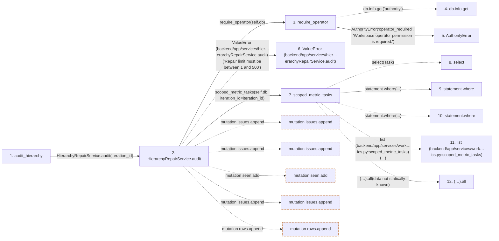

# audit_hierarchy

**Entry point:** `audit_hierarchy` (`http`)
**Source:** [snapshots](../modules/snapshots.md)
**Modules touched:** [authority](../modules/authority.md), [hierarchy_repair_service](../modules/hierarchy_repair_service.md), [query_limits](../modules/query_limits.md), and 4 more

**Complete modules touched:**

- [authority](../modules/authority.md)
- [hierarchy_repair_service](../modules/hierarchy_repair_service.md)
- [query_limits](../modules/query_limits.md)
- [services_work_metrics](../modules/services_work_metrics.md)
- [snapshots](../modules/snapshots.md)
- [task_status_service](../modules/task_status_service.md)
- [time](../modules/time.md)

## Call sequence

> Static overview in presentation order, not runtime execution order. Arrows retain captured callers; representative internal continuations and boundary examples precede repeated helper detail.

```mermaid
sequenceDiagram
    participant p0 as audit_hierarchy
    participant p1 as HierarchyRepairService.audit
    participant p2 as HierarchyRepairService
    participant p3 as require_operator
    participant p4 as scoped_metric_tasks
    participant p5 as task_signals
    participant p6 as working_today
    participant p7 as TaskStatusService.derive_parent_status
    participant p8 as effective_work_flags
    participant p9 as AuthorityError
    participant p10 as CollectionLimitExceededError
    participant p11 as as_utc
    participant p12 as utc_now
    participant p13 as ValueError (backend/app/services/hier…erarchyRepairService.audit)
    participant p14 as children.setdefault(…).append
    participant p15 as children.setdefault
    participant p16 as sorted
    participant p17 as by_id.get (backend/app/services/hier…erarchyRepairService.audit)
    participant p18 as issues.append
    participant p19 as seen.add (backend/app/services/hier…erarchyRepairService.audit)
    participant p20 as children.get
    participant p21 as min
    participant p22 as any
    participant p23 as {'priority': priority, 'is_summary': True, 'effort_days': 0.0, 'effort_hours': 0.0, 'assignee_id': None}.items
    participant p24 as getattr (backend/app/services/hier…erarchyRepairService.audit)
    participant p25 as rows.append
    participant p26 as len (backend/app/services/hier…erarchyRepairService.audit)
    p0->>p1: HierarchyRepairService.audit
    p0->>p2: HierarchyRepairService
    p1->>p3: require_operator
    p1->>p4: scoped_metric_tasks
    p1->>p5: task_signals
    p5->>p6: working_today
    p1->>p7: TaskStatusService.derive_parent_status
    p1->>p8: effective_work_flags
    p3->>p9: AuthorityError
    p4->>p10: CollectionLimitExceededError
    p6->>p11: as_utc
    p6->>p12: utc_now
    p1-->>p13: ValueError (backend/app/services/hier…erarchyRepairService.audit)('Repair limit must be between 1 and 500')
    p1-->>p14: children.setdefault(…).append(task)
    p1-->>p15: children.setdefault(task.parent_id, [...])
    p1-->>p16: sorted(tasks, key=...)
    p1-->>p17: by_id.get (backend/app/services/hier…erarchyRepairService.audit)(task.parent_id)
    p1-->>p18: issues.append('Parent scope is missing or inconsistent operator reconciliation required')
    p1-->>p18: issues.append('Hierarchy cycle requires explicit reconciliation')
    p1-->>p19: seen.add (backend/app/services/hier…erarchyRepairService.audit)(ancestor)
    p1-->>p20: children.get(task.id, [...])
    p1-->>p21: min(...)
    p1-->>p22: any(...)
    p1-->>p18: issues.append('Closed roll-up has unknown acceptance provenance do not promote automatically')
    p1-->>p23: {'priority': priority, 'is_summary': True, 'effort_days': 0.0, 'effort_hours': 0.0, 'assignee_id': None}.items
    p1-->>p24: getattr (backend/app/services/hier…erarchyRepairService.audit)(task, field)
    p1-->>p22: any(...)
    p1-->>p25: rows.append({...})
    p1-->>p24: getattr (backend/app/services/hier…erarchyRepairService.audit)(task, key)
    p1-->>p26: len (backend/app/services/hier…erarchyRepairService.audit)(rows)
```

<!-- Auto-generated from static call edges. Dashed arrows are external or unresolved calls. Reviewed runtime conditions and side effects belong in Behavior. -->

> Call sequence diagram shows 30 of 73 interactions; 43 omitted to keep the visualization within the 30-interaction and generated-diagram limits, with uncertain identities omitted rather than inferred.

> Captured boundary calls: external 8 of 36 (28 omitted); unresolved 10 of 24 (14 omitted). These counts cover the captured static trace.

Omitted captured detail, grouped by actual caller occurrence and target module:

| Caller | Parent step | Target module | Kind | Omitted interactions |
| --- | --- | --- | --- | --- |
| `backend/app/authority.py:require_operator` | 3 | - | unresolved | 1 |
| `backend/app/services/work_metrics.py:scoped_metric_tasks` | 7 | - | external | 3 |
| `backend/app/services/work_metrics.py:scoped_metric_tasks` | 7 | - | unresolved | 6 |
| `backend/app/services/task_status_service.py:TaskStatusService.derive_parent_status` | 26 | - | external | 5 |
| `backend/app/services/work_metrics.py:working_today` | 35 | - | unresolved | 2 |
| `backend/app/utils/time.py:as_utc` | 38 | - | unresolved | 2 |
| `backend/app/utils/time.py:utc_now` | 41 | - | external | 1 |
| `backend/app/services/work_metrics.py:working_today` | 35 | - | external | 1 |
> Omission summary shows 8 of 13 groups; 5 further groups are not expanded here. Counts above include all omitted interactions.
> Detailed flow queries retain their own coverage and limits; omitted paths may execute at runtime.

## Data flow

<!-- Auto-generated static analysis. Treat values and boundaries as best-effort hints, not runtime proof. -->

### Analysis coverage

**Effect analysis partially available.** Flow assembly and source effect analysis are separate; empty observations do not prove an empty handler body.

Source steps: 14; effect analysis evaluated: 11, partial: 0, unavailable: 3. Counts include steps omitted from the displayed trace.

Collector observations for 11 source steps with known totals: observed: 60, emitted: 60, omitted: 0. Unavailable totals are excluded.

- Callable record unavailable for one or more source steps; those steps have no represented callable body.
- Effect collector totals unavailable; observed counts cover captured records only.

| Step | Callable record | Effect analysis | Collector totals | Observed | Emitted | Omitted |
|---|---|---|---|---:|---:|---:|
| `audit_hierarchy` | `available` | `evaluated` | `available` | `4` | `4` | `0` |
| `HierarchyRepairService.audit` | `available` | `evaluated` | `available` | `13` | `13` | `0` |
| `require_operator` | `available` | `evaluated` | `available` | `1` | `1` | `0` |
| `db.info.get` | `not_applicable` | `not_applicable` | `not_applicable` | — | — | — |
| `AuthorityError` | `unavailable` | `unavailable` | `unavailable` | — | — | — |
| `ValueError (backend/app/services/hier…erarchyRepairService.audit)` | `not_applicable` | `not_applicable` | `not_applicable` | — | — | — |
| `scoped_metric_tasks` | `available` | `evaluated` | `available` | `4` | `4` | `0` |
| `select` | `not_applicable` | `not_applicable` | `not_applicable` | — | — | — |
| `statement.where` | `not_applicable` | `not_applicable` | `not_applicable` | — | — | — |
| `statement.where` | `not_applicable` | `not_applicable` | `not_applicable` | — | — | — |
| `list (backend/app/services/work…ics.py:scoped_metric_tasks)` | `not_applicable` | `not_applicable` | `not_applicable` | — | — | — |
| `(…).all` | `not_applicable` | `not_applicable` | `not_applicable` | — | — | — |

### Step data

| Step | Inputs | Reads | Writes | Returns |
|---|---|---|---|---|
| `audit_hierarchy` | `iteration_id: int`, `db: Annotated[AsyncSession, Depends(get_db, scope='function')]`, `_operator: Annotated[None, Depends(require_admin_api_key)]` | - | - | `...` |
| `HierarchyRepairService.audit` | `iteration_id`, `after_id`, `limit` | `self.db`, `self.db` | `proposed[...]`, `proposed[...]` | `{...}` |
| `require_operator` | `db` | - | - | - |
| `db.info.get` | - | - | - | - |
| `AuthorityError` | - | - | - | - |
| `ValueError (backend/app/services/hier…erarchyRepairService.audit)` | - | - | - | - |
| `scoped_metric_tasks` | `db`, `project_id`, `iteration_id` | - | - | `rows` |
| `select` | - | - | - | - |
| `statement.where` | - | - | - | - |
| `statement.where` | - | - | - | - |
| `list (backend/app/services/work…ics.py:scoped_metric_tasks)` | - | - | - | - |
| `(…).all` | - | - | - | - |

### Call data

| From | To | Line | Call |
|---|---|---:|---|
| audit_hierarchy | HierarchyRepairService.audit | 254 | `HierarchyRepairService(db).audit(iteration_id)` |
| HierarchyRepairService.audit | require_operator | 19 | `require_operator(self.db)` |
| require_operator | db.info.get | 79 | `db.info.get('authority')` |
| require_operator | AuthorityError | 81 | `AuthorityError('operator_required', 'Workspace operator permission is required.')` |
| HierarchyRepairService.audit | ValueError (backend/app/services/hier…erarchyRepairService.audit) | 21 | `ValueError('Repair limit must be between 1 and 500')` |
| HierarchyRepairService.audit | scoped_metric_tasks | 22 | `scoped_metric_tasks(self.db, iteration_id=iteration_id)` |
| scoped_metric_tasks | select | 141 | `select(Task)` |
| scoped_metric_tasks | statement.where | 143 | `statement.where(...)` |
| scoped_metric_tasks | statement.where | 145 | `statement.where(...)` |
| scoped_metric_tasks | list (backend/app/services/work…ics.py:scoped_metric_tasks) | 146 | `list(...)` |
| scoped_metric_tasks | (…).all | 146 | `(await db.scalars(statement.order_by(Task.id).limit(MAX_PROJECT_TREE_TASKS + 1))).all(data not statically known)` |

### Boundary effects

| Kind | Target | Step | Line |
|---|---|---|---:|
| mutation | `issues.append` | `HierarchyRepairService.audit` | 34 |
| mutation | `issues.append` | `HierarchyRepairService.audit` | 38 |
| mutation | `seen.add` | `HierarchyRepairService.audit` | 40 |
| mutation | `issues.append` | `HierarchyRepairService.audit` | 48 |
| mutation | `rows.append` | `HierarchyRepairService.audit` | 57 |

### Static analysis gaps

| Kind | Step | Target | Line |
|---|---|---|---:|
| unresolved_call | `require_operator` | `db.info.get` | 79 |
| external_call | `HierarchyRepairService.audit` | `ValueError` | 21 |
| external_call | `scoped_metric_tasks` | `select` | 141 |
| unresolved_call | `scoped_metric_tasks` | `statement.where` | 143 |
| unresolved_call | `scoped_metric_tasks` | `statement.where` | 145 |
| unresolved_call | `scoped_metric_tasks` | `(await db.scalars(statement.order_by(Task.id).limit(MAX_PROJECT_TREE_TASKS + 1))).all` | 146 |
| step_limit | `audit_hierarchy` | `first 12 steps` | 0 |

## Behavior

This flow starts at `audit_hierarchy` and is classified as `http`. The generated call and data-flow sections are bounded static projections; runtime conditions and side effects require source-level confirmation.
