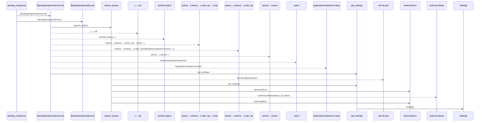
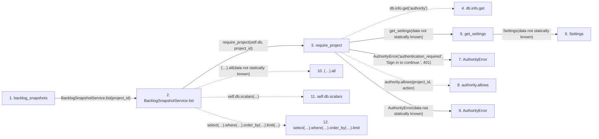

# backlog_snapshots

**Entry point:** `backlog_snapshots` (`http`)
**Source:** [routers_task_domain](../modules/routers_task_domain.md)
**Modules touched:** [authority](../modules/authority.md), [backlog_snapshot_service](../modules/backlog_snapshot_service.md), [config](../modules/config.md), [routers_task_domain](../modules/routers_task_domain.md)

## Call sequence

> Static overview in presentation order, not runtime execution order. Arrows retain captured callers; representative internal continuations and boundary examples precede repeated helper detail.

<!-- Auto-generated from static call edges. Dashed arrows are external or unresolved calls. Reviewed runtime conditions and side effects belong in Behavior. -->

> Call sequence diagram shows 17 of 17 interactions; 0 omitted to keep the visualization within the 30-interaction and generated-diagram limits, with uncertain identities omitted rather than inferred.

> Captured boundary calls: external 1 of 1 (0 omitted); unresolved 8 of 8 (0 omitted). These counts cover the captured static trace.
> Detailed flow queries retain their own coverage and limits; omitted paths may execute at runtime.

## Data flow

<!-- Auto-generated static analysis. Treat values and boundaries as best-effort hints, not runtime proof. -->

### Analysis coverage

**Effect analysis partially available.** Flow assembly and source effect analysis are separate; empty observations do not prove an empty handler body.

Source steps: 9; effect analysis evaluated: 5, partial: 0, unavailable: 4. Counts include steps omitted from the displayed trace.

Collector observations for 5 source steps with known totals: observed: 12, emitted: 12, omitted: 0. Unavailable totals are excluded.

- Callable record unavailable for one or more source steps; those steps have no represented callable body.
- Effect collector totals unavailable; observed counts cover captured records only.

| Step | Callable record | Effect analysis | Collector totals | Observed | Emitted | Omitted |
|---|---|---|---|---:|---:|---:|
| `backlog_snapshots` | `available` | `evaluated` | `available` | `3` | `3` | `0` |
| `BacklogSnapshotService.list` | `available` | `evaluated` | `available` | `3` | `3` | `0` |
| `require_project` | `available` | `evaluated` | `available` | `4` | `4` | `0` |
| `db.info.get` | `not_applicable` | `not_applicable` | `not_applicable` | — | — | — |
| `get_settings` | `available` | `evaluated` | `available` | `1` | `1` | `0` |
| `Settings` | `unavailable` | `unavailable` | `unavailable` | — | — | — |
| `AuthorityError` | `unavailable` | `unavailable` | `unavailable` | — | — | — |
| `authority.allows` | `not_applicable` | `not_applicable` | `not_applicable` | — | — | — |
| `AuthorityError` | `unavailable` | `unavailable` | `unavailable` | — | — | — |
| `(…).all` | `not_applicable` | `not_applicable` | `not_applicable` | — | — | — |
| `self.db.scalars` | `not_applicable` | `not_applicable` | `not_applicable` | — | — | — |
| `select(…).where(…).order_by(…).limit` | `not_applicable` | `not_applicable` | `not_applicable` | — | — | — |

### Step data

| Step | Inputs | Reads | Writes | Returns |
|---|---|---|---|---|
| `backlog_snapshots` | `project_id: int`, `db: DB` | - | - | `...` |
| `BacklogSnapshotService.list` | `project_id` | `self.db` | - | `...` |
| `require_project` | `db`, `project_id`, `action` | - | - | `none` |
| `db.info.get` | - | - | - | - |
| `get_settings` | - | - | - | `Settings(...)` |
| `Settings` | - | - | - | - |
| `AuthorityError` | - | - | - | - |
| `authority.allows` | - | - | - | - |
| `AuthorityError` | - | - | - | - |
| `(…).all` | - | - | - | - |
| `self.db.scalars` | - | - | - | - |
| `select(…).where(…).order_by(…).limit` | - | - | - | - |

### Call data

| From | To | Line | Call |
|---|---|---:|---|
| backlog_snapshots | BacklogSnapshotService.list | 249 | `BacklogSnapshotService(db).list(project_id)` |
| BacklogSnapshotService.list | require_project | 53 | `require_project(self.db, project_id)` |
| require_project | db.info.get | 69 | `db.info.get('authority')` |
| require_project | get_settings | 71 | `get_settings(data not statically known)` |
| get_settings | Settings | 481 | `Settings(data not statically known)` |
| require_project | AuthorityError | 73 | `AuthorityError('authentication_required', 'Sign in to continue.', 401)` |
| require_project | authority.allows | 74 | `authority.allows(project_id, action)` |
| require_project | AuthorityError | 75 | `AuthorityError(data not statically known)` |
| BacklogSnapshotService.list | (…).all | 54 | `(await self.db.scalars(select(ApplicationSnapshot).where(ApplicationSnapshot.project_id == project_id).order_by(ApplicationSnapshot.id.desc()).limit(get_settings().snapshot_retention_count))).all(data not statically known)` |
| BacklogSnapshotService.list | self.db.scalars | 54 | `self.db.scalars(...)` |
| BacklogSnapshotService.list | select(…).where(…).order_by(…).limit | 54 | `select(ApplicationSnapshot).where(ApplicationSnapshot.project_id == project_id).order_by(ApplicationSnapshot.id.desc()).limit(...)` |

### Boundary effects

*No boundary-effect observations were captured in this static trace.*

### Static analysis gaps

| Kind | Step | Target | Line |
|---|---|---|---:|
| unresolved_call | `require_project` | `db.info.get` | 69 |
| unresolved_call | `require_project` | `authority.allows` | 74 |
| unresolved_call | `BacklogSnapshotService.list` | `(await self.db.scalars(select(ApplicationSnapshot).where(ApplicationSnapshot.project_id == project_id).order_by(ApplicationSnapshot.id.desc()).limit(get_settings().snapshot_retention_count))).all` | 54 |
| unresolved_call | `BacklogSnapshotService.list` | `self.db.scalars` | 54 |
| unresolved_call | `BacklogSnapshotService.list` | `select(ApplicationSnapshot).where(ApplicationSnapshot.project_id == project_id).order_by(ApplicationSnapshot.id.desc()).limit` | 54 |
| step_limit | `backlog_snapshots` | `first 12 steps` | 0 |

## Behavior

This flow starts at `backlog_snapshots` and is classified as `http`. The generated call and data-flow sections are bounded static projections; runtime conditions and side effects require source-level confirmation.
