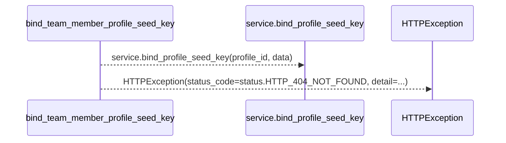
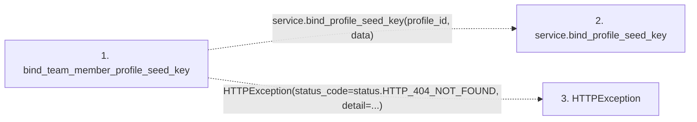

# bind_team_member_profile_seed_key

**Entry point:** `bind_team_member_profile_seed_key` (`http`)
**Source:** [routers_team](../modules/routers_team.md)
**Modules touched:** [routers_team](../modules/routers_team.md)

## Call sequence

> Static overview in presentation order, not runtime execution order. Arrows retain captured callers; representative internal continuations and boundary examples precede repeated helper detail.

<!-- Auto-generated from static call edges. Dashed arrows are external or unresolved calls. Reviewed runtime conditions and side effects belong in Behavior. -->

> Call sequence diagram shows 2 of 2 interactions; 0 omitted to keep the visualization within the 30-interaction and generated-diagram limits, with uncertain identities omitted rather than inferred.

> Captured boundary calls: external 1 of 1 (0 omitted); unresolved 1 of 1 (0 omitted). These counts cover the captured static trace.
> Detailed flow queries retain their own coverage and limits; omitted paths may execute at runtime.

## Data flow

<!-- Auto-generated static analysis. Treat values and boundaries as best-effort hints, not runtime proof. -->

### Analysis coverage

**Effect analysis evaluated.** Flow assembly and source effect analysis are separate; empty observations do not prove an empty handler body.

Source steps: 1; effect analysis evaluated: 1, partial: 0, unavailable: 0. Counts include steps omitted from the displayed trace.

Collector observations for 1 source steps with known totals: observed: 5, emitted: 5, omitted: 0. Unavailable totals are excluded.

### Step data

| Step | Inputs | Reads | Writes | Returns |
|---|---|---|---|---|
| `bind_team_member_profile_seed_key` | `profile_id: int`, `data: TeamMemberProfileSeedKeyBind`, `service: Annotated[TeamService, Depends(get_team_service)]` | `status` | - | `profile` |
| `service.bind_profile_seed_key` | - | - | - | - |
| `HTTPException` | - | - | - | - |

### Call data

| From | To | Line | Call |
|---|---|---:|---|
| bind_team_member_profile_seed_key | service.bind_profile_seed_key | 119 | `service.bind_profile_seed_key(profile_id, data)` |
| bind_team_member_profile_seed_key | HTTPException | 121 | `HTTPException(status_code=status.HTTP_404_NOT_FOUND, detail=...)` |

### Boundary effects

*No boundary-effect observations were captured in this static trace.*

### Static analysis gaps

| Kind | Step | Target | Line |
|---|---|---|---:|
| unresolved_call | `bind_team_member_profile_seed_key` | `service.bind_profile_seed_key` | 119 |
| external_call | `bind_team_member_profile_seed_key` | `HTTPException` | 121 |

## Behavior

Binds a seed key once, in place, to an existing profile that has none; an already keyed profile is a conflict. The profile row keeps its id, so capacity, availability, assignments and history links stay attached. A seed key is not a scheduling input, so no planning revision or task version advances. Agent credentials are refused in every mode; only the workspace operator or a trusted-local person may bind.
