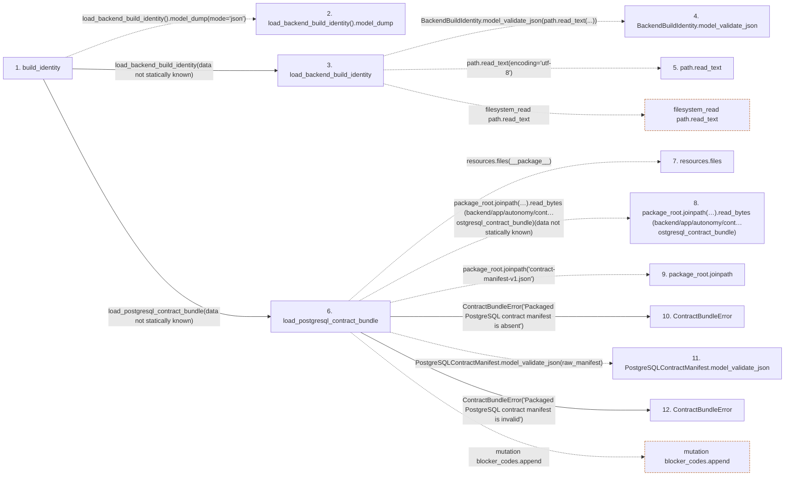

# build_identity

**Entry point:** `build_identity` (`http`)
**Source:** [app_main](../modules/app_main.md)
**Modules touched:** [app_main](../modules/app_main.md), [autonomy_canonical](../modules/autonomy_canonical.md), [build_identity](../modules/build_identity.md), [loader](../modules/loader.md)

## Call sequence

> Static overview in presentation order, not runtime execution order. Arrows retain captured callers; representative internal continuations and boundary examples precede repeated helper detail.

```mermaid
sequenceDiagram
    participant p0 as build_identity
    participant p1 as load_postgresql_contract_bundle
    participant p2 as load_backend_build_identity
    participant p3 as canonical_json_bytes
    participant p4 as sha256_hex
    participant p5 as _validate_machine_semantics
    participant p6 as _json_value
    participant p7 as ContractBundleError
    participant p8 as PostgreSQLContractBundle
    participant p9 as resources.files
    participant p10 as load_backend_build_identity().model_dump
    participant p11 as BackendBuildIdentity.model_validate_json
    participant p12 as path.read_text
    participant p13 as package_root.joinpath(…).read_bytes (backend/app/autonomy/cont…ostgresql_contract_bundle)
    participant p14 as package_root.joinpath
    participant p15 as PostgreSQLContractManifest.model_validate_json
    participant p16 as package_root.joinpath(…).read_bytes (backend/app/autonomy/cont…gresql_contract_bundle, 1)
    participant p17 as len (backend/app/autonomy/cont…ostgresql_contract_bundle)
    participant p18 as blocker_codes.append
    participant p19 as archive.get_exact
    participant p20 as members.get
    participant p21 as tuple
    participant p22 as json.dumps(…).encode
    participant p23 as isinstance (backend/app/autonomy/canonical.py:sha256_hex)
    participant p24 as members.items
    participant p25 as json.dumps
    participant p26 as json.loads
    participant p27 as value.encode
    p0->>p1: load_postgresql_contract_bundle
    p0->>p2: load_backend_build_identity
    p1->>p3: canonical_json_bytes
    p1->>p4: sha256_hex
    p1->>p5: _validate_machine_semantics
    p3->>p6: _json_value
    p1->>p7: ContractBundleError
    p1->>p8: PostgreSQLContractBundle
    p1-->>p9: resources.files(__package__)
    p0-->>p10: load_backend_build_identity().model_dump(mode='json')
    p2-->>p11: BackendBuildIdentity.model_validate_json(path.read_text(...))
    p2-->>p12: path.read_text(encoding='utf-8')
    p1-->>p13: package_root.joinpath(…).read_bytes (backend/app/autonomy/cont…ostgresql_contract_bundle)
    p1-->>p14: package_root.joinpath('contract-manifest-v1.json')
    p1-->>p15: PostgreSQLContractManifest.model_validate_json(raw_manifest)
    p1-->>p16: package_root.joinpath(…).read_bytes (backend/app/autonomy/cont…gresql_contract_bundle, 1)
    p1-->>p14: package_root.joinpath(expected.path)
    p1-->>p17: len (backend/app/autonomy/cont…ostgresql_contract_bundle)(payload)
    p1-->>p18: blocker_codes.append('immutable-contract-archive-unavailable')
    p1-->>p19: archive.get_exact(logical_key=source.logical_key, expected_sha256=source.sha256)
    p1-->>p17: len (backend/app/autonomy/cont…ostgresql_contract_bundle)(archived)
    p1-->>p20: members.get(source.packaged_member)
    p1-->>p21: tuple(blocker_codes)
    p3-->>p22: json.dumps(…).encode('utf-8')
    p4-->>p23: isinstance (backend/app/autonomy/canonical.py:sha256_hex)(value, bytes)
    p5-->>p24: members.items
    p3-->>p25: json.dumps(_json_value(...), ensure_ascii=False, allow_nan=False, sort_keys=True, separators=(...))
    p4-->>p23: isinstance (backend/app/autonomy/canonical.py:sha256_hex)(value, str)
    p5-->>p26: json.loads(payload)
    p4-->>p27: value.encode('utf-8')
```

<!-- Auto-generated from static call edges. Dashed arrows are external or unresolved calls. Reviewed runtime conditions and side effects belong in Behavior. -->

> Call sequence diagram shows 30 of 124 interactions; 94 omitted to keep the visualization within the 30-interaction and generated-diagram limits, with uncertain identities omitted rather than inferred.

> Captured boundary calls: external 8 of 55 (47 omitted); unresolved 14 of 34 (20 omitted). These counts cover the captured static trace.

Omitted captured detail, grouped by actual caller occurrence and target module:

| Caller | Parent step | Target module | Kind | Omitted interactions |
| --- | --- | --- | --- | --- |
| `backend/app/autonomy/contracts/postgresql/loader.py:load_postgresql_contract_bundle` | 6 | [backend/app/autonomy/contracts/postgresql/loader.py](../modules/loader.md) | internal | 8 |
| `backend/app/autonomy/canonical.py:_json_value` | 16 | - | external | 7 |
| `backend/app/autonomy/canonical.py:_json_value` | 16 | - | unresolved | 3 |
| `backend/app/autonomy/canonical.py:_json_value` | 16 | [backend/app/autonomy/canonical.py](../modules/autonomy_canonical.md) | internal | 2 |
| `backend/app/autonomy/canonical.py:sha256_hex` | 34 | [backend/app/autonomy/canonical.py](../modules/autonomy_canonical.md) | internal | 1 |
| `backend/app/autonomy/canonical.py:sha256_hex` | 34 | - | unresolved | 1 |
| `backend/app/autonomy/canonical.py:sha256_hex` | 34 | - | external | 1 |
| `backend/app/autonomy/contracts/postgresql/loader.py:_validate_machine_semantics` | 42 | [backend/app/autonomy/contracts/postgresql/loader.py](../modules/loader.md) | internal | 14 |
> Omission summary shows 8 of 11 groups; 3 further groups are not expanded here. Counts above include all omitted interactions.
> Detailed flow queries retain their own coverage and limits; omitted paths may execute at runtime.

## Data flow

<!-- Auto-generated static analysis. Treat values and boundaries as best-effort hints, not runtime proof. -->

### Analysis coverage

**Effect analysis partially available.** Flow assembly and source effect analysis are separate; empty observations do not prove an empty handler body.

Source steps: 36; effect analysis evaluated: 12, partial: 0, unavailable: 24. Counts include steps omitted from the displayed trace.

Collector observations for 12 source steps with known totals: observed: 64, emitted: 64, omitted: 0. Unavailable totals are excluded.

- Callable record unavailable for one or more source steps; those steps have no represented callable body.
- Effect collector totals unavailable; observed counts cover captured records only.

| Step | Callable record | Effect analysis | Collector totals | Observed | Emitted | Omitted |
|---|---|---|---|---:|---:|---:|
| `build_identity` | `available` | `evaluated` | `available` | `1` | `1` | `0` |
| `load_backend_build_identity().model_dump` | `not_applicable` | `not_applicable` | `not_applicable` | — | — | — |
| `load_backend_build_identity` | `available` | `evaluated` | `available` | `3` | `3` | `0` |
| `BackendBuildIdentity.model_validate_json` | `not_applicable` | `not_applicable` | `not_applicable` | — | — | — |
| `path.read_text` | `not_applicable` | `not_applicable` | `not_applicable` | — | — | — |
| `load_postgresql_contract_bundle` | `available` | `evaluated` | `available` | `5` | `5` | `0` |
| `resources.files` | `not_applicable` | `not_applicable` | `not_applicable` | — | — | — |
| `package_root.joinpath(…).read_bytes (backend/app/autonomy/cont…ostgresql_contract_bundle)` | `not_applicable` | `not_applicable` | `not_applicable` | — | — | — |
| `package_root.joinpath` | `not_applicable` | `not_applicable` | `not_applicable` | — | — | — |
| `ContractBundleError` | `unavailable` | `unavailable` | `unavailable` | — | — | — |
| `PostgreSQLContractManifest.model_validate_json` | `not_applicable` | `not_applicable` | `not_applicable` | — | — | — |
| `ContractBundleError` | `unavailable` | `unavailable` | `unavailable` | — | — | — |

### Step data

| Step | Inputs | Reads | Writes | Returns |
|---|---|---|---|---|
| `build_identity` | - | - | - | `{...}` |
| `load_backend_build_identity().model_dump` | - | - | - | - |
| `load_backend_build_identity` | `path: Path` | - | - | `BackendBuildIdentity.model_validate_json(...)` |
| `BackendBuildIdentity.model_validate_json` | - | - | - | - |
| `path.read_text` | - | - | - | - |
| `load_postgresql_contract_bundle` | `archive: ImmutableContractArchive \| None`, `require_archive: bool` | - | `members[...]` | `PostgreSQLContractBundle(...)` |
| `resources.files` | - | - | - | - |
| `package_root.joinpath(…).read_bytes (backend/app/autonomy/cont…ostgresql_contract_bundle)` | - | - | - | - |
| `package_root.joinpath` | - | - | - | - |
| `ContractBundleError` | - | - | - | - |
| `PostgreSQLContractManifest.model_validate_json` | - | - | - | - |
| `ContractBundleError` | - | - | - | - |

### Call data

| From | To | Line | Call |
|---|---|---:|---|
| build_identity | load_backend_build_identity().model_dump | 276 | `load_backend_build_identity().model_dump(mode='json')` |
| build_identity | load_backend_build_identity | 276 | `load_backend_build_identity(data not statically known)` |
| load_backend_build_identity | BackendBuildIdentity.model_validate_json | 44 | `BackendBuildIdentity.model_validate_json(path.read_text(...))` |
| load_backend_build_identity | path.read_text | 44 | `path.read_text(encoding='utf-8')` |
| build_identity | load_postgresql_contract_bundle | 278 | `load_postgresql_contract_bundle(data not statically known)` |
| load_postgresql_contract_bundle | resources.files | 179 | `resources.files(__package__)` |
| load_postgresql_contract_bundle | package_root.joinpath(…).read_bytes (backend/app/autonomy/cont…ostgresql_contract_bundle) | 181 | `package_root.joinpath('contract-manifest-v1.json').read_bytes(data not statically known)` |
| load_postgresql_contract_bundle | package_root.joinpath | 181 | `package_root.joinpath('contract-manifest-v1.json')` |
| load_postgresql_contract_bundle | ContractBundleError | 183 | `ContractBundleError('Packaged PostgreSQL contract manifest is absent')` |
| load_postgresql_contract_bundle | PostgreSQLContractManifest.model_validate_json | 185 | `PostgreSQLContractManifest.model_validate_json(raw_manifest)` |
| load_postgresql_contract_bundle | ContractBundleError | 187 | `ContractBundleError('Packaged PostgreSQL contract manifest is invalid')` |

### Boundary effects

| Kind | Target | Step | Line |
|---|---|---|---:|
| filesystem_read | `path.read_text` | `load_backend_build_identity` | 44 |
| mutation | `blocker_codes.append` | `load_postgresql_contract_bundle` | 211 |

### Static analysis gaps

| Kind | Step | Target | Line |
|---|---|---|---:|
| unresolved_call | `build_identity` | `load_backend_build_identity().model_dump` | 276 |
| external_call | `load_postgresql_contract_bundle` | `resources.files` | 179 |
| unresolved_call | `load_postgresql_contract_bundle` | `package_root.joinpath('contract-manifest-v1.json').read_bytes` | 181 |
| unresolved_call | `load_postgresql_contract_bundle` | `package_root.joinpath` | 181 |
| unresolved_call | `load_postgresql_contract_bundle` | `PostgreSQLContractManifest.model_validate_json` | 185 |
| step_limit | `build_identity` | `first 12 steps` | 0 |

## Behavior

This flow starts at `build_identity` and is classified as `http`. The generated call and data-flow sections are bounded static projections; runtime conditions and side effects require source-level confirmation.
