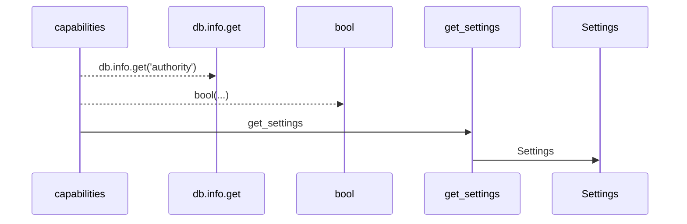
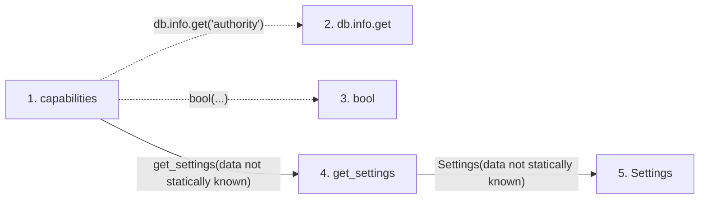

# capabilities

**Entry point:** `capabilities` (`http`)
**Source:** [time_entries](../modules/time_entries.md)
**Modules touched:** [config](../modules/config.md), [time_entries](../modules/time_entries.md)

## Call sequence

> Static overview in presentation order, not runtime execution order. Arrows retain captured callers; representative internal continuations and boundary examples precede repeated helper detail.

<!-- Auto-generated from static call edges. Dashed arrows are external or unresolved calls. Reviewed runtime conditions and side effects belong in Behavior. -->

> Call sequence diagram shows 4 of 4 interactions; 0 omitted to keep the visualization within the 30-interaction and generated-diagram limits, with uncertain identities omitted rather than inferred.

> Captured boundary calls: external 1 of 1 (0 omitted); unresolved 1 of 1 (0 omitted). These counts cover the captured static trace.
> Detailed flow queries retain their own coverage and limits; omitted paths may execute at runtime.

## Data flow

<!-- Auto-generated static analysis. Treat values and boundaries as best-effort hints, not runtime proof. -->

### Analysis coverage

**Effect analysis partially available.** Flow assembly and source effect analysis are separate; empty observations do not prove an empty handler body.

Source steps: 3; effect analysis evaluated: 2, partial: 0, unavailable: 1. Counts include steps omitted from the displayed trace.

Collector observations for 2 source steps with known totals: observed: 3, emitted: 3, omitted: 0. Unavailable totals are excluded.

- Callable record unavailable for one or more source steps; those steps have no represented callable body.
- Effect collector totals unavailable; observed counts cover captured records only.

| Step | Callable record | Effect analysis | Collector totals | Observed | Emitted | Omitted |
|---|---|---|---|---:|---:|---:|
| `capabilities` | `available` | `evaluated` | `available` | `2` | `2` | `0` |
| `db.info.get` | `not_applicable` | `not_applicable` | `not_applicable` | — | — | — |
| `bool` | `not_applicable` | `not_applicable` | `not_applicable` | — | — | — |
| `get_settings` | `available` | `evaluated` | `available` | `1` | `1` | `0` |
| `Settings` | `unavailable` | `unavailable` | `unavailable` | — | — | — |

### Step data

| Step | Inputs | Reads | Writes | Returns |
|---|---|---|---|---|
| `capabilities` | `db: DB` | - | - | `{...}` |
| `db.info.get` | - | - | - | - |
| `bool` | - | - | - | - |
| `get_settings` | - | - | - | `Settings(...)` |
| `Settings` | - | - | - | - |

### Call data

| From | To | Line | Call |
|---|---|---:|---|
| capabilities | db.info.get | 29 | `db.info.get('authority')` |
| capabilities | bool | 30 | `bool(...)` |
| capabilities | get_settings | 31 | `get_settings(data not statically known)` |
| get_settings | Settings | 481 | `Settings(data not statically known)` |

### Boundary effects

*No boundary-effect observations were captured in this static trace.*

### Static analysis gaps

| Kind | Step | Target | Line |
|---|---|---|---:|
| unresolved_call | `capabilities` | `db.info.get` | 29 |

## Behavior

This flow starts at `capabilities` and is classified as `http`. The generated call and data-flow sections are bounded static projections; runtime conditions and side effects require source-level confirmation.
