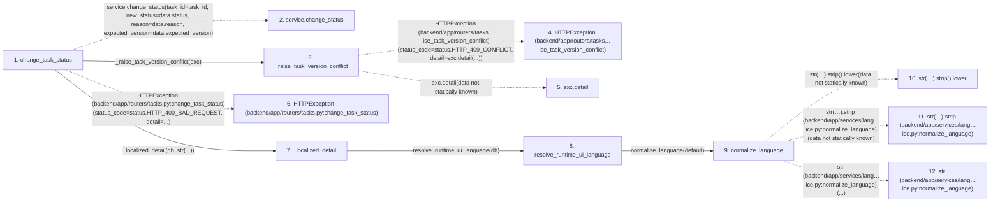

# change_task_status

**Entry point:** `change_task_status` (`http`)
**Source:** [tasks](../modules/tasks.md)
**Modules touched:** [config](../modules/config.md), [iteration_service](../modules/iteration_service.md), [language_service](../modules/language_service.md), [schemas_task](../modules/schemas_task.md), and 3 more

**Complete modules touched:**

- [config](../modules/config.md)
- [iteration_service](../modules/iteration_service.md)
- [language_service](../modules/language_service.md)
- [schemas_task](../modules/schemas_task.md)
- [system_settings_service](../modules/system_settings_service.md)
- [tasks](../modules/tasks.md)
- [url_policy](../modules/url_policy.md)

## Call sequence

> Static overview in presentation order, not runtime execution order. Arrows retain captured callers; representative internal continuations and boundary examples precede repeated helper detail.

```mermaid
sequenceDiagram
    participant p0 as change_task_status
    participant p1 as _localized_detail
    participant p2 as _not_found_detail
    participant p3 as invalid_status_transition_message
    participant p4 as _raise_task_version_conflict
    participant p5 as resolve_runtime_ui_language
    participant p6 as IterationService
    participant p7 as IterationService.get_by_id
    participant p8 as TaskStatusChangeResponse
    participant p9 as CascadeUpdateInfo
    participant p10 as backend_error_message
    participant p11 as RuntimeSettingsService.get_app_settings
    participant p12 as entity_not_found_message
    participant p13 as get_settings
    participant p14 as scoped_entity_not_found_message
    participant p15 as entity_deleted_message
    participant p16 as RuntimeSettingsService.resolve
    participant p17 as localized
    participant p18 as RuntimeSettingsService._definition
    participant p19 as RuntimeSettingsService._decrypt_secret
    participant p20 as RuntimeSettingsService._coerce
    participant p21 as normalize_language
    participant p22 as RuntimeSettingsService
    participant p23 as Settings
    participant p24 as RuntimeSettingsService._row
    participant p25 as RuntimeSettingsService._env_value
    participant p26 as RuntimeSettingsError
    participant p27 as RuntimeSettingsService._fernet
    participant p28 as RuntimeSettingsEncryptionError
    participant p29 as HTTPException (backend/app/routers/tasks.py:change_task_status)
    participant p30 as service.change_status
    p0->>p1: _localized_detail
    p0->>p2: _not_found_detail
    p0->>p3: invalid_status_transition_message
    p0->>p4: _raise_task_version_conflict
    p0->>p5: resolve_runtime_ui_language
    p0->>p6: IterationService
    p0->>p7: IterationService.get_by_id
    p0->>p8: TaskStatusChangeResponse
    p0->>p9: CascadeUpdateInfo
    p1->>p10: backend_error_message
    p5->>p11: RuntimeSettingsService.get_app_settings
    p10->>p12: entity_not_found_message
    p5->>p13: get_settings
    p10->>p14: scoped_entity_not_found_message
    p10->>p15: entity_deleted_message
    p11->>p16: RuntimeSettingsService.resolve
    p12->>p17: localized
    p16->>p18: RuntimeSettingsService._definition
    p16->>p19: RuntimeSettingsService._decrypt_secret
    p16->>p20: RuntimeSettingsService._coerce
    p5->>p21: normalize_language
    p5->>p22: RuntimeSettingsService
    p13->>p23: Settings
    p16->>p24: RuntimeSettingsService._row
    p16->>p25: RuntimeSettingsService._env_value
    p18->>p26: RuntimeSettingsError
    p19->>p27: RuntimeSettingsService._fernet
    p19->>p28: RuntimeSettingsEncryptionError
    p0-->>p29: HTTPException (backend/app/routers/tasks.py:change_task_status)(status_code=status.HTTP_400_BAD_REQUEST, detail=...)
    p0-->>p30: service.change_status(task_id=task_id, new_status=data.status, reason=data.reason, expected_version=data.expected_version)
```

<!-- Auto-generated from static call edges. Dashed arrows are external or unresolved calls. Reviewed runtime conditions and side effects belong in Behavior. -->

> Call sequence diagram shows 30 of 185 interactions; 155 omitted to keep the visualization within the 30-interaction and generated-diagram limits, with uncertain identities omitted rather than inferred.

> Captured boundary calls: external 1 of 52 (51 omitted); unresolved 1 of 77 (76 omitted). These counts cover the captured static trace.

Omitted captured detail, grouped by actual caller occurrence and target module:

| Caller | Parent step | Target module | Kind | Omitted interactions |
| --- | --- | --- | --- | --- |
| `backend/app/routers/tasks.py:_raise_task_version_conflict` | 3 | - | external | 1 |
| `backend/app/routers/tasks.py:_raise_task_version_conflict` | 3 | - | unresolved | 1 |
| `backend/app/routers/tasks.py:_localized_detail` | 7 | [backend/app/services/language_service.py](../modules/language_service.md) | internal | 1 |
| `backend/app/services/language_service.py:normalize_language` | 9 | - | unresolved | 2 |
| `backend/app/services/language_service.py:normalize_language` | 9 | - | external | 1 |
| `backend/app/services/system_settings_service.py:RuntimeSettingsService._definition` | 15 | - | unresolved | 1 |
| `backend/app/services/system_settings_service.py:RuntimeSettingsService._row` | 18 | - | unresolved | 3 |
| `backend/app/services/system_settings_service.py:RuntimeSettingsService._row` | 18 | - | external | 1 |
> Omission summary shows 8 of 35 groups; 27 further groups are not expanded here. Counts above include all omitted interactions.
> Detailed flow queries retain their own coverage and limits; omitted paths may execute at runtime.

> Trace truncated at the depth limit; deeper calls are omitted.

## Data flow

<!-- Auto-generated static analysis. Treat values and boundaries as best-effort hints, not runtime proof. -->

### Analysis coverage

**Effect analysis partially available.** Flow assembly and source effect analysis are separate; empty observations do not prove an empty handler body.

Source steps: 57; effect analysis evaluated: 35, partial: 1, unavailable: 21. Counts include steps omitted from the displayed trace.

Collector observations for 36 source steps with known totals: observed: 181, emitted: 155, omitted: 26. Unavailable totals are excluded.

- Callable record unavailable for one or more source steps; those steps have no represented callable body.
- Effect collector omitted observations before flow assembly; displayed effects are partial.
- Effect collector totals unavailable; observed counts cover captured records only.

| Step | Callable record | Effect analysis | Collector totals | Observed | Emitted | Omitted |
|---|---|---|---|---:|---:|---:|
| `change_task_status` | `available` | `evaluated` | `available` | `9` | `9` | `0` |
| `service.change_status` | `not_applicable` | `not_applicable` | `not_applicable` | — | — | — |
| `_raise_task_version_conflict` | `available` | `evaluated` | `available` | `2` | `2` | `0` |
| `HTTPException (backend/app/routers/tasks…ise_task_version_conflict)` | `not_applicable` | `not_applicable` | `not_applicable` | — | — | — |
| `exc.detail` | `not_applicable` | `not_applicable` | `not_applicable` | — | — | — |
| `HTTPException (backend/app/routers/tasks.py:change_task_status)` | `not_applicable` | `not_applicable` | `not_applicable` | — | — | — |
| `_localized_detail` | `available` | `evaluated` | `available` | `3` | `3` | `0` |
| `resolve_runtime_ui_language` | `available` | `evaluated` | `available` | `5` | `5` | `0` |
| `normalize_language` | `available` | `evaluated` | `available` | `4` | `4` | `0` |
| `str(…).strip().lower` | `not_applicable` | `not_applicable` | `not_applicable` | — | — | — |
| `str(…).strip (backend/app/services/lang…ice.py:normalize_language)` | `not_applicable` | `not_applicable` | `not_applicable` | — | — | — |
| `str (backend/app/services/lang…ice.py:normalize_language)` | `not_applicable` | `not_applicable` | `not_applicable` | — | — | — |

### Step data

| Step | Inputs | Reads | Writes | Returns |
|---|---|---|---|---|
| `change_task_status` | `task_id: int`, `data: TaskStatusChange`, `service: Annotated[TaskService, Depends(get_task_service)]`, `db: Annotated[AsyncSession, Depends(get_db, scope='function')]` | `TaskVersionConflictError`, `status`, `status`, `status` | - | `TaskStatusChangeResponse(...)` |
| `service.change_status` | - | - | - | - |
| `_raise_task_version_conflict` | `exc: TaskVersionConflictError` | `status` | - | - |
| `HTTPException (backend/app/routers/tasks…ise_task_version_conflict)` | - | - | - | - |
| `exc.detail` | - | - | - | - |
| `HTTPException (backend/app/routers/tasks.py:change_task_status)` | - | - | - | - |
| `_localized_detail` | `db: AsyncSession`, `message: str` | - | - | `backend_error_message(...)` |
| `resolve_runtime_ui_language` | `db: Any`, `default: LanguageCode \| None` | - | - | `normalize_language(...)`, `normalize_language(...)`, `fallback` |
| `normalize_language` | `value: Any`, `default: LanguageCode` | - | - | `normalized`, `default` |
| `str(…).strip().lower` | - | - | - | - |
| `str(…).strip (backend/app/services/lang…ice.py:normalize_language)` | - | - | - | - |
| `str (backend/app/services/lang…ice.py:normalize_language)` | - | - | - | - |

### Call data

| From | To | Line | Call |
|---|---|---:|---|
| change_task_status | service.change_status | 919 | `service.change_status(task_id=task_id, new_status=data.status, reason=data.reason, expected_version=data.expected_version)` |
| change_task_status | _raise_task_version_conflict | 926 | `_raise_task_version_conflict(exc)` |
| _raise_task_version_conflict | HTTPException (backend/app/routers/tasks…ise_task_version_conflict) | 59 | `HTTPException(status_code=status.HTTP_409_CONFLICT, detail=exc.detail(...))` |
| _raise_task_version_conflict | exc.detail | 61 | `exc.detail(data not statically known)` |
| change_task_status | HTTPException (backend/app/routers/tasks.py:change_task_status) | 928 | `HTTPException(status_code=status.HTTP_400_BAD_REQUEST, detail=...)` |
| change_task_status | _localized_detail | 930 | `_localized_detail(db, str(...))` |
| _localized_detail | resolve_runtime_ui_language | 66 | `resolve_runtime_ui_language(db)` |
| resolve_runtime_ui_language | normalize_language | 406 | `normalize_language(default)` |
| normalize_language | str(…).strip().lower | 35 | `str(value or '').strip().lower(data not statically known)` |
| normalize_language | str(…).strip (backend/app/services/lang…ice.py:normalize_language) | 35 | `str(value or '').strip(data not statically known)` |
| normalize_language | str (backend/app/services/lang…ice.py:normalize_language) | 35 | `str(...)` |

### Boundary effects

*No boundary-effect observations were captured in this static trace.*

### Static analysis gaps

| Kind | Step | Target | Line |
|---|---|---|---:|
| unresolved_call | `change_task_status` | `service.change_status` | 919 |
| external_call | `_raise_task_version_conflict` | `HTTPException` | 59 |
| unresolved_call | `_raise_task_version_conflict` | `exc.detail` | 61 |
| external_call | `change_task_status` | `HTTPException` | 928 |
| unresolved_call | `normalize_language` | `str(value or '').strip().lower` | 35 |
| unresolved_call | `normalize_language` | `str(value or '').strip` | 35 |
| step_limit | `change_task_status` | `first 12 steps` | 0 |
| truncated_flow | `change_task_status` | `depth limit` | 0 |

## Behavior

This flow starts at `change_task_status` and is classified as `http`. The generated call and data-flow sections are bounded static projections; runtime conditions and side effects require source-level confirmation.
