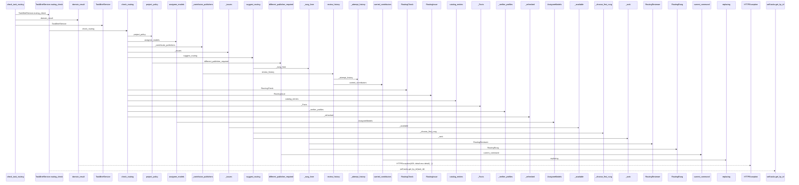
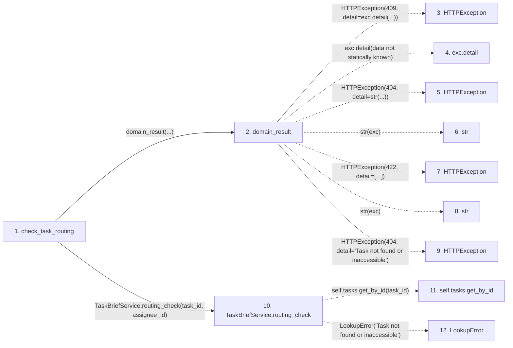

# check_task_routing

**Entry point:** `check_task_routing` (`http`)
**Source:** [routers_task_domain](../modules/routers_task_domain.md)
**Modules touched:** [authority](../modules/authority.md), [commands](../modules/commands.md), [manual_provenance_service](../modules/manual_provenance_service.md), [query_limits](../modules/query_limits.md), and 6 more

**Complete modules touched:**

- [authority](../modules/authority.md)
- [commands](../modules/commands.md)
- [manual_provenance_service](../modules/manual_provenance_service.md)
- [query_limits](../modules/query_limits.md)
- [review_provenance](../modules/review_provenance.md)
- [routers_task_domain](../modules/routers_task_domain.md)
- [task_brief_service](../modules/task_brief_service.md)
- [task_replacement_service](../modules/task_replacement_service.md)
- [task_routing](../modules/task_routing.md)
- [task_routing_service](../modules/task_routing_service.md)

## Call sequence

> Static overview in presentation order, not runtime execution order. Arrows retain captured callers; representative internal continuations and boundary examples precede repeated helper detail.

<!-- Auto-generated from static call edges. Dashed arrows are external or unresolved calls. Reviewed runtime conditions and side effects belong in Behavior. -->

> Call sequence diagram shows 30 of 207 interactions; 177 omitted to keep the visualization within the 30-interaction and generated-diagram limits, with uncertain identities omitted rather than inferred.

> Captured boundary calls: external 1 of 44 (43 omitted); unresolved 1 of 103 (102 omitted). These counts cover the captured static trace.

Omitted captured detail, grouped by actual caller occurrence and target module:

| Caller | Parent step | Target module | Kind | Omitted interactions |
| --- | --- | --- | --- | --- |
| `backend/app/routers/task_domain.py:domain_result` | 2 | - | unresolved | 1 |
| `backend/app/routers/task_domain.py:domain_result` | 2 | - | external | 5 |
| `backend/app/services/task_brief_service.py:TaskBriefService.routing_check` | 10 | - | external | 1 |
| `backend/app/services/task_brief_service.py:TaskBriefService.routing_check` | 10 | - | unresolved | 2 |
| `backend/app/services/task_routing_service.py:check_routing` | 14 | - | external | 5 |
| `backend/app/services/task_routing_service.py:check_routing` | 14 | - | unresolved | 5 |
| `backend/app/services/review_provenance.py:different_publisher_required` | 19 | - | unresolved | 4 |
| `backend/app/services/review_provenance.py:different_publisher_required` | 19 | - | external | 2 |
> Omission summary shows 8 of 42 groups; 34 further groups are not expanded here. Counts above include all omitted interactions.
> Detailed flow queries retain their own coverage and limits; omitted paths may execute at runtime.

> Trace truncated at the depth limit; deeper calls are omitted.

## Data flow

<!-- Auto-generated static analysis. Treat values and boundaries as best-effort hints, not runtime proof. -->

### Analysis coverage

**Effect analysis partially available.** Flow assembly and source effect analysis are separate; empty observations do not prove an empty handler body.

Source steps: 61; effect analysis evaluated: 42, partial: 4, unavailable: 15. Counts include steps omitted from the displayed trace.

Collector observations for 46 source steps with known totals: observed: 294, emitted: 285, omitted: 9. Unavailable totals are excluded.

- Callable record unavailable for one or more source steps; those steps have no represented callable body.
- Effect collector omitted observations before flow assembly; displayed effects are partial.
- Effect collector totals unavailable; observed counts cover captured records only.

| Step | Callable record | Effect analysis | Collector totals | Observed | Emitted | Omitted |
|---|---|---|---|---:|---:|---:|
| `check_task_routing` | `available` | `evaluated` | `available` | `4` | `4` | `0` |
| `domain_result` | `available` | `evaluated` | `available` | `3` | `3` | `0` |
| `HTTPException` | `not_applicable` | `not_applicable` | `not_applicable` | — | — | — |
| `exc.detail` | `not_applicable` | `not_applicable` | `not_applicable` | — | — | — |
| `HTTPException` | `not_applicable` | `not_applicable` | `not_applicable` | — | — | — |
| `str` | `not_applicable` | `not_applicable` | `not_applicable` | — | — | — |
| `HTTPException` | `not_applicable` | `not_applicable` | `not_applicable` | — | — | — |
| `str` | `not_applicable` | `not_applicable` | `not_applicable` | — | — | — |
| `HTTPException` | `not_applicable` | `not_applicable` | `not_applicable` | — | — | — |
| `TaskBriefService.routing_check` | `available` | `evaluated` | `available` | `5` | `5` | `0` |
| `self.tasks.get_by_id` | `not_applicable` | `not_applicable` | `not_applicable` | — | — | — |
| `LookupError` | `not_applicable` | `not_applicable` | `not_applicable` | — | — | — |

### Step data

| Step | Inputs | Reads | Writes | Returns |
|---|---|---|---|---|
| `check_task_routing` | `task_id: int`, `db: DB`, `assignee_id: int \| None` | - | - | `...` |
| `domain_result` | `awaitable` | `TaskVersionConflictError` | - | `result` |
| `HTTPException` | - | - | - | - |
| `exc.detail` | - | - | - | - |
| `HTTPException` | - | - | - | - |
| `str` | - | - | - | - |
| `HTTPException` | - | - | - | - |
| `str` | - | - | - | - |
| `HTTPException` | - | - | - | - |
| `TaskBriefService.routing_check` | `task_id`, `assignee_id`, `use_current_assignee` | `self.db` | - | `...` |
| `self.tasks.get_by_id` | - | - | - | - |
| `LookupError` | - | - | - | - |

### Call data

| From | To | Line | Call |
|---|---|---:|---|
| check_task_routing | domain_result | 267 | `domain_result(...)` |
| domain_result | HTTPException | 56 | `HTTPException(409, detail=exc.detail(...))` |
| domain_result | exc.detail | 56 | `exc.detail(data not statically known)` |
| domain_result | HTTPException | 58 | `HTTPException(404, detail=str(...))` |
| domain_result | str | 58 | `str(exc)` |
| domain_result | HTTPException | 60 | `HTTPException(422, detail=[...])` |
| domain_result | str | 60 | `str(exc)` |
| domain_result | HTTPException | 62 | `HTTPException(404, detail='Task not found or inaccessible')` |
| check_task_routing | TaskBriefService.routing_check | 267 | `TaskBriefService(db).routing_check(task_id, assignee_id)` |
| TaskBriefService.routing_check | self.tasks.get_by_id | 332 | `self.tasks.get_by_id(task_id)` |
| TaskBriefService.routing_check | LookupError | 334 | `LookupError('Task not found or inaccessible')` |

### Boundary effects

*No boundary-effect observations were captured in this static trace.*

### Static analysis gaps

| Kind | Step | Target | Line |
|---|---|---|---:|
| external_call | `domain_result` | `HTTPException` | 56 |
| unresolved_call | `domain_result` | `exc.detail` | 56 |
| external_call | `domain_result` | `HTTPException` | 58 |
| external_call | `domain_result` | `HTTPException` | 60 |
| external_call | `domain_result` | `HTTPException` | 62 |
| unresolved_call | `TaskBriefService.routing_check` | `self.tasks.get_by_id` | 332 |
| external_call | `TaskBriefService.routing_check` | `LookupError` | 334 |
| step_limit | `check_task_routing` | `first 12 steps` | 0 |
| truncated_flow | `check_task_routing` | `depth limit` | 0 |

## Behavior

This flow starts at `check_task_routing` and is classified as `http`. The generated call and data-flow sections are bounded static projections; runtime conditions and side effects require source-level confirmation.
