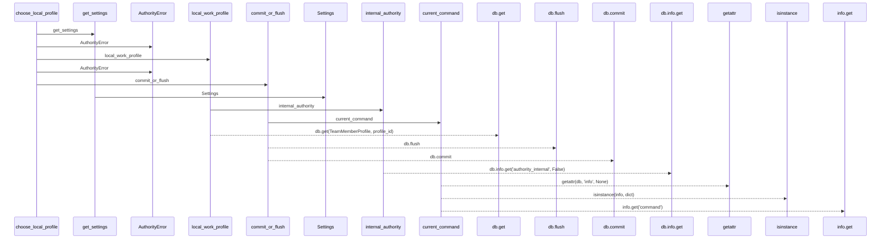
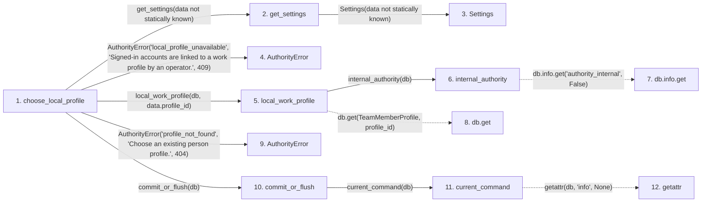

# choose_local_profile

**Entry point:** `choose_local_profile` (`http`)
**Source:** [routers_identity](../modules/routers_identity.md)
**Modules touched:** [authority](../modules/authority.md), [commands](../modules/commands.md), [config](../modules/config.md), [identity_service](../modules/identity_service.md), [routers_identity](../modules/routers_identity.md)

## Call sequence

> Static overview in presentation order, not runtime execution order. Arrows retain captured callers; representative internal continuations and boundary examples precede repeated helper detail.

<!-- Auto-generated from static call edges. Dashed arrows are external or unresolved calls. Reviewed runtime conditions and side effects belong in Behavior. -->

> Call sequence diagram shows 15 of 15 interactions; 0 omitted to keep the visualization within the 30-interaction and generated-diagram limits, with uncertain identities omitted rather than inferred.

> Captured boundary calls: external 2 of 2 (0 omitted); unresolved 5 of 5 (0 omitted). These counts cover the captured static trace.
> Detailed flow queries retain their own coverage and limits; omitted paths may execute at runtime.

## Data flow

<!-- Auto-generated static analysis. Treat values and boundaries as best-effort hints, not runtime proof. -->

### Analysis coverage

**Effect analysis partially available.** Flow assembly and source effect analysis are separate; empty observations do not prove an empty handler body.

Source steps: 9; effect analysis evaluated: 6, partial: 0, unavailable: 3. Counts include steps omitted from the displayed trace.

Collector observations for 6 source steps with known totals: observed: 18, emitted: 18, omitted: 0. Unavailable totals are excluded.

- Callable record unavailable for one or more source steps; those steps have no represented callable body.
- Effect collector totals unavailable; observed counts cover captured records only.

| Step | Callable record | Effect analysis | Collector totals | Observed | Emitted | Omitted |
|---|---|---|---|---:|---:|---:|
| `choose_local_profile` | `available` | `evaluated` | `available` | `7` | `7` | `0` |
| `get_settings` | `available` | `evaluated` | `available` | `1` | `1` | `0` |
| `Settings` | `unavailable` | `unavailable` | `unavailable` | — | — | — |
| `AuthorityError` | `unavailable` | `unavailable` | `unavailable` | — | — | — |
| `local_work_profile` | `available` | `evaluated` | `available` | `4` | `4` | `0` |
| `internal_authority` | `available` | `evaluated` | `available` | `3` | `3` | `0` |
| `db.info.get` | `not_applicable` | `not_applicable` | `not_applicable` | — | — | — |
| `db.get` | `not_applicable` | `not_applicable` | `not_applicable` | — | — | — |
| `AuthorityError` | `unavailable` | `unavailable` | `unavailable` | — | — | — |
| `commit_or_flush` | `available` | `evaluated` | `available` | `1` | `1` | `0` |
| `current_command` | `available` | `evaluated` | `available` | `2` | `2` | `0` |
| `getattr` | `not_applicable` | `not_applicable` | `not_applicable` | — | — | — |

### Step data

| Step | Inputs | Reads | Writes | Returns |
|---|---|---|---|---|
| `choose_local_profile` | `data: LocalProfileChoice`, `response: Response`, `db: Database`, `session: Annotated[UserSession, Depends(get_current_session)]` | - | `response.headers[...]`, `session.local_profile_id` | `{...}` |
| `get_settings` | - | - | - | `Settings(...)` |
| `Settings` | - | - | - | - |
| `AuthorityError` | - | - | - | - |
| `local_work_profile` | `db`, `profile_id` | - | - | `None`, `...` |
| `internal_authority` | `db` | - | `db.info[...]`, `db.info[...]` | - |
| `db.info.get` | - | - | - | - |
| `db.get` | - | - | - | - |
| `AuthorityError` | - | - | - | - |
| `commit_or_flush` | `db` | - | - | - |
| `current_command` | `db` | - | - | `...` |
| `getattr` | - | - | - | - |

### Call data

| From | To | Line | Call |
|---|---|---:|---|
| choose_local_profile | get_settings | 163 | `get_settings(data not statically known)` |
| get_settings | Settings | 481 | `Settings(data not statically known)` |
| choose_local_profile | AuthorityError | 164 | `AuthorityError('local_profile_unavailable', 'Signed-in accounts are linked to a work profile by an operator.', 409)` |
| choose_local_profile | local_work_profile | 165 | `local_work_profile(db, data.profile_id)` |
| local_work_profile | internal_authority | 40 | `internal_authority(db)` |
| internal_authority | db.info.get | 87 | `db.info.get('authority_internal', False)` |
| local_work_profile | db.get | 41 | `db.get(TeamMemberProfile, profile_id)` |
| choose_local_profile | AuthorityError | 167 | `AuthorityError('profile_not_found', 'Choose an existing person profile.', 404)` |
| choose_local_profile | commit_or_flush | 169 | `commit_or_flush(db)` |
| commit_or_flush | current_command | 79 | `current_command(db)` |
| current_command | getattr | 73 | `getattr(db, 'info', None)` |

### Boundary effects

*No boundary-effect observations were captured in this static trace.*

### Static analysis gaps

| Kind | Step | Target | Line |
|---|---|---|---:|
| unresolved_call | `internal_authority` | `db.info.get` | 87 |
| unresolved_call | `local_work_profile` | `db.get` | 41 |
| external_call | `current_command` | `getattr` | 73 |
| step_limit | `choose_local_profile` | `first 12 steps` | 0 |

## Behavior

This flow starts at `choose_local_profile` and is classified as `http`. The generated call and data-flow sections are bounded static projections; runtime conditions and side effects require source-level confirmation.
