# classify_planning_triage_item

**Entry point:** `classify_planning_triage_item` (`http`)
**Source:** [routers_agent_planning](../modules/routers_agent_planning.md)
**Modules touched:** [agent_service](../modules/agent_service.md), [commands](../modules/commands.md), [llm_service](../modules/llm_service.md), [mcp_agent_tools](../modules/mcp_agent_tools.md), and 10 more

**Complete modules touched:**

- [agent_service](../modules/agent_service.md)
- [commands](../modules/commands.md)
- [llm_service](../modules/llm_service.md)
- [mcp_agent_tools](../modules/mcp_agent_tools.md)
- [models_agent](../modules/models_agent.md)
- [models_triage](../modules/models_triage.md)
- [outbound_webhook_service](../modules/outbound_webhook_service.md)
- [routers_agent_planning](../modules/routers_agent_planning.md)
- [schemas_agent_planning](../modules/schemas_agent_planning.md)
- [schemas_triage](../modules/schemas_triage.md)
- [system_settings_service](../modules/system_settings_service.md)
- [task_service](../modules/task_service.md)
- [text_similarity](../modules/text_similarity.md)
- [triage_service](../modules/triage_service.md)

## Call sequence

> Static overview in presentation order, not runtime execution order. Arrows retain captured callers; representative internal continuations and boundary examples precede repeated helper detail.

```mermaid
sequenceDiagram
    participant p0 as classify_planning_triage_item
    participant p1 as require_scope
    participant p2 as classify_triage_item
    participant p3 as _require_triage_result
    participant p4 as _handle_agent_error
    participant p5 as actor_has_scope
    participant p6 as _triage_command_context
    participant p7 as _triage_command_replay
    participant p8 as TriageService.classify_item
    participant p9 as _stage_triage_command_audit_event
    participant p10 as _stage_triage_command_receipt
    participant p11 as _commit_triage_command
    participant p12 as TaskService.record_task_event
    participant p13 as TriageService._classification_duplicate_candidates
    participant p14 as LLMService.from_runtime
    participant p15 as TriageService._normalize_classification_draft
    participant p16 as emit_outbound_webhook_event
    participant p17 as commit_or_flush
    participant p18 as TriageService.get_duplicate_suggestions
    participant p19 as RuntimeSettingsService.get_llm_settings
    participant p20 as TriageService._valid_slug
    participant p21 as OutboundWebhookService.safe_emit_event
    participant p22 as RuntimeSettingsService.resolve
    participant p23 as OutboundWebhookService.enqueue_event
    participant p24 as TriageService._triage_item_text
    participant p25 as TriageService._task_text
    participant p26 as BM25Similarity.fit
    participant p27 as BM25Similarity.score
    participant p28 as TriageService._score_boosts
    participant p29 as LookupError
    participant p30 as db.rollback (backend/app/mcp_agent_tools.py:classify_triage_item)
    p0->>p1: require_scope
    p0->>p2: classify_triage_item
    p0->>p3: _require_triage_result
    p0->>p4: _handle_agent_error
    p1->>p5: actor_has_scope
    p2->>p6: _triage_command_context
    p2->>p7: _triage_command_replay
    p2->>p8: TriageService.classify_item
    p2->>p9: _stage_triage_command_audit_event
    p2->>p10: _stage_triage_command_receipt
    p2->>p11: _commit_triage_command
    p9->>p12: TaskService.record_task_event
    p8->>p13: TriageService._classification_duplicate_candidates
    p8->>p14: LLMService.from_runtime
    p8->>p15: TriageService._normalize_classification_draft
    p8->>p16: emit_outbound_webhook_event
    p8->>p17: commit_or_flush
    p13->>p18: TriageService.get_duplicate_suggestions
    p14->>p19: RuntimeSettingsService.get_llm_settings
    p15->>p20: TriageService._valid_slug
    p16->>p21: OutboundWebhookService.safe_emit_event
    p19->>p22: RuntimeSettingsService.resolve
    p21->>p23: OutboundWebhookService.enqueue_event
    p18->>p24: TriageService._triage_item_text
    p18->>p25: TriageService._task_text
    p18->>p26: BM25Similarity.fit
    p18->>p27: BM25Similarity.score
    p18->>p28: TriageService._score_boosts
    p3-->>p29: LookupError(...)
    p2-->>p30: db.rollback (backend/app/mcp_agent_tools.py:classify_triage_item)
```

<!-- Auto-generated from static call edges. Dashed arrows are external or unresolved calls. Reviewed runtime conditions and side effects belong in Behavior. -->

> Call sequence diagram shows 30 of 282 interactions; 252 omitted to keep the visualization within the 30-interaction and generated-diagram limits, with uncertain identities omitted rather than inferred.

> Captured boundary calls: external 1 of 85 (84 omitted); unresolved 1 of 96 (95 omitted). These counts cover the captured static trace.

Omitted captured detail, grouped by actual caller occurrence and target module:

| Caller | Parent step | Target module | Kind | Omitted interactions |
| --- | --- | --- | --- | --- |
| `backend/app/services/agent_service.py:actor_has_scope` | 3 | [backend/app/services/agent_service.py](../modules/agent_service.md) | internal | 1 |
| `backend/app/services/agent_service.py:actor_scopes` | 4 | - | external | 2 |
| `backend/app/services/agent_service.py:require_scope` | 2 | [backend/app/services/agent_service.py](../modules/agent_service.md) | internal | 1 |
| `backend/app/mcp_agent_tools.py:_triage_command_context` | 9 | [backend/app/services/agent_service.py](../modules/agent_service.md) | internal | 1 |
| `backend/app/services/agent_service.py:validate_idempotency_key` | 10 | - | external | 6 |
| `backend/app/services/agent_service.py:validate_idempotency_key` | 10 | - | unresolved | 1 |
| `backend/app/mcp_agent_tools.py:_triage_command_context` | 9 | [backend/app/schemas/agent_planning.py](../modules/schemas_agent_planning.md) | internal | 1 |
| `backend/app/mcp_agent_tools.py:classify_triage_item` | 8 | [backend/app/mcp_agent_tools.py](../modules/mcp_agent_tools.md) | internal | 2 |
> Omission summary shows 8 of 82 groups; 74 further groups are not expanded here. Counts above include all omitted interactions.
> Detailed flow queries retain their own coverage and limits; omitted paths may execute at runtime.

> Trace truncated at the depth limit; deeper calls are omitted.

## Data flow

<!-- Auto-generated static analysis. Treat values and boundaries as best-effort hints, not runtime proof. -->

### Analysis coverage

**Effect analysis partially available.** Flow assembly and source effect analysis are separate; empty observations do not prove an empty handler body.

Source steps: 102; effect analysis evaluated: 76, partial: 4, unavailable: 22. Counts include steps omitted from the displayed trace.

Collector observations for 80 source steps with known totals: observed: 411, emitted: 403, omitted: 8. Unavailable totals are excluded.

- Callable record unavailable for one or more source steps; those steps have no represented callable body.
- Effect collector omitted observations before flow assembly; displayed effects are partial.
- Effect collector totals unavailable; observed counts cover captured records only.

| Step | Callable record | Effect analysis | Collector totals | Observed | Emitted | Omitted |
|---|---|---|---|---:|---:|---:|
| `classify_planning_triage_item` | `available` | `evaluated` | `available` | `5` | `5` | `0` |
| `require_scope` | `available` | `evaluated` | `available` | `2` | `2` | `0` |
| `actor_has_scope` | `available` | `evaluated` | `available` | `3` | `3` | `0` |
| `actor_scopes` | `available` | `evaluated` | `available` | `3` | `3` | `0` |
| `json.loads (backend/app/services/agent_service.py:actor_scopes)` | `not_applicable` | `not_applicable` | `not_applicable` | — | — | — |
| `isinstance (backend/app/services/agent_service.py:actor_scopes)` | `not_applicable` | `not_applicable` | `not_applicable` | — | — | — |
| `AgentPermissionError` | `unavailable` | `unavailable` | `unavailable` | — | — | — |
| `classify_triage_item` | `available` | `evaluated` | `available` | `10` | `10` | `0` |
| `_triage_command_context` | `available` | `evaluated` | `available` | `4` | `4` | `0` |
| `validate_idempotency_key` | `available` | `evaluated` | `available` | `4` | `4` | `0` |
| `ValueError` | `not_applicable` | `not_applicable` | `not_applicable` | — | — | — |
| `value.strip` | `not_applicable` | `not_applicable` | `not_applicable` | — | — | — |

```mermaid
flowchart LR
    s1["1. classify_planning_triage_item"]
    s2["2. require_scope"]
    s3["3. actor_has_scope"]
    s4["4. actor_scopes"]
    s5["5. json.loads (backend/app/services/agent_service.py:actor_scopes)"]
    s6["6. isinstance (backend/app/services/agent_service.py:actor_scopes)"]
    s7["7. AgentPermissionError"]
    s8["8. classify_triage_item"]
    s9["9. _triage_command_context"]
    s10["10. validate_idempotency_key"]
    s11["11. ValueError"]
    s12["12. value.strip"]
    s1 -->|"require_scope(actor, 'planning:write')"| s2
    s2 -->|"actor_has_scope(actor, scope)"| s3
    s3 -->|"actor_scopes(actor)"| s4
    s4 -. "json.loads (backend/app/services/agent_service.py:actor_scopes)(actor.scopes)" .-> s5
    s4 -. "isinstance (backend/app/services/agent_service.py:actor_scopes)(scopes, list)" .-> s6
    s2 -->|"AgentPermissionError(...)"| s7
    s1 -->|"classify_triage_item(db, actor, triage_item_id, idempotency_key=command.idempotency_key, rationale=command.rationale, correlation_id=command.correlation_id)"| s8
    s8 -->|"_triage_command_context(idempotency_key=idempotency_key, rationale=rationale, correlation_id=correlation_id)"| s9
    s9 -->|"validate_idempotency_key(idempotency_key, required=True)"| s10
    s10 -. "ValueError('Idempotency-Key is required')" .-> s11
    s10 -. "value.strip(data not statically known)" .-> s12
    click s1 "../modules/routers_agent_planning.md"
    click s2 "../modules/agent_service.md"
    click s3 "../modules/agent_service.md"
    click s4 "../modules/agent_service.md"
    click s7 "../modules/agent_service.md"
    click s8 "../modules/mcp_agent_tools.md"
    click s9 "../modules/mcp_agent_tools.md"
    click s10 "../modules/agent_service.md"
```

### Step data

| Step | Inputs | Reads | Writes | Returns |
|---|---|---|---|---|
| `classify_planning_triage_item` | `triage_item_id: int`, `actor: Annotated[AgentActor, Depends(get_agent_actor)]`, `db: Annotated[AsyncSession, Depends(get_db, scope='function')]`, `command: Annotated[AgentPlanningCommandContext, Depends(get_agent_planning_command_context)]` | - | - | `_require_triage_result(...)` |
| `require_scope` | `actor: AgentActor`, `scope: str` | - | - | - |
| `actor_has_scope` | `actor: AgentActor`, `scope: str` | - | - | `...` |
| `actor_scopes` | `actor: AgentActor` | `json` | - | `...` |
| `json.loads (backend/app/services/agent_service.py:actor_scopes)` | - | - | - | - |
| `isinstance (backend/app/services/agent_service.py:actor_scopes)` | - | - | - | - |
| `AgentPermissionError` | - | - | - | - |
| `classify_triage_item` | `db: AsyncSession`, `actor: AgentActor`, `triage_item_id: int`, `idempotency_key: str`, `rationale: str`, `correlation_id: str` | `TriageClassificationSuggestionResponse` | - | `replay`, `None`, `...` |
| `_triage_command_context` | `idempotency_key: str`, `rationale: str`, `correlation_id: str` | - | - | `AgentPlanningCommandContext(...)` |
| `validate_idempotency_key` | `value: Optional[str]`, `required: bool` | - | - | `None`, `value` |
| `ValueError` | - | - | - | - |
| `value.strip` | - | - | - | - |

### Call data

| From | To | Line | Call |
|---|---|---:|---|
| classify_planning_triage_item | require_scope | 621 | `require_scope(actor, 'planning:write')` |
| require_scope | actor_has_scope | 100 | `actor_has_scope(actor, scope)` |
| actor_has_scope | actor_scopes | 94 | `actor_scopes(actor)` |
| actor_scopes | json.loads (backend/app/services/agent_service.py:actor_scopes) | 86 | `json.loads(actor.scopes)` |
| actor_scopes | isinstance (backend/app/services/agent_service.py:actor_scopes) | 89 | `isinstance(scopes, list)` |
| require_scope | AgentPermissionError | 101 | `AgentPermissionError(...)` |
| classify_planning_triage_item | classify_triage_item | 622 | `mcp_agent_tools.classify_triage_item(db, actor, triage_item_id, idempotency_key=command.idempotency_key, rationale=command.rationale, correlation_id=command.correlation_id)` |
| classify_triage_item | _triage_command_context | 2312 | `_triage_command_context(idempotency_key=idempotency_key, rationale=rationale, correlation_id=correlation_id)` |
| _triage_command_context | validate_idempotency_key | 216 | `validate_idempotency_key(idempotency_key, required=True)` |
| validate_idempotency_key | ValueError | 110 | `ValueError('Idempotency-Key is required')` |
| validate_idempotency_key | value.strip | 114 | `value.strip(data not statically known)` |

### Boundary effects

*No boundary-effect observations were captured in this static trace.*

### Static analysis gaps

| Kind | Step | Target | Line |
|---|---|---|---:|
| external_call | `actor_scopes` | `json.loads` | 86 |
| external_call | `actor_scopes` | `isinstance` | 89 |
| external_call | `validate_idempotency_key` | `ValueError` | 110 |
| unresolved_call | `validate_idempotency_key` | `value.strip` | 114 |
| step_limit | `classify_planning_triage_item` | `first 12 steps` | 0 |
| truncated_flow | `classify_planning_triage_item` | `depth limit` | 0 |

## Behavior

This flow starts at `classify_planning_triage_item` and is classified as `http`. The generated call and data-flow sections are bounded static projections; runtime conditions and side effects require source-level confirmation.
