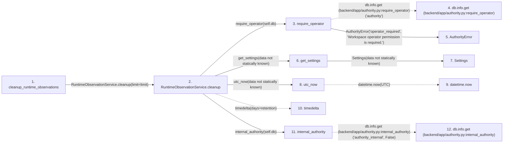

# cleanup_runtime_observations

**Entry point:** `cleanup_runtime_observations` (`http`)
**Source:** [routers_agent](../modules/routers_agent.md)
**Modules touched:** [authority](../modules/authority.md), [config](../modules/config.md), [routers_agent](../modules/routers_agent.md), [runtime_observation_service](../modules/runtime_observation_service.md), [time](../modules/time.md)

## Call sequence

> Static overview in presentation order, not runtime execution order. Arrows retain captured callers; representative internal continuations and boundary examples precede repeated helper detail.

```mermaid
sequenceDiagram
    participant p0 as cleanup_runtime_observations
    participant p1 as RuntimeObservationService.cleanup
    participant p2 as RuntimeObservationService
    participant p3 as require_operator
    participant p4 as get_settings
    participant p5 as utc_now
    participant p6 as timedelta
    participant p7 as internal_authority
    participant p8 as select(…).where(…).order_by(…).limit
    participant p9 as select(…).where(…).order_by
    participant p10 as select(…).where
    participant p11 as select
    participant p12 as list
    participant p13 as (…).scalars().all
    participant p14 as (…).scalars
    participant p15 as self.db.execute
    participant p16 as delete(…).where
    participant p17 as delete
    participant p18 as AgentRuntimeObservation.id.in_
    participant p19 as len
    participant p20 as db.info.get (backend/app/authority.py:require_operator)
    participant p21 as Settings
    participant p22 as datetime.now
    participant p23 as db.info.get (backend/app/authority.py:internal_authority)
    participant p24 as AuthorityError
    p0->>p1: RuntimeObservationService.cleanup
    p0->>p2: RuntimeObservationService
    p1->>p3: require_operator
    p1->>p4: get_settings
    p1->>p5: utc_now
    p1-->>p6: timedelta(days=retention)
    p1->>p7: internal_authority
    p1-->>p8: select(…).where(…).order_by(…).limit(limit)
    p1-->>p9: select(…).where(…).order_by(AgentRuntimeObservation.id)
    p1-->>p10: select(…).where(...)
    p1-->>p11: select(AgentRuntimeObservation.id)
    p1-->>p12: list(...)
    p1-->>p13: (…).scalars().all
    p1-->>p14: (…).scalars
    p1-->>p15: self.db.execute(expired)
    p1-->>p15: self.db.execute(...)
    p1-->>p16: delete(…).where(AgentRuntimeObservation.id.in_(...))
    p1-->>p17: delete(AgentRuntimeObservation)
    p1-->>p18: AgentRuntimeObservation.id.in_(ids)
    p1-->>p19: len(ids)
    p3-->>p20: db.info.get (backend/app/authority.py:require_operator)('authority')
    p4->>p21: Settings
    p5-->>p22: datetime.now(UTC)
    p7-->>p23: db.info.get (backend/app/authority.py:internal_authority)('authority_internal', False)
    p3->>p24: AuthorityError
```

<!-- Auto-generated from static call edges. Dashed arrows are external or unresolved calls. Reviewed runtime conditions and side effects belong in Behavior. -->

> Call sequence diagram shows 25 of 25 interactions; 0 omitted to keep the visualization within the 30-interaction and generated-diagram limits, with uncertain identities omitted rather than inferred.

> Captured boundary calls: external 6 of 6 (0 omitted); unresolved 11 of 11 (0 omitted). These counts cover the captured static trace.
> Detailed flow queries retain their own coverage and limits; omitted paths may execute at runtime.

## Data flow

<!-- Auto-generated static analysis. Treat values and boundaries as best-effort hints, not runtime proof. -->

### Analysis coverage

**Effect analysis partially available.** Flow assembly and source effect analysis are separate; empty observations do not prove an empty handler body.

Source steps: 9; effect analysis evaluated: 6, partial: 0, unavailable: 3. Counts include steps omitted from the displayed trace.

Collector observations for 6 source steps with known totals: observed: 14, emitted: 14, omitted: 0. Unavailable totals are excluded.

- Callable record unavailable for one or more source steps; those steps have no represented callable body.
- Effect collector totals unavailable; observed counts cover captured records only.

| Step | Callable record | Effect analysis | Collector totals | Observed | Emitted | Omitted |
|---|---|---|---|---:|---:|---:|
| `cleanup_runtime_observations` | `available` | `evaluated` | `available` | `3` | `3` | `0` |
| `RuntimeObservationService.cleanup` | `available` | `evaluated` | `available` | `4` | `4` | `0` |
| `require_operator` | `available` | `evaluated` | `available` | `1` | `1` | `0` |
| `db.info.get (backend/app/authority.py:require_operator)` | `not_applicable` | `not_applicable` | `not_applicable` | — | — | — |
| `AuthorityError` | `unavailable` | `unavailable` | `unavailable` | — | — | — |
| `get_settings` | `available` | `evaluated` | `available` | `1` | `1` | `0` |
| `Settings` | `unavailable` | `unavailable` | `unavailable` | — | — | — |
| `utc_now` | `available` | `evaluated` | `available` | `2` | `2` | `0` |
| `datetime.now` | `not_applicable` | `not_applicable` | `not_applicable` | — | — | — |
| `timedelta` | `not_applicable` | `not_applicable` | `not_applicable` | — | — | — |
| `internal_authority` | `available` | `evaluated` | `available` | `3` | `3` | `0` |
| `db.info.get (backend/app/authority.py:internal_authority)` | `not_applicable` | `not_applicable` | `not_applicable` | — | — | — |

### Step data

| Step | Inputs | Reads | Writes | Returns |
|---|---|---|---|---|
| `cleanup_runtime_observations` | `db: Annotated[AsyncSession, Depends(get_db, scope='function')]`, `limit: int` | - | - | `...` |
| `RuntimeObservationService.cleanup` | `limit` | `self.db`, `self.db` | - | `{...}` |
| `require_operator` | `db` | - | - | - |
| `db.info.get (backend/app/authority.py:require_operator)` | - | - | - | - |
| `AuthorityError` | - | - | - | - |
| `get_settings` | - | - | - | `Settings(...)` |
| `Settings` | - | - | - | - |
| `utc_now` | - | `UTC` | - | `datetime.now(...)` |
| `datetime.now` | - | - | - | - |
| `timedelta` | - | - | - | - |
| `internal_authority` | `db` | - | `db.info[...]`, `db.info[...]` | - |
| `db.info.get (backend/app/authority.py:internal_authority)` | - | - | - | - |

### Call data

| From | To | Line | Call |
|---|---|---:|---|
| cleanup_runtime_observations | RuntimeObservationService.cleanup | 1560 | `RuntimeObservationService(db).cleanup(limit=limit)` |
| RuntimeObservationService.cleanup | require_operator | 115 | `require_operator(self.db)` |
| require_operator | db.info.get (backend/app/authority.py:require_operator) | 84 | `db.info.get('authority')` |
| require_operator | AuthorityError | 86 | `AuthorityError('operator_required', 'Workspace operator permission is required.')` |
| RuntimeObservationService.cleanup | get_settings | 116 | `get_settings(data not statically known)` |
| get_settings | Settings | 524 | `Settings(data not statically known)` |
| RuntimeObservationService.cleanup | utc_now | 117 | `utc_now(data not statically known)` |
| utc_now | datetime.now | 13 | `datetime.now(UTC)` |
| RuntimeObservationService.cleanup | timedelta | 117 | `timedelta(days=retention)` |
| RuntimeObservationService.cleanup | internal_authority | 118 | `internal_authority(self.db)` |
| internal_authority | db.info.get (backend/app/authority.py:internal_authority) | 92 | `db.info.get('authority_internal', False)` |

### Boundary effects

*No boundary-effect observations were captured in this static trace.*

### Static analysis gaps

| Kind | Step | Target | Line |
|---|---|---|---:|
| unresolved_call | `require_operator` | `db.info.get` | 84 |
| external_call | `utc_now` | `datetime.now` | 13 |
| external_call | `RuntimeObservationService.cleanup` | `timedelta` | 117 |
| unresolved_call | `internal_authority` | `db.info.get` | 92 |
| step_limit | `cleanup_runtime_observations` | `first 12 steps` | 0 |

## Behavior

Operator-only bounded removal of observations older than `AGENT_OBSERVATION_RETENTION_DAYS`.
