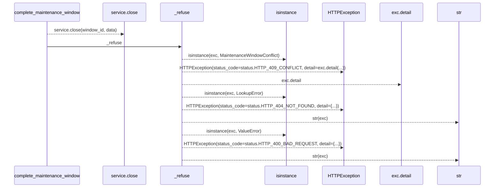
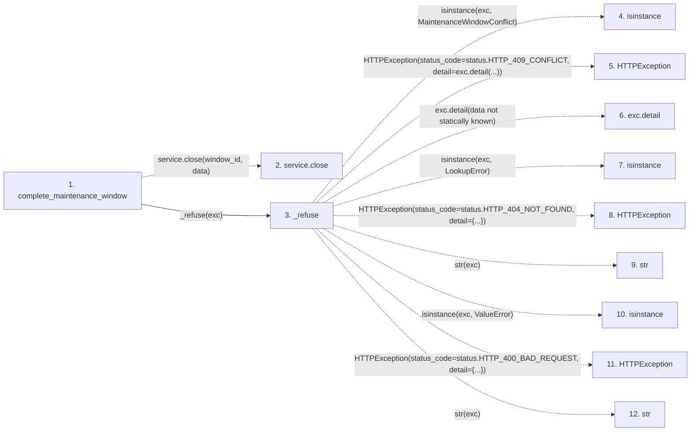

# complete_maintenance_window

**Entry point:** `complete_maintenance_window` (`http`)
**Source:** [maintenance_windows](../modules/maintenance_windows.md)
**Modules touched:** [maintenance_windows](../modules/maintenance_windows.md)

## Call sequence

> Static overview in presentation order, not runtime execution order. Arrows retain captured callers; representative internal continuations and boundary examples precede repeated helper detail.

<!-- Auto-generated from static call edges. Dashed arrows are external or unresolved calls. Reviewed runtime conditions and side effects belong in Behavior. -->

> Call sequence diagram shows 11 of 11 interactions; 0 omitted to keep the visualization within the 30-interaction and generated-diagram limits, with uncertain identities omitted rather than inferred.

> Captured boundary calls: external 8 of 8 (0 omitted); unresolved 2 of 2 (0 omitted). These counts cover the captured static trace.
> Detailed flow queries retain their own coverage and limits; omitted paths may execute at runtime.

## Data flow

<!-- Auto-generated static analysis. Treat values and boundaries as best-effort hints, not runtime proof. -->

### Analysis coverage

**Effect analysis evaluated.** Flow assembly and source effect analysis are separate; empty observations do not prove an empty handler body.

Source steps: 2; effect analysis evaluated: 2, partial: 0, unavailable: 0. Counts include steps omitted from the displayed trace.

Collector observations for 2 source steps with known totals: observed: 9, emitted: 9, omitted: 0. Unavailable totals are excluded.

### Step data

| Step | Inputs | Reads | Writes | Returns |
|---|---|---|---|---|
| `complete_maintenance_window` | `window_id: int`, `data: MaintenanceWindowClose`, `service: Service` | - | - | `...` |
| `service.close` | - | - | - | - |
| `_refuse` | `exc: Exception` | `MaintenanceWindowConflict`, `status`, `status`, `status` | - | - |
| `isinstance` | - | - | - | - |
| `HTTPException` | - | - | - | - |
| `exc.detail` | - | - | - | - |
| `isinstance` | - | - | - | - |
| `HTTPException` | - | - | - | - |
| `str` | - | - | - | - |
| `isinstance` | - | - | - | - |
| `HTTPException` | - | - | - | - |
| `str` | - | - | - | - |

### Call data

| From | To | Line | Call |
|---|---|---:|---|
| complete_maintenance_window | service.close | 95 | `service.close(window_id, data)` |
| complete_maintenance_window | _refuse | 97 | `_refuse(exc)` |
| _refuse | isinstance | 38 | `isinstance(exc, MaintenanceWindowConflict)` |
| _refuse | HTTPException | 39 | `HTTPException(status_code=status.HTTP_409_CONFLICT, detail=exc.detail(...))` |
| _refuse | exc.detail | 39 | `exc.detail(data not statically known)` |
| _refuse | isinstance | 40 | `isinstance(exc, LookupError)` |
| _refuse | HTTPException | 41 | `HTTPException(status_code=status.HTTP_404_NOT_FOUND, detail={...})` |
| _refuse | str | 42 | `str(exc)` |
| _refuse | isinstance | 43 | `isinstance(exc, ValueError)` |
| _refuse | HTTPException | 44 | `HTTPException(status_code=status.HTTP_400_BAD_REQUEST, detail={...})` |
| _refuse | str | 45 | `str(exc)` |

### Boundary effects

*No boundary-effect observations were captured in this static trace.*

### Static analysis gaps

| Kind | Step | Target | Line |
|---|---|---|---:|
| unresolved_call | `complete_maintenance_window` | `service.close` | 95 |
| external_call | `_refuse` | `isinstance` | 38 |
| external_call | `_refuse` | `HTTPException` | 39 |
| unresolved_call | `_refuse` | `exc.detail` | 39 |
| external_call | `_refuse` | `isinstance` | 40 |
| external_call | `_refuse` | `HTTPException` | 41 |
| external_call | `_refuse` | `isinstance` | 43 |
| external_call | `_refuse` | `HTTPException` | 44 |

## Behavior

Closes a begun window, records its actual end and each protected claim's resumption, and reopens admission. A coordinated control-plane maintenance window has one open window at a time. Announcing it closes admission for new work at once; work already holding a live claim keeps renewing and may finish. The operator can begin only when every live claim owner has acknowledged for the claim's current generation, each lease outlives the bounded outage plus its margin, no running run lacks a live claim and every PM has a notice receipt. A PM notice is recorded evidence of notification, never run-owner consent. Closing or cancelling reopens admission.
