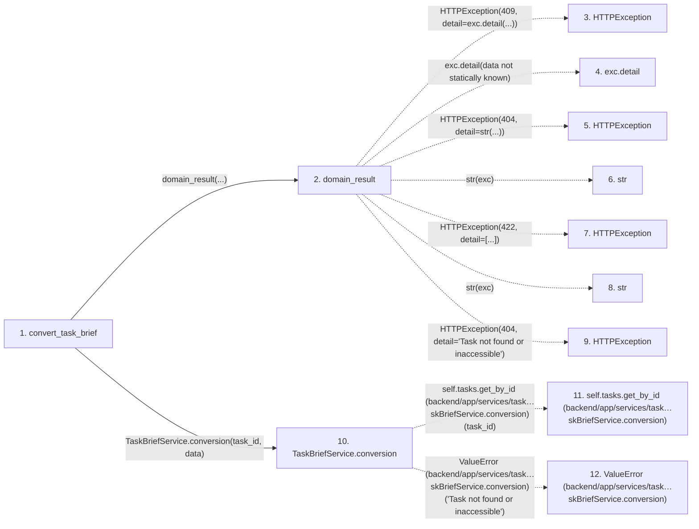

# convert_task_brief

**Entry point:** `convert_task_brief` (`http`)
**Source:** [routers_task_domain](../modules/routers_task_domain.md)
**Modules touched:** [authority](../modules/authority.md), [commands](../modules/commands.md), [config](../modules/config.md), [delivery_dependency_service](../modules/delivery_dependency_service.md), and 13 more

**Complete modules touched:**

- [authority](../modules/authority.md)
- [commands](../modules/commands.md)
- [config](../modules/config.md)
- [delivery_dependency_service](../modules/delivery_dependency_service.md)
- [discussion_service](../modules/discussion_service.md)
- [identity_service](../modules/identity_service.md)
- [models_outbound_webhook](../modules/models_outbound_webhook.md)
- [models_task_brief](../modules/models_task_brief.md)
- [mutation_versions](../modules/mutation_versions.md)
- [review_provenance](../modules/review_provenance.md)
- [routers_task_domain](../modules/routers_task_domain.md)
- [snapshot_service](../modules/snapshot_service.md)
- [task_brief_service](../modules/task_brief_service.md)
- [task_reactivation_service](../modules/task_reactivation_service.md)
- [task_routing](../modules/task_routing.md)
- [task_routing_service](../modules/task_routing_service.md)
- [task_service](../modules/task_service.md)

## Call sequence

> Static overview in presentation order, not runtime execution order. Arrows retain captured callers; representative internal continuations and boundary examples precede repeated helper detail.

```mermaid
sequenceDiagram
    participant p0 as convert_task_brief
    participant p1 as TaskBriefService.conversion
    participant p2 as domain_result
    participant p3 as TaskBriefService
    participant p4 as command_transaction
    participant p5 as TaskBriefService._locked
    participant p6 as TaskBriefService.apply_brief
    participant p7 as require_project
    participant p8 as process_reactivation_checks
    participant p9 as resolve_routing
    participant p10 as DeliveryDependencyService.reconcile
    participant p11 as DiscussionService.enqueue
    participant p12 as render_brief
    participant p13 as enforce_routing
    participant p14 as check_routing
    participant p15 as ReactivationService.evaluate_waiting
    participant p16 as render_routing
    participant p17 as _remember
    participant p18 as DeliveryDependencyService.validate_cycles
    participant p19 as DiscussionService.recipient_authorized
    participant p20 as TaskService.reserve_task_version
    participant p21 as clear_execution_evidence
    participant p22 as DeliveryDependencyService.graph
    participant p23 as lock_iterations
    participant p24 as project_policy
    participant p25 as IdentityService.context
    participant p26 as assignee_models
    participant p27 as ReactivationService._evaluate_isolated
    participant p28 as _contributor_publishers
    participant p29 as HTTPException
    participant p30 as self.tasks.get_by_id (backend/app/services/task…skBriefService.conversion)
    p0->>p1: TaskBriefService.conversion
    p0->>p2: domain_result
    p0->>p3: TaskBriefService
    p1->>p4: command_transaction
    p1->>p5: TaskBriefService._locked
    p1->>p6: TaskBriefService.apply_brief
    p6->>p7: require_project
    p4->>p8: process_reactivation_checks
    p6->>p9: resolve_routing
    p4->>p10: DeliveryDependencyService.reconcile
    p4->>p11: DiscussionService.enqueue
    p6->>p12: render_brief
    p6->>p13: enforce_routing
    p13->>p14: check_routing
    p8->>p15: ReactivationService.evaluate_waiting
    p12->>p16: render_routing
    p13->>p17: _remember
    p10->>p18: DeliveryDependencyService.validate_cycles
    p11->>p19: DiscussionService.recipient_authorized
    p10->>p20: TaskService.reserve_task_version
    p10->>p21: clear_execution_evidence
    p18->>p22: DeliveryDependencyService.graph
    p20->>p23: lock_iterations
    p14->>p24: project_policy
    p19->>p25: IdentityService.context
    p14->>p26: assignee_models
    p15->>p27: ReactivationService._evaluate_isolated
    p14->>p28: _contributor_publishers
    p2-->>p29: HTTPException(409, detail=exc.detail(...))
    p1-->>p30: self.tasks.get_by_id (backend/app/services/task…skBriefService.conversion)(task_id)
```

<!-- Auto-generated from static call edges. Dashed arrows are external or unresolved calls. Reviewed runtime conditions and side effects belong in Behavior. -->

> Call sequence diagram shows 30 of 569 interactions; 539 omitted to keep the visualization within the 30-interaction and generated-diagram limits, with uncertain identities omitted rather than inferred.

> Captured boundary calls: external 1 of 115 (114 omitted); unresolved 1 of 329 (328 omitted). These counts cover the captured static trace.

Omitted captured detail, grouped by actual caller occurrence and target module:

| Caller | Parent step | Target module | Kind | Omitted interactions |
| --- | --- | --- | --- | --- |
| `backend/app/routers/task_domain.py:domain_result` | 2 | - | unresolved | 1 |
| `backend/app/routers/task_domain.py:domain_result` | 2 | - | external | 5 |
| `backend/app/services/task_brief_service.py:TaskBriefService.conversion` | 10 | - | external | 1 |
| `backend/app/services/task_brief_service.py:TaskBriefService.conversion` | 10 | - | unresolved | 2 |
| `backend/app/services/task_brief_service.py:TaskBriefService.conversion` | 10 | [backend/app/services/task_brief_service.py](../modules/task_brief_service.md) | internal | 2 |
| `backend/app/services/task_brief_service.py:import_legacy_brief` | 14 | - | external | 10 |
| `backend/app/services/task_brief_service.py:import_legacy_brief` | 14 | - | unresolved | 23 |
| `backend/app/commands.py:command_transaction` | 48 | [backend/app/commands.py](../modules/commands.md) | internal | 2 |
> Omission summary shows 8 of 111 groups; 103 further groups are not expanded here. Counts above include all omitted interactions.
> Detailed flow queries retain their own coverage and limits; omitted paths may execute at runtime.

> Trace truncated at the depth limit; deeper calls are omitted.

## Data flow

<!-- Auto-generated static analysis. Treat values and boundaries as best-effort hints, not runtime proof. -->

### Analysis coverage

**Effect analysis partially available.** Flow assembly and source effect analysis are separate; empty observations do not prove an empty handler body.

Source steps: 126; effect analysis evaluated: 87, partial: 4, unavailable: 35. Counts include steps omitted from the displayed trace.

Collector observations for 91 source steps with known totals: observed: 532, emitted: 522, omitted: 10. Unavailable totals are excluded.

- Callable record unavailable for one or more source steps; those steps have no represented callable body.
- Effect collector omitted observations before flow assembly; displayed effects are partial.
- Effect collector totals unavailable; observed counts cover captured records only.

| Step | Callable record | Effect analysis | Collector totals | Observed | Emitted | Omitted |
|---|---|---|---|---:|---:|---:|
| `convert_task_brief` | `available` | `evaluated` | `available` | `4` | `4` | `0` |
| `domain_result` | `available` | `evaluated` | `available` | `3` | `3` | `0` |
| `HTTPException` | `not_applicable` | `not_applicable` | `not_applicable` | — | — | — |
| `exc.detail` | `not_applicable` | `not_applicable` | `not_applicable` | — | — | — |
| `HTTPException` | `not_applicable` | `not_applicable` | `not_applicable` | — | — | — |
| `str` | `not_applicable` | `not_applicable` | `not_applicable` | — | — | — |
| `HTTPException` | `not_applicable` | `not_applicable` | `not_applicable` | — | — | — |
| `str` | `not_applicable` | `not_applicable` | `not_applicable` | — | — | — |
| `HTTPException` | `not_applicable` | `not_applicable` | `not_applicable` | — | — | — |
| `TaskBriefService.conversion` | `available` | `evaluated` | `available` | `6` | `6` | `0` |
| `self.tasks.get_by_id (backend/app/services/task…skBriefService.conversion)` | `not_applicable` | `not_applicable` | `not_applicable` | — | — | — |
| `ValueError (backend/app/services/task…skBriefService.conversion)` | `not_applicable` | `not_applicable` | `not_applicable` | — | — | — |

### Step data

| Step | Inputs | Reads | Writes | Returns |
|---|---|---|---|---|
| `convert_task_brief` | `task_id: int`, `data: BriefConvert`, `db: DB` | - | - | `...` |
| `domain_result` | `awaitable` | `TaskVersionConflictError` | - | `result` |
| `HTTPException` | - | - | - | - |
| `exc.detail` | - | - | - | - |
| `HTTPException` | - | - | - | - |
| `str` | - | - | - | - |
| `HTTPException` | - | - | - | - |
| `str` | - | - | - | - |
| `HTTPException` | - | - | - | - |
| `TaskBriefService.conversion` | `task_id`, `data` | `self.db` | `task.brief_migration_notes` | `{...}`, `{...}` |
| `self.tasks.get_by_id (backend/app/services/task…skBriefService.conversion)` | - | - | - | - |
| `ValueError (backend/app/services/task…skBriefService.conversion)` | - | - | - | - |

### Call data

| From | To | Line | Call |
|---|---|---:|---|
| convert_task_brief | domain_result | 260 | `domain_result(...)` |
| domain_result | HTTPException | 56 | `HTTPException(409, detail=exc.detail(...))` |
| domain_result | exc.detail | 56 | `exc.detail(data not statically known)` |
| domain_result | HTTPException | 58 | `HTTPException(404, detail=str(...))` |
| domain_result | str | 58 | `str(exc)` |
| domain_result | HTTPException | 60 | `HTTPException(422, detail=[...])` |
| domain_result | str | 60 | `str(exc)` |
| domain_result | HTTPException | 62 | `HTTPException(404, detail='Task not found or inaccessible')` |
| convert_task_brief | TaskBriefService.conversion | 260 | `TaskBriefService(db).conversion(task_id, data)` |
| TaskBriefService.conversion | self.tasks.get_by_id (backend/app/services/task…skBriefService.conversion) | 313 | `self.tasks.get_by_id(task_id)` |
| TaskBriefService.conversion | ValueError (backend/app/services/task…skBriefService.conversion) | 315 | `ValueError('Task not found or inaccessible')` |

### Boundary effects

*No boundary-effect observations were captured in this static trace.*

### Static analysis gaps

| Kind | Step | Target | Line |
|---|---|---|---:|
| external_call | `domain_result` | `HTTPException` | 56 |
| unresolved_call | `domain_result` | `exc.detail` | 56 |
| external_call | `domain_result` | `HTTPException` | 58 |
| external_call | `domain_result` | `HTTPException` | 60 |
| external_call | `domain_result` | `HTTPException` | 62 |
| unresolved_call | `TaskBriefService.conversion` | `self.tasks.get_by_id` | 313 |
| external_call | `TaskBriefService.conversion` | `ValueError` | 315 |
| step_limit | `convert_task_brief` | `first 12 steps` | 0 |
| truncated_flow | `convert_task_brief` | `depth limit` | 0 |

## Behavior

This flow starts at `convert_task_brief` and is classified as `http`. The generated call and data-flow sections are bounded static projections; runtime conditions and side effects require source-level confirmation.
