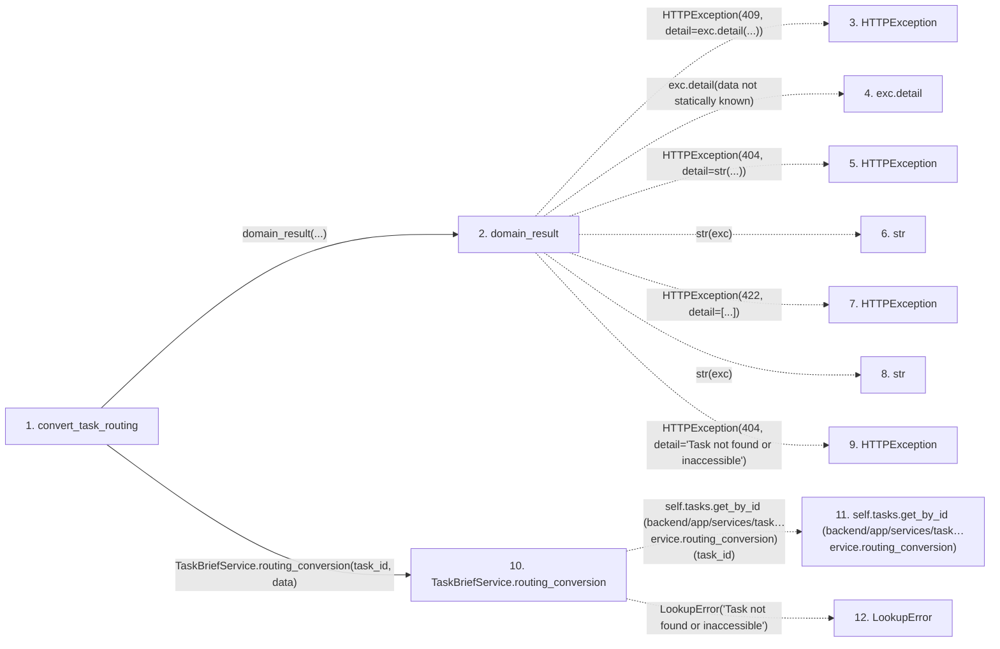

# convert_task_routing

**Entry point:** `convert_task_routing` (`http`)
**Source:** [routers_task_domain](../modules/routers_task_domain.md)
**Modules touched:** [authority](../modules/authority.md), [commands](../modules/commands.md), [config](../modules/config.md), [delivery_dependency_service](../modules/delivery_dependency_service.md), and 14 more

**Complete modules touched:**

- [authority](../modules/authority.md)
- [commands](../modules/commands.md)
- [config](../modules/config.md)
- [delivery_dependency_service](../modules/delivery_dependency_service.md)
- [discussion_service](../modules/discussion_service.md)
- [identity_service](../modules/identity_service.md)
- [models_outbound_webhook](../modules/models_outbound_webhook.md)
- [models_task_brief](../modules/models_task_brief.md)
- [mutation_versions](../modules/mutation_versions.md)
- [review_provenance](../modules/review_provenance.md)
- [routers_task_domain](../modules/routers_task_domain.md)
- [snapshot_service](../modules/snapshot_service.md)
- [task_brief_service](../modules/task_brief_service.md)
- [task_reactivation_service](../modules/task_reactivation_service.md)
- [task_replacement_service](../modules/task_replacement_service.md)
- [task_routing](../modules/task_routing.md)
- [task_routing_service](../modules/task_routing_service.md)
- [task_service](../modules/task_service.md)

## Call sequence

> Static overview in presentation order, not runtime execution order. Arrows retain captured callers; representative internal continuations and boundary examples precede repeated helper detail.

```mermaid
sequenceDiagram
    participant p0 as convert_task_routing
    participant p1 as TaskBriefService.routing_conversion
    participant p2 as domain_result
    participant p3 as TaskBriefService
    participant p4 as convert_text_routing
    participant p5 as command_transaction
    participant p6 as TaskBriefService._locked
    participant p7 as parse_text_routing
    participant p8 as process_reactivation_checks
    participant p9 as _remove_first
    participant p10 as DeliveryDependencyService.reconcile
    participant p11 as DiscussionService.enqueue
    participant p12 as resolve_routing
    participant p13 as check_routing
    participant p14 as TaskBriefService.apply_brief
    participant p15 as require_project
    participant p16 as project_policy
    participant p17 as ReactivationService.evaluate_waiting
    participant p18 as assignee_models
    participant p19 as _contributor_publishers
    participant p20 as DeliveryDependencyService.validate_cycles
    participant p21 as _rung_from
    participant p22 as _issues
    participant p23 as DiscussionService.recipient_authorized
    participant p24 as suggest_routing
    participant p25 as render_brief
    participant p26 as enforce_routing
    participant p27 as TaskService.reserve_task_version
    participant p28 as clear_execution_evidence
    participant p29 as HTTPException
    participant p30 as self.tasks.get_by_id (backend/app/services/task…ervice.routing_conversion)
    p0->>p1: TaskBriefService.routing_conversion
    p0->>p2: domain_result
    p0->>p3: TaskBriefService
    p1->>p4: convert_text_routing
    p1->>p5: command_transaction
    p1->>p6: TaskBriefService._locked
    p4->>p7: parse_text_routing
    p5->>p8: process_reactivation_checks
    p4->>p9: _remove_first
    p5->>p10: DeliveryDependencyService.reconcile
    p5->>p11: DiscussionService.enqueue
    p4->>p12: resolve_routing
    p4->>p13: check_routing
    p4->>p14: TaskBriefService.apply_brief
    p14->>p15: require_project
    p13->>p16: project_policy
    p8->>p17: ReactivationService.evaluate_waiting
    p13->>p18: assignee_models
    p13->>p19: _contributor_publishers
    p10->>p20: DeliveryDependencyService.validate_cycles
    p7->>p21: _rung_from
    p13->>p22: _issues
    p11->>p23: DiscussionService.recipient_authorized
    p13->>p24: suggest_routing
    p14->>p25: render_brief
    p14->>p26: enforce_routing
    p10->>p27: TaskService.reserve_task_version
    p10->>p28: clear_execution_evidence
    p2-->>p29: HTTPException(409, detail=exc.detail(...))
    p1-->>p30: self.tasks.get_by_id (backend/app/services/task…ervice.routing_conversion)(task_id)
```

<!-- Auto-generated from static call edges. Dashed arrows are external or unresolved calls. Reviewed runtime conditions and side effects belong in Behavior. -->

> Call sequence diagram shows 30 of 693 interactions; 663 omitted to keep the visualization within the 30-interaction and generated-diagram limits, with uncertain identities omitted rather than inferred.

> Captured boundary calls: external 1 of 136 (135 omitted); unresolved 1 of 405 (404 omitted). These counts cover the captured static trace.

Omitted captured detail, grouped by actual caller occurrence and target module:

| Caller | Parent step | Target module | Kind | Omitted interactions |
| --- | --- | --- | --- | --- |
| `backend/app/routers/task_domain.py:domain_result` | 2 | - | unresolved | 1 |
| `backend/app/routers/task_domain.py:domain_result` | 2 | - | external | 5 |
| `backend/app/services/task_brief_service.py:TaskBriefService.routing_conversion` | 10 | - | external | 1 |
| `backend/app/services/task_brief_service.py:TaskBriefService.routing_conversion` | 10 | - | unresolved | 2 |
| `backend/app/services/task_routing_service.py:convert_text_routing` | 14 | - | external | 9 |
| `backend/app/services/task_routing_service.py:convert_text_routing` | 14 | - | unresolved | 10 |
| `backend/app/services/task_routing_service.py:convert_text_routing` | 14 | [backend/app/services/task_routing_service.py](../modules/task_routing_service.md) | internal | 2 |
| `backend/app/services/task_routing_service.py:catalog_entries` | 19 | - | external | 3 |
> Omission summary shows 8 of 135 groups; 127 further groups are not expanded here. Counts above include all omitted interactions.
> Detailed flow queries retain their own coverage and limits; omitted paths may execute at runtime.

> Trace truncated at the depth limit; deeper calls are omitted.

## Data flow

<!-- Auto-generated static analysis. Treat values and boundaries as best-effort hints, not runtime proof. -->

### Analysis coverage

**Effect analysis partially available.** Flow assembly and source effect analysis are separate; empty observations do not prove an empty handler body.

Source steps: 153; effect analysis evaluated: 105, partial: 6, unavailable: 42. Counts include steps omitted from the displayed trace.

Collector observations for 111 source steps with known totals: observed: 654, emitted: 641, omitted: 13. Unavailable totals are excluded.

- Callable record unavailable for one or more source steps; those steps have no represented callable body.
- Effect collector omitted observations before flow assembly; displayed effects are partial.
- Effect collector totals unavailable; observed counts cover captured records only.

| Step | Callable record | Effect analysis | Collector totals | Observed | Emitted | Omitted |
|---|---|---|---|---:|---:|---:|
| `convert_task_routing` | `available` | `evaluated` | `available` | `4` | `4` | `0` |
| `domain_result` | `available` | `evaluated` | `available` | `3` | `3` | `0` |
| `HTTPException` | `not_applicable` | `not_applicable` | `not_applicable` | — | — | — |
| `exc.detail` | `not_applicable` | `not_applicable` | `not_applicable` | — | — | — |
| `HTTPException` | `not_applicable` | `not_applicable` | `not_applicable` | — | — | — |
| `str` | `not_applicable` | `not_applicable` | `not_applicable` | — | — | — |
| `HTTPException` | `not_applicable` | `not_applicable` | `not_applicable` | — | — | — |
| `str` | `not_applicable` | `not_applicable` | `not_applicable` | — | — | — |
| `HTTPException` | `not_applicable` | `not_applicable` | `not_applicable` | — | — | — |
| `TaskBriefService.routing_conversion` | `available` | `evaluated` | `available` | `7` | `7` | `0` |
| `self.tasks.get_by_id (backend/app/services/task…ervice.routing_conversion)` | `not_applicable` | `not_applicable` | `not_applicable` | — | — | — |
| `LookupError` | `not_applicable` | `not_applicable` | `not_applicable` | — | — | — |

### Step data

| Step | Inputs | Reads | Writes | Returns |
|---|---|---|---|---|
| `convert_task_routing` | `task_id: int`, `data: RoutingConvert`, `db: DB` | - | - | `...` |
| `domain_result` | `awaitable` | `TaskVersionConflictError` | - | `result` |
| `HTTPException` | - | - | - | - |
| `exc.detail` | - | - | - | - |
| `HTTPException` | - | - | - | - |
| `str` | - | - | - | - |
| `HTTPException` | - | - | - | - |
| `str` | - | - | - | - |
| `HTTPException` | - | - | - | - |
| `TaskBriefService.routing_conversion` | `task_id`, `data` | `self.db`, `self.db`, `self.db` | - | `...`, `result` |
| `self.tasks.get_by_id (backend/app/services/task…ervice.routing_conversion)` | - | - | - | - |
| `LookupError` | - | - | - | - |

### Call data

| From | To | Line | Call |
|---|---|---:|---|
| convert_task_routing | domain_result | 273 | `domain_result(...)` |
| domain_result | HTTPException | 56 | `HTTPException(409, detail=exc.detail(...))` |
| domain_result | exc.detail | 56 | `exc.detail(data not statically known)` |
| domain_result | HTTPException | 58 | `HTTPException(404, detail=str(...))` |
| domain_result | str | 58 | `str(exc)` |
| domain_result | HTTPException | 60 | `HTTPException(422, detail=[...])` |
| domain_result | str | 60 | `str(exc)` |
| domain_result | HTTPException | 62 | `HTTPException(404, detail='Task not found or inaccessible')` |
| convert_task_routing | TaskBriefService.routing_conversion | 273 | `TaskBriefService(db).routing_conversion(task_id, data)` |
| TaskBriefService.routing_conversion | self.tasks.get_by_id (backend/app/services/task…ervice.routing_conversion) | 349 | `self.tasks.get_by_id(task_id)` |
| TaskBriefService.routing_conversion | LookupError | 351 | `LookupError('Task not found or inaccessible')` |

### Boundary effects

*No boundary-effect observations were captured in this static trace.*

### Static analysis gaps

| Kind | Step | Target | Line |
|---|---|---|---:|
| external_call | `domain_result` | `HTTPException` | 56 |
| unresolved_call | `domain_result` | `exc.detail` | 56 |
| external_call | `domain_result` | `HTTPException` | 58 |
| external_call | `domain_result` | `HTTPException` | 60 |
| external_call | `domain_result` | `HTTPException` | 62 |
| unresolved_call | `TaskBriefService.routing_conversion` | `self.tasks.get_by_id` | 349 |
| external_call | `TaskBriefService.routing_conversion` | `LookupError` | 351 |
| step_limit | `convert_task_routing` | `first 12 steps` | 0 |
| truncated_flow | `convert_task_routing` | `depth limit` | 0 |

## Behavior

Moves routing that a brief names in free text (first rung, escalation, reviewer) into the brief's structured routing. Without `apply` it returns a preview with the structure the conversion parsed and the sentences it would remove; an ambiguous model can be settled by supplying the routing to use. With `apply` it saves the structured routing through the brief with the caller's expected version and removes the replaced sentences, keeping them as audit-only source text. Removing sentences from the brief text is a substantive brief edit, so applying such a conversion can reset the task's progress; the response reports this as `resets_progress`. A brief with nothing to convert is reported as such and not changed.
