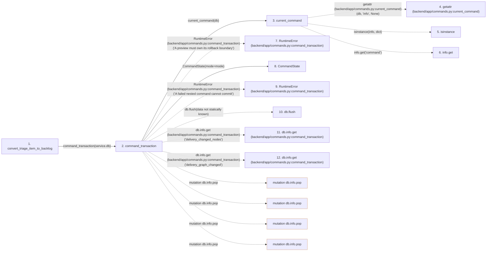

# convert_triage_item_to_backlog

**Entry point:** `convert_triage_item_to_backlog` (`http`)
**Source:** [routers_triage](../modules/routers_triage.md)
**Modules touched:** [authority](../modules/authority.md), [commands](../modules/commands.md), [config](../modules/config.md), [delivery_dependency_service](../modules/delivery_dependency_service.md), and 9 more

**Complete modules touched:**

- [authority](../modules/authority.md)
- [commands](../modules/commands.md)
- [config](../modules/config.md)
- [delivery_dependency_service](../modules/delivery_dependency_service.md)
- [discussion_service](../modules/discussion_service.md)
- [identity_service](../modules/identity_service.md)
- [models_outbound_webhook](../modules/models_outbound_webhook.md)
- [mutation_versions](../modules/mutation_versions.md)
- [routers_task_domain](../modules/routers_task_domain.md)
- [routers_triage](../modules/routers_triage.md)
- [schemas_triage](../modules/schemas_triage.md)
- [task_brief_service](../modules/task_brief_service.md)
- [task_service](../modules/task_service.md)

## Call sequence

> Static overview in presentation order, not runtime execution order. Arrows retain captured callers; representative internal continuations and boundary examples precede repeated helper detail.

```mermaid
sequenceDiagram
    participant p0 as convert_triage_item_to_backlog
    participant p1 as command_transaction
    participant p2 as domain_result
    participant p3 as TriageConvertToTaskResponse
    participant p4 as DeliveryDependencyService.reconcile
    participant p5 as DiscussionService.enqueue
    participant p6 as DeliveryDependencyService.validate_cycles
    participant p7 as DiscussionService.recipient_authorized
    participant p8 as TaskService.reserve_task_version
    participant p9 as clear_execution_evidence
    participant p10 as DeliveryDependencyService.graph
    participant p11 as lock_iterations
    participant p12 as IdentityService.context
    participant p13 as lock_planning
    participant p14 as require_mutation_revision
    participant p15 as current_command
    participant p16 as CommandState
    participant p17 as DeliveryDependencyService
    participant p18 as DiscussionService
    participant p19 as internal_authority
    participant p20 as PlanningConflict
    participant p21 as OutboundWebhookEvent
    participant p22 as OutboundWebhookDelivery
    participant p23 as TaskService
    participant p24 as clear_acceptance
    participant p25 as TaskVersionConflictError
    participant p26 as TaskService._metadata_from_task
    participant p27 as IdentityService
    participant p28 as TaskService._current_task_metadata
    participant p29 as HTTPException (backend/app/routers/triag…rt_triage_item_to_backlog)
    participant p30 as service.convert_to_task
    p0->>p1: command_transaction
    p0->>p2: domain_result
    p0->>p3: TriageConvertToTaskResponse
    p1->>p4: DeliveryDependencyService.reconcile
    p1->>p5: DiscussionService.enqueue
    p4->>p6: DeliveryDependencyService.validate_cycles
    p5->>p7: DiscussionService.recipient_authorized
    p4->>p8: TaskService.reserve_task_version
    p4->>p9: clear_execution_evidence
    p6->>p10: DeliveryDependencyService.graph
    p8->>p11: lock_iterations
    p7->>p12: IdentityService.context
    p11->>p13: lock_planning
    p11->>p14: require_mutation_revision
    p1->>p15: current_command
    p1->>p16: CommandState
    p1->>p17: DeliveryDependencyService
    p1->>p18: DiscussionService
    p5->>p19: internal_authority
    p4->>p20: PlanningConflict
    p5->>p21: OutboundWebhookEvent
    p5->>p22: OutboundWebhookDelivery
    p4->>p23: TaskService
    p9->>p24: clear_acceptance
    p8->>p25: TaskVersionConflictError
    p8->>p26: TaskService._metadata_from_task
    p7->>p27: IdentityService
    p8->>p28: TaskService._current_task_metadata
    p0-->>p29: HTTPException (backend/app/routers/triag…rt_triage_item_to_backlog)(409, detail=str(...))
    p0-->>p30: service.convert_to_task(triage_item_id, data)
```

<!-- Auto-generated from static call edges. Dashed arrows are external or unresolved calls. Reviewed runtime conditions and side effects belong in Behavior. -->

> Call sequence diagram shows 30 of 247 interactions; 217 omitted to keep the visualization within the 30-interaction and generated-diagram limits, with uncertain identities omitted rather than inferred.

> Captured boundary calls: external 1 of 63 (62 omitted); unresolved 1 of 133 (132 omitted). These counts cover the captured static trace.

Omitted captured detail, grouped by actual caller occurrence and target module:

| Caller | Parent step | Target module | Kind | Omitted interactions |
| --- | --- | --- | --- | --- |
| `backend/app/commands.py:current_command` | 3 | - | external | 2 |
| `backend/app/commands.py:current_command` | 3 | - | unresolved | 1 |
| `backend/app/commands.py:command_transaction` | 2 | - | external | 4 |
| `backend/app/commands.py:command_transaction` | 2 | - | unresolved | 12 |
| `backend/app/services/delivery_dependency_service.py:DeliveryDependencyService.reconcile` | 14 | - | unresolved | 23 |
| `backend/app/services/delivery_dependency_service.py:DeliveryDependencyService.reconcile` | 14 | - | external | 10 |
| `backend/app/services/delivery_dependency_service.py:DeliveryDependencyService.reconcile` | 14 | [backend/app/authority.py](../modules/authority.md) | internal | 3 |
| `backend/app/authority.py:internal_authority` | 20 | - | unresolved | 1 |
> Omission summary shows 8 of 46 groups; 38 further groups are not expanded here. Counts above include all omitted interactions.
> Detailed flow queries retain their own coverage and limits; omitted paths may execute at runtime.

> Trace truncated at the depth limit; deeper calls are omitted.

## Data flow

<!-- Auto-generated static analysis. Treat values and boundaries as best-effort hints, not runtime proof. -->

### Analysis coverage

**Effect analysis partially available.** Flow assembly and source effect analysis are separate; empty observations do not prove an empty handler body.

Source steps: 52; effect analysis evaluated: 32, partial: 0, unavailable: 20. Counts include steps omitted from the displayed trace.

Collector observations for 32 source steps with known totals: observed: 140, emitted: 140, omitted: 0. Unavailable totals are excluded.

- Callable record unavailable for one or more source steps; those steps have no represented callable body.
- Effect collector totals unavailable; observed counts cover captured records only.

| Step | Callable record | Effect analysis | Collector totals | Observed | Emitted | Omitted |
|---|---|---|---|---:|---:|---:|
| `convert_triage_item_to_backlog` | `available` | `evaluated` | `available` | `5` | `5` | `0` |
| `command_transaction` | `available` | `evaluated` | `available` | `10` | `10` | `0` |
| `current_command` | `available` | `evaluated` | `available` | `2` | `2` | `0` |
| `getattr (backend/app/commands.py:current_command)` | `not_applicable` | `not_applicable` | `not_applicable` | — | — | — |
| `isinstance` | `not_applicable` | `not_applicable` | `not_applicable` | — | — | — |
| `info.get` | `not_applicable` | `not_applicable` | `not_applicable` | — | — | — |
| `RuntimeError (backend/app/commands.py:command_transaction)` | `not_applicable` | `not_applicable` | `not_applicable` | — | — | — |
| `CommandState` | `unavailable` | `unavailable` | `unavailable` | — | — | — |
| `RuntimeError (backend/app/commands.py:command_transaction)` | `not_applicable` | `not_applicable` | `not_applicable` | — | — | — |
| `db.flush` | `not_applicable` | `not_applicable` | `not_applicable` | — | — | — |
| `db.info.get (backend/app/commands.py:command_transaction)` | `not_applicable` | `not_applicable` | `not_applicable` | — | — | — |
| `db.info.get (backend/app/commands.py:command_transaction)` | `not_applicable` | `not_applicable` | `not_applicable` | — | — | — |

### Step data

| Step | Inputs | Reads | Writes | Returns |
|---|---|---|---|---|
| `convert_triage_item_to_backlog` | `triage_item_id: int`, `data: TriageConvertToBacklogRequest`, `service: Annotated[TriageService, Depends(get_triage_service)]` | `TriageConflictError` | - | `TriageConvertToTaskResponse(...)` |
| `command_transaction` | `db: AsyncSession`, `mode`, `commit` | - | `previous.failed`, `db.info[...]` | `none` |
| `current_command` | `db` | - | - | `...` |
| `getattr (backend/app/commands.py:current_command)` | - | - | - | - |
| `isinstance` | - | - | - | - |
| `info.get` | - | - | - | - |
| `RuntimeError (backend/app/commands.py:command_transaction)` | - | - | - | - |
| `CommandState` | - | - | - | - |
| `RuntimeError (backend/app/commands.py:command_transaction)` | - | - | - | - |
| `db.flush` | - | - | - | - |
| `db.info.get (backend/app/commands.py:command_transaction)` | - | - | - | - |
| `db.info.get (backend/app/commands.py:command_transaction)` | - | - | - | - |

### Call data

| From | To | Line | Call |
|---|---|---:|---|
| convert_triage_item_to_backlog | command_transaction | 387 | `command_transaction(service.db)` |
| command_transaction | current_command | 87 | `current_command(db)` |
| current_command | getattr (backend/app/commands.py:current_command) | 73 | `getattr(db, 'info', None)` |
| current_command | isinstance | 74 | `isinstance(info, dict)` |
| current_command | info.get | 74 | `info.get('command')` |
| command_transaction | RuntimeError (backend/app/commands.py:command_transaction) | 90 | `RuntimeError('A preview must own its rollback boundary')` |
| command_transaction | CommandState | 97 | `CommandState(mode=mode)` |
| command_transaction | RuntimeError (backend/app/commands.py:command_transaction) | 102 | `RuntimeError('A failed nested command cannot commit')` |
| command_transaction | db.flush | 103 | `db.flush(data not statically known)` |
| command_transaction | db.info.get (backend/app/commands.py:command_transaction) | 104 | `db.info.get('delivery_changed_nodes')` |
| command_transaction | db.info.get (backend/app/commands.py:command_transaction) | 104 | `db.info.get('delivery_graph_changed')` |

### Boundary effects

| Kind | Target | Step | Line |
|---|---|---|---:|
| mutation | `db.info.pop` | `command_transaction` | 107 |
| mutation | `db.info.pop` | `command_transaction` | 120 |
| mutation | `db.info.pop` | `command_transaction` | 121 |
| mutation | `db.info.pop` | `command_transaction` | 123 |

### Static analysis gaps

| Kind | Step | Target | Line |
|---|---|---|---:|
| external_call | `current_command` | `getattr` | 73 |
| external_call | `current_command` | `isinstance` | 74 |
| unresolved_call | `current_command` | `info.get` | 74 |
| external_call | `command_transaction` | `RuntimeError` | 90 |
| external_call | `command_transaction` | `RuntimeError` | 102 |
| unresolved_call | `command_transaction` | `db.flush` | 103 |
| unresolved_call | `command_transaction` | `db.info.get` | 104 |
| step_limit | `convert_triage_item_to_backlog` | `first 12 steps` | 0 |
| truncated_flow | `convert_triage_item_to_backlog` | `depth limit` | 0 |

## Behavior

This flow starts at `convert_triage_item_to_backlog` and is classified as `http`. The generated call and data-flow sections are bounded static projections; runtime conditions and side effects require source-level confirmation.
