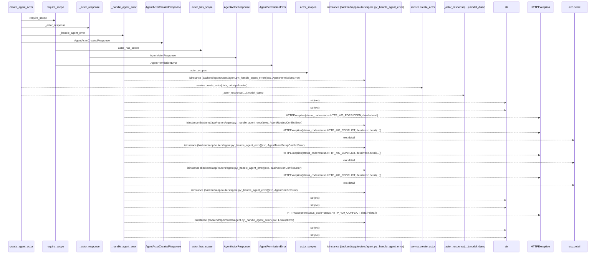
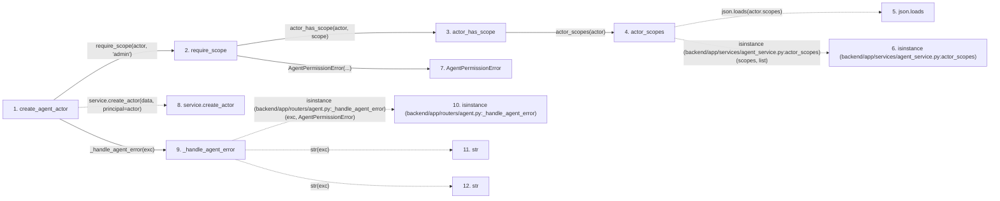

# create_agent_actor

**Entry point:** `create_agent_actor` (`http`)
**Source:** [routers_agent](../modules/routers_agent.md)
**Modules touched:** [agent_service](../modules/agent_service.md), [routers_agent](../modules/routers_agent.md), [schemas_agent](../modules/schemas_agent.md)

## Call sequence

> Static overview in presentation order, not runtime execution order. Arrows retain captured callers; representative internal continuations and boundary examples precede repeated helper detail.

<!-- Auto-generated from static call edges. Dashed arrows are external or unresolved calls. Reviewed runtime conditions and side effects belong in Behavior. -->

> Call sequence diagram shows 30 of 38 interactions; 8 omitted to keep the visualization within the 30-interaction and generated-diagram limits, with uncertain identities omitted rather than inferred.

> Captured boundary calls: external 17 of 24 (7 omitted); unresolved 5 of 5 (0 omitted). These counts cover the captured static trace.

Omitted captured detail, grouped by actual caller occurrence and target module:

| Caller | Parent step | Target module | Kind | Omitted interactions |
| --- | --- | --- | --- | --- |
| `backend/app/services/agent_service.py:actor_has_scope` | 3 | [backend/app/services/agent_service.py](../modules/agent_service.md) | internal | 1 |
| `backend/app/services/agent_service.py:actor_scopes` | 4 | - | external | 2 |
| `backend/app/routers/agent.py:_handle_agent_error` | 9 | - | external | 5 |
> Detailed flow queries retain their own coverage and limits; omitted paths may execute at runtime.

## Data flow

<!-- Auto-generated static analysis. Treat values and boundaries as best-effort hints, not runtime proof. -->

### Analysis coverage

**Effect analysis partially available.** Flow assembly and source effect analysis are separate; empty observations do not prove an empty handler body.

Source steps: 10; effect analysis evaluated: 6, partial: 1, unavailable: 3. Counts include steps omitted from the displayed trace.

Collector observations for 7 source steps with known totals: observed: 35, emitted: 31, omitted: 4. Unavailable totals are excluded.

- Callable record unavailable for one or more source steps; those steps have no represented callable body.
- Effect collector omitted observations before flow assembly; displayed effects are partial.
- Effect collector totals unavailable; observed counts cover captured records only.

| Step | Callable record | Effect analysis | Collector totals | Observed | Emitted | Omitted |
|---|---|---|---|---:|---:|---:|
| `create_agent_actor` | `available` | `evaluated` | `available` | `8` | `8` | `0` |
| `require_scope` | `available` | `evaluated` | `available` | `2` | `2` | `0` |
| `actor_has_scope` | `available` | `evaluated` | `available` | `3` | `3` | `0` |
| `actor_scopes` | `available` | `evaluated` | `available` | `3` | `3` | `0` |
| `json.loads` | `not_applicable` | `not_applicable` | `not_applicable` | — | — | — |
| `isinstance (backend/app/services/agent_service.py:actor_scopes)` | `not_applicable` | `not_applicable` | `not_applicable` | — | — | — |
| `AgentPermissionError` | `unavailable` | `unavailable` | `unavailable` | — | — | — |
| `service.create_actor` | `not_applicable` | `not_applicable` | `not_applicable` | — | — | — |
| `_handle_agent_error` | `available` | `partial` | `available` | `14` | `10` | `4` |
| `isinstance (backend/app/routers/agent.py:_handle_agent_error)` | `not_applicable` | `not_applicable` | `not_applicable` | — | — | — |
| `str` | `not_applicable` | `not_applicable` | `not_applicable` | — | — | — |
| `str` | `not_applicable` | `not_applicable` | `not_applicable` | — | — | — |

### Step data

| Step | Inputs | Reads | Writes | Returns |
|---|---|---|---|---|
| `create_agent_actor` | `data: AgentActorCreate`, `response: Response`, `actor: Annotated[AgentActor, Depends(get_agent_admin_actor)]`, `service: Annotated[AgentService, Depends(get_agent_service)]` | - | `response.headers[...]`, `response.headers[...]`, `response.headers[...]` | `AgentActorCreatedResponse(...)` |
| `require_scope` | `actor: AgentActor`, `scope: str` | - | - | - |
| `actor_has_scope` | `actor: AgentActor`, `scope: str` | - | - | `...` |
| `actor_scopes` | `actor: AgentActor` | `json` | - | `...` |
| `json.loads` | - | - | - | - |
| `isinstance (backend/app/services/agent_service.py:actor_scopes)` | - | - | - | - |
| `AgentPermissionError` | - | - | - | - |
| `service.create_actor` | - | - | - | - |
| `_handle_agent_error` | `exc: Exception`, `structured: bool` | `AgentPermissionError`, `status`, `AgentRoutingConflictError`, `status`, `AgentTeamSetupConflictError`, `status`, `TaskVersionConflictError`, `status` | - | - |
| `isinstance (backend/app/routers/agent.py:_handle_agent_error)` | - | - | - | - |
| `str` | - | - | - | - |
| `str` | - | - | - | - |

### Call data

| From | To | Line | Call |
|---|---|---:|---|
| create_agent_actor | require_scope | 575 | `require_scope(actor, 'admin')` |
| require_scope | actor_has_scope | 100 | `actor_has_scope(actor, scope)` |
| actor_has_scope | actor_scopes | 94 | `actor_scopes(actor)` |
| actor_scopes | json.loads | 86 | `json.loads(actor.scopes)` |
| actor_scopes | isinstance (backend/app/services/agent_service.py:actor_scopes) | 89 | `isinstance(scopes, list)` |
| require_scope | AgentPermissionError | 101 | `AgentPermissionError(...)` |
| create_agent_actor | service.create_actor | 576 | `service.create_actor(data, principal=actor)` |
| create_agent_actor | _handle_agent_error | 581 | `_handle_agent_error(exc)` |
| _handle_agent_error | isinstance (backend/app/routers/agent.py:_handle_agent_error) | 271 | `isinstance(exc, AgentPermissionError)` |
| _handle_agent_error | str | 273 | `str(exc)` |
| _handle_agent_error | str | 275 | `str(exc)` |

### Boundary effects

*No boundary-effect observations were captured in this static trace.*

### Static analysis gaps

| Kind | Step | Target | Line |
|---|---|---|---:|
| external_call | `actor_scopes` | `json.loads` | 86 |
| external_call | `actor_scopes` | `isinstance` | 89 |
| unresolved_call | `create_agent_actor` | `service.create_actor` | 576 |
| external_call | `_handle_agent_error` | `isinstance` | 271 |
| step_limit | `create_agent_actor` | `first 12 steps` | 0 |

## Behavior

This flow starts at `create_agent_actor` and is classified as `http`. The generated call and data-flow sections are bounded static projections; runtime conditions and side effects require source-level confirmation.
