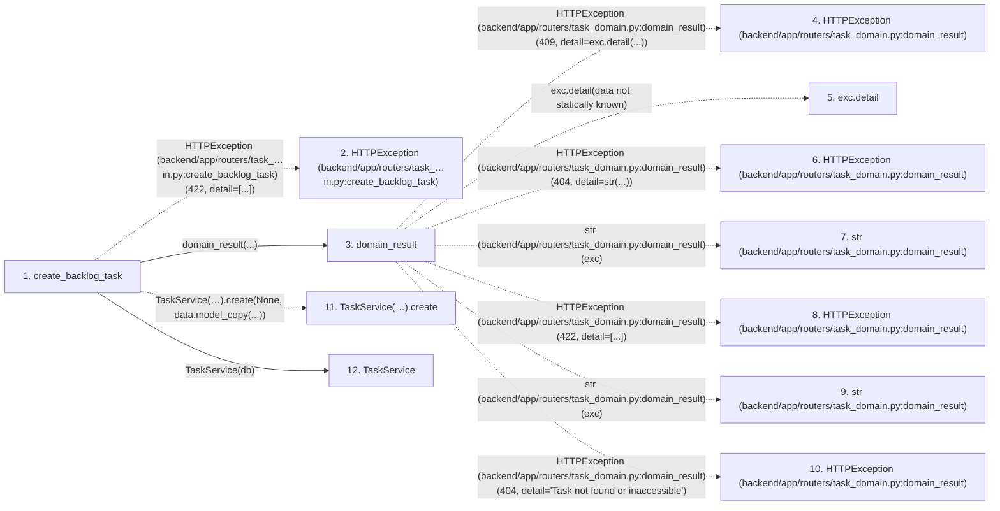

# create_backlog_task

**Entry point:** `create_backlog_task` (`http`)
**Source:** [routers_task_domain](../modules/routers_task_domain.md)
**Modules touched:** [agent_readiness](../modules/agent_readiness.md), [commands](../modules/commands.md), [external_link_service](../modules/external_link_service.md), [routers_task_domain](../modules/routers_task_domain.md), and 6 more

**Complete modules touched:**

- [agent_readiness](../modules/agent_readiness.md)
- [commands](../modules/commands.md)
- [external_link_service](../modules/external_link_service.md)
- [routers_task_domain](../modules/routers_task_domain.md)
- [schemas_external_link](../modules/schemas_external_link.md)
- [schemas_task](../modules/schemas_task.md)
- [services_work_metrics](../modules/services_work_metrics.md)
- [task_brief_service](../modules/task_brief_service.md)
- [task_service](../modules/task_service.md)
- [time](../modules/time.md)

## Call sequence

> Static overview in presentation order, not runtime execution order. Arrows retain captured callers; representative internal continuations and boundary examples precede repeated helper detail.

```mermaid
sequenceDiagram
    participant p0 as create_backlog_task
    participant p1 as TaskService.task_to_response
    participant p2 as domain_result
    participant p3 as TaskService
    participant p4 as task_signals
    participant p5 as evaluate_agent_readiness
    participant p6 as ExternalLinkService.task_links_to_response
    participant p7 as working_today
    participant p8 as ExternalLinkService.link_to_response
    participant p9 as ExternalLinkService.legacy_task_link_response
    participant p10 as _add_criterion
    participant p11 as current_command
    participant p12 as TaskAssignee
    participant p13 as TaskProject
    participant p14 as TaskMilestone
    participant p15 as TaskClaimedBy
    participant p16 as TaskResponse
    participant p17 as ExternalLinkService
    participant p18 as utc_now
    participant p19 as effective_work_flags
    participant p20 as _dependency_task
    participant p21 as as_utc
    participant p22 as brief_definition_blockers
    participant p23 as _description_is_actionable
    participant p24 as TaskAgentReadiness
    participant p25 as ExternalLinkResponse
    participant p26 as TaskAgentReadinessCriterion
    participant p27 as HTTPException (backend/app/routers/task_…in.py:create_backlog_task)
    participant p28 as TaskService(…).create
    participant p29 as data.model_copy
    participant p30 as HTTPException (backend/app/routers/task_domain.py:domain_result)
    p0->>p1: TaskService.task_to_response
    p0->>p2: domain_result
    p0->>p3: TaskService
    p1->>p4: task_signals
    p1->>p5: evaluate_agent_readiness
    p1->>p6: ExternalLinkService.task_links_to_response
    p4->>p7: working_today
    p6->>p8: ExternalLinkService.link_to_response
    p6->>p9: ExternalLinkService.legacy_task_link_response
    p5->>p10: _add_criterion
    p1->>p11: current_command
    p1->>p12: TaskAssignee
    p1->>p13: TaskProject
    p1->>p14: TaskMilestone
    p1->>p15: TaskClaimedBy
    p1->>p16: TaskResponse
    p1->>p17: ExternalLinkService
    p5->>p18: utc_now
    p4->>p19: effective_work_flags
    p5->>p20: _dependency_task
    p5->>p21: as_utc
    p5->>p22: brief_definition_blockers
    p5->>p23: _description_is_actionable
    p5->>p24: TaskAgentReadiness
    p8->>p25: ExternalLinkResponse
    p10->>p26: TaskAgentReadinessCriterion
    p0-->>p27: HTTPException (backend/app/routers/task_…in.py:create_backlog_task)(422, detail=[...])
    p0-->>p28: TaskService(…).create(None, data.model_copy(...))
    p0-->>p29: data.model_copy(update={...})
    p2-->>p30: HTTPException (backend/app/routers/task_domain.py:domain_result)(409, detail=exc.detail(...))
```

<!-- Auto-generated from static call edges. Dashed arrows are external or unresolved calls. Reviewed runtime conditions and side effects belong in Behavior. -->

> Call sequence diagram shows 30 of 130 interactions; 100 omitted to keep the visualization within the 30-interaction and generated-diagram limits, with uncertain identities omitted rather than inferred.

> Captured boundary calls: external 2 of 44 (42 omitted); unresolved 2 of 45 (43 omitted). These counts cover the captured static trace.

Omitted captured detail, grouped by actual caller occurrence and target module:

| Caller | Parent step | Target module | Kind | Omitted interactions |
| --- | --- | --- | --- | --- |
| `backend/app/routers/task_domain.py:domain_result` | 3 | - | unresolved | 1 |
| `backend/app/routers/task_domain.py:domain_result` | 3 | - | external | 5 |
| `backend/app/commands.py:current_command` | 15 | - | external | 2 |
| `backend/app/commands.py:current_command` | 15 | - | unresolved | 1 |
| `backend/app/services/task_service.py:TaskService.task_to_response` | 14 | - | unresolved | 6 |
| `backend/app/services/task_service.py:TaskService.task_to_response` | 14 | - | external | 5 |
| `backend/app/services/work_metrics.py:working_today` | 24 | - | unresolved | 2 |
| `backend/app/services/work_metrics.py:working_today` | 24 | [backend/app/utils/time.py](../modules/time.md) | internal | 2 |
> Omission summary shows 8 of 31 groups; 23 further groups are not expanded here. Counts above include all omitted interactions.
> Detailed flow queries retain their own coverage and limits; omitted paths may execute at runtime.

## Data flow

<!-- Auto-generated static analysis. Treat values and boundaries as best-effort hints, not runtime proof. -->

### Analysis coverage

**Effect analysis partially available.** Flow assembly and source effect analysis are separate; empty observations do not prove an empty handler body.

Source steps: 42; effect analysis evaluated: 29, partial: 0, unavailable: 13. Counts include steps omitted from the displayed trace.

Collector observations for 29 source steps with known totals: observed: 158, emitted: 158, omitted: 0. Unavailable totals are excluded.

- Callable record unavailable for one or more source steps; those steps have no represented callable body.
- Effect collector totals unavailable; observed counts cover captured records only.

| Step | Callable record | Effect analysis | Collector totals | Observed | Emitted | Omitted |
|---|---|---|---|---:|---:|---:|
| `create_backlog_task` | `available` | `evaluated` | `available` | `4` | `4` | `0` |
| `HTTPException (backend/app/routers/task_…in.py:create_backlog_task)` | `not_applicable` | `not_applicable` | `not_applicable` | — | — | — |
| `domain_result` | `available` | `evaluated` | `available` | `3` | `3` | `0` |
| `HTTPException (backend/app/routers/task_domain.py:domain_result)` | `not_applicable` | `not_applicable` | `not_applicable` | — | — | — |
| `exc.detail` | `not_applicable` | `not_applicable` | `not_applicable` | — | — | — |
| `HTTPException (backend/app/routers/task_domain.py:domain_result)` | `not_applicable` | `not_applicable` | `not_applicable` | — | — | — |
| `str (backend/app/routers/task_domain.py:domain_result)` | `not_applicable` | `not_applicable` | `not_applicable` | — | — | — |
| `HTTPException (backend/app/routers/task_domain.py:domain_result)` | `not_applicable` | `not_applicable` | `not_applicable` | — | — | — |
| `str (backend/app/routers/task_domain.py:domain_result)` | `not_applicable` | `not_applicable` | `not_applicable` | — | — | — |
| `HTTPException (backend/app/routers/task_domain.py:domain_result)` | `not_applicable` | `not_applicable` | `not_applicable` | — | — | — |
| `TaskService(…).create` | `not_applicable` | `not_applicable` | `not_applicable` | — | — | — |
| `TaskService` | `unavailable` | `unavailable` | `unavailable` | — | — | — |

### Step data

| Step | Inputs | Reads | Writes | Returns |
|---|---|---|---|---|
| `create_backlog_task` | `project_id: int`, `data: TaskCreate`, `db: DB` | - | - | `...` |
| `HTTPException (backend/app/routers/task_…in.py:create_backlog_task)` | - | - | - | - |
| `domain_result` | `awaitable` | `TaskVersionConflictError` | - | `result` |
| `HTTPException (backend/app/routers/task_domain.py:domain_result)` | - | - | - | - |
| `exc.detail` | - | - | - | - |
| `HTTPException (backend/app/routers/task_domain.py:domain_result)` | - | - | - | - |
| `str (backend/app/routers/task_domain.py:domain_result)` | - | - | - | - |
| `HTTPException (backend/app/routers/task_domain.py:domain_result)` | - | - | - | - |
| `str (backend/app/routers/task_domain.py:domain_result)` | - | - | - | - |
| `HTTPException (backend/app/routers/task_domain.py:domain_result)` | - | - | - | - |
| `TaskService(…).create` | - | - | - | - |
| `TaskService` | - | - | - | - |

### Call data

| From | To | Line | Call |
|---|---|---:|---|
| create_backlog_task | HTTPException (backend/app/routers/task_…in.py:create_backlog_task) | 206 | `HTTPException(422, detail=[...])` |
| create_backlog_task | domain_result | 207 | `domain_result(...)` |
| domain_result | HTTPException (backend/app/routers/task_domain.py:domain_result) | 51 | `HTTPException(409, detail=exc.detail(...))` |
| domain_result | exc.detail | 51 | `exc.detail(data not statically known)` |
| domain_result | HTTPException (backend/app/routers/task_domain.py:domain_result) | 53 | `HTTPException(404, detail=str(...))` |
| domain_result | str (backend/app/routers/task_domain.py:domain_result) | 53 | `str(exc)` |
| domain_result | HTTPException (backend/app/routers/task_domain.py:domain_result) | 55 | `HTTPException(422, detail=[...])` |
| domain_result | str (backend/app/routers/task_domain.py:domain_result) | 55 | `str(exc)` |
| domain_result | HTTPException (backend/app/routers/task_domain.py:domain_result) | 57 | `HTTPException(404, detail='Task not found or inaccessible')` |
| create_backlog_task | TaskService(…).create | 207 | `TaskService(db).create(None, data.model_copy(...))` |
| create_backlog_task | TaskService | 207 | `TaskService(db)` |

### Boundary effects

*No boundary-effect observations were captured in this static trace.*

### Static analysis gaps

| Kind | Step | Target | Line |
|---|---|---|---:|
| external_call | `create_backlog_task` | `HTTPException` | 206 |
| external_call | `domain_result` | `HTTPException` | 51 |
| unresolved_call | `domain_result` | `exc.detail` | 51 |
| external_call | `domain_result` | `HTTPException` | 53 |
| external_call | `domain_result` | `HTTPException` | 55 |
| external_call | `domain_result` | `HTTPException` | 57 |
| unresolved_call | `create_backlog_task` | `TaskService(db).create` | 207 |
| step_limit | `create_backlog_task` | `first 12 steps` | 0 |

## Behavior

This flow starts at `create_backlog_task` and is classified as `http`. The generated call and data-flow sections are bounded static projections; runtime conditions and side effects require source-level confirmation.
