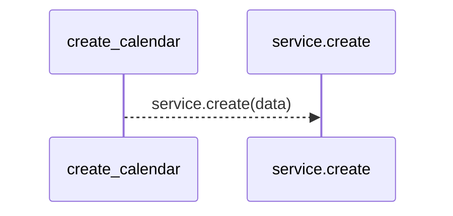
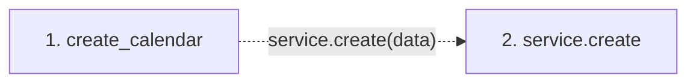

# create_calendar

**Entry point:** `create_calendar` (`http`)
**Source:** [calendars](../modules/calendars.md)
**Modules touched:** [calendars](../modules/calendars.md)

## Call sequence

> Static overview in presentation order, not runtime execution order. Arrows retain captured callers; representative internal continuations and boundary examples precede repeated helper detail.

<!-- Auto-generated from static call edges. Dashed arrows are external or unresolved calls. Reviewed runtime conditions and side effects belong in Behavior. -->

> Call sequence diagram shows 1 of 1 interactions; 0 omitted to keep the visualization within the 30-interaction and generated-diagram limits, with uncertain identities omitted rather than inferred.

> Captured boundary calls: external 0 of 0 (0 omitted); unresolved 1 of 1 (0 omitted). These counts cover the captured static trace.
> Detailed flow queries retain their own coverage and limits; omitted paths may execute at runtime.

## Data flow

<!-- Auto-generated static analysis. Treat values and boundaries as best-effort hints, not runtime proof. -->

### Analysis coverage

**Effect analysis evaluated.** Flow assembly and source effect analysis are separate; empty observations do not prove an empty handler body.

Source steps: 1; effect analysis evaluated: 1, partial: 0, unavailable: 0. Counts include steps omitted from the displayed trace.

Collector observations for 1 source steps with known totals: observed: 3, emitted: 3, omitted: 0. Unavailable totals are excluded.

### Step data

| Step | Inputs | Reads | Writes | Returns |
|---|---|---|---|---|
| `create_calendar` | `data: CalendarCreate`, `service: Annotated[CalendarService, Depends(get_calendar_service)]` | - | - | `...` |
| `service.create` | - | - | - | - |

### Call data

| From | To | Line | Call |
|---|---|---:|---|
| create_calendar | service.create | 43 | `service.create(data)` |

### Boundary effects

*No boundary-effect observations were captured in this static trace.*

### Static analysis gaps

| Kind | Step | Target | Line |
|---|---|---|---:|
| unresolved_call | `create_calendar` | `service.create` | 43 |

## Behavior

This flow starts at `create_calendar` and is classified as `http`. The generated call and data-flow sections are bounded static projections; runtime conditions and side effects require source-level confirmation.
