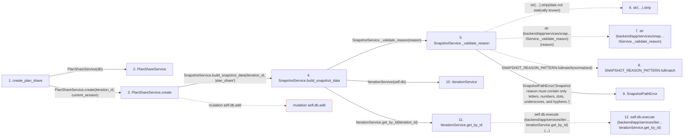

# create_plan_share

**Entry point:** `create_plan_share` (`http`)
**Source:** [plan_shares](../modules/plan_shares.md)
**Modules touched:** [authority](../modules/authority.md), [commands](../modules/commands.md), [iteration_service](../modules/iteration_service.md), [models_plan_share](../modules/models_plan_share.md), and 8 more

**Complete modules touched:**

- [authority](../modules/authority.md)
- [commands](../modules/commands.md)
- [iteration_service](../modules/iteration_service.md)
- [models_plan_share](../modules/models_plan_share.md)
- [plan_share_service](../modules/plan_share_service.md)
- [plan_shares](../modules/plan_shares.md)
- [query_limits](../modules/query_limits.md)
- [snapshot_service](../modules/snapshot_service.md)
- [task_hierarchy_service](../modules/task_hierarchy_service.md)
- [task_service](../modules/task_service.md)
- [team_service](../modules/team_service.md)
- [time](../modules/time.md)

## Call sequence

> Static overview in presentation order, not runtime execution order. Arrows retain captured callers; representative internal continuations and boundary examples precede repeated helper detail.

```mermaid
sequenceDiagram
    participant p0 as create_plan_share
    participant p1 as PlanShareService.create
    participant p2 as PlanShareService
    participant p3 as SnapshotService.build_snapshot_data
    participant p4 as commit_or_flush
    participant p5 as SnapshotService._validate_reason
    participant p6 as TaskService.get_by_iteration
    participant p7 as TeamService.get_by_iteration
    participant p8 as SnapshotService._task_to_export
    participant p9 as SnapshotService.profile_lifetimes
    participant p10 as SnapshotService._profile_references
    participant p11 as TaskService._task_graph_query
    participant p12 as TaskService._load_iteration_tree
    participant p13 as TaskHierarchyService._load_iteration_tree
    participant p14 as SnapshotService
    participant p15 as utc_now
    participant p16 as PlanShareService._owner_filter
    participant p17 as PlanShare
    participant p18 as PlanShareService._share_snapshot
    participant p19 as PlanShareService._query
    participant p20 as current_command
    participant p21 as IterationService
    participant p22 as IterationService.get_by_id
    participant p23 as TaskService
    participant p24 as TeamService
    participant p25 as SnapshotService._member_to_export
    participant p26 as internal_authority
    participant p27 as SnapshotPathError
    participant p28 as TeamService._member_options
    participant p29 as HTTPException
    participant p30 as service.to_response
    p0->>p1: PlanShareService.create
    p0->>p2: PlanShareService
    p1->>p3: SnapshotService.build_snapshot_data
    p1->>p4: commit_or_flush
    p3->>p5: SnapshotService._validate_reason
    p3->>p6: TaskService.get_by_iteration
    p3->>p7: TeamService.get_by_iteration
    p3->>p8: SnapshotService._task_to_export
    p3->>p9: SnapshotService.profile_lifetimes
    p9->>p10: SnapshotService._profile_references
    p6->>p11: TaskService._task_graph_query
    p6->>p12: TaskService._load_iteration_tree
    p12->>p13: TaskHierarchyService._load_iteration_tree
    p1->>p14: SnapshotService
    p1->>p15: utc_now
    p1->>p16: PlanShareService._owner_filter
    p1->>p17: PlanShare
    p1->>p18: PlanShareService._share_snapshot
    p1->>p19: PlanShareService._query
    p4->>p20: current_command
    p3->>p21: IterationService
    p3->>p22: IterationService.get_by_id
    p3->>p23: TaskService
    p3->>p24: TeamService
    p3->>p25: SnapshotService._member_to_export
    p9->>p26: internal_authority
    p5->>p27: SnapshotPathError
    p7->>p28: TeamService._member_options
    p0-->>p29: HTTPException(status_code=status.HTTP_404_NOT_FOUND, detail=...)
    p0-->>p30: service.to_response(share)
```

<!-- Auto-generated from static call edges. Dashed arrows are external or unresolved calls. Reviewed runtime conditions and side effects belong in Behavior. -->

> Call sequence diagram shows 30 of 194 interactions; 164 omitted to keep the visualization within the 30-interaction and generated-diagram limits, with uncertain identities omitted rather than inferred.

> Captured boundary calls: external 1 of 52 (51 omitted); unresolved 1 of 101 (100 omitted). These counts cover the captured static trace.

Omitted captured detail, grouped by actual caller occurrence and target module:

| Caller | Parent step | Target module | Kind | Omitted interactions |
| --- | --- | --- | --- | --- |
| `backend/app/services/snapshot_service.py:SnapshotService._validate_reason` | 5 | - | unresolved | 2 |
| `backend/app/services/snapshot_service.py:SnapshotService._validate_reason` | 5 | - | external | 1 |
| `backend/app/services/iteration_service.py:IterationService.get_by_id` | 11 | - | unresolved | 4 |
| `backend/app/services/iteration_service.py:IterationService.get_by_id` | 11 | - | external | 3 |
| `backend/app/services/task_service.py:TaskService.get_by_iteration` | 19 | - | unresolved | 6 |
| `backend/app/services/task_service.py:TaskService._task_graph_query` | 23 | [backend/app/services/task_hierarchy_service.py](../modules/task_hierarchy_service.md) | internal | 2 |
| `backend/app/services/task_hierarchy_service.py:TaskHierarchyService._task_graph_query` | 24 | - | unresolved | 6 |
| `backend/app/services/task_hierarchy_service.py:TaskHierarchyService._task_graph_query` | 24 | - | external | 8 |
> Omission summary shows 8 of 45 groups; 37 further groups are not expanded here. Counts above include all omitted interactions.
> Detailed flow queries retain their own coverage and limits; omitted paths may execute at runtime.

## Data flow

<!-- Auto-generated static analysis. Treat values and boundaries as best-effort hints, not runtime proof. -->

### Analysis coverage

**Effect analysis partially available.** Flow assembly and source effect analysis are separate; empty observations do not prove an empty handler body.

Source steps: 42; effect analysis evaluated: 27, partial: 0, unavailable: 15. Counts include steps omitted from the displayed trace.

Collector observations for 27 source steps with known totals: observed: 99, emitted: 99, omitted: 0. Unavailable totals are excluded.

- Callable record unavailable for one or more source steps; those steps have no represented callable body.
- Effect collector totals unavailable; observed counts cover captured records only.

| Step | Callable record | Effect analysis | Collector totals | Observed | Emitted | Omitted |
|---|---|---|---|---:|---:|---:|
| `create_plan_share` | `available` | `evaluated` | `available` | `7` | `7` | `0` |
| `PlanShareService` | `unavailable` | `unavailable` | `unavailable` | — | — | — |
| `PlanShareService.create` | `available` | `evaluated` | `available` | `8` | `8` | `0` |
| `SnapshotService.build_snapshot_data` | `available` | `evaluated` | `available` | `6` | `6` | `0` |
| `SnapshotService._validate_reason` | `available` | `evaluated` | `available` | `2` | `2` | `0` |
| `str(…).strip` | `not_applicable` | `not_applicable` | `not_applicable` | — | — | — |
| `str (backend/app/services/snap…tService._validate_reason)` | `not_applicable` | `not_applicable` | `not_applicable` | — | — | — |
| `SNAPSHOT_REASON_PATTERN.fullmatch` | `not_applicable` | `not_applicable` | `not_applicable` | — | — | — |
| `SnapshotPathError` | `unavailable` | `unavailable` | `unavailable` | — | — | — |
| `IterationService` | `unavailable` | `unavailable` | `unavailable` | — | — | — |
| `IterationService.get_by_id` | `available` | `evaluated` | `available` | `3` | `3` | `0` |
| `self.db.execute (backend/app/services/iter…terationService.get_by_id)` | `not_applicable` | `not_applicable` | `not_applicable` | — | — | — |

### Step data

| Step | Inputs | Reads | Writes | Returns |
|---|---|---|---|---|
| `create_plan_share` | `iteration_id: int`, `response: Response`, `current_session: Annotated[UserSession, Depends(session_service.get_current_session)]`, `db: Annotated[AsyncSession, Depends(get_db, scope='function')]` | `status` | `response.headers[...]` | `service.to_response(...)` |
| `PlanShareService` | - | - | - | - |
| `PlanShareService.create` | `iteration_id: int`, `session: UserSession` | `PlanShare`, `self.db`, `PlanShare` | - | `None`, `result.scalar_one(...)` |
| `SnapshotService.build_snapshot_data` | `iteration_id: int`, `reason: str` | `self.db` | `payload[...]` | `None`, `payload` |
| `SnapshotService._validate_reason` | `reason: str` | - | - | `normalized` |
| `str(…).strip` | - | - | - | - |
| `str (backend/app/services/snap…tService._validate_reason)` | - | - | - | - |
| `SNAPSHOT_REASON_PATTERN.fullmatch` | - | - | - | - |
| `SnapshotPathError` | - | - | - | - |
| `IterationService` | - | - | - | - |
| `IterationService.get_by_id` | `iteration_id: int` | `Iteration` | - | `result.scalar_one_or_none(...)` |
| `self.db.execute (backend/app/services/iter…terationService.get_by_id)` | - | - | - | - |

### Call data

| From | To | Line | Call |
|---|---|---:|---|
| create_plan_share | PlanShareService | 54 | `PlanShareService(db)` |
| create_plan_share | PlanShareService.create | 55 | `service.create(iteration_id, current_session)` |
| PlanShareService.create | SnapshotService.build_snapshot_data | 135 | `SnapshotService(self.db).build_snapshot_data(iteration_id, 'plan_share')` |
| SnapshotService.build_snapshot_data | SnapshotService._validate_reason | 209 | `self._validate_reason(reason)` |
| SnapshotService._validate_reason | str(…).strip | 159 | `str(reason).strip(data not statically known)` |
| SnapshotService._validate_reason | str (backend/app/services/snap…tService._validate_reason) | 159 | `str(reason)` |
| SnapshotService._validate_reason | SNAPSHOT_REASON_PATTERN.fullmatch | 160 | `SNAPSHOT_REASON_PATTERN.fullmatch(normalized)` |
| SnapshotService._validate_reason | SnapshotPathError | 161 | `SnapshotPathError('Snapshot reason must contain only letters, numbers, dots, underscores, and hyphens.')` |
| SnapshotService.build_snapshot_data | IterationService | 210 | `IterationService(self.db)` |
| SnapshotService.build_snapshot_data | IterationService.get_by_id | 211 | `iteration_service.get_by_id(iteration_id)` |
| IterationService.get_by_id | self.db.execute (backend/app/services/iter…terationService.get_by_id) | 323 | `self.db.execute(...)` |

### Boundary effects

| Kind | Target | Step | Line |
|---|---|---|---:|
| mutation | `self.db.add` | `PlanShareService.create` | 169 |

### Static analysis gaps

| Kind | Step | Target | Line |
|---|---|---|---:|
| unresolved_call | `SnapshotService._validate_reason` | `str(reason).strip` | 159 |
| unresolved_call | `SnapshotService._validate_reason` | `SNAPSHOT_REASON_PATTERN.fullmatch` | 160 |
| unresolved_call | `IterationService.get_by_id` | `self.db.execute` | 323 |
| step_limit | `create_plan_share` | `first 12 steps` | 0 |

## Behavior

This flow starts at `create_plan_share` and is classified as `http`. The generated call and data-flow sections are bounded static projections; runtime conditions and side effects require source-level confirmation.
