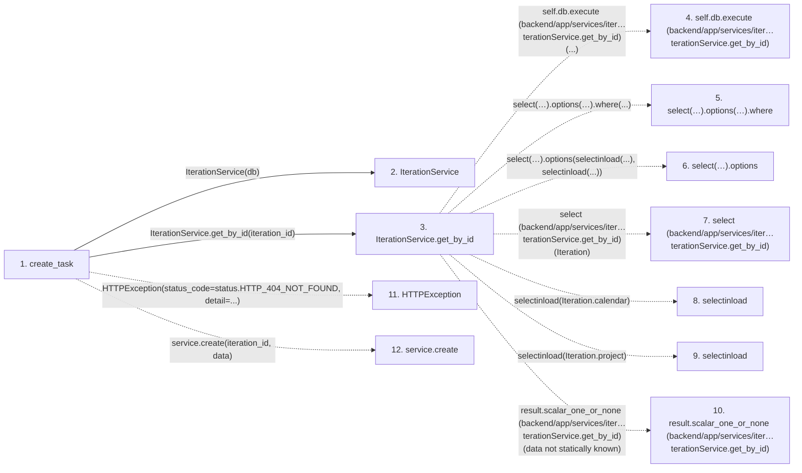

# create_task

**Entry point:** `create_task` (`http`)
**Source:** [tasks](../modules/tasks.md)
**Modules touched:** [config](../modules/config.md), [iteration_service](../modules/iteration_service.md), [language_service](../modules/language_service.md), [system_settings_service](../modules/system_settings_service.md), and 2 more

**Complete modules touched:**

- [config](../modules/config.md)
- [iteration_service](../modules/iteration_service.md)
- [language_service](../modules/language_service.md)
- [system_settings_service](../modules/system_settings_service.md)
- [tasks](../modules/tasks.md)
- [url_policy](../modules/url_policy.md)

## Call sequence

> Static overview in presentation order, not runtime execution order. Arrows retain captured callers; representative internal continuations and boundary examples precede repeated helper detail.

```mermaid
sequenceDiagram
    participant p0 as create_task
    participant p1 as _localized_detail
    participant p2 as IterationService
    participant p3 as IterationService.get_by_id
    participant p4 as resolve_runtime_ui_language
    participant p5 as backend_error_message
    participant p6 as RuntimeSettingsService.get_app_settings
    participant p7 as entity_not_found_message
    participant p8 as get_settings
    participant p9 as scoped_entity_not_found_message
    participant p10 as entity_deleted_message
    participant p11 as RuntimeSettingsService.resolve
    participant p12 as localized
    participant p13 as RuntimeSettingsService._definition
    participant p14 as RuntimeSettingsService._decrypt_secret
    participant p15 as RuntimeSettingsService._coerce
    participant p16 as normalize_language
    participant p17 as RuntimeSettingsService
    participant p18 as Settings
    participant p19 as RuntimeSettingsService._row
    participant p20 as RuntimeSettingsService._env_value
    participant p21 as RuntimeSettingsError
    participant p22 as RuntimeSettingsService._fernet
    participant p23 as RuntimeSettingsEncryptionError
    participant p24 as normalize_provider_api_url
    participant p25 as HTTPException
    participant p26 as service.create
    participant p27 as str (backend/app/routers/tasks.py:create_task)
    participant p28 as service.task_to_response
    participant p29 as self.db.execute (backend/app/services/iter…terationService.get_by_id)
    p0->>p1: _localized_detail
    p0->>p2: IterationService
    p0->>p3: IterationService.get_by_id
    p1->>p4: resolve_runtime_ui_language
    p1->>p5: backend_error_message
    p4->>p6: RuntimeSettingsService.get_app_settings
    p5->>p7: entity_not_found_message
    p4->>p8: get_settings
    p5->>p9: scoped_entity_not_found_message
    p5->>p10: entity_deleted_message
    p6->>p11: RuntimeSettingsService.resolve
    p7->>p12: localized
    p11->>p13: RuntimeSettingsService._definition
    p11->>p14: RuntimeSettingsService._decrypt_secret
    p11->>p15: RuntimeSettingsService._coerce
    p4->>p16: normalize_language
    p4->>p17: RuntimeSettingsService
    p8->>p18: Settings
    p11->>p19: RuntimeSettingsService._row
    p11->>p20: RuntimeSettingsService._env_value
    p13->>p21: RuntimeSettingsError
    p14->>p22: RuntimeSettingsService._fernet
    p14->>p23: RuntimeSettingsEncryptionError
    p15->>p24: normalize_provider_api_url
    p0-->>p25: HTTPException(status_code=status.HTTP_404_NOT_FOUND, detail=...)
    p0-->>p26: service.create(iteration_id, data)
    p0-->>p25: HTTPException(status_code=status.HTTP_400_BAD_REQUEST, detail=...)
    p0-->>p27: str (backend/app/routers/tasks.py:create_task)(e)
    p0-->>p28: service.task_to_response(task, iteration.end_date)
    p3-->>p29: self.db.execute (backend/app/services/iter…terationService.get_by_id)(...)
```

<!-- Auto-generated from static call edges. Dashed arrows are external or unresolved calls. Reviewed runtime conditions and side effects belong in Behavior. -->

> Call sequence diagram shows 30 of 172 interactions; 142 omitted to keep the visualization within the 30-interaction and generated-diagram limits, with uncertain identities omitted rather than inferred.

> Captured boundary calls: external 3 of 50 (47 omitted); unresolved 3 of 75 (72 omitted). These counts cover the captured static trace.

Omitted captured detail, grouped by actual caller occurrence and target module:

| Caller | Parent step | Target module | Kind | Omitted interactions |
| --- | --- | --- | --- | --- |
| `backend/app/services/iteration_service.py:IterationService.get_by_id` | 3 | - | unresolved | 3 |
| `backend/app/services/iteration_service.py:IterationService.get_by_id` | 3 | - | external | 3 |
| `backend/app/services/language_service.py:normalize_language` | 16 | - | unresolved | 2 |
| `backend/app/services/language_service.py:normalize_language` | 16 | - | external | 1 |
| `backend/app/services/system_settings_service.py:RuntimeSettingsService._definition` | 22 | - | unresolved | 1 |
| `backend/app/services/system_settings_service.py:RuntimeSettingsService._row` | 25 | - | unresolved | 3 |
| `backend/app/services/system_settings_service.py:RuntimeSettingsService._row` | 25 | - | external | 1 |
| `backend/app/services/system_settings_service.py:RuntimeSettingsService._decrypt_secret` | 30 | - | unresolved | 3 |
> Omission summary shows 8 of 28 groups; 20 further groups are not expanded here. Counts above include all omitted interactions.
> Detailed flow queries retain their own coverage and limits; omitted paths may execute at runtime.

> Trace truncated at the depth limit; deeper calls are omitted.

## Data flow

<!-- Auto-generated static analysis. Treat values and boundaries as best-effort hints, not runtime proof. -->

### Analysis coverage

**Effect analysis partially available.** Flow assembly and source effect analysis are separate; empty observations do not prove an empty handler body.

Source steps: 48; effect analysis evaluated: 28, partial: 1, unavailable: 19. Counts include steps omitted from the displayed trace.

Collector observations for 29 source steps with known totals: observed: 151, emitted: 125, omitted: 26. Unavailable totals are excluded.

- Callable record unavailable for one or more source steps; those steps have no represented callable body.
- Effect collector omitted observations before flow assembly; displayed effects are partial.
- Effect collector totals unavailable; observed counts cover captured records only.

| Step | Callable record | Effect analysis | Collector totals | Observed | Emitted | Omitted |
|---|---|---|---|---:|---:|---:|
| `create_task` | `available` | `evaluated` | `available` | `7` | `7` | `0` |
| `IterationService` | `unavailable` | `unavailable` | `unavailable` | — | — | — |
| `IterationService.get_by_id` | `available` | `evaluated` | `available` | `3` | `3` | `0` |
| `self.db.execute (backend/app/services/iter…terationService.get_by_id)` | `not_applicable` | `not_applicable` | `not_applicable` | — | — | — |
| `select(…).options(…).where` | `not_applicable` | `not_applicable` | `not_applicable` | — | — | — |
| `select(…).options` | `not_applicable` | `not_applicable` | `not_applicable` | — | — | — |
| `select (backend/app/services/iter…terationService.get_by_id)` | `not_applicable` | `not_applicable` | `not_applicable` | — | — | — |
| `selectinload` | `not_applicable` | `not_applicable` | `not_applicable` | — | — | — |
| `selectinload` | `not_applicable` | `not_applicable` | `not_applicable` | — | — | — |
| `result.scalar_one_or_none (backend/app/services/iter…terationService.get_by_id)` | `not_applicable` | `not_applicable` | `not_applicable` | — | — | — |
| `HTTPException` | `not_applicable` | `not_applicable` | `not_applicable` | — | — | — |
| `service.create` | `not_applicable` | `not_applicable` | `not_applicable` | — | — | — |

### Step data

| Step | Inputs | Reads | Writes | Returns |
|---|---|---|---|---|
| `create_task` | `iteration_id: int`, `data: TaskCreate`, `service: Annotated[TaskService, Depends(get_task_service)]`, `db: Annotated[AsyncSession, Depends(get_db, scope='function')]` | `status`, `status` | - | `service.task_to_response(...)` |
| `IterationService` | - | - | - | - |
| `IterationService.get_by_id` | `iteration_id: int` | `Iteration` | - | `result.scalar_one_or_none(...)` |
| `self.db.execute (backend/app/services/iter…terationService.get_by_id)` | - | - | - | - |
| `select(…).options(…).where` | - | - | - | - |
| `select(…).options` | - | - | - | - |
| `select (backend/app/services/iter…terationService.get_by_id)` | - | - | - | - |
| `selectinload` | - | - | - | - |
| `selectinload` | - | - | - | - |
| `result.scalar_one_or_none (backend/app/services/iter…terationService.get_by_id)` | - | - | - | - |
| `HTTPException` | - | - | - | - |
| `service.create` | - | - | - | - |

### Call data

| From | To | Line | Call |
|---|---|---:|---|
| create_task | IterationService | 148 | `IterationService(db)` |
| create_task | IterationService.get_by_id | 149 | `iteration_service.get_by_id(iteration_id)` |
| IterationService.get_by_id | self.db.execute (backend/app/services/iter…terationService.get_by_id) | 323 | `self.db.execute(...)` |
| IterationService.get_by_id | select(…).options(…).where | 324 | `select(Iteration).options(selectinload(Iteration.calendar), selectinload(Iteration.project)).where(...)` |
| IterationService.get_by_id | select(…).options | 324 | `select(Iteration).options(selectinload(...), selectinload(...))` |
| IterationService.get_by_id | select (backend/app/services/iter…terationService.get_by_id) | 324 | `select(Iteration)` |
| IterationService.get_by_id | selectinload | 326 | `selectinload(Iteration.calendar)` |
| IterationService.get_by_id | selectinload | 327 | `selectinload(Iteration.project)` |
| IterationService.get_by_id | result.scalar_one_or_none (backend/app/services/iter…terationService.get_by_id) | 331 | `result.scalar_one_or_none(data not statically known)` |
| create_task | HTTPException | 152 | `HTTPException(status_code=status.HTTP_404_NOT_FOUND, detail=...)` |
| create_task | service.create | 158 | `service.create(iteration_id, data)` |

### Boundary effects

*No boundary-effect observations were captured in this static trace.*

### Static analysis gaps

| Kind | Step | Target | Line |
|---|---|---|---:|
| unresolved_call | `IterationService.get_by_id` | `self.db.execute` | 323 |
| unresolved_call | `IterationService.get_by_id` | `select(Iteration).options(selectinload(Iteration.calendar), selectinload(Iteration.project)).where` | 324 |
| unresolved_call | `IterationService.get_by_id` | `select(Iteration).options` | 324 |
| external_call | `IterationService.get_by_id` | `select` | 324 |
| external_call | `IterationService.get_by_id` | `selectinload` | 326 |
| external_call | `IterationService.get_by_id` | `selectinload` | 327 |
| unresolved_call | `IterationService.get_by_id` | `result.scalar_one_or_none` | 331 |
| external_call | `create_task` | `HTTPException` | 152 |
| unresolved_call | `create_task` | `service.create` | 158 |
| step_limit | `create_task` | `first 12 steps` | 0 |
| truncated_flow | `create_task` | `depth limit` | 0 |

## Behavior

This flow starts at `create_task` and is classified as `http`. The generated call and data-flow sections are bounded static projections; runtime conditions and side effects require source-level confirmation.
