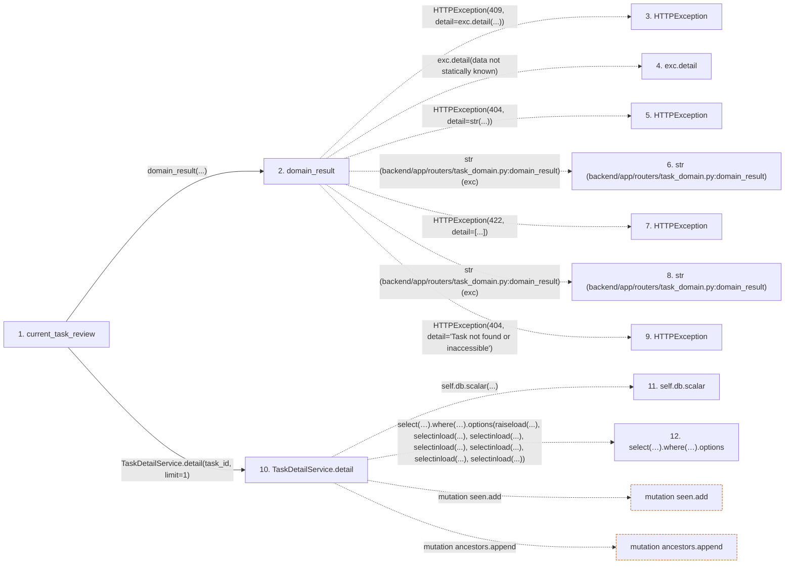

# current_task_review

**Entry point:** `current_task_review` (`http`)
**Source:** [routers_task_domain](../modules/routers_task_domain.md)
**Modules touched:** [agent_readiness](../modules/agent_readiness.md), [authority](../modules/authority.md), [commands](../modules/commands.md), [config](../modules/config.md), and 10 more

**Complete modules touched:**

- [agent_readiness](../modules/agent_readiness.md)
- [authority](../modules/authority.md)
- [commands](../modules/commands.md)
- [config](../modules/config.md)
- [external_link_service](../modules/external_link_service.md)
- [routers_task_domain](../modules/routers_task_domain.md)
- [schemas_external_link](../modules/schemas_external_link.md)
- [schemas_task](../modules/schemas_task.md)
- [services_work_metrics](../modules/services_work_metrics.md)
- [task_brief_service](../modules/task_brief_service.md)
- [task_detail](../modules/task_detail.md)
- [task_detail_service](../modules/task_detail_service.md)
- [task_service](../modules/task_service.md)
- [time](../modules/time.md)

## Call sequence

> Static overview in presentation order, not runtime execution order. Arrows retain captured callers; representative internal continuations and boundary examples precede repeated helper detail.

```mermaid
sequenceDiagram
    participant p0 as current_task_review
    participant p1 as TaskDetailService.detail
    participant p2 as domain_result
    participant p3 as TaskDetailService
    participant p4 as require_project
    participant p5 as TaskService.load_owner_names
    participant p6 as TaskService.task_to_response
    participant p7 as TaskDetailService._policy_flags
    participant p8 as TaskDetailService.page
    participant p9 as get_settings
    participant p10 as task_signals
    participant p11 as evaluate_agent_readiness
    participant p12 as ExternalLinkService.task_links_to_response
    participant p13 as working_today
    participant p14 as ExternalLinkService.link_to_response
    participant p15 as ExternalLinkService.legacy_task_link_response
    participant p16 as _add_criterion
    participant p17 as TaskService
    participant p18 as TaskAgentReadiness
    participant p19 as TaskDetailService.references
    participant p20 as PlanningConflict
    participant p21 as TaskDetailService.reviewer_names
    participant p22 as TaskDetailResponse
    participant p23 as current_command
    participant p24 as internal_authority
    participant p25 as AuthorityError
    participant p26 as TaskReferencePage
    participant p27 as TaskAssignee
    participant p28 as TaskProject
    participant p29 as select (backend/app/routers/task_…in.py:current_task_review)
    participant p30 as db.scalar
    p0->>p1: TaskDetailService.detail
    p0->>p2: domain_result
    p0->>p3: TaskDetailService
    p1->>p4: require_project
    p1->>p5: TaskService.load_owner_names
    p1->>p6: TaskService.task_to_response
    p1->>p7: TaskDetailService._policy_flags
    p1->>p8: TaskDetailService.page
    p4->>p9: get_settings
    p6->>p10: task_signals
    p6->>p11: evaluate_agent_readiness
    p6->>p12: ExternalLinkService.task_links_to_response
    p10->>p13: working_today
    p12->>p14: ExternalLinkService.link_to_response
    p12->>p15: ExternalLinkService.legacy_task_link_response
    p11->>p16: _add_criterion
    p1->>p17: TaskService
    p1->>p18: TaskAgentReadiness
    p1->>p19: TaskDetailService.references
    p1->>p20: PlanningConflict
    p1->>p21: TaskDetailService.reviewer_names
    p1->>p22: TaskDetailResponse
    p6->>p23: current_command
    p5->>p24: internal_authority
    p4->>p25: AuthorityError
    p8->>p26: TaskReferencePage
    p6->>p27: TaskAssignee
    p6->>p28: TaskProject
    p0-->>p29: select (backend/app/routers/task_…in.py:current_task_review)(TaskReviewRecord)
    p0-->>p30: db.scalar(...)
```

<!-- Auto-generated from static call edges. Dashed arrows are external or unresolved calls. Reviewed runtime conditions and side effects belong in Behavior. -->

> Call sequence diagram shows 30 of 238 interactions; 208 omitted to keep the visualization within the 30-interaction and generated-diagram limits, with uncertain identities omitted rather than inferred.

> Captured boundary calls: external 1 of 74 (73 omitted); unresolved 1 of 100 (99 omitted). These counts cover the captured static trace.

Omitted captured detail, grouped by actual caller occurrence and target module:

| Caller | Parent step | Target module | Kind | Omitted interactions |
| --- | --- | --- | --- | --- |
| `backend/app/routers/task_domain.py:domain_result` | 2 | - | external | 6 |
| `backend/app/routers/task_domain.py:domain_result` | 2 | - | unresolved | 1 |
| `backend/app/services/task_detail_service.py:TaskDetailService.detail` | 10 | - | unresolved | 15 |
| `backend/app/services/task_detail_service.py:TaskDetailService.detail` | 10 | - | external | 14 |
| `backend/app/authority.py:require_project` | 22 | - | unresolved | 2 |
| `backend/app/config.py:get_settings` | 24 | [backend/app/config.py](../modules/config.md) | internal | 1 |
| `backend/app/authority.py:require_project` | 22 | [backend/app/authority.py](../modules/authority.md) | internal | 1 |
| `backend/app/services/task_service.py:TaskService.load_owner_names` | 29 | [backend/app/authority.py](../modules/authority.md) | internal | 1 |
> Omission summary shows 8 of 57 groups; 49 further groups are not expanded here. Counts above include all omitted interactions.
> Detailed flow queries retain their own coverage and limits; omitted paths may execute at runtime.

## Data flow

<!-- Auto-generated static analysis. Treat values and boundaries as best-effort hints, not runtime proof. -->

### Analysis coverage

**Effect analysis partially available.** Flow assembly and source effect analysis are separate; empty observations do not prove an empty handler body.

Source steps: 65; effect analysis evaluated: 44, partial: 0, unavailable: 21. Counts include steps omitted from the displayed trace.

Collector observations for 44 source steps with known totals: observed: 221, emitted: 221, omitted: 0. Unavailable totals are excluded.

- Callable record unavailable for one or more source steps; those steps have no represented callable body.
- Effect collector totals unavailable; observed counts cover captured records only.

| Step | Callable record | Effect analysis | Collector totals | Observed | Emitted | Omitted |
|---|---|---|---|---:|---:|---:|
| `current_task_review` | `available` | `evaluated` | `available` | `3` | `3` | `0` |
| `domain_result` | `available` | `evaluated` | `available` | `3` | `3` | `0` |
| `HTTPException` | `not_applicable` | `not_applicable` | `not_applicable` | — | — | — |
| `exc.detail` | `not_applicable` | `not_applicable` | `not_applicable` | — | — | — |
| `HTTPException` | `not_applicable` | `not_applicable` | `not_applicable` | — | — | — |
| `str (backend/app/routers/task_domain.py:domain_result)` | `not_applicable` | `not_applicable` | `not_applicable` | — | — | — |
| `HTTPException` | `not_applicable` | `not_applicable` | `not_applicable` | — | — | — |
| `str (backend/app/routers/task_domain.py:domain_result)` | `not_applicable` | `not_applicable` | `not_applicable` | — | — | — |
| `HTTPException` | `not_applicable` | `not_applicable` | `not_applicable` | — | — | — |
| `TaskDetailService.detail` | `available` | `evaluated` | `available` | `17` | `17` | `0` |
| `self.db.scalar` | `not_applicable` | `not_applicable` | `not_applicable` | — | — | — |
| `select(…).where(…).options` | `not_applicable` | `not_applicable` | `not_applicable` | — | — | — |

### Step data

| Step | Inputs | Reads | Writes | Returns |
|---|---|---|---|---|
| `current_task_review` | `task_id: int`, `db: DB` | - | - | `{...}` |
| `domain_result` | `awaitable` | `TaskVersionConflictError` | - | `result` |
| `HTTPException` | - | - | - | - |
| `exc.detail` | - | - | - | - |
| `HTTPException` | - | - | - | - |
| `str (backend/app/routers/task_domain.py:domain_result)` | - | - | - | - |
| `HTTPException` | - | - | - | - |
| `str (backend/app/routers/task_domain.py:domain_result)` | - | - | - | - |
| `HTTPException` | - | - | - | - |
| `TaskDetailService.detail` | `task_id`, `limit`, `children_after_id`, `dependencies_after_id` | `Task`, `self.db`, `Task`, `TaskDependency`, `Task` | `response.children`, `response.dependencies`, `response.agent_readiness`, `response.is_composite` | `None`, `TaskDetailResponse(...)` |
| `self.db.scalar` | - | - | - | - |
| `select(…).where(…).options` | - | - | - | - |

### Call data

| From | To | Line | Call |
|---|---|---:|---|
| current_task_review | domain_result | 220 | `domain_result(...)` |
| domain_result | HTTPException | 51 | `HTTPException(409, detail=exc.detail(...))` |
| domain_result | exc.detail | 51 | `exc.detail(data not statically known)` |
| domain_result | HTTPException | 53 | `HTTPException(404, detail=str(...))` |
| domain_result | str (backend/app/routers/task_domain.py:domain_result) | 53 | `str(exc)` |
| domain_result | HTTPException | 55 | `HTTPException(422, detail=[...])` |
| domain_result | str (backend/app/routers/task_domain.py:domain_result) | 55 | `str(exc)` |
| domain_result | HTTPException | 57 | `HTTPException(404, detail='Task not found or inaccessible')` |
| current_task_review | TaskDetailService.detail | 220 | `TaskDetailService(db).detail(task_id, limit=1)` |
| TaskDetailService.detail | self.db.scalar | 145 | `self.db.scalar(...)` |
| TaskDetailService.detail | select(…).where(…).options | 145 | `select(Task).where(Task.id == task_id).options(raiseload(...), selectinload(...), selectinload(...), selectinload(...), selectinload(...), selectinload(...), selectinload(...))` |

### Boundary effects

| Kind | Target | Step | Line |
|---|---|---|---:|
| mutation | `seen.add` | `TaskDetailService.detail` | 164 |
| mutation | `ancestors.append` | `TaskDetailService.detail` | 168 |

### Static analysis gaps

| Kind | Step | Target | Line |
|---|---|---|---:|
| external_call | `domain_result` | `HTTPException` | 51 |
| unresolved_call | `domain_result` | `exc.detail` | 51 |
| external_call | `domain_result` | `HTTPException` | 53 |
| external_call | `domain_result` | `HTTPException` | 55 |
| external_call | `domain_result` | `HTTPException` | 57 |
| unresolved_call | `TaskDetailService.detail` | `self.db.scalar` | 145 |
| unresolved_call | `TaskDetailService.detail` | `select(Task).where(Task.id == task_id).options` | 145 |
| step_limit | `current_task_review` | `first 12 steps` | 0 |

## Behavior

Checks current task visibility through the bounded detail service, then selects the latest review matching the current task, brief and artifact revisions. The response includes the task version with the verdict or null. This lookup does not depend on the first history page and does not mutate task state.
