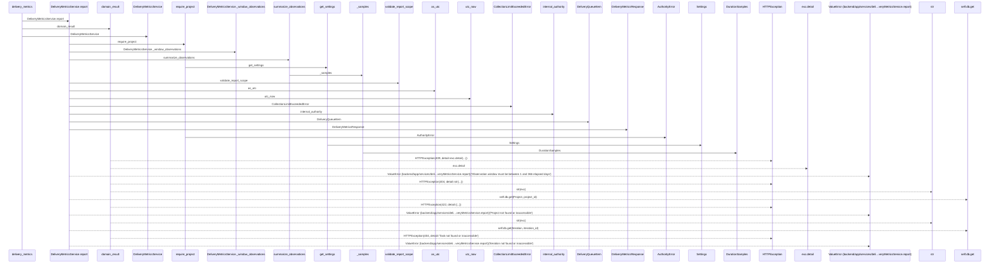
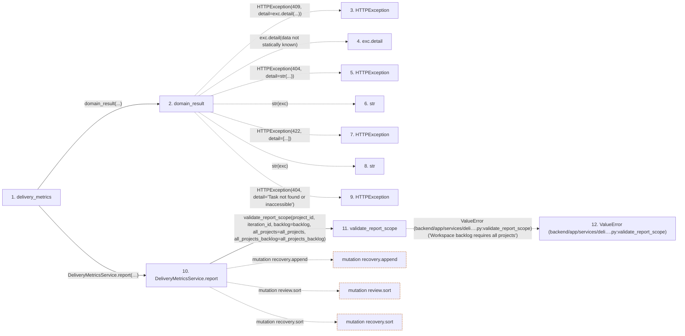

# delivery_metrics

**Entry point:** `delivery_metrics` (`http`)
**Source:** [routers_task_domain](../modules/routers_task_domain.md)
**Modules touched:** [authority](../modules/authority.md), [config](../modules/config.md), [delivery_metrics](../modules/delivery_metrics.md), [delivery_metrics_service](../modules/delivery_metrics_service.md), and 3 more

**Complete modules touched:**

- [authority](../modules/authority.md)
- [config](../modules/config.md)
- [delivery_metrics](../modules/delivery_metrics.md)
- [delivery_metrics_service](../modules/delivery_metrics_service.md)
- [query_limits](../modules/query_limits.md)
- [routers_task_domain](../modules/routers_task_domain.md)
- [time](../modules/time.md)

## Call sequence

> Static overview in presentation order, not runtime execution order. Arrows retain captured callers; representative internal continuations and boundary examples precede repeated helper detail.

<!-- Auto-generated from static call edges. Dashed arrows are external or unresolved calls. Reviewed runtime conditions and side effects belong in Behavior. -->

> Call sequence diagram shows 30 of 186 interactions; 156 omitted to keep the visualization within the 30-interaction and generated-diagram limits, with uncertain identities omitted rather than inferred.

> Captured boundary calls: external 9 of 66 (57 omitted); unresolved 3 of 85 (82 omitted). These counts cover the captured static trace.

Omitted captured detail, grouped by actual caller occurrence and target module:

| Caller | Parent step | Target module | Kind | Omitted interactions |
| --- | --- | --- | --- | --- |
| `backend/app/services/delivery_metrics_service.py:validate_report_scope` | 11 | - | external | 4 |
| `backend/app/authority.py:require_project` | 17 | - | unresolved | 2 |
| `backend/app/authority.py:require_project` | 17 | [backend/app/authority.py](../modules/authority.md) | internal | 1 |
| `backend/app/utils/time.py:as_utc` | 28 | - | unresolved | 2 |
| `backend/app/utils/time.py:utc_now` | 31 | - | external | 1 |
| `backend/app/services/delivery_metrics_service.py:DeliveryMetricsService.report` | 10 | - | external | 20 |
| `backend/app/services/delivery_metrics_service.py:DeliveryMetricsService.report` | 10 | - | unresolved | 41 |
| `backend/app/services/delivery_metrics_service.py:DeliveryMetricsService._window_observations` | 52 | - | unresolved | 29 |
> Omission summary shows 8 of 19 groups; 11 further groups are not expanded here. Counts above include all omitted interactions.
> Detailed flow queries retain their own coverage and limits; omitted paths may execute at runtime.

## Data flow

<!-- Auto-generated static analysis. Treat values and boundaries as best-effort hints, not runtime proof. -->

### Analysis coverage

**Effect analysis partially available.** Flow assembly and source effect analysis are separate; empty observations do not prove an empty handler body.

Source steps: 36; effect analysis evaluated: 23, partial: 1, unavailable: 12. Counts include steps omitted from the displayed trace.

Collector observations for 24 source steps with known totals: observed: 136, emitted: 126, omitted: 10. Unavailable totals are excluded.

- Callable record unavailable for one or more source steps; those steps have no represented callable body.
- Effect collector omitted observations before flow assembly; displayed effects are partial.
- Effect collector totals unavailable; observed counts cover captured records only.

| Step | Callable record | Effect analysis | Collector totals | Observed | Emitted | Omitted |
|---|---|---|---|---:|---:|---:|
| `delivery_metrics` | `available` | `evaluated` | `available` | `8` | `8` | `0` |
| `domain_result` | `available` | `evaluated` | `available` | `3` | `3` | `0` |
| `HTTPException` | `not_applicable` | `not_applicable` | `not_applicable` | — | — | — |
| `exc.detail` | `not_applicable` | `not_applicable` | `not_applicable` | — | — | — |
| `HTTPException` | `not_applicable` | `not_applicable` | `not_applicable` | — | — | — |
| `str` | `not_applicable` | `not_applicable` | `not_applicable` | — | — | — |
| `HTTPException` | `not_applicable` | `not_applicable` | `not_applicable` | — | — | — |
| `str` | `not_applicable` | `not_applicable` | `not_applicable` | — | — | — |
| `HTTPException` | `not_applicable` | `not_applicable` | `not_applicable` | — | — | — |
| `DeliveryMetricsService.report` | `available` | `partial` | `available` | `29` | `19` | `10` |
| `validate_report_scope` | `available` | `evaluated` | `available` | `5` | `5` | `0` |
| `ValueError (backend/app/services/deli….py:validate_report_scope)` | `not_applicable` | `not_applicable` | `not_applicable` | — | — | — |

### Step data

| Step | Inputs | Reads | Writes | Returns |
|---|---|---|---|---|
| `delivery_metrics` | `db: DB`, `project_id: int \| None`, `iteration_id: int \| None`, `lookback_days: int`, `backlog: bool`, `all_projects: bool`, `all_projects_backlog: bool` | - | - | `...` |
| `domain_result` | `awaitable` | `TaskVersionConflictError` | - | `result` |
| `HTTPException` | - | - | - | - |
| `exc.detail` | - | - | - | - |
| `HTTPException` | - | - | - | - |
| `str` | - | - | - | - |
| `HTTPException` | - | - | - | - |
| `str` | - | - | - | - |
| `HTTPException` | - | - | - | - |
| `DeliveryMetricsService.report` | `project_id`, `iteration_id`, `lookback_days`, `now`, `backlog`, `all_projects`, `all_projects_backlog` | `self.db`, `Project`, `Iteration`, `DeliveryObservation`, `Task`, `DeliveryObservation`, `Task`, `DeliveryObservation` | - | `DeliveryMetricsResponse(...)` |
| `validate_report_scope` | `project_id`, `iteration_id`, `backlog`, `all_projects`, `all_projects_backlog` | - | - | - |
| `ValueError (backend/app/services/deli….py:validate_report_scope)` | - | - | - | - |

### Call data

| From | To | Line | Call |
|---|---|---:|---|
| delivery_metrics | domain_result | 78 | `domain_result(...)` |
| domain_result | HTTPException | 55 | `HTTPException(409, detail=exc.detail(...))` |
| domain_result | exc.detail | 55 | `exc.detail(data not statically known)` |
| domain_result | HTTPException | 57 | `HTTPException(404, detail=str(...))` |
| domain_result | str | 57 | `str(exc)` |
| domain_result | HTTPException | 59 | `HTTPException(422, detail=[...])` |
| domain_result | str | 59 | `str(exc)` |
| domain_result | HTTPException | 61 | `HTTPException(404, detail='Task not found or inaccessible')` |
| delivery_metrics | DeliveryMetricsService.report | 78 | `DeliveryMetricsService(db).report(project_id=project_id, iteration_id=iteration_id, lookback_days=lookback_days, backlog=backlog, all_projects=all_projects, all_projects_backlog=all_projects_backlog)` |
| DeliveryMetricsService.report | validate_report_scope | 157 | `validate_report_scope(project_id, iteration_id, backlog=backlog, all_projects=all_projects, all_projects_backlog=all_projects_backlog)` |
| validate_report_scope | ValueError (backend/app/services/deli….py:validate_report_scope) | 25 | `ValueError('Workspace backlog requires all projects')` |

### Boundary effects

| Kind | Target | Step | Line |
|---|---|---|---:|
| mutation | `recovery.append` | `DeliveryMetricsService.report` | 208 |
| mutation | `review.sort` | `DeliveryMetricsService.report` | 211 |
| mutation | `recovery.sort` | `DeliveryMetricsService.report` | 212 |

### Static analysis gaps

| Kind | Step | Target | Line |
|---|---|---|---:|
| external_call | `domain_result` | `HTTPException` | 55 |
| unresolved_call | `domain_result` | `exc.detail` | 55 |
| external_call | `domain_result` | `HTTPException` | 57 |
| external_call | `domain_result` | `HTTPException` | 59 |
| external_call | `domain_result` | `HTTPException` | 61 |
| external_call | `validate_report_scope` | `ValueError` | 25 |
| step_limit | `delivery_metrics` | `first 12 steps` | 0 |

## Behavior

This flow starts at `delivery_metrics` and is classified as `http`. The generated call and data-flow sections are bounded static projections; runtime conditions and side effects require source-level confirmation.
