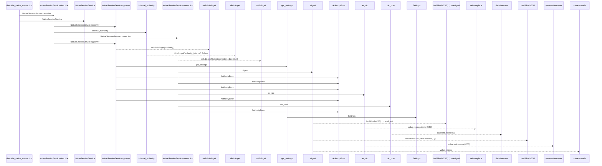
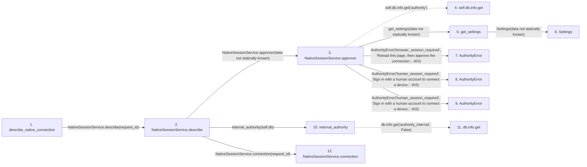

# describe_native_connection

**Entry point:** `describe_native_connection` (`http`)
**Source:** [routers_identity](../modules/routers_identity.md)
**Modules touched:** [authority](../modules/authority.md), [config](../modules/config.md), [identity_service](../modules/identity_service.md), [native_session_service](../modules/native_session_service.md), and 2 more

**Complete modules touched:**

- [authority](../modules/authority.md)
- [config](../modules/config.md)
- [identity_service](../modules/identity_service.md)
- [native_session_service](../modules/native_session_service.md)
- [routers_identity](../modules/routers_identity.md)
- [time](../modules/time.md)

## Call sequence

> Static overview in presentation order, not runtime execution order. Arrows retain captured callers; representative internal continuations and boundary examples precede repeated helper detail.

<!-- Auto-generated from static call edges. Dashed arrows are external or unresolved calls. Reviewed runtime conditions and side effects belong in Behavior. -->

> Call sequence diagram shows 25 of 25 interactions; 0 omitted to keep the visualization within the 30-interaction and generated-diagram limits, with uncertain identities omitted rather than inferred.

> Captured boundary calls: external 2 of 2 (0 omitted); unresolved 7 of 7 (0 omitted). These counts cover the captured static trace.
> Detailed flow queries retain their own coverage and limits; omitted paths may execute at runtime.

## Data flow

<!-- Auto-generated static analysis. Treat values and boundaries as best-effort hints, not runtime proof. -->

### Analysis coverage

**Effect analysis partially available.** Flow assembly and source effect analysis are separate; empty observations do not prove an empty handler body.

Source steps: 17; effect analysis evaluated: 10, partial: 0, unavailable: 7. Counts include steps omitted from the displayed trace.

Collector observations for 10 source steps with known totals: observed: 30, emitted: 30, omitted: 0. Unavailable totals are excluded.

- Callable record unavailable for one or more source steps; those steps have no represented callable body.
- Effect collector totals unavailable; observed counts cover captured records only.

| Step | Callable record | Effect analysis | Collector totals | Observed | Emitted | Omitted |
|---|---|---|---|---:|---:|---:|
| `describe_native_connection` | `available` | `evaluated` | `available` | `5` | `5` | `0` |
| `NativeSessionService.describe` | `available` | `evaluated` | `available` | `3` | `3` | `0` |
| `NativeSessionService.approver` | `available` | `evaluated` | `available` | `3` | `3` | `0` |
| `self.db.info.get` | `not_applicable` | `not_applicable` | `not_applicable` | — | — | — |
| `get_settings` | `available` | `evaluated` | `available` | `1` | `1` | `0` |
| `Settings` | `unavailable` | `unavailable` | `unavailable` | — | — | — |
| `AuthorityError` | `unavailable` | `unavailable` | `unavailable` | — | — | — |
| `AuthorityError` | `unavailable` | `unavailable` | `unavailable` | — | — | — |
| `AuthorityError` | `unavailable` | `unavailable` | `unavailable` | — | — | — |
| `internal_authority` | `available` | `evaluated` | `available` | `3` | `3` | `0` |
| `db.info.get` | `not_applicable` | `not_applicable` | `not_applicable` | — | — | — |
| `NativeSessionService.connection` | `available` | `evaluated` | `available` | `3` | `3` | `0` |

### Step data

| Step | Inputs | Reads | Writes | Returns |
|---|---|---|---|---|
| `describe_native_connection` | `request_id: str`, `response: Response`, `db: Database` | - | `response.headers[...]` | `...` |
| `NativeSessionService.describe` | `request_id` | `self.db` | - | `{...}` |
| `NativeSessionService.approver` | `row` | - | - | `authority`, `authority` |
| `self.db.info.get` | - | - | - | - |
| `get_settings` | - | - | - | `Settings(...)` |
| `Settings` | - | - | - | - |
| `AuthorityError` | - | - | - | - |
| `AuthorityError` | - | - | - | - |
| `AuthorityError` | - | - | - | - |
| `internal_authority` | `db` | - | `db.info[...]`, `db.info[...]` | - |
| `db.info.get` | - | - | - | - |
| `NativeSessionService.connection` | `request_id` | `NativeConnection` | - | `row` |

### Call data

| From | To | Line | Call |
|---|---|---:|---|
| describe_native_connection | NativeSessionService.describe | 118 | `NativeSessionService(db).describe(request_id)` |
| NativeSessionService.describe | NativeSessionService.approver | 81 | `self.approver(data not statically known)` |
| NativeSessionService.approver | self.db.info.get | 33 | `self.db.info.get('authority')` |
| NativeSessionService.approver | get_settings | 35 | `get_settings(data not statically known)` |
| get_settings | Settings | 524 | `Settings(data not statically known)` |
| NativeSessionService.approver | AuthorityError | 37 | `AuthorityError('browser_session_required', 'Reload this page, then approve the connection.', 403)` |
| NativeSessionService.approver | AuthorityError | 39 | `AuthorityError('human_session_required', 'Sign in with a human account to connect a device.', 403)` |
| NativeSessionService.approver | AuthorityError | 44 | `AuthorityError('human_session_required', 'Sign in with a human account to connect a device.', 403)` |
| NativeSessionService.describe | internal_authority | 82 | `internal_authority(self.db)` |
| internal_authority | db.info.get | 92 | `db.info.get('authority_internal', False)` |
| NativeSessionService.describe | NativeSessionService.connection | 83 | `self.connection(request_id)` |

### Boundary effects

*No boundary-effect observations were captured in this static trace.*

### Static analysis gaps

| Kind | Step | Target | Line |
|---|---|---|---:|
| unresolved_call | `NativeSessionService.approver` | `self.db.info.get` | 33 |
| unresolved_call | `internal_authority` | `db.info.get` | 92 |
| step_limit | `describe_native_connection` | `first 12 steps` | 0 |

## Behavior

Requires a human session and returns only the display code, expiry, and approval state for a live connection. It does not return the challenge, approving session identity, or token.
