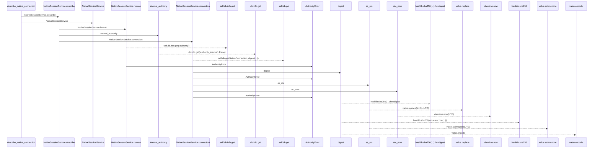
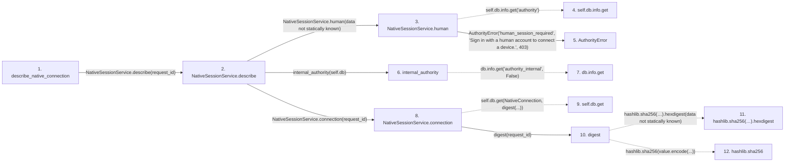

# describe_native_connection

**Entry point:** `describe_native_connection` (`http`)
**Source:** [routers_identity](../modules/routers_identity.md)
**Modules touched:** [authority](../modules/authority.md), [identity_service](../modules/identity_service.md), [native_session_service](../modules/native_session_service.md), [routers_identity](../modules/routers_identity.md), and 1 more

**Complete modules touched:**

- [authority](../modules/authority.md)
- [identity_service](../modules/identity_service.md)
- [native_session_service](../modules/native_session_service.md)
- [routers_identity](../modules/routers_identity.md)
- [time](../modules/time.md)

## Call sequence

> Static overview in presentation order, not runtime execution order. Arrows retain captured callers; representative internal continuations and boundary examples precede repeated helper detail.

<!-- Auto-generated from static call edges. Dashed arrows are external or unresolved calls. Reviewed runtime conditions and side effects belong in Behavior. -->

> Call sequence diagram shows 20 of 20 interactions; 0 omitted to keep the visualization within the 30-interaction and generated-diagram limits, with uncertain identities omitted rather than inferred.

> Captured boundary calls: external 2 of 2 (0 omitted); unresolved 7 of 7 (0 omitted). These counts cover the captured static trace.
> Detailed flow queries retain their own coverage and limits; omitted paths may execute at runtime.

## Data flow

<!-- Auto-generated static analysis. Treat values and boundaries as best-effort hints, not runtime proof. -->

### Analysis coverage

**Effect analysis partially available.** Flow assembly and source effect analysis are separate; empty observations do not prove an empty handler body.

Source steps: 12; effect analysis evaluated: 8, partial: 0, unavailable: 4. Counts include steps omitted from the displayed trace.

Collector observations for 8 source steps with known totals: observed: 24, emitted: 24, omitted: 0. Unavailable totals are excluded.

- Callable record unavailable for one or more source steps; those steps have no represented callable body.
- Effect collector totals unavailable; observed counts cover captured records only.

| Step | Callable record | Effect analysis | Collector totals | Observed | Emitted | Omitted |
|---|---|---|---|---:|---:|---:|
| `describe_native_connection` | `available` | `evaluated` | `available` | `5` | `5` | `0` |
| `NativeSessionService.describe` | `available` | `evaluated` | `available` | `3` | `3` | `0` |
| `NativeSessionService.human` | `available` | `evaluated` | `available` | `1` | `1` | `0` |
| `self.db.info.get` | `not_applicable` | `not_applicable` | `not_applicable` | — | — | — |
| `AuthorityError` | `unavailable` | `unavailable` | `unavailable` | — | — | — |
| `internal_authority` | `available` | `evaluated` | `available` | `3` | `3` | `0` |
| `db.info.get` | `not_applicable` | `not_applicable` | `not_applicable` | — | — | — |
| `NativeSessionService.connection` | `available` | `evaluated` | `available` | `3` | `3` | `0` |
| `self.db.get` | `not_applicable` | `not_applicable` | `not_applicable` | — | — | — |
| `digest` | `available` | `evaluated` | `available` | `2` | `2` | `0` |
| `hashlib.sha256(…).hexdigest` | `not_applicable` | `not_applicable` | `not_applicable` | — | — | — |
| `hashlib.sha256` | `not_applicable` | `not_applicable` | `not_applicable` | — | — | — |

### Step data

| Step | Inputs | Reads | Writes | Returns |
|---|---|---|---|---|
| `describe_native_connection` | `request_id: str`, `response: Response`, `db: Database` | - | `response.headers[...]` | `...` |
| `NativeSessionService.describe` | `request_id` | `self.db` | - | `{...}` |
| `NativeSessionService.human` | - | - | - | `authority` |
| `self.db.info.get` | - | - | - | - |
| `AuthorityError` | - | - | - | - |
| `internal_authority` | `db` | - | `db.info[...]`, `db.info[...]` | - |
| `db.info.get` | - | - | - | - |
| `NativeSessionService.connection` | `request_id` | `NativeConnection` | - | `row` |
| `self.db.get` | - | - | - | - |
| `digest` | `value: str` | - | - | `...` |
| `hashlib.sha256(…).hexdigest` | - | - | - | - |
| `hashlib.sha256` | - | - | - | - |

### Call data

| From | To | Line | Call |
|---|---|---:|---|
| describe_native_connection | NativeSessionService.describe | 98 | `NativeSessionService(db).describe(request_id)` |
| NativeSessionService.describe | NativeSessionService.human | 64 | `self.human(data not statically known)` |
| NativeSessionService.human | self.db.info.get | 26 | `self.db.info.get('authority')` |
| NativeSessionService.human | AuthorityError | 28 | `AuthorityError('human_session_required', 'Sign in with a human account to connect a device.', 403)` |
| NativeSessionService.describe | internal_authority | 65 | `internal_authority(self.db)` |
| internal_authority | db.info.get | 87 | `db.info.get('authority_internal', False)` |
| NativeSessionService.describe | NativeSessionService.connection | 66 | `self.connection(request_id)` |
| NativeSessionService.connection | self.db.get | 32 | `self.db.get(NativeConnection, digest(...))` |
| NativeSessionService.connection | digest | 32 | `digest(request_id)` |
| digest | hashlib.sha256(…).hexdigest | 27 | `hashlib.sha256(value.encode()).hexdigest(data not statically known)` |
| digest | hashlib.sha256 | 27 | `hashlib.sha256(value.encode(...))` |

### Boundary effects

*No boundary-effect observations were captured in this static trace.*

### Static analysis gaps

| Kind | Step | Target | Line |
|---|---|---|---:|
| unresolved_call | `NativeSessionService.human` | `self.db.info.get` | 26 |
| unresolved_call | `internal_authority` | `db.info.get` | 87 |
| unresolved_call | `NativeSessionService.connection` | `self.db.get` | 32 |
| unresolved_call | `digest` | `hashlib.sha256(value.encode()).hexdigest` | 27 |
| external_call | `digest` | `hashlib.sha256` | 27 |
| step_limit | `describe_native_connection` | `first 12 steps` | 0 |

## Behavior

Requires a human session and returns only the display code, expiry, and approval state for a live connection. It does not return the challenge, approving session identity, or token.
