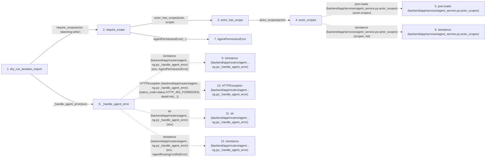

# dry_run_iteration_import

**Entry point:** `dry_run_iteration_import` (`http`)
**Source:** [routers_agent_planning](../modules/routers_agent_planning.md)
**Modules touched:** [agent_service](../modules/agent_service.md), [authority](../modules/authority.md), [commands](../modules/commands.md), [config](../modules/config.md), and 10 more

**Complete modules touched:**

- [agent_service](../modules/agent_service.md)
- [authority](../modules/authority.md)
- [commands](../modules/commands.md)
- [config](../modules/config.md)
- [export](../modules/export.md)
- [import_parser](../modules/import_parser.md)
- [import_planning_service](../modules/import_planning_service.md)
- [import_review_service](../modules/import_review_service.md)
- [iteration_service](../modules/iteration_service.md)
- [mcp_agent_tools](../modules/mcp_agent_tools.md)
- [planning_input_context](../modules/planning_input_context.md)
- [routers_agent_planning](../modules/routers_agent_planning.md)
- [schemas_iteration](../modules/schemas_iteration.md)
- [team_service](../modules/team_service.md)

## Call sequence

> Static overview in presentation order, not runtime execution order. Arrows retain captured callers; representative internal continuations and boundary examples precede repeated helper detail.

```mermaid
sequenceDiagram
    participant p0 as dry_run_iteration_import
    participant p1 as require_scope
    participant p2 as _validate_import_data
    participant p3 as preview_iteration_import
    participant p4 as _handle_agent_error
    participant p5 as _read_json_upload
    participant p6 as actor_has_scope
    participant p7 as validate_import_payload
    participant p8 as dry_run_import
    participant p9 as _authorize_reviewer
    participant p10 as _bound_dry_run
    participant p11 as _require_readable_profiles
    participant p12 as _explicit_profile_ids
    participant p13 as import_scope_revisions
    participant p14 as _operator_authority
    participant p15 as _run_within_budget
    participant p16 as target_sha256
    participant p17 as changes_sha256
    participant p18 as affected_iteration_ids
    participant p19 as _sha256
    participant p20 as _list_field
    participant p21 as _referenced_project_ids
    participant p22 as _profile_reference
    participant p23 as require_project
    participant p24 as _file_tasks
    participant p25 as run_import_with_changes
    participant p26 as _too_slow
    participant p27 as get_settings
    participant p28 as write_new_iteration_import
    participant p29 as HTTPException (backend/app/routers/agent…:dry_run_iteration_import)
    participant p30 as exc.detail (backend/app/routers/agent…:dry_run_iteration_import)
    p0->>p1: require_scope
    p0->>p2: _validate_import_data
    p0->>p3: preview_iteration_import
    p0->>p4: _handle_agent_error
    p0->>p5: _read_json_upload
    p1->>p6: actor_has_scope
    p3->>p7: validate_import_payload
    p3->>p8: dry_run_import
    p8->>p9: _authorize_reviewer
    p8->>p10: _bound_dry_run
    p8->>p11: _require_readable_profiles
    p8->>p12: _explicit_profile_ids
    p8->>p13: import_scope_revisions
    p8->>p14: _operator_authority
    p8->>p15: _run_within_budget
    p8->>p16: target_sha256
    p8->>p17: changes_sha256
    p13->>p18: affected_iteration_ids
    p16->>p19: _sha256
    p10->>p20: _list_field
    p9->>p21: _referenced_project_ids
    p12->>p22: _profile_reference
    p9->>p23: require_project
    p12->>p24: _file_tasks
    p15->>p25: run_import_with_changes
    p15->>p26: _too_slow
    p23->>p27: get_settings
    p25->>p28: write_new_iteration_import
    p0-->>p29: HTTPException (backend/app/routers/agent…:dry_run_iteration_import)(status_code=status.HTTP_422_UNPROCESSABLE_CONTENT, detail=exc.detail(...))
    p0-->>p30: exc.detail (backend/app/routers/agent…:dry_run_iteration_import)
```

<!-- Auto-generated from static call edges. Dashed arrows are external or unresolved calls. Reviewed runtime conditions and side effects belong in Behavior. -->

> Call sequence diagram shows 30 of 531 interactions; 501 omitted to keep the visualization within the 30-interaction and generated-diagram limits, with uncertain identities omitted rather than inferred.

> Captured boundary calls: external 1 of 207 (206 omitted); unresolved 1 of 215 (214 omitted). These counts cover the captured static trace.

Omitted captured detail, grouped by actual caller occurrence and target module:

| Caller | Parent step | Target module | Kind | Omitted interactions |
| --- | --- | --- | --- | --- |
| `backend/app/services/agent_service.py:actor_has_scope` | 3 | [backend/app/services/agent_service.py](../modules/agent_service.md) | internal | 1 |
| `backend/app/services/agent_service.py:actor_scopes` | 4 | - | external | 2 |
| `backend/app/services/agent_service.py:require_scope` | 2 | [backend/app/services/agent_service.py](../modules/agent_service.md) | internal | 1 |
| `backend/app/routers/agent_planning.py:_handle_agent_error` | 8 | - | external | 21 |
| `backend/app/routers/agent_planning.py:_handle_agent_error` | 8 | - | unresolved | 3 |
| `backend/app/routers/export.py:_read_json_upload` | 33 | - | unresolved | 2 |
| `backend/app/routers/export.py:_read_json_upload` | 33 | - | external | 7 |
| `backend/app/routers/export.py:_validate_import_data` | 43 | - | unresolved | 2 |
> Omission summary shows 8 of 117 groups; 109 further groups are not expanded here. Counts above include all omitted interactions.
> Detailed flow queries retain their own coverage and limits; omitted paths may execute at runtime.

> Trace truncated at the depth limit; deeper calls are omitted.

## Data flow

<!-- Auto-generated static analysis. Treat values and boundaries as best-effort hints, not runtime proof. -->

### Analysis coverage

**Effect analysis partially available.** Flow assembly and source effect analysis are separate; empty observations do not prove an empty handler body.

Source steps: 110; effect analysis evaluated: 78, partial: 5, unavailable: 27. Counts include steps omitted from the displayed trace.

Collector observations for 83 source steps with known totals: observed: 402, emitted: 382, omitted: 20. Unavailable totals are excluded.

- Callable record unavailable for one or more source steps; those steps have no represented callable body.
- Effect collector omitted observations before flow assembly; displayed effects are partial.
- Effect collector totals unavailable; observed counts cover captured records only.

| Step | Callable record | Effect analysis | Collector totals | Observed | Emitted | Omitted |
|---|---|---|---|---:|---:|---:|
| `dry_run_iteration_import` | `available` | `evaluated` | `available` | `6` | `6` | `0` |
| `require_scope` | `available` | `evaluated` | `available` | `2` | `2` | `0` |
| `actor_has_scope` | `available` | `evaluated` | `available` | `3` | `3` | `0` |
| `actor_scopes` | `available` | `evaluated` | `available` | `3` | `3` | `0` |
| `json.loads (backend/app/services/agent_service.py:actor_scopes)` | `not_applicable` | `not_applicable` | `not_applicable` | — | — | — |
| `isinstance (backend/app/services/agent_service.py:actor_scopes)` | `not_applicable` | `not_applicable` | `not_applicable` | — | — | — |
| `AgentPermissionError` | `unavailable` | `unavailable` | `unavailable` | — | — | — |
| `_handle_agent_error` | `available` | `partial` | `available` | `15` | `9` | `6` |
| `isinstance (backend/app/routers/agent…ng.py:_handle_agent_error)` | `not_applicable` | `not_applicable` | `not_applicable` | — | — | — |
| `HTTPException (backend/app/routers/agent…ng.py:_handle_agent_error)` | `not_applicable` | `not_applicable` | `not_applicable` | — | — | — |
| `str (backend/app/routers/agent…ng.py:_handle_agent_error)` | `not_applicable` | `not_applicable` | `not_applicable` | — | — | — |
| `isinstance (backend/app/routers/agent…ng.py:_handle_agent_error)` | `not_applicable` | `not_applicable` | `not_applicable` | — | — | — |

### Step data

| Step | Inputs | Reads | Writes | Returns |
|---|---|---|---|---|
| `dry_run_iteration_import` | `file: Annotated[UploadFile, File(...)]`, `actor: Annotated[AgentActor, Depends(get_agent_actor)]`, `db: Annotated[AsyncSession, Depends(get_db, scope='function')]`, `iteration_id: int \| None` | `status` | - | `...` |
| `require_scope` | `actor: AgentActor`, `scope: str` | - | - | - |
| `actor_has_scope` | `actor: AgentActor`, `scope: str` | - | - | `...` |
| `actor_scopes` | `actor: AgentActor` | `json` | - | `...` |
| `json.loads (backend/app/services/agent_service.py:actor_scopes)` | - | - | - | - |
| `isinstance (backend/app/services/agent_service.py:actor_scopes)` | - | - | - | - |
| `AgentPermissionError` | - | - | - | - |
| `_handle_agent_error` | `exc: Exception` | `AgentPermissionError`, `status`, `AgentRoutingConflictError`, `status`, `TaskVersionConflictError`, `status`, `AgentConflictError`, `status` | - | - |
| `isinstance (backend/app/routers/agent…ng.py:_handle_agent_error)` | - | - | - | - |
| `HTTPException (backend/app/routers/agent…ng.py:_handle_agent_error)` | - | - | - | - |
| `str (backend/app/routers/agent…ng.py:_handle_agent_error)` | - | - | - | - |
| `isinstance (backend/app/routers/agent…ng.py:_handle_agent_error)` | - | - | - | - |

### Call data

| From | To | Line | Call |
|---|---|---:|---|
| dry_run_iteration_import | require_scope | 166 | `require_scope(actor, 'planning:write')` |
| require_scope | actor_has_scope | 113 | `actor_has_scope(actor, scope)` |
| actor_has_scope | actor_scopes | 95 | `actor_scopes(actor)` |
| actor_scopes | json.loads (backend/app/services/agent_service.py:actor_scopes) | 87 | `json.loads(actor.scopes)` |
| actor_scopes | isinstance (backend/app/services/agent_service.py:actor_scopes) | 90 | `isinstance(scopes, list)` |
| require_scope | AgentPermissionError | 114 | `AgentPermissionError(...)` |
| dry_run_iteration_import | _handle_agent_error | 168 | `_handle_agent_error(exc)` |
| _handle_agent_error | isinstance (backend/app/routers/agent…ng.py:_handle_agent_error) | 110 | `isinstance(exc, AgentPermissionError)` |
| _handle_agent_error | HTTPException (backend/app/routers/agent…ng.py:_handle_agent_error) | 111 | `HTTPException(status_code=status.HTTP_403_FORBIDDEN, detail=str(...))` |
| _handle_agent_error | str (backend/app/routers/agent…ng.py:_handle_agent_error) | 111 | `str(exc)` |
| _handle_agent_error | isinstance (backend/app/routers/agent…ng.py:_handle_agent_error) | 112 | `isinstance(exc, AgentRoutingConflictError)` |

### Boundary effects

*No boundary-effect observations were captured in this static trace.*

### Static analysis gaps

| Kind | Step | Target | Line |
|---|---|---|---:|
| external_call | `actor_scopes` | `json.loads` | 87 |
| external_call | `actor_scopes` | `isinstance` | 90 |
| external_call | `_handle_agent_error` | `isinstance` | 110 |
| external_call | `_handle_agent_error` | `HTTPException` | 111 |
| external_call | `_handle_agent_error` | `isinstance` | 112 |
| step_limit | `dry_run_iteration_import` | `first 12 steps` | 0 |
| truncated_flow | `dry_run_iteration_import` | `depth limit` | 0 |

## Behavior

This flow starts at `dry_run_iteration_import` and is classified as `http`. The generated call and data-flow sections are bounded static projections; runtime conditions and side effects require source-level confirmation.
