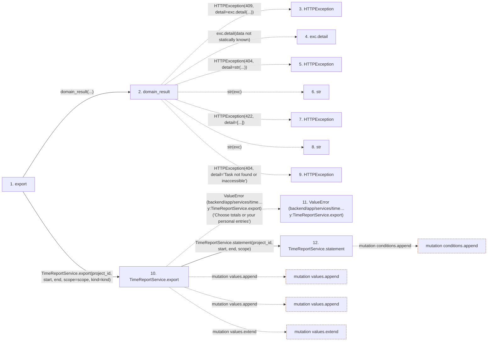

# export

**Entry point:** `export` (`http`)
**Source:** [time_entries](../modules/time_entries.md)
**Modules touched:** [authority](../modules/authority.md), [query_limits](../modules/query_limits.md), [routers_task_domain](../modules/routers_task_domain.md), [time_entries](../modules/time_entries.md), and 1 more

**Complete modules touched:**

- [authority](../modules/authority.md)
- [query_limits](../modules/query_limits.md)
- [routers_task_domain](../modules/routers_task_domain.md)
- [time_entries](../modules/time_entries.md)
- [time_report_service](../modules/time_report_service.md)

## Call sequence

> Static overview in presentation order, not runtime execution order. Arrows retain captured callers; representative internal continuations and boundary examples precede repeated helper detail.

```mermaid
sequenceDiagram
    participant p0 as export
    participant p1 as TimeReportService.export
    participant p2 as domain_result
    participant p3 as TimeReportService
    participant p4 as TimeReportService.statement
    participant p5 as internal_authority
    participant p6 as CollectionLimitExceededError
    participant p7 as TimeReportService.item
    participant p8 as AuthorityError
    participant p9 as TimeReportService.csv
    participant p10 as Response
    participant p11 as exc.detail
    participant p12 as HTTPException
    participant p13 as ValueError (backend/app/services/time…y:TimeReportService.export)
    participant p14 as str
    participant p15 as (…).all (backend/app/services/time…y:TimeReportService.export)
    participant p16 as self.db.execute
    participant p17 as query.order_by(…).limit
    participant p18 as query.order_by
    participant p19 as len
    participant p20 as values.append
    participant p21 as self.ledger.principal_id (backend/app/services/time…y:TimeReportService.export)
    participant p22 as (…).all (backend/app/services/time…imeReportService.export, 1)
    participant p23 as self.db.scalars
    participant p24 as select(…).where(…).order_by(…).limit
    participant p25 as select(…).where(…).order_by
    p0->>p1: TimeReportService.export
    p0->>p2: domain_result
    p0->>p3: TimeReportService
    p1->>p4: TimeReportService.statement
    p1->>p5: internal_authority
    p1->>p6: CollectionLimitExceededError
    p1->>p7: TimeReportService.item
    p1->>p8: AuthorityError
    p1->>p9: TimeReportService.csv
    p0-->>p10: Response(content=content, media_type='text/csv', headers={...})
    p2-->>p11: exc.detail
    p2-->>p12: HTTPException(409, detail=exc.detail(...))
    p1-->>p13: ValueError (backend/app/services/time…y:TimeReportService.export)('Choose totals or your personal entries')
    p2-->>p12: HTTPException(404, detail=str(...))
    p2-->>p14: str(exc)
    p1-->>p15: (…).all (backend/app/services/time…y:TimeReportService.export)
    p2-->>p12: HTTPException(422, detail=[...])
    p1-->>p16: self.db.execute(...)
    p2-->>p14: str(exc)
    p1-->>p17: query.order_by(…).limit(5001)
    p2-->>p12: HTTPException(404, detail='Task not found or inaccessible')
    p1-->>p18: query.order_by('task_id')
    p1-->>p19: len(rows)
    p1-->>p20: values.append([...])
    p1-->>p20: values.append([...])
    p1-->>p21: self.ledger.principal_id (backend/app/services/time…y:TimeReportService.export)
    p1-->>p22: (…).all (backend/app/services/time…imeReportService.export, 1)
    p1-->>p23: self.db.scalars(...)
    p1-->>p24: select(…).where(…).order_by(…).limit(5001)
    p1-->>p25: select(…).where(…).order_by(TimeEntry.id)
```

<!-- Auto-generated from static call edges. Dashed arrows are external or unresolved calls. Reviewed runtime conditions and side effects belong in Behavior. -->

> Call sequence diagram shows 30 of 94 interactions; 64 omitted to keep the visualization within the 30-interaction and generated-diagram limits, with uncertain identities omitted rather than inferred.

> Captured boundary calls: external 9 of 32 (23 omitted); unresolved 12 of 50 (38 omitted). These counts cover the captured static trace.

Omitted captured detail, grouped by actual caller occurrence and target module:

| Caller | Parent step | Target module | Kind | Omitted interactions |
| --- | --- | --- | --- | --- |
| `backend/app/services/time_report_service.py:TimeReportService.statement` | 12 | - | unresolved | 32 |
| `backend/app/services/time_report_service.py:TimeReportService.statement` | 12 | - | external | 19 |
| `backend/app/services/time_report_service.py:TimeReportService.statement` | 12 | [backend/app/authority.py](../modules/authority.md) | internal | 2 |
| `backend/app/authority.py:internal_authority` | 60 | - | unresolved | 1 |
| `backend/app/services/time_report_service.py:TimeReportService.export` | 10 | - | unresolved | 2 |
| `backend/app/services/time_report_service.py:TimeReportService.export` | 10 | - | external | 2 |
| `backend/app/services/time_report_service.py:TimeReportService.export` | 10 | [backend/app/query_limits.py](../modules/query_limits.md) | internal | 1 |
| `backend/app/services/time_report_service.py:TimeReportService.csv` | 88 | - | external | 2 |
> Omission summary shows 8 of 9 groups; 1 further groups are not expanded here. Counts above include all omitted interactions.
> Detailed flow queries retain their own coverage and limits; omitted paths may execute at runtime.

## Data flow

<!-- Auto-generated static analysis. Treat values and boundaries as best-effort hints, not runtime proof. -->

### Analysis coverage

**Effect analysis partially available.** Flow assembly and source effect analysis are separate; empty observations do not prove an empty handler body.

Source steps: 13; effect analysis evaluated: 8, partial: 0, unavailable: 5. Counts include steps omitted from the displayed trace.

Collector observations for 8 source steps with known totals: observed: 42, emitted: 42, omitted: 0. Unavailable totals are excluded.

- Callable record unavailable for one or more source steps; those steps have no represented callable body.
- Effect collector totals unavailable; observed counts cover captured records only.

| Step | Callable record | Effect analysis | Collector totals | Observed | Emitted | Omitted |
|---|---|---|---|---:|---:|---:|
| `export` | `available` | `evaluated` | `available` | `7` | `7` | `0` |
| `domain_result` | `available` | `evaluated` | `available` | `3` | `3` | `0` |
| `HTTPException` | `not_applicable` | `not_applicable` | `not_applicable` | — | — | — |
| `exc.detail` | `not_applicable` | `not_applicable` | `not_applicable` | — | — | — |
| `HTTPException` | `not_applicable` | `not_applicable` | `not_applicable` | — | — | — |
| `str` | `not_applicable` | `not_applicable` | `not_applicable` | — | — | — |
| `HTTPException` | `not_applicable` | `not_applicable` | `not_applicable` | — | — | — |
| `str` | `not_applicable` | `not_applicable` | `not_applicable` | — | — | — |
| `HTTPException` | `not_applicable` | `not_applicable` | `not_applicable` | — | — | — |
| `TimeReportService.export` | `available` | `evaluated` | `available` | `10` | `10` | `0` |
| `ValueError (backend/app/services/time…y:TimeReportService.export)` | `not_applicable` | `not_applicable` | `not_applicable` | — | — | — |
| `TimeReportService.statement` | `available` | `evaluated` | `available` | `12` | `12` | `0` |

### Step data

| Step | Inputs | Reads | Writes | Returns |
|---|---|---|---|---|
| `export` | `db: DB`, `project_id: int`, `start: date`, `end: date`, `scope: Literal['mine', 'project']`, `kind: Literal['totals', 'entries']` | - | - | `Response(...)` |
| `domain_result` | `awaitable` | `TaskVersionConflictError` | - | `result` |
| `HTTPException` | - | - | - | - |
| `exc.detail` | - | - | - | - |
| `HTTPException` | - | - | - | - |
| `str` | - | - | - | - |
| `HTTPException` | - | - | - | - |
| `str` | - | - | - | - |
| `HTTPException` | - | - | - | - |
| `TimeReportService.export` | `project_id`, `start`, `end`, `scope`, `kind` | `self.db` | - | `self.csv(...)` |
| `ValueError (backend/app/services/time…y:TimeReportService.export)` | - | - | - | - |
| `TimeReportService.statement` | `project_id`, `start`, `end`, `scope` | `TimeEntry`, `TimeEntry`, `TimeEntry`, `Task`, `Task`, `self.db` | - | `(...)` |

### Call data

| From | To | Line | Call |
|---|---|---:|---|
| export | domain_result | 60 | `domain_result(...)` |
| domain_result | HTTPException | 51 | `HTTPException(409, detail=exc.detail(...))` |
| domain_result | exc.detail | 51 | `exc.detail(data not statically known)` |
| domain_result | HTTPException | 53 | `HTTPException(404, detail=str(...))` |
| domain_result | str | 53 | `str(exc)` |
| domain_result | HTTPException | 55 | `HTTPException(422, detail=[...])` |
| domain_result | str | 55 | `str(exc)` |
| domain_result | HTTPException | 57 | `HTTPException(404, detail='Task not found or inaccessible')` |
| export | TimeReportService.export | 60 | `TimeReportService(db).export(project_id, start, end, scope=scope, kind=kind)` |
| TimeReportService.export | ValueError (backend/app/services/time…y:TimeReportService.export) | 99 | `ValueError('Choose totals or your personal entries')` |
| TimeReportService.export | TimeReportService.statement | 100 | `self.statement(project_id, start, end, scope)` |

### Boundary effects

| Kind | Target | Step | Line |
|---|---|---|---:|
| mutation | `values.append` | `TimeReportService.export` | 109 |
| mutation | `values.append` | `TimeReportService.export` | 110 |
| mutation | `values.extend` | `TimeReportService.export` | 121 |
| mutation | `conditions.append` | `TimeReportService.statement` | 33 |

### Static analysis gaps

| Kind | Step | Target | Line |
|---|---|---|---:|
| external_call | `domain_result` | `HTTPException` | 51 |
| unresolved_call | `domain_result` | `exc.detail` | 51 |
| external_call | `domain_result` | `HTTPException` | 53 |
| external_call | `domain_result` | `HTTPException` | 55 |
| external_call | `domain_result` | `HTTPException` | 57 |
| external_call | `TimeReportService.export` | `ValueError` | 99 |
| step_limit | `export` | `first 12 steps` | 0 |

## Behavior

This flow starts at `export` and is classified as `http`. The generated call and data-flow sections are bounded static projections; runtime conditions and side effects require source-level confirmation.
