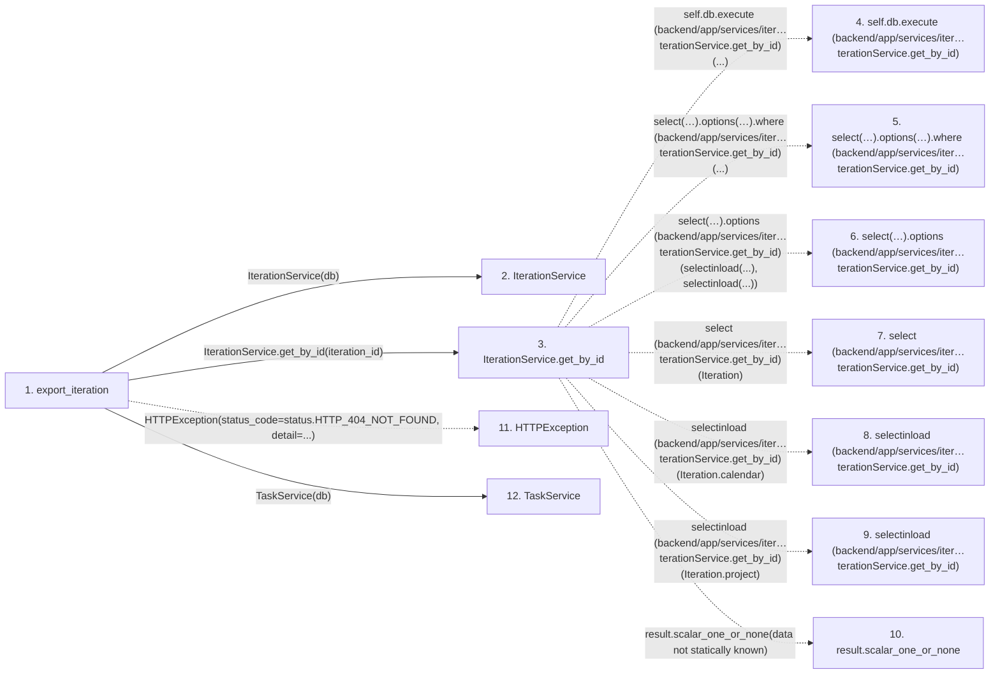

# export_iteration

**Entry point:** `export_iteration` (`http`)
**Source:** [export](../modules/export.md)
**Modules touched:** [authority](../modules/authority.md), [commands](../modules/commands.md), [export](../modules/export.md), [iteration_service](../modules/iteration_service.md), and 6 more

**Complete modules touched:**

- [authority](../modules/authority.md)
- [commands](../modules/commands.md)
- [export](../modules/export.md)
- [iteration_service](../modules/iteration_service.md)
- [query_limits](../modules/query_limits.md)
- [services_work_metrics](../modules/services_work_metrics.md)
- [task_hierarchy_service](../modules/task_hierarchy_service.md)
- [task_service](../modules/task_service.md)
- [team_service](../modules/team_service.md)
- [time](../modules/time.md)

## Call sequence

> Static overview in presentation order, not runtime execution order. Arrows retain captured callers; representative internal continuations and boundary examples precede repeated helper detail.

```mermaid
sequenceDiagram
    participant p0 as export_iteration
    participant p1 as TaskService.get_by_iteration
    participant p2 as TeamService.get_by_iteration
    participant p3 as aggregate_metrics
    participant p4 as _task_to_export
    participant p5 as IterationService
    participant p6 as IterationService.get_by_id
    participant p7 as TaskService
    participant p8 as TeamService
    participant p9 as TaskService._task_graph_query
    participant p10 as TaskService._load_iteration_tree
    participant p11 as working_today
    participant p12 as TaskHierarchyService._load_iteration_tree
    participant p13 as utc_now
    participant p14 as _scope_conditions
    participant p15 as TeamService._member_options
    participant p16 as CollectionLimitExceededError
    participant p17 as HierarchyScopeError
    participant p18 as TaskHierarchyService._task_graph_query
    participant p19 as TaskHierarchyService
    participant p20 as as_utc
    participant p21 as HTTPException
    participant p22 as iteration.start_date.isoformat
    participant p23 as iteration.end_date.isoformat
    participant p24 as calculate_member_workload
    participant p25 as v.start_date.isoformat
    participant p26 as v.end_date.isoformat
    participant p27 as JSONResponse
    participant p28 as jsonable_encoder
    participant p29 as self.db.execute (backend/app/services/iter…terationService.get_by_id)
    participant p30 as self.db.execute (backend/app/services/task…kService.get_by_iteration)
    p0->>p1: TaskService.get_by_iteration
    p0->>p2: TeamService.get_by_iteration
    p0->>p3: aggregate_metrics
    p0->>p4: _task_to_export
    p0->>p5: IterationService
    p0->>p6: IterationService.get_by_id
    p0->>p7: TaskService
    p0->>p8: TeamService
    p1->>p9: TaskService._task_graph_query
    p1->>p10: TaskService._load_iteration_tree
    p3->>p11: working_today
    p10->>p12: TaskHierarchyService._load_iteration_tree
    p3->>p13: utc_now
    p3->>p14: _scope_conditions
    p2->>p15: TeamService._member_options
    p1->>p16: CollectionLimitExceededError
    p3->>p17: HierarchyScopeError
    p9->>p18: TaskHierarchyService._task_graph_query
    p9->>p19: TaskHierarchyService
    p11->>p20: as_utc
    p0-->>p21: HTTPException(status_code=status.HTTP_404_NOT_FOUND, detail=...)
    p0-->>p22: iteration.start_date.isoformat
    p0-->>p23: iteration.end_date.isoformat
    p0-->>p24: calculate_member_workload(m, tasks)
    p0-->>p25: v.start_date.isoformat
    p0-->>p26: v.end_date.isoformat
    p0-->>p27: JSONResponse(content=jsonable_encoder(...), headers={...})
    p0-->>p28: jsonable_encoder(export_data)
    p6-->>p29: self.db.execute (backend/app/services/iter…terationService.get_by_id)(...)
    p1-->>p30: self.db.execute (backend/app/services/task…kService.get_by_iteration)(...)
```

<!-- Auto-generated from static call edges. Dashed arrows are external or unresolved calls. Reviewed runtime conditions and side effects belong in Behavior. -->

> Call sequence diagram shows 30 of 374 interactions; 344 omitted to keep the visualization within the 30-interaction and generated-diagram limits, with uncertain identities omitted rather than inferred.

> Captured boundary calls: external 3 of 141 (138 omitted); unresolved 7 of 202 (195 omitted). These counts cover the captured static trace.

Omitted captured detail, grouped by actual caller occurrence and target module:

| Caller | Parent step | Target module | Kind | Omitted interactions |
| --- | --- | --- | --- | --- |
| `backend/app/services/iteration_service.py:IterationService.get_by_id` | 3 | - | unresolved | 3 |
| `backend/app/services/iteration_service.py:IterationService.get_by_id` | 3 | - | external | 3 |
| `backend/app/services/task_service.py:TaskService.get_by_iteration` | 13 | - | unresolved | 5 |
| `backend/app/services/task_hierarchy_service.py:TaskHierarchyService._task_graph_query` | 18 | - | unresolved | 6 |
| `backend/app/services/task_hierarchy_service.py:TaskHierarchyService._task_graph_query` | 18 | - | external | 8 |
| `backend/app/services/task_service.py:TaskService.get_by_iteration` | 13 | - | external | 2 |
| `backend/app/services/task_hierarchy_service.py:TaskHierarchyService._load_iteration_tree` | 41 | - | unresolved | 20 |
| `backend/app/services/task_hierarchy_service.py:TaskHierarchyService._load_iteration_tree` | 41 | - | external | 11 |
> Omission summary shows 8 of 29 groups; 21 further groups are not expanded here. Counts above include all omitted interactions.
> Detailed flow queries retain their own coverage and limits; omitted paths may execute at runtime.

## Data flow

<!-- Auto-generated static analysis. Treat values and boundaries as best-effort hints, not runtime proof. -->

### Analysis coverage

**Effect analysis partially available.** Flow assembly and source effect analysis are separate; empty observations do not prove an empty handler body.

Source steps: 32; effect analysis evaluated: 22, partial: 0, unavailable: 10. Counts include steps omitted from the displayed trace.

Collector observations for 22 source steps with known totals: observed: 95, emitted: 95, omitted: 0. Unavailable totals are excluded.

- Callable record unavailable for one or more source steps; those steps have no represented callable body.
- Effect collector totals unavailable; observed counts cover captured records only.

| Step | Callable record | Effect analysis | Collector totals | Observed | Emitted | Omitted |
|---|---|---|---|---:|---:|---:|
| `export_iteration` | `available` | `evaluated` | `available` | `5` | `5` | `0` |
| `IterationService` | `unavailable` | `unavailable` | `unavailable` | — | — | — |
| `IterationService.get_by_id` | `available` | `evaluated` | `available` | `3` | `3` | `0` |
| `self.db.execute (backend/app/services/iter…terationService.get_by_id)` | `not_applicable` | `not_applicable` | `not_applicable` | — | — | — |
| `select(…).options(…).where (backend/app/services/iter…terationService.get_by_id)` | `not_applicable` | `not_applicable` | `not_applicable` | — | — | — |
| `select(…).options (backend/app/services/iter…terationService.get_by_id)` | `not_applicable` | `not_applicable` | `not_applicable` | — | — | — |
| `select (backend/app/services/iter…terationService.get_by_id)` | `not_applicable` | `not_applicable` | `not_applicable` | — | — | — |
| `selectinload (backend/app/services/iter…terationService.get_by_id)` | `not_applicable` | `not_applicable` | `not_applicable` | — | — | — |
| `selectinload (backend/app/services/iter…terationService.get_by_id)` | `not_applicable` | `not_applicable` | `not_applicable` | — | — | — |
| `result.scalar_one_or_none` | `not_applicable` | `not_applicable` | `not_applicable` | — | — | — |
| `HTTPException` | `not_applicable` | `not_applicable` | `not_applicable` | — | — | — |
| `TaskService` | `unavailable` | `unavailable` | `unavailable` | — | — | — |

### Step data

| Step | Inputs | Reads | Writes | Returns |
|---|---|---|---|---|
| `export_iteration` | `iteration_id: int`, `db: Annotated[AsyncSession, Depends(get_db, scope='function')]` | `status`, `MAX_SYNC_EXPORT_TASKS` | - | `JSONResponse(...)` |
| `IterationService` | - | - | - | - |
| `IterationService.get_by_id` | `iteration_id: int` | `Iteration` | - | `result.scalar_one_or_none(...)` |
| `self.db.execute (backend/app/services/iter…terationService.get_by_id)` | - | - | - | - |
| `select(…).options(…).where (backend/app/services/iter…terationService.get_by_id)` | - | - | - | - |
| `select(…).options (backend/app/services/iter…terationService.get_by_id)` | - | - | - | - |
| `select (backend/app/services/iter…terationService.get_by_id)` | - | - | - | - |
| `selectinload (backend/app/services/iter…terationService.get_by_id)` | - | - | - | - |
| `selectinload (backend/app/services/iter…terationService.get_by_id)` | - | - | - | - |
| `result.scalar_one_or_none` | - | - | - | - |
| `HTTPException` | - | - | - | - |
| `TaskService` | - | - | - | - |

### Call data

| From | To | Line | Call |
|---|---|---:|---|
| export_iteration | IterationService | 82 | `IterationService(db)` |
| export_iteration | IterationService.get_by_id | 83 | `iteration_service.get_by_id(iteration_id)` |
| IterationService.get_by_id | self.db.execute (backend/app/services/iter…terationService.get_by_id) | 323 | `self.db.execute(...)` |
| IterationService.get_by_id | select(…).options(…).where (backend/app/services/iter…terationService.get_by_id) | 324 | `select(Iteration).options(selectinload(Iteration.calendar), selectinload(Iteration.project)).where(...)` |
| IterationService.get_by_id | select(…).options (backend/app/services/iter…terationService.get_by_id) | 324 | `select(Iteration).options(selectinload(...), selectinload(...))` |
| IterationService.get_by_id | select (backend/app/services/iter…terationService.get_by_id) | 324 | `select(Iteration)` |
| IterationService.get_by_id | selectinload (backend/app/services/iter…terationService.get_by_id) | 326 | `selectinload(Iteration.calendar)` |
| IterationService.get_by_id | selectinload (backend/app/services/iter…terationService.get_by_id) | 327 | `selectinload(Iteration.project)` |
| IterationService.get_by_id | result.scalar_one_or_none | 331 | `result.scalar_one_or_none(data not statically known)` |
| export_iteration | HTTPException | 86 | `HTTPException(status_code=status.HTTP_404_NOT_FOUND, detail=...)` |
| export_iteration | TaskService | 91 | `TaskService(db)` |

### Boundary effects

*No boundary-effect observations were captured in this static trace.*

### Static analysis gaps

| Kind | Step | Target | Line |
|---|---|---|---:|
| unresolved_call | `IterationService.get_by_id` | `self.db.execute` | 323 |
| unresolved_call | `IterationService.get_by_id` | `select(Iteration).options(selectinload(Iteration.calendar), selectinload(Iteration.project)).where` | 324 |
| unresolved_call | `IterationService.get_by_id` | `select(Iteration).options` | 324 |
| external_call | `IterationService.get_by_id` | `select` | 324 |
| external_call | `IterationService.get_by_id` | `selectinload` | 326 |
| external_call | `IterationService.get_by_id` | `selectinload` | 327 |
| unresolved_call | `IterationService.get_by_id` | `result.scalar_one_or_none` | 331 |
| external_call | `export_iteration` | `HTTPException` | 86 |
| step_limit | `export_iteration` | `first 12 steps` | 0 |

## Behavior

This flow starts at `export_iteration` and is classified as `http`. The generated call and data-flow sections are bounded static projections; runtime conditions and side effects require source-level confirmation.
