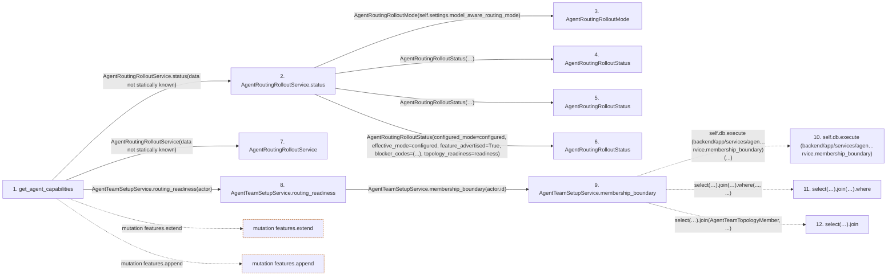

# get_agent_capabilities

**Entry point:** `get_agent_capabilities` (`http`)
**Source:** [routers_agent](../modules/routers_agent.md)
**Modules touched:** [agent_contract](../modules/agent_contract.md), [agent_routing_rollout](../modules/agent_routing_rollout.md), [agent_service](../modules/agent_service.md), [agent_team_setup](../modules/agent_team_setup.md), and 8 more

**Complete modules touched:**

- [agent_contract](../modules/agent_contract.md)
- [agent_routing_rollout](../modules/agent_routing_rollout.md)
- [agent_service](../modules/agent_service.md)
- [agent_team_setup](../modules/agent_team_setup.md)
- [agent_team_setup_service](../modules/agent_team_setup_service.md)
- [authority](../modules/authority.md)
- [autonomy_canonical](../modules/autonomy_canonical.md)
- [config](../modules/config.md)
- [routers_agent](../modules/routers_agent.md)
- [schemas_agent](../modules/schemas_agent.md)
- [task_domain_service](../modules/task_domain_service.md)
- [time](../modules/time.md)

## Call sequence

> Static overview in presentation order, not runtime execution order. Arrows retain captured callers; representative internal continuations and boundary examples precede repeated helper detail.

```mermaid
sequenceDiagram
    participant p0 as get_agent_capabilities
    participant p1 as AgentRoutingRolloutService.status
    participant p2 as AgentTeamSetupService.routing_readiness
    participant p3 as domain_capabilities
    participant p4 as actor_has_scope
    participant p5 as AgentRoutingRolloutService
    participant p6 as AgentTeamSetupService
    participant p7 as agent_contract_features
    participant p8 as get_settings
    participant p9 as AgentCapabilitiesResponse
    participant p10 as actor_scopes
    participant p11 as AgentTeamSetupService.membership_boundary
    participant p12 as AgentRoutingTopologyReadiness.unavailable
    participant p13 as AgentRoutingTopologyReadiness.ready
    participant p14 as AgentRoutingTopologyReadiness.not_ready
    participant p15 as AgentTeamSetupService._status_for_topology
    participant p16 as _member_contract_outdated
    participant p17 as AgentTeamSetupService._handoff
    participant p18 as _canonical_json
    participant p19 as ensure_agent_team_secret_free
    participant p20 as AgentRoutingRolloutMode
    participant p21 as internal_authority
    participant p22 as AgentRoutingRolloutStatus
    participant p23 as AgentTeamSetupService._topology
    participant p24 as AgentRoutingTopologyReadiness
    participant p25 as Settings
    participant p26 as AgentTeamMembershipBoundary
    participant p27 as load_stored_agent_team_master
    participant p28 as AgentTeamSetupConflictError
    participant p29 as getattr
    participant p30 as (…).status
    p0->>p1: AgentRoutingRolloutService.status
    p0->>p2: AgentTeamSetupService.routing_readiness
    p0->>p3: domain_capabilities
    p0->>p4: actor_has_scope
    p0->>p5: AgentRoutingRolloutService
    p0->>p6: AgentTeamSetupService
    p0->>p7: agent_contract_features
    p0->>p8: get_settings
    p0->>p9: AgentCapabilitiesResponse
    p0->>p10: actor_scopes
    p2->>p11: AgentTeamSetupService.membership_boundary
    p2->>p12: AgentRoutingTopologyReadiness.unavailable
    p2->>p13: AgentRoutingTopologyReadiness.ready
    p2->>p14: AgentRoutingTopologyReadiness.not_ready
    p11->>p15: AgentTeamSetupService._status_for_topology
    p15->>p16: _member_contract_outdated
    p15->>p17: AgentTeamSetupService._handoff
    p15->>p18: _canonical_json
    p18->>p19: ensure_agent_team_secret_free
    p1->>p20: AgentRoutingRolloutMode
    p3->>p21: internal_authority
    p1->>p22: AgentRoutingRolloutStatus
    p2->>p23: AgentTeamSetupService._topology
    p12->>p24: AgentRoutingTopologyReadiness
    p8->>p25: Settings
    p11->>p26: AgentTeamMembershipBoundary
    p15->>p27: load_stored_agent_team_master
    p15->>p28: AgentTeamSetupConflictError
    p0-->>p29: getattr(service, 'db', None)
    p0-->>p30: (…).status
```

<!-- Auto-generated from static call edges. Dashed arrows are external or unresolved calls. Reviewed runtime conditions and side effects belong in Behavior. -->

> Call sequence diagram shows 30 of 225 interactions; 195 omitted to keep the visualization within the 30-interaction and generated-diagram limits, with uncertain identities omitted rather than inferred.

> Captured boundary calls: external 1 of 63 (62 omitted); unresolved 1 of 101 (100 omitted). These counts cover the captured static trace.

Omitted captured detail, grouped by actual caller occurrence and target module:

| Caller | Parent step | Target module | Kind | Omitted interactions |
| --- | --- | --- | --- | --- |
| `backend/app/services/agent_routing_rollout.py:AgentRoutingRolloutService.status` | 2 | [backend/app/services/agent_routing_rollout.py](../modules/agent_routing_rollout.md) | internal | 2 |
| `backend/app/services/agent_team_setup_service.py:AgentTeamSetupService.membership_boundary` | 9 | - | unresolved | 4 |
| `backend/app/services/agent_team_setup_service.py:AgentTeamSetupService.membership_boundary` | 9 | - | external | 3 |
| `backend/app/services/agent_team_setup_service.py:AgentTeamSetupService.membership_boundary` | 9 | [backend/app/services/agent_team_setup_service.py](../modules/agent_team_setup_service.md) | internal | 1 |
| `backend/app/services/agent_team_setup_service.py:AgentTeamSetupService._topology` | 15 | - | unresolved | 16 |
| `backend/app/services/agent_team_setup_service.py:AgentTeamSetupService._topology` | 15 | - | external | 5 |
| `backend/app/schemas/agent_team_setup.py:load_stored_agent_team_master` | 38 | - | unresolved | 1 |
| `backend/app/services/agent_team_setup_service.py:AgentTeamSetupService._status_for_topology` | 37 | [backend/app/utils/time.py](../modules/time.md) | internal | 3 |
> Omission summary shows 8 of 41 groups; 33 further groups are not expanded here. Counts above include all omitted interactions.
> Detailed flow queries retain their own coverage and limits; omitted paths may execute at runtime.

> Trace truncated at the depth limit; deeper calls are omitted.

## Data flow

<!-- Auto-generated static analysis. Treat values and boundaries as best-effort hints, not runtime proof. -->

### Analysis coverage

**Effect analysis partially available.** Flow assembly and source effect analysis are separate; empty observations do not prove an empty handler body.

Source steps: 62; effect analysis evaluated: 34, partial: 2, unavailable: 26. Counts include steps omitted from the displayed trace.

Collector observations for 36 source steps with known totals: observed: 204, emitted: 178, omitted: 26. Unavailable totals are excluded.

- Callable record unavailable for one or more source steps; those steps have no represented callable body.
- Effect collector omitted observations before flow assembly; displayed effects are partial.
- Effect collector totals unavailable; observed counts cover captured records only.

| Step | Callable record | Effect analysis | Collector totals | Observed | Emitted | Omitted |
|---|---|---|---|---:|---:|---:|
| `get_agent_capabilities` | `available` | `evaluated` | `available` | `9` | `9` | `0` |
| `AgentRoutingRolloutService.status` | `available` | `evaluated` | `available` | `9` | `9` | `0` |
| `AgentRoutingRolloutMode` | `unavailable` | `unavailable` | `unavailable` | — | — | — |
| `AgentRoutingRolloutStatus` | `unavailable` | `unavailable` | `unavailable` | — | — | — |
| `AgentRoutingRolloutStatus` | `unavailable` | `unavailable` | `unavailable` | — | — | — |
| `AgentRoutingRolloutStatus` | `unavailable` | `unavailable` | `unavailable` | — | — | — |
| `AgentRoutingRolloutService` | `unavailable` | `unavailable` | `unavailable` | — | — | — |
| `AgentTeamSetupService.routing_readiness` | `available` | `evaluated` | `available` | `4` | `4` | `0` |
| `AgentTeamSetupService.membership_boundary` | `available` | `evaluated` | `available` | `6` | `6` | `0` |
| `self.db.execute (backend/app/services/agen…rvice.membership_boundary)` | `not_applicable` | `not_applicable` | `not_applicable` | — | — | — |
| `select(…).join(…).where` | `not_applicable` | `not_applicable` | `not_applicable` | — | — | — |
| `select(…).join` | `not_applicable` | `not_applicable` | `not_applicable` | — | — | — |

### Step data

| Step | Inputs | Reads | Writes | Returns |
|---|---|---|---|---|
| `get_agent_capabilities` | `request: Request`, `actor: Annotated[AgentActor, Depends(get_agent_actor)]`, `service: Annotated[AgentWorkService, Depends(get_agent_work_service)]`, `bundle_service: Annotated[AgentSkillBundleService, Depends(get_agent_skill_bundle_service)]` | `SkillBundleArtifactError` | `recommended_skills[...]` | `AgentCapabilitiesResponse(...)` |
| `AgentRoutingRolloutService.status` | - | `self.settings.model_aware_routing_mode`, `self.topology_readiness`, `AgentRoutingRolloutMode`, `AgentRoutingRolloutMode`, `AgentRoutingTopologyReadinessStatus`, `AgentRoutingRolloutMode` | - | `AgentRoutingRolloutStatus(...)`, `AgentRoutingRolloutStatus(...)`, `AgentRoutingRolloutStatus(...)` |
| `AgentRoutingRolloutMode` | - | - | - | - |
| `AgentRoutingRolloutStatus` | - | - | - | - |
| `AgentRoutingRolloutStatus` | - | - | - | - |
| `AgentRoutingRolloutStatus` | - | - | - | - |
| `AgentRoutingRolloutService` | - | - | - | - |
| `AgentTeamSetupService.routing_readiness` | `actor: AgentActor` | - | - | `AgentRoutingTopologyReadiness.unavailable(...)`, `AgentRoutingTopologyReadiness.ready(...)`, `AgentRoutingTopologyReadiness.not_ready(...)` |
| `AgentTeamSetupService.membership_boundary` | `actor_id: int` | `AgentTeamTopologyMember`, `AgentTeamTopology` | - | `None`, `None`, `AgentTeamMembershipBoundary(...)` |
| `self.db.execute (backend/app/services/agen…rvice.membership_boundary)` | - | - | - | - |
| `select(…).join(…).where` | - | - | - | - |
| `select(…).join` | - | - | - | - |

### Call data

| From | To | Line | Call |
|---|---|---:|---|
| get_agent_capabilities | AgentRoutingRolloutService.status | 356 | `AgentRoutingRolloutService().status(data not statically known)` |
| AgentRoutingRolloutService.status | AgentRoutingRolloutMode | 253 | `AgentRoutingRolloutMode(self.settings.model_aware_routing_mode)` |
| AgentRoutingRolloutService.status | AgentRoutingRolloutStatus | 258 | `AgentRoutingRolloutStatus(configured_mode=configured, effective_mode=AgentRoutingRolloutMode.OFF, feature_advertised=False, blocker_codes=(...), topology_readiness=readiness)` |
| AgentRoutingRolloutService.status | AgentRoutingRolloutStatus | 266 | `AgentRoutingRolloutStatus(configured_mode=configured, effective_mode=AgentRoutingRolloutMode.OFF, feature_advertised=False, blocker_codes=(...), topology_readiness=readiness)` |
| AgentRoutingRolloutService.status | AgentRoutingRolloutStatus | 273 | `AgentRoutingRolloutStatus(configured_mode=configured, effective_mode=configured, feature_advertised=True, blocker_codes=(...), topology_readiness=readiness)` |
| get_agent_capabilities | AgentRoutingRolloutService | 356 | `AgentRoutingRolloutService(data not statically known)` |
| get_agent_capabilities | AgentTeamSetupService.routing_readiness | 358 | `AgentTeamSetupService(service.db).routing_readiness(actor)` |
| AgentTeamSetupService.routing_readiness | AgentTeamSetupService.membership_boundary | 3542 | `self.membership_boundary(actor.id)` |
| AgentTeamSetupService.membership_boundary | self.db.execute (backend/app/services/agen…rvice.membership_boundary) | 3474 | `self.db.execute(...)` |
| AgentTeamSetupService.membership_boundary | select(…).join(…).where | 3475 | `select(AgentTeamTopology.topology_key).join(AgentTeamTopologyMember, AgentTeamTopologyMember.topology_id == AgentTeamTopology.id).where(..., ...)` |
| AgentTeamSetupService.membership_boundary | select(…).join | 3475 | `select(AgentTeamTopology.topology_key).join(AgentTeamTopologyMember, ...)` |

### Boundary effects

| Kind | Target | Step | Line |
|---|---|---|---:|
| mutation | `features.extend` | `get_agent_capabilities` | 374 |
| mutation | `features.append` | `get_agent_capabilities` | 391 |

### Static analysis gaps

| Kind | Step | Target | Line |
|---|---|---|---:|
| unresolved_call | `AgentTeamSetupService.membership_boundary` | `self.db.execute` | 3474 |
| unresolved_call | `AgentTeamSetupService.membership_boundary` | `select(AgentTeamTopology.topology_key).join(AgentTeamTopologyMember, AgentTeamTopologyMember.topology_id == AgentTeamTopology.id).where` | 3475 |
| unresolved_call | `AgentTeamSetupService.membership_boundary` | `select(AgentTeamTopology.topology_key).join` | 3475 |
| step_limit | `get_agent_capabilities` | `first 12 steps` | 0 |
| truncated_flow | `get_agent_capabilities` | `depth limit` | 0 |

## Behavior

This flow starts at `get_agent_capabilities` and is classified as `http`. The generated call and data-flow sections are bounded static projections; runtime conditions and side effects require source-level confirmation.
