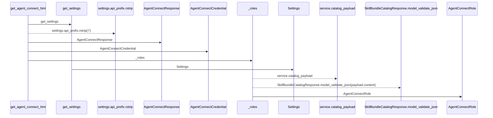
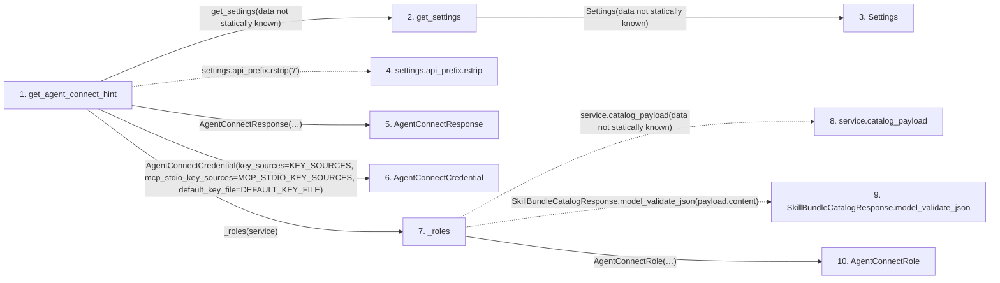

# get_agent_connect_hint

**Entry point:** `get_agent_connect_hint` (`http`)
**Source:** [routers_agent_connect](../modules/routers_agent_connect.md)
**Modules touched:** [config](../modules/config.md), [routers_agent_connect](../modules/routers_agent_connect.md), [schemas_agent_connect](../modules/schemas_agent_connect.md)

## Call sequence

> Static overview in presentation order, not runtime execution order. Arrows retain captured callers; representative internal continuations and boundary examples precede repeated helper detail.

<!-- Auto-generated from static call edges. Dashed arrows are external or unresolved calls. Reviewed runtime conditions and side effects belong in Behavior. -->

> Call sequence diagram shows 9 of 9 interactions; 0 omitted to keep the visualization within the 30-interaction and generated-diagram limits, with uncertain identities omitted rather than inferred.

> Captured boundary calls: external 0 of 0 (0 omitted); unresolved 3 of 3 (0 omitted). These counts cover the captured static trace.
> Detailed flow queries retain their own coverage and limits; omitted paths may execute at runtime.

## Data flow

<!-- Auto-generated static analysis. Treat values and boundaries as best-effort hints, not runtime proof. -->

### Analysis coverage

**Effect analysis partially available.** Flow assembly and source effect analysis are separate; empty observations do not prove an empty handler body.

Source steps: 7; effect analysis evaluated: 3, partial: 0, unavailable: 4. Counts include steps omitted from the displayed trace.

Collector observations for 3 source steps with known totals: observed: 12, emitted: 12, omitted: 0. Unavailable totals are excluded.

- Callable record unavailable for one or more source steps; those steps have no represented callable body.
- Effect collector totals unavailable; observed counts cover captured records only.

| Step | Callable record | Effect analysis | Collector totals | Observed | Emitted | Omitted |
|---|---|---|---|---:|---:|---:|
| `get_agent_connect_hint` | `available` | `evaluated` | `available` | `6` | `6` | `0` |
| `get_settings` | `available` | `evaluated` | `available` | `1` | `1` | `0` |
| `Settings` | `unavailable` | `unavailable` | `unavailable` | — | — | — |
| `settings.api_prefix.rstrip` | `not_applicable` | `not_applicable` | `not_applicable` | — | — | — |
| `AgentConnectResponse` | `unavailable` | `unavailable` | `unavailable` | — | — | — |
| `AgentConnectCredential` | `unavailable` | `unavailable` | `unavailable` | — | — | — |
| `_roles` | `available` | `evaluated` | `available` | `5` | `5` | `0` |
| `service.catalog_payload` | `not_applicable` | `not_applicable` | `not_applicable` | — | — | — |
| `SkillBundleCatalogResponse.model_validate_json` | `not_applicable` | `not_applicable` | `not_applicable` | — | — | — |
| `AgentConnectRole` | `unavailable` | `unavailable` | `unavailable` | — | — | — |

### Step data

| Step | Inputs | Reads | Writes | Returns |
|---|---|---|---|---|
| `get_agent_connect_hint` | `service: Annotated[AgentSkillBundleService, Depends(get_agent_connect_bundle_service)]` | `KEY_SOURCES`, `MCP_STDIO_KEY_SOURCES`, `DEFAULT_KEY_FILE`, `PROVISIONING` | - | `AgentConnectResponse(...)` |
| `get_settings` | - | - | - | `Settings(...)` |
| `Settings` | - | - | - | - |
| `settings.api_prefix.rstrip` | - | - | - | - |
| `AgentConnectResponse` | - | - | - | - |
| `AgentConnectCredential` | - | - | - | - |
| `_roles` | `service: AgentSkillBundleService` | `SkillBundleArtifactError`, `SkillBundleNotFoundError` | - | `[...]`, `...` |
| `service.catalog_payload` | - | - | - | - |
| `SkillBundleCatalogResponse.model_validate_json` | - | - | - | - |
| `AgentConnectRole` | - | - | - | - |

### Call data

| From | To | Line | Call |
|---|---|---:|---|
| get_agent_connect_hint | get_settings | 71 | `get_settings(data not statically known)` |
| get_settings | Settings | 481 | `Settings(data not statically known)` |
| get_agent_connect_hint | settings.api_prefix.rstrip | 72 | `settings.api_prefix.rstrip('/')` |
| get_agent_connect_hint | AgentConnectResponse | 73 | `AgentConnectResponse(auth_mode=settings.workchord_auth_mode, api_prefix=..., capabilities_path=..., mcp_http_path=..., skill_discovery_path='/.well-known/workchord-agent-skills.json', credential=AgentConnectCredential(...), roles=_roles(...), provisioning=PROVISIONING)` |
| get_agent_connect_hint | AgentConnectCredential | 79 | `AgentConnectCredential(key_sources=KEY_SOURCES, mcp_stdio_key_sources=MCP_STDIO_KEY_SOURCES, default_key_file=DEFAULT_KEY_FILE)` |
| get_agent_connect_hint | _roles | 84 | `_roles(service)` |
| _roles | service.catalog_payload | 49 | `service.catalog_payload(data not statically known)` |
| _roles | SkillBundleCatalogResponse.model_validate_json | 50 | `SkillBundleCatalogResponse.model_validate_json(payload.content)` |
| _roles | AgentConnectRole | 55 | `AgentConnectRole(skill=entry.name, skill_version=entry.version, actor_role=entry.role, required_scopes=entry.required_scopes, optional_scopes=entry.optional_scopes)` |

### Boundary effects

*No boundary-effect observations were captured in this static trace.*

### Static analysis gaps

| Kind | Step | Target | Line |
|---|---|---|---:|
| unresolved_call | `get_agent_connect_hint` | `settings.api_prefix.rstrip` | 72 |
| unresolved_call | `_roles` | `service.catalog_payload` | 49 |
| unresolved_call | `_roles` | `SkillBundleCatalogResponse.model_validate_json` | 50 |

## Behavior

Serves `GET /.well-known/workchord/agent-connect.json` without authentication: the `/.well-known/workchord/agent` prefix is public in `enforce_http_authority`. It tells an agent that holds no key where to connect and how an operator gives it one: the auth mode, API prefix, capabilities and MCP paths, the key header, the key sources the role skills read (variables, a key file named by a variable, then the per-role default file), and the provisioning steps. Role names, versions and scopes come from the deployed skill catalog; when the release artifacts are missing or invalid the list is empty and the response still succeeds. The strict response models forbid extra fields, and the response holds no key, token or instance data. It writes nothing.
