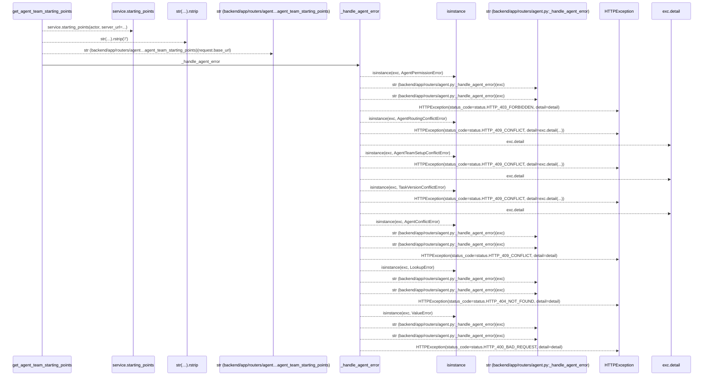
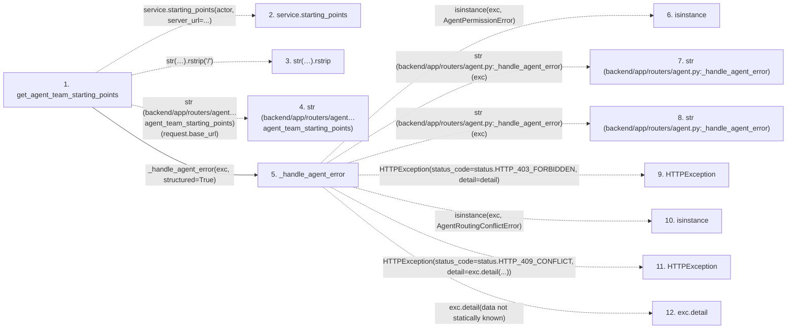

# get_agent_team_starting_points

**Entry point:** `get_agent_team_starting_points` (`http`)
**Source:** [routers_agent](../modules/routers_agent.md)
**Modules touched:** [routers_agent](../modules/routers_agent.md)

## Call sequence

> Static overview in presentation order, not runtime execution order. Arrows retain captured callers; representative internal continuations and boundary examples precede repeated helper detail.

<!-- Auto-generated from static call edges. Dashed arrows are external or unresolved calls. Reviewed runtime conditions and side effects belong in Behavior. -->

> Call sequence diagram shows 29 of 29 interactions; 0 omitted to keep the visualization within the 30-interaction and generated-diagram limits, with uncertain identities omitted rather than inferred.

> Captured boundary calls: external 23 of 23 (0 omitted); unresolved 5 of 5 (0 omitted). These counts cover the captured static trace.
> Detailed flow queries retain their own coverage and limits; omitted paths may execute at runtime.

## Data flow

<!-- Auto-generated static analysis. Treat values and boundaries as best-effort hints, not runtime proof. -->

### Analysis coverage

**Effect analysis partially available.** Flow assembly and source effect analysis are separate; empty observations do not prove an empty handler body.

Source steps: 2; effect analysis evaluated: 1, partial: 1, unavailable: 0. Counts include steps omitted from the displayed trace.

Collector observations for 2 source steps with known totals: observed: 20, emitted: 16, omitted: 4. Unavailable totals are excluded.

- Effect collector omitted observations before flow assembly; displayed effects are partial.

| Step | Callable record | Effect analysis | Collector totals | Observed | Emitted | Omitted |
|---|---|---|---|---:|---:|---:|
| `get_agent_team_starting_points` | `available` | `evaluated` | `available` | `6` | `6` | `0` |
| `service.starting_points` | `not_applicable` | `not_applicable` | `not_applicable` | — | — | — |
| `str(…).rstrip` | `not_applicable` | `not_applicable` | `not_applicable` | — | — | — |
| `str (backend/app/routers/agent…agent_team_starting_points)` | `not_applicable` | `not_applicable` | `not_applicable` | — | — | — |
| `_handle_agent_error` | `available` | `partial` | `available` | `14` | `10` | `4` |
| `isinstance` | `not_applicable` | `not_applicable` | `not_applicable` | — | — | — |
| `str (backend/app/routers/agent.py:_handle_agent_error)` | `not_applicable` | `not_applicable` | `not_applicable` | — | — | — |
| `str (backend/app/routers/agent.py:_handle_agent_error)` | `not_applicable` | `not_applicable` | `not_applicable` | — | — | — |
| `HTTPException` | `not_applicable` | `not_applicable` | `not_applicable` | — | — | — |
| `isinstance` | `not_applicable` | `not_applicable` | `not_applicable` | — | — | — |
| `HTTPException` | `not_applicable` | `not_applicable` | `not_applicable` | — | — | — |
| `exc.detail` | `not_applicable` | `not_applicable` | `not_applicable` | — | — | — |

### Step data

| Step | Inputs | Reads | Writes | Returns |
|---|---|---|---|---|
| `get_agent_team_starting_points` | `request: Request`, `response: Response`, `actor: Annotated[AgentActor, Depends(get_agent_admin_actor)]`, `service: Annotated[AgentTeamSetupService, Depends(get_agent_team_setup_service)]` | - | `response.headers[...]` | `result` |
| `service.starting_points` | - | - | - | - |
| `str(…).rstrip` | - | - | - | - |
| `str (backend/app/routers/agent…agent_team_starting_points)` | - | - | - | - |
| `_handle_agent_error` | `exc: Exception`, `structured: bool` | `AgentPermissionError`, `status`, `AgentRoutingConflictError`, `status`, `AgentTeamSetupConflictError`, `status`, `TaskVersionConflictError`, `status` | - | - |
| `isinstance` | - | - | - | - |
| `str (backend/app/routers/agent.py:_handle_agent_error)` | - | - | - | - |
| `str (backend/app/routers/agent.py:_handle_agent_error)` | - | - | - | - |
| `HTTPException` | - | - | - | - |
| `isinstance` | - | - | - | - |
| `HTTPException` | - | - | - | - |
| `exc.detail` | - | - | - | - |

### Call data

| From | To | Line | Call |
|---|---|---:|---|
| get_agent_team_starting_points | service.starting_points | 500 | `service.starting_points(actor, server_url=...)` |
| get_agent_team_starting_points | str(…).rstrip | 500 | `str(request.base_url).rstrip('/')` |
| get_agent_team_starting_points | str (backend/app/routers/agent…agent_team_starting_points) | 500 | `str(request.base_url)` |
| get_agent_team_starting_points | _handle_agent_error | 502 | `_handle_agent_error(exc, structured=True)` |
| _handle_agent_error | isinstance | 271 | `isinstance(exc, AgentPermissionError)` |
| _handle_agent_error | str (backend/app/routers/agent.py:_handle_agent_error) | 273 | `str(exc)` |
| _handle_agent_error | str (backend/app/routers/agent.py:_handle_agent_error) | 275 | `str(exc)` |
| _handle_agent_error | HTTPException | 277 | `HTTPException(status_code=status.HTTP_403_FORBIDDEN, detail=detail)` |
| _handle_agent_error | isinstance | 278 | `isinstance(exc, AgentRoutingConflictError)` |
| _handle_agent_error | HTTPException | 279 | `HTTPException(status_code=status.HTTP_409_CONFLICT, detail=exc.detail(...))` |
| _handle_agent_error | exc.detail | 279 | `exc.detail(data not statically known)` |

### Boundary effects

*No boundary-effect observations were captured in this static trace.*

### Static analysis gaps

| Kind | Step | Target | Line |
|---|---|---|---:|
| unresolved_call | `get_agent_team_starting_points` | `service.starting_points` | 500 |
| unresolved_call | `get_agent_team_starting_points` | `str(request.base_url).rstrip` | 500 |
| external_call | `_handle_agent_error` | `isinstance` | 271 |
| external_call | `_handle_agent_error` | `HTTPException` | 277 |
| external_call | `_handle_agent_error` | `isinstance` | 278 |
| external_call | `_handle_agent_error` | `HTTPException` | 279 |
| unresolved_call | `_handle_agent_error` | `exc.detail` | 279 |
| step_limit | `get_agent_team_starting_points` | `first 12 steps` | 0 |

## Behavior

This flow starts at `get_agent_team_starting_points` and is classified as `http`. The generated call and data-flow sections are bounded static projections; runtime conditions and side effects require source-level confirmation.
