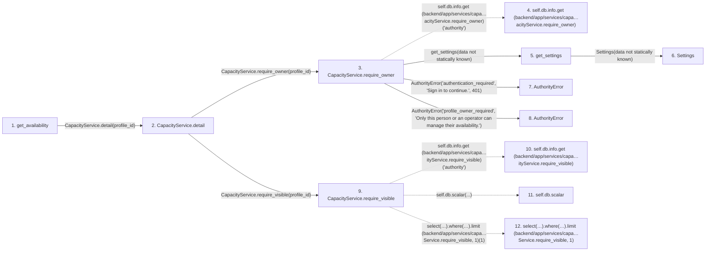

# get_availability

**Entry point:** `get_availability` (`http`)
**Source:** [routers_capacity](../modules/routers_capacity.md)
**Modules touched:** [authority](../modules/authority.md), [capacity_service](../modules/capacity_service.md), [commands](../modules/commands.md), [config](../modules/config.md), [routers_capacity](../modules/routers_capacity.md)

## Call sequence

> Static overview in presentation order, not runtime execution order. Arrows retain captured callers; representative internal continuations and boundary examples precede repeated helper detail.

```mermaid
sequenceDiagram
    participant p0 as get_availability
    participant p1 as CapacityService.detail
    participant p2 as CapacityService
    participant p3 as CapacityService.require_owner
    participant p4 as CapacityService.require_visible
    participant p5 as get_settings
    participant p6 as internal_authority
    participant p7 as calendar_signature
    participant p8 as AuthorityError
    participant p9 as PlanningConflict
    participant p10 as Settings
    participant p11 as list
    participant p12 as self.db.get (backend/app/services/capa….py:CapacityService.detail)
    participant p13 as (…).unique().all
    participant p14 as (…).unique
    participant p15 as self.db.scalars
    participant p16 as select(…).join(…).join(…).where
    participant p17 as select(…).join(…).join
    participant p18 as select(…).join
    participant p19 as select (backend/app/services/capa….py:CapacityService.detail)
    participant p20 as len
    participant p21 as sorted (backend/app/services/capa….py:CapacityService.detail)
    participant p22 as (…).all
    participant p23 as select(…).where(…).order_by
    participant p24 as select(…).where (backend/app/services/capa….py:CapacityService.detail)
    participant p25 as ProfileAbsence.deleted.is_
    participant p26 as self.db.info.get (backend/app/services/capa…acityService.require_owner)
    participant p27 as self.db.info.get (backend/app/services/capa…ityService.require_visible)
    participant p28 as tuple
    p0->>p1: CapacityService.detail
    p0->>p2: CapacityService
    p1->>p3: CapacityService.require_owner
    p1->>p4: CapacityService.require_visible
    p3->>p5: get_settings
    p1->>p6: internal_authority
    p1->>p7: calendar_signature
    p3->>p8: AuthorityError
    p4->>p9: PlanningConflict
    p5->>p10: Settings
    p1-->>p11: list(...)
    p1-->>p12: self.db.get (backend/app/services/capa….py:CapacityService.detail)(ProfileAvailability, profile_id)
    p1-->>p13: (…).unique().all
    p1-->>p14: (…).unique
    p1-->>p15: self.db.scalars(...)
    p1-->>p16: select(…).join(…).join(…).where(...)
    p1-->>p17: select(…).join(…).join(TeamMember, ...)
    p1-->>p18: select(…).join(Iteration)
    p1-->>p19: select (backend/app/services/capa….py:CapacityService.detail)(Calendar)
    p1-->>p20: len(...)
    p1-->>p21: sorted (backend/app/services/capa….py:CapacityService.detail)(...)
    p1-->>p22: (…).all
    p1-->>p15: self.db.scalars(...)
    p1-->>p23: select(…).where(…).order_by(ProfileAbsence.start_date, ProfileAbsence.id)
    p1-->>p24: select(…).where (backend/app/services/capa….py:CapacityService.detail)(..., ProfileAbsence.deleted.is_(...))
    p1-->>p19: select (backend/app/services/capa….py:CapacityService.detail)(ProfileAbsence)
    p1-->>p25: ProfileAbsence.deleted.is_(False)
    p3-->>p26: self.db.info.get (backend/app/services/capa…acityService.require_owner)('authority')
    p4-->>p27: self.db.info.get (backend/app/services/capa…ityService.require_visible)('authority')
    p7-->>p28: tuple(sorted(...))
```

<!-- Auto-generated from static call edges. Dashed arrows are external or unresolved calls. Reviewed runtime conditions and side effects belong in Behavior. -->

> Call sequence diagram shows 30 of 48 interactions; 18 omitted to keep the visualization within the 30-interaction and generated-diagram limits, with uncertain identities omitted rather than inferred.

> Captured boundary calls: external 6 of 13 (7 omitted); unresolved 14 of 22 (8 omitted). These counts cover the captured static trace.

Omitted captured detail, grouped by actual caller occurrence and target module:

| Caller | Parent step | Target module | Kind | Omitted interactions |
| --- | --- | --- | --- | --- |
| `backend/app/services/capacity_service.py:CapacityService.require_owner` | 3 | [backend/app/authority.py](../modules/authority.md) | internal | 1 |
| `backend/app/services/capacity_service.py:CapacityService.require_visible` | 9 | - | unresolved | 7 |
| `backend/app/services/capacity_service.py:CapacityService.require_visible` | 9 | - | external | 2 |
| `backend/app/services/capacity_service.py:CapacityService.require_visible` | 9 | [backend/app/authority.py](../modules/authority.md) | internal | 2 |
| `backend/app/authority.py:internal_authority` | 20 | - | unresolved | 1 |
| `backend/app/services/capacity_service.py:calendar_signature` | 35 | - | external | 5 |
> Detailed flow queries retain their own coverage and limits; omitted paths may execute at runtime.

## Data flow

<!-- Auto-generated static analysis. Treat values and boundaries as best-effort hints, not runtime proof. -->

### Analysis coverage

**Effect analysis partially available.** Flow assembly and source effect analysis are separate; empty observations do not prove an empty handler body.

Source steps: 14; effect analysis evaluated: 8, partial: 0, unavailable: 6. Counts include steps omitted from the displayed trace.

Collector observations for 8 source steps with known totals: observed: 20, emitted: 20, omitted: 0. Unavailable totals are excluded.

- Callable record unavailable for one or more source steps; those steps have no represented callable body.
- Effect collector totals unavailable; observed counts cover captured records only.

| Step | Callable record | Effect analysis | Collector totals | Observed | Emitted | Omitted |
|---|---|---|---|---:|---:|---:|
| `get_availability` | `available` | `evaluated` | `available` | `3` | `3` | `0` |
| `CapacityService.detail` | `available` | `evaluated` | `available` | `4` | `4` | `0` |
| `CapacityService.require_owner` | `available` | `evaluated` | `available` | `1` | `1` | `0` |
| `self.db.info.get (backend/app/services/capa…acityService.require_owner)` | `not_applicable` | `not_applicable` | `not_applicable` | — | — | — |
| `get_settings` | `available` | `evaluated` | `available` | `1` | `1` | `0` |
| `Settings` | `unavailable` | `unavailable` | `unavailable` | — | — | — |
| `AuthorityError` | `unavailable` | `unavailable` | `unavailable` | — | — | — |
| `AuthorityError` | `unavailable` | `unavailable` | `unavailable` | — | — | — |
| `CapacityService.require_visible` | `available` | `evaluated` | `available` | `3` | `3` | `0` |
| `self.db.info.get (backend/app/services/capa…ityService.require_visible)` | `not_applicable` | `not_applicable` | `not_applicable` | — | — | — |
| `self.db.scalar` | `not_applicable` | `not_applicable` | `not_applicable` | — | — | — |
| `select(…).where(…).limit (backend/app/services/capa…Service.require_visible, 1)` | `not_applicable` | `not_applicable` | `not_applicable` | — | — | — |

### Step data

| Step | Inputs | Reads | Writes | Returns |
|---|---|---|---|---|
| `get_availability` | `profile_id: int`, `db: Database` | - | - | `...` |
| `CapacityService.detail` | `profile_id` | `self.db`, `ProfileAvailability` | - | `{...}` |
| `CapacityService.require_owner` | `profile_id` | - | - | - |
| `self.db.info.get (backend/app/services/capa…acityService.require_owner)` | - | - | - | - |
| `get_settings` | - | - | - | `Settings(...)` |
| `Settings` | - | - | - | - |
| `AuthorityError` | - | - | - | - |
| `AuthorityError` | - | - | - | - |
| `CapacityService.require_visible` | `profile_id` | `self.db`, `TeamMemberProfile` | - | - |
| `self.db.info.get (backend/app/services/capa…ityService.require_visible)` | - | - | - | - |
| `self.db.scalar` | - | - | - | - |
| `select(…).where(…).limit (backend/app/services/capa…Service.require_visible, 1)` | - | - | - | - |

### Call data

| From | To | Line | Call |
|---|---|---:|---|
| get_availability | CapacityService.detail | 34 | `CapacityService(db).detail(profile_id)` |
| CapacityService.detail | CapacityService.require_owner | 101 | `self.require_owner(profile_id)` |
| CapacityService.require_owner | self.db.info.get (backend/app/services/capa…acityService.require_owner) | 32 | `self.db.info.get('authority')` |
| CapacityService.require_owner | get_settings | 34 | `get_settings(data not statically known)` |
| get_settings | Settings | 481 | `Settings(data not statically known)` |
| CapacityService.require_owner | AuthorityError | 35 | `AuthorityError('authentication_required', 'Sign in to continue.', 401)` |
| CapacityService.require_owner | AuthorityError | 38 | `AuthorityError('profile_owner_required', 'Only this person or an operator can manage their availability.')` |
| CapacityService.detail | CapacityService.require_visible | 102 | `self.require_visible(profile_id)` |
| CapacityService.require_visible | self.db.info.get (backend/app/services/capa…ityService.require_visible) | 41 | `self.db.info.get('authority')` |
| CapacityService.require_visible | self.db.scalar | 43 | `self.db.scalar(...)` |
| CapacityService.require_visible | select(…).where(…).limit (backend/app/services/capa…Service.require_visible, 1) | 43 | `select(TeamMember.id).where(TeamMember.profile_id == profile_id).limit(1)` |

### Boundary effects

*No boundary-effect observations were captured in this static trace.*

### Static analysis gaps

| Kind | Step | Target | Line |
|---|---|---|---:|
| unresolved_call | `CapacityService.require_owner` | `self.db.info.get` | 32 |
| unresolved_call | `CapacityService.require_visible` | `self.db.info.get` | 41 |
| unresolved_call | `CapacityService.require_visible` | `self.db.scalar` | 43 |
| unresolved_call | `CapacityService.require_visible` | `select(TeamMember.id).where(TeamMember.profile_id == profile_id).limit` | 43 |
| step_limit | `get_availability` | `first 12 steps` | 0 |

## Behavior

Returns calendar selection, reconciliation hints and current absence provenance only to the profile owner or an operator. Ordinary project access does not grant private availability detail.
