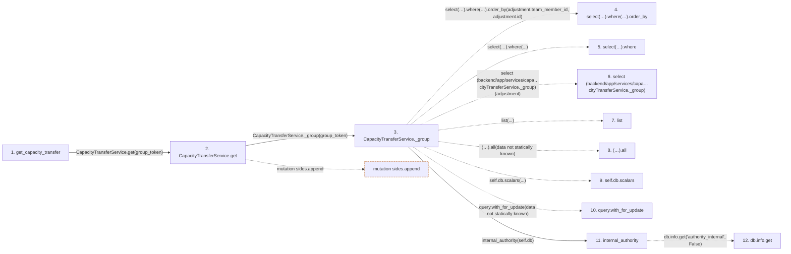

# get_capacity_transfer

**Entry point:** `get_capacity_transfer` (`http`)
**Source:** [routers_team](../modules/routers_team.md)
**Modules touched:** [authority](../modules/authority.md), [capacity_adjustments](../modules/capacity_adjustments.md), [capacity_transfers](../modules/capacity_transfers.md), and 2 more

**Complete modules touched:**

- [authority](../modules/authority.md)
- [capacity_adjustments](../modules/capacity_adjustments.md)
- [capacity_transfers](../modules/capacity_transfers.md)
- [planning_input_context](../modules/planning_input_context.md)
- [routers_team](../modules/routers_team.md)

## Call sequence

> Static overview in presentation order, not runtime execution order. Arrows retain captured callers; representative internal continuations and boundary examples precede repeated helper detail.

```mermaid
sequenceDiagram
    participant p0 as get_capacity_transfer
    participant p1 as CapacityTransferService.get
    participant p2 as CapacityTransferService
    participant p3 as CapacityTransferService._group
    participant p4 as CapacityTransferService._members
    participant p5 as CapacityTransferService._side
    participant p6 as _unavailable
    participant p7 as CapacityTransferService._role
    participant p8 as _round
    participant p9 as internal_authority
    participant p10 as _response
    participant p11 as PlanningInputUnavailable
    participant p12 as sorted
    participant p13 as sides.append
    participant p14 as len (backend/app/services/capa…apacityTransferService.get)
    participant p15 as max
    participant p16 as min
    participant p17 as timedelta
    participant p18 as select(…).where(…).order_by
    participant p19 as (…).scalars().all
    participant p20 as hours
    participant p21 as select(…).where
    participant p22 as (…).scalars
    participant p23 as before
    participant p24 as select (backend/app/services/capa…cityTransferService._group)
    participant p25 as self.db.execute
    participant p26 as after
    participant p27 as list
    p0->>p1: CapacityTransferService.get
    p0->>p2: CapacityTransferService
    p1->>p3: CapacityTransferService._group
    p1->>p4: CapacityTransferService._members
    p1->>p5: CapacityTransferService._side
    p3->>p6: _unavailable
    p1->>p7: CapacityTransferService._role
    p5->>p8: _round
    p3->>p9: internal_authority
    p5->>p10: _response
    p6->>p11: PlanningInputUnavailable
    p1-->>p12: sorted(...)
    p1-->>p13: sides.append(side)
    p1-->>p14: len (backend/app/services/capa…apacityTransferService.get)(withdrawn)
    p1-->>p14: len (backend/app/services/capa…apacityTransferService.get)(rows)
    p1-->>p15: max(withdrawn, key=...)
    p1-->>p16: min(...)
    p1-->>p15: max(...)
    p1-->>p15: max(...)
    p1-->>p17: timedelta(days=1)
    p3-->>p18: select(…).where(…).order_by(adjustment.team_member_id, adjustment.id)
    p4-->>p19: (…).scalars().all
    p5-->>p20: hours(day)
    p3-->>p21: select(…).where(...)
    p4-->>p22: (…).scalars
    p5-->>p23: before(day)
    p3-->>p24: select (backend/app/services/capa…cityTransferService._group)(adjustment)
    p4-->>p25: self.db.execute(...)
    p5-->>p26: after(day)
    p3-->>p27: list(...)
```

<!-- Auto-generated from static call edges. Dashed arrows are external or unresolved calls. Reviewed runtime conditions and side effects belong in Behavior. -->

> Call sequence diagram shows 30 of 59 interactions; 29 omitted to keep the visualization within the 30-interaction and generated-diagram limits, with uncertain identities omitted rather than inferred.

> Captured boundary calls: external 10 of 21 (11 omitted); unresolved 9 of 23 (14 omitted). These counts cover the captured static trace.

Omitted captured detail, grouped by actual caller occurrence and target module:

| Caller | Parent step | Target module | Kind | Omitted interactions |
| --- | --- | --- | --- | --- |
| `backend/app/services/capacity_transfers.py:CapacityTransferService._group` | 3 | - | unresolved | 6 |
| `backend/app/authority.py:internal_authority` | 11 | - | unresolved | 1 |
| `backend/app/services/capacity_transfers.py:CapacityTransferService._group` | 3 | - | external | 4 |
| `backend/app/services/capacity_transfers.py:CapacityTransferService._members` | 22 | - | unresolved | 5 |
| `backend/app/services/capacity_transfers.py:CapacityTransferService._members` | 22 | - | external | 5 |
| `backend/app/services/capacity_transfers.py:CapacityTransferService._members` | 22 | [backend/app/services/capacity_transfers.py](../modules/capacity_transfers.md) | internal | 1 |
| `backend/app/services/capacity_transfers.py:CapacityTransferService._side` | 38 | - | unresolved | 1 |
| `backend/app/services/capacity_transfers.py:_round` | 43 | - | external | 1 |
> Omission summary shows 8 of 12 groups; 4 further groups are not expanded here. Counts above include all omitted interactions.
> Detailed flow queries retain their own coverage and limits; omitted paths may execute at runtime.

## Data flow

<!-- Auto-generated static analysis. Treat values and boundaries as best-effort hints, not runtime proof. -->

### Analysis coverage

**Effect analysis partially available.** Flow assembly and source effect analysis are separate; empty observations do not prove an empty handler body.

Source steps: 16; effect analysis evaluated: 13, partial: 1, unavailable: 2. Counts include steps omitted from the displayed trace.

Collector observations for 14 source steps with known totals: observed: 54, emitted: 52, omitted: 2. Unavailable totals are excluded.

- Callable record unavailable for one or more source steps; those steps have no represented callable body.
- Effect collector omitted observations before flow assembly; displayed effects are partial.
- Effect collector totals unavailable; observed counts cover captured records only.

| Step | Callable record | Effect analysis | Collector totals | Observed | Emitted | Omitted |
|---|---|---|---|---:|---:|---:|
| `get_capacity_transfer` | `available` | `evaluated` | `available` | `3` | `3` | `0` |
| `CapacityTransferService.get` | `available` | `evaluated` | `available` | `3` | `3` | `0` |
| `CapacityTransferService._group` | `available` | `evaluated` | `available` | `5` | `5` | `0` |
| `select(…).where(…).order_by` | `not_applicable` | `not_applicable` | `not_applicable` | — | — | — |
| `select(…).where` | `not_applicable` | `not_applicable` | `not_applicable` | — | — | — |
| `select (backend/app/services/capa…cityTransferService._group)` | `not_applicable` | `not_applicable` | `not_applicable` | — | — | — |
| `list` | `not_applicable` | `not_applicable` | `not_applicable` | — | — | — |
| `(…).all` | `not_applicable` | `not_applicable` | `not_applicable` | — | — | — |
| `self.db.scalars` | `not_applicable` | `not_applicable` | `not_applicable` | — | — | — |
| `query.with_for_update` | `not_applicable` | `not_applicable` | `not_applicable` | — | — | — |
| `internal_authority` | `available` | `evaluated` | `available` | `3` | `3` | `0` |
| `db.info.get` | `not_applicable` | `not_applicable` | `not_applicable` | — | — | — |

### Step data

| Step | Inputs | Reads | Writes | Returns |
|---|---|---|---|---|
| `get_capacity_transfer` | `group_token: Annotated[str, Path(max_length=36)]`, `db: Annotated[AsyncSession, Depends(get_db, scope='function')]` | - | - | `...` |
| `CapacityTransferService.get` | `group_token` | - | - | `{...}` |
| `CapacityTransferService._group` | `group_token`, `lock` | `TeamMemberCapacityAdjustment`, `self.db` | - | `rows` |
| `select(…).where(…).order_by` | - | - | - | - |
| `select(…).where` | - | - | - | - |
| `select (backend/app/services/capa…cityTransferService._group)` | - | - | - | - |
| `list` | - | - | - | - |
| `(…).all` | - | - | - | - |
| `self.db.scalars` | - | - | - | - |
| `query.with_for_update` | - | - | - | - |
| `internal_authority` | `db` | - | `db.info[...]`, `db.info[...]` | - |
| `db.info.get` | - | - | - | - |

### Call data

| From | To | Line | Call |
|---|---|---:|---|
| get_capacity_transfer | CapacityTransferService.get | 345 | `CapacityTransferService(db).get(group_token)` |
| CapacityTransferService.get | CapacityTransferService._group | 461 | `self._group(group_token)` |
| CapacityTransferService._group | select(…).where(…).order_by | 355 | `select(adjustment).where(adjustment.group_token == group_token).order_by(adjustment.team_member_id, adjustment.id)` |
| CapacityTransferService._group | select(…).where | 355 | `select(adjustment).where(...)` |
| CapacityTransferService._group | select (backend/app/services/capa…cityTransferService._group) | 355 | `select(adjustment)` |
| CapacityTransferService._group | list | 356 | `list(...)` |
| CapacityTransferService._group | (…).all | 356 | `(await self.db.scalars(query.with_for_update() if lock else query)).all(data not statically known)` |
| CapacityTransferService._group | self.db.scalars | 356 | `self.db.scalars(...)` |
| CapacityTransferService._group | query.with_for_update | 356 | `query.with_for_update(data not statically known)` |
| CapacityTransferService._group | internal_authority | 357 | `internal_authority(self.db)` |
| internal_authority | db.info.get | 92 | `db.info.get('authority_internal', False)` |

### Boundary effects

| Kind | Target | Step | Line |
|---|---|---|---:|
| mutation | `sides.append` | `CapacityTransferService.get` | 468 |

### Static analysis gaps

| Kind | Step | Target | Line |
|---|---|---|---:|
| unresolved_call | `CapacityTransferService._group` | `select(adjustment).where(adjustment.group_token == group_token).order_by` | 355 |
| unresolved_call | `CapacityTransferService._group` | `select(adjustment).where` | 355 |
| external_call | `CapacityTransferService._group` | `select` | 355 |
| unresolved_call | `CapacityTransferService._group` | `(await self.db.scalars(query.with_for_update() if lock else query)).all` | 356 |
| unresolved_call | `CapacityTransferService._group` | `self.db.scalars` | 356 |
| unresolved_call | `CapacityTransferService._group` | `query.with_for_update` | 356 |
| unresolved_call | `internal_authority` | `db.info.get` | 92 |
| step_limit | `get_capacity_transfer` | `first 12 steps` | 0 |

## Behavior

A temporary capacity transfer lends part of the availability of one or more source rows to a target row of the same person for a dated range. It is recorded as dated adjustments sharing one group token, so each source counts its own percentage minus the lent percentage and the target adds the lent total on those dates only; the prior shares return after the end date without a scheduled job and the rows' own percentages are never edited. Preview rolls everything back. Apply and withdraw are one shared planning input command over every row they change, so both sides change together or not at all, and an intervening change to an affected iteration is a revision conflict. No task, assignment or run changes, and a source reduction or target restoration on dates where that row's issued work is scheduled is refused.
