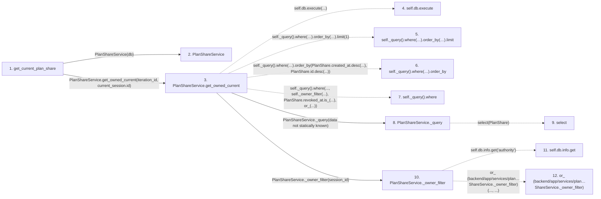

# get_current_plan_share

**Entry point:** `get_current_plan_share` (`http`)
**Source:** [plan_shares](../modules/plan_shares.md)
**Modules touched:** [plan_share_service](../modules/plan_share_service.md), [plan_shares](../modules/plan_shares.md), [time](../modules/time.md)

## Call sequence

> Static overview in presentation order, not runtime execution order. Arrows retain captured callers; representative internal continuations and boundary examples precede repeated helper detail.

```mermaid
sequenceDiagram
    participant p0 as get_current_plan_share
    participant p1 as PlanShareService
    participant p2 as PlanShareService.get_owned_current
    participant p3 as service.to_response
    participant p4 as self.db.execute
    participant p5 as self._query().where(…).order_by(…).limit
    participant p6 as self._query().where(…).order_by
    participant p7 as self._query().where
    participant p8 as PlanShareService._query
    participant p9 as PlanShareService._owner_filter
    participant p10 as PlanShare.revoked_at.is_
    participant p11 as or_ (backend/app/services/plan…eService.get_owned_current)
    participant p12 as PlanShare.expires_at.is_
    participant p13 as utc_now
    participant p14 as PlanShare.created_at.desc
    participant p15 as PlanShare.id.desc
    participant p16 as result.scalar_one_or_none
    participant p17 as select
    participant p18 as self.db.info.get
    participant p19 as datetime.now
    participant p20 as or_ (backend/app/services/plan…ShareService._owner_filter)
    p0->>p1: PlanShareService
    p0->>p2: PlanShareService.get_owned_current
    p0-->>p3: service.to_response(share)
    p2-->>p4: self.db.execute(...)
    p2-->>p5: self._query().where(…).order_by(…).limit(1)
    p2-->>p6: self._query().where(…).order_by(PlanShare.created_at.desc(...), PlanShare.id.desc(...))
    p2-->>p7: self._query().where(..., self._owner_filter(...), PlanShare.revoked_at.is_(...), or_(...))
    p2->>p8: PlanShareService._query
    p2->>p9: PlanShareService._owner_filter
    p2-->>p10: PlanShare.revoked_at.is_(None)
    p2-->>p11: or_ (backend/app/services/plan…eService.get_owned_current)(PlanShare.expires_at.is_(...), ...)
    p2-->>p12: PlanShare.expires_at.is_(None)
    p2->>p13: utc_now
    p2-->>p14: PlanShare.created_at.desc
    p2-->>p15: PlanShare.id.desc
    p2-->>p16: result.scalar_one_or_none
    p8-->>p17: select(PlanShare)
    p9-->>p18: self.db.info.get('authority')
    p13-->>p19: datetime.now(UTC)
    p9-->>p20: or_ (backend/app/services/plan…ShareService._owner_filter)(..., ...)
```

<!-- Auto-generated from static call edges. Dashed arrows are external or unresolved calls. Reviewed runtime conditions and side effects belong in Behavior. -->

> Call sequence diagram shows 20 of 20 interactions; 0 omitted to keep the visualization within the 30-interaction and generated-diagram limits, with uncertain identities omitted rather than inferred.

> Captured boundary calls: external 4 of 4 (0 omitted); unresolved 11 of 11 (0 omitted). These counts cover the captured static trace.
> Detailed flow queries retain their own coverage and limits; omitted paths may execute at runtime.

## Data flow

<!-- Auto-generated static analysis. Treat values and boundaries as best-effort hints, not runtime proof. -->

### Analysis coverage

**Effect analysis partially available.** Flow assembly and source effect analysis are separate; empty observations do not prove an empty handler body.

Source steps: 6; effect analysis evaluated: 5, partial: 0, unavailable: 1. Counts include steps omitted from the displayed trace.

Collector observations for 5 source steps with known totals: observed: 19, emitted: 19, omitted: 0. Unavailable totals are excluded.

- Callable record unavailable for one or more source steps; those steps have no represented callable body.
- Effect collector totals unavailable; observed counts cover captured records only.

| Step | Callable record | Effect analysis | Collector totals | Observed | Emitted | Omitted |
|---|---|---|---|---:|---:|---:|
| `get_current_plan_share` | `available` | `evaluated` | `available` | `6` | `6` | `0` |
| `PlanShareService` | `unavailable` | `unavailable` | `unavailable` | — | — | — |
| `PlanShareService.get_owned_current` | `available` | `evaluated` | `available` | `3` | `3` | `0` |
| `self.db.execute` | `not_applicable` | `not_applicable` | `not_applicable` | — | — | — |
| `self._query().where(…).order_by(…).limit` | `not_applicable` | `not_applicable` | `not_applicable` | — | — | — |
| `self._query().where(…).order_by` | `not_applicable` | `not_applicable` | `not_applicable` | — | — | — |
| `self._query().where` | `not_applicable` | `not_applicable` | `not_applicable` | — | — | — |
| `PlanShareService._query` | `available` | `evaluated` | `available` | `2` | `2` | `0` |
| `select` | `not_applicable` | `not_applicable` | `not_applicable` | — | — | — |
| `PlanShareService._owner_filter` | `available` | `evaluated` | `available` | `6` | `6` | `0` |
| `self.db.info.get` | `not_applicable` | `not_applicable` | `not_applicable` | — | — | — |
| `or_ (backend/app/services/plan…ShareService._owner_filter)` | `not_applicable` | `not_applicable` | `not_applicable` | — | — | — |

### Step data

| Step | Inputs | Reads | Writes | Returns |
|---|---|---|---|---|
| `get_current_plan_share` | `iteration_id: int`, `response: Response`, `current_session: Annotated[UserSession, Depends(session_service.get_current_session)]`, `db: Annotated[AsyncSession, Depends(get_db, scope='function')]` | - | `response.headers[...]` | `...` |
| `PlanShareService` | - | - | - | - |
| `PlanShareService.get_owned_current` | `iteration_id: int`, `session_id: int` | - | - | `result.scalar_one_or_none(...)` |
| `self.db.execute` | - | - | - | - |
| `self._query().where(…).order_by(…).limit` | - | - | - | - |
| `self._query().where(…).order_by` | - | - | - | - |
| `self._query().where` | - | - | - | - |
| `PlanShareService._query` | - | `PlanShare` | - | `select(...)` |
| `select` | - | - | - | - |
| `PlanShareService._owner_filter` | `session_id` | `PlanShare`, `PlanShare`, `PlanShare` | - | `or_(...)`, `...` |
| `self.db.info.get` | - | - | - | - |
| `or_ (backend/app/services/plan…ShareService._owner_filter)` | - | - | - | - |

### Call data

| From | To | Line | Call |
|---|---|---:|---|
| get_current_plan_share | PlanShareService | 33 | `PlanShareService(db)` |
| get_current_plan_share | PlanShareService.get_owned_current | 34 | `service.get_owned_current(iteration_id, current_session.id)` |
| PlanShareService.get_owned_current | self.db.execute | 107 | `self.db.execute(...)` |
| PlanShareService.get_owned_current | self._query().where(…).order_by(…).limit | 108 | `self._query().where(PlanShare.iteration_id == iteration_id, self._owner_filter(session_id), PlanShare.revoked_at.is_(None), or_(PlanShare.expires_at.is_(None), PlanShare.expires_at > utc_now())).order_by(PlanShare.created_at.desc(), PlanShare.id.desc()).limit(1)` |
| PlanShareService.get_owned_current | self._query().where(…).order_by | 108 | `self._query().where(PlanShare.iteration_id == iteration_id, self._owner_filter(session_id), PlanShare.revoked_at.is_(None), or_(PlanShare.expires_at.is_(None), PlanShare.expires_at > utc_now())).order_by(PlanShare.created_at.desc(...), PlanShare.id.desc(...))` |
| PlanShareService.get_owned_current | self._query().where | 108 | `self._query().where(..., self._owner_filter(...), PlanShare.revoked_at.is_(...), or_(...))` |
| PlanShareService.get_owned_current | PlanShareService._query | 108 | `self._query(data not statically known)` |
| PlanShareService._query | select | 27 | `select(PlanShare)` |
| PlanShareService.get_owned_current | PlanShareService._owner_filter | 111 | `self._owner_filter(session_id)` |
| PlanShareService._owner_filter | self.db.info.get | 96 | `self.db.info.get('authority')` |
| PlanShareService._owner_filter | or_ (backend/app/services/plan…ShareService._owner_filter) | 98 | `or_(..., ...)` |

### Boundary effects

*No boundary-effect observations were captured in this static trace.*

### Static analysis gaps

| Kind | Step | Target | Line |
|---|---|---|---:|
| unresolved_call | `PlanShareService.get_owned_current` | `self.db.execute` | 107 |
| unresolved_call | `PlanShareService.get_owned_current` | `self._query().where(PlanShare.iteration_id == iteration_id, self._owner_filter(session_id), PlanShare.revoked_at.is_(None), or_(PlanShare.expires_at.is_(None), PlanShare.expires_at > utc_now())).order_by(PlanShare.created_at.desc(), PlanShare.id.desc()).limit` | 108 |
| unresolved_call | `PlanShareService.get_owned_current` | `self._query().where(PlanShare.iteration_id == iteration_id, self._owner_filter(session_id), PlanShare.revoked_at.is_(None), or_(PlanShare.expires_at.is_(None), PlanShare.expires_at > utc_now())).order_by` | 108 |
| unresolved_call | `PlanShareService.get_owned_current` | `self._query().where` | 108 |
| external_call | `PlanShareService._query` | `select` | 27 |
| unresolved_call | `PlanShareService._owner_filter` | `self.db.info.get` | 96 |
| external_call | `PlanShareService._owner_filter` | `or_` | 98 |
| step_limit | `get_current_plan_share` | `first 12 steps` | 0 |

## Behavior

This flow starts at `get_current_plan_share` and is classified as `http`. The generated call and data-flow sections are bounded static projections; runtime conditions and side effects require source-level confirmation.
