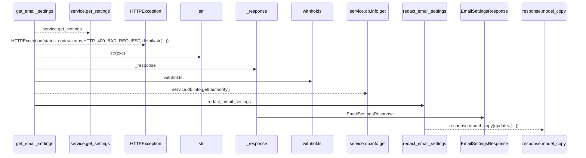
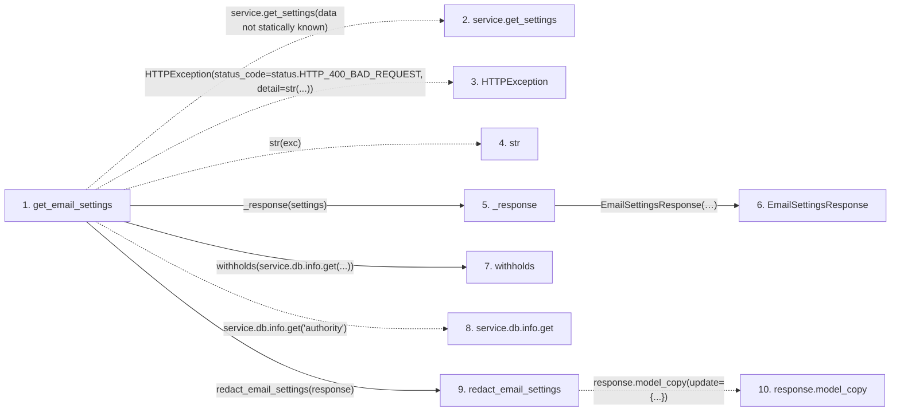

# get_email_settings

**Entry point:** `get_email_settings` (`http`)
**Source:** [routers_email_settings](../modules/routers_email_settings.md)
**Modules touched:** [routers_email_settings](../modules/routers_email_settings.md), [schemas_email_settings](../modules/schemas_email_settings.md), [settings_read](../modules/settings_read.md)

## Call sequence

> Static overview in presentation order, not runtime execution order. Arrows retain captured callers; representative internal continuations and boundary examples precede repeated helper detail.

<!-- Auto-generated from static call edges. Dashed arrows are external or unresolved calls. Reviewed runtime conditions and side effects belong in Behavior. -->

> Call sequence diagram shows 9 of 9 interactions; 0 omitted to keep the visualization within the 30-interaction and generated-diagram limits, with uncertain identities omitted rather than inferred.

> Captured boundary calls: external 2 of 2 (0 omitted); unresolved 3 of 3 (0 omitted). These counts cover the captured static trace.
> Detailed flow queries retain their own coverage and limits; omitted paths may execute at runtime.

## Data flow

<!-- Auto-generated static analysis. Treat values and boundaries as best-effort hints, not runtime proof. -->

### Analysis coverage

**Effect analysis partially available.** Flow assembly and source effect analysis are separate; empty observations do not prove an empty handler body.

Source steps: 5; effect analysis evaluated: 4, partial: 0, unavailable: 1. Counts include steps omitted from the displayed trace.

Collector observations for 4 source steps with known totals: observed: 10, emitted: 10, omitted: 0. Unavailable totals are excluded.

- Callable record unavailable for one or more source steps; those steps have no represented callable body.
- Effect collector totals unavailable; observed counts cover captured records only.

| Step | Callable record | Effect analysis | Collector totals | Observed | Emitted | Omitted |
|---|---|---|---|---:|---:|---:|
| `get_email_settings` | `available` | `evaluated` | `available` | `4` | `4` | `0` |
| `service.get_settings` | `not_applicable` | `not_applicable` | `not_applicable` | — | — | — |
| `HTTPException` | `not_applicable` | `not_applicable` | `not_applicable` | — | — | — |
| `str` | `not_applicable` | `not_applicable` | `not_applicable` | — | — | — |
| `_response` | `available` | `evaluated` | `available` | `2` | `2` | `0` |
| `EmailSettingsResponse` | `unavailable` | `unavailable` | `unavailable` | — | — | — |
| `withholds` | `available` | `evaluated` | `available` | `2` | `2` | `0` |
| `service.db.info.get` | `not_applicable` | `not_applicable` | `not_applicable` | — | — | — |
| `redact_email_settings` | `available` | `evaluated` | `available` | `2` | `2` | `0` |
| `response.model_copy` | `not_applicable` | `not_applicable` | `not_applicable` | — | — | — |

### Step data

| Step | Inputs | Reads | Writes | Returns |
|---|---|---|---|---|
| `get_email_settings` | `service: Annotated[EmailSettingsService, Depends(get_settings_service)]` | `RuntimeSettingsError`, `status` | - | `...` |
| `service.get_settings` | - | - | - | - |
| `HTTPException` | - | - | - | - |
| `str` | - | - | - | - |
| `_response` | `settings` | - | - | `EmailSettingsResponse(...)` |
| `EmailSettingsResponse` | - | - | - | - |
| `withholds` | `authority` | - | - | `...` |
| `service.db.info.get` | - | - | - | - |
| `redact_email_settings` | `response` | - | - | `response.model_copy(...)` |
| `response.model_copy` | - | - | - | - |

### Call data

| From | To | Line | Call |
|---|---|---:|---|
| get_email_settings | service.get_settings | 49 | `service.get_settings(data not statically known)` |
| get_email_settings | HTTPException | 51 | `HTTPException(status_code=status.HTTP_400_BAD_REQUEST, detail=str(...))` |
| get_email_settings | str | 53 | `str(exc)` |
| get_email_settings | _response | 56 | `_response(settings)` |
| _response | EmailSettingsResponse | 24 | `EmailSettingsResponse(enabled=settings.enabled, smtp_host=settings.smtp_host, smtp_port=settings.smtp_port, smtp_user=settings.smtp_user, smtp_from_email=settings.smtp_from_email, smtp_use_tls=settings.smtp_use_tls, has_password=settings.has_password, field_sources=settings.field_sources)` |
| get_email_settings | withholds | 57 | `withholds(service.db.info.get(...))` |
| get_email_settings | service.db.info.get | 57 | `service.db.info.get('authority')` |
| get_email_settings | redact_email_settings | 57 | `redact_email_settings(response)` |
| redact_email_settings | response.model_copy | 59 | `response.model_copy(update={...})` |

### Boundary effects

*No boundary-effect observations were captured in this static trace.*

### Static analysis gaps

| Kind | Step | Target | Line |
|---|---|---|---:|
| unresolved_call | `get_email_settings` | `service.get_settings` | 49 |
| external_call | `get_email_settings` | `HTTPException` | 51 |
| unresolved_call | `get_email_settings` | `service.db.info.get` | 57 |
| unresolved_call | `redact_email_settings` | `response.model_copy` | 59 |

## Behavior

This flow starts at `get_email_settings` and is classified as `http`. The generated call and data-flow sections are bounded static projections; runtime conditions and side effects require source-level confirmation.
