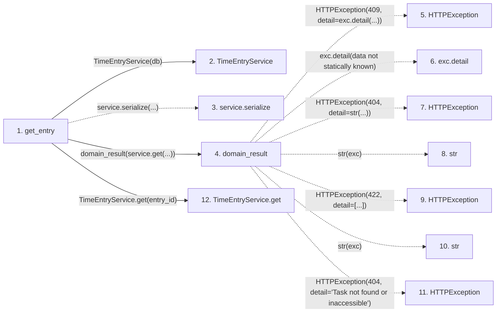

# get_entry

**Entry point:** `get_entry` (`http`)
**Source:** [time_entries](../modules/time_entries.md)
**Modules touched:** [authority](../modules/authority.md), [config](../modules/config.md), [routers_task_domain](../modules/routers_task_domain.md), [time_entries](../modules/time_entries.md), and 1 more

**Complete modules touched:**

- [authority](../modules/authority.md)
- [config](../modules/config.md)
- [routers_task_domain](../modules/routers_task_domain.md)
- [time_entries](../modules/time_entries.md)
- [time_entry_service](../modules/time_entry_service.md)

## Call sequence

> Static overview in presentation order, not runtime execution order. Arrows retain captured callers; representative internal continuations and boundary examples precede repeated helper detail.

```mermaid
sequenceDiagram
    participant p0 as get_entry
    participant p1 as TimeEntryService.get
    participant p2 as TimeEntryService
    participant p3 as domain_result
    participant p4 as TimeEntryService.principal_id
    participant p5 as TimeEntryService.project
    participant p6 as get_settings
    participant p7 as require_project
    participant p8 as AuthorityError
    participant p9 as Settings
    participant p10 as HTTPException
    participant p11 as service.serialize
    participant p12 as exc.detail
    participant p13 as self.db.scalar (backend/app/services/time…ce.py:TimeEntryService.get)
    participant p14 as select(…).where(…).execution_options
    participant p15 as str
    participant p16 as select(…).where (backend/app/services/time…ce.py:TimeEntryService.get)
    participant p17 as select (backend/app/services/time…ce.py:TimeEntryService.get)
    participant p18 as LookupError (backend/app/services/time…ce.py:TimeEntryService.get)
    participant p19 as self.db.scalar (backend/app/services/time…y:TimeEntryService.project)
    participant p20 as self.db.info.get
    participant p21 as select(…).where (backend/app/services/time…y:TimeEntryService.project)
    participant p22 as select (backend/app/services/time…y:TimeEntryService.project)
    participant p23 as LookupError (backend/app/services/time…y:TimeEntryService.project)
    participant p24 as any
    participant p25 as authority.allows (backend/app/services/time…y:TimeEntryService.project)
    participant p26 as db.info.get
    p0->>p1: TimeEntryService.get
    p0->>p2: TimeEntryService
    p0->>p3: domain_result
    p1->>p4: TimeEntryService.principal_id
    p1->>p5: TimeEntryService.project
    p4->>p6: get_settings
    p5->>p7: require_project
    p4->>p8: AuthorityError
    p6->>p9: Settings
    p3-->>p10: HTTPException(409, detail=exc.detail(...))
    p0-->>p11: service.serialize(...)
    p3-->>p12: exc.detail
    p1-->>p13: self.db.scalar (backend/app/services/time…ce.py:TimeEntryService.get)(...)
    p3-->>p10: HTTPException(404, detail=str(...))
    p1-->>p14: select(…).where(…).execution_options(populate_existing=True)
    p3-->>p15: str(exc)
    p1-->>p16: select(…).where (backend/app/services/time…ce.py:TimeEntryService.get)(..., ...)
    p3-->>p10: HTTPException(422, detail=[...])
    p1-->>p17: select (backend/app/services/time…ce.py:TimeEntryService.get)(TimeEntry)
    p3-->>p15: str(exc)
    p1-->>p18: LookupError (backend/app/services/time…ce.py:TimeEntryService.get)('Time entry not found or inaccessible')
    p3-->>p10: HTTPException(404, detail='Task not found or inaccessible')
    p5-->>p19: self.db.scalar (backend/app/services/time…y:TimeEntryService.project)(...)
    p4-->>p20: self.db.info.get('authority')
    p5-->>p21: select(…).where (backend/app/services/time…y:TimeEntryService.project)(...)
    p5-->>p22: select (backend/app/services/time…y:TimeEntryService.project)(Project.id)
    p5-->>p23: LookupError (backend/app/services/time…y:TimeEntryService.project)('Project not found or inaccessible')
    p5-->>p24: any(...)
    p5-->>p25: authority.allows (backend/app/services/time…y:TimeEntryService.project)(project_id, action)
    p7-->>p26: db.info.get('authority')
```

<!-- Auto-generated from static call edges. Dashed arrows are external or unresolved calls. Reviewed runtime conditions and side effects belong in Behavior. -->

> Call sequence diagram shows 30 of 36 interactions; 6 omitted to keep the visualization within the 30-interaction and generated-diagram limits, with uncertain identities omitted rather than inferred.

> Captured boundary calls: external 11 of 11 (0 omitted); unresolved 10 of 11 (1 omitted). These counts cover the captured static trace.

Omitted captured detail, grouped by actual caller occurrence and target module:

| Caller | Parent step | Target module | Kind | Omitted interactions |
| --- | --- | --- | --- | --- |
| `backend/app/services/time_entry_service.py:TimeEntryService.principal_id` | 13 | [backend/app/authority.py](../modules/authority.md) | internal | 1 |
| `backend/app/authority.py:require_project` | 25 | [backend/app/config.py](../modules/config.md) | internal | 1 |
| `backend/app/authority.py:require_project` | 25 | [backend/app/authority.py](../modules/authority.md) | internal | 2 |
| `backend/app/authority.py:require_project` | 25 | - | unresolved | 1 |
| `backend/app/services/time_entry_service.py:TimeEntryService.project` | 24 | [backend/app/authority.py](../modules/authority.md) | internal | 1 |
> Detailed flow queries retain their own coverage and limits; omitted paths may execute at runtime.

## Data flow

<!-- Auto-generated static analysis. Treat values and boundaries as best-effort hints, not runtime proof. -->

### Analysis coverage

**Effect analysis partially available.** Flow assembly and source effect analysis are separate; empty observations do not prove an empty handler body.

Source steps: 15; effect analysis evaluated: 8, partial: 0, unavailable: 7. Counts include steps omitted from the displayed trace.

Collector observations for 8 source steps with known totals: observed: 21, emitted: 21, omitted: 0. Unavailable totals are excluded.

- Callable record unavailable for one or more source steps; those steps have no represented callable body.
- Effect collector totals unavailable; observed counts cover captured records only.

| Step | Callable record | Effect analysis | Collector totals | Observed | Emitted | Omitted |
|---|---|---|---|---:|---:|---:|
| `get_entry` | `available` | `evaluated` | `available` | `3` | `3` | `0` |
| `TimeEntryService` | `unavailable` | `unavailable` | `unavailable` | — | — | — |
| `service.serialize` | `not_applicable` | `not_applicable` | `not_applicable` | — | — | — |
| `domain_result` | `available` | `evaluated` | `available` | `3` | `3` | `0` |
| `HTTPException` | `not_applicable` | `not_applicable` | `not_applicable` | — | — | — |
| `exc.detail` | `not_applicable` | `not_applicable` | `not_applicable` | — | — | — |
| `HTTPException` | `not_applicable` | `not_applicable` | `not_applicable` | — | — | — |
| `str` | `not_applicable` | `not_applicable` | `not_applicable` | — | — | — |
| `HTTPException` | `not_applicable` | `not_applicable` | `not_applicable` | — | — | — |
| `str` | `not_applicable` | `not_applicable` | `not_applicable` | — | — | — |
| `HTTPException` | `not_applicable` | `not_applicable` | `not_applicable` | — | — | — |
| `TimeEntryService.get` | `available` | `evaluated` | `available` | `2` | `2` | `0` |

### Step data

| Step | Inputs | Reads | Writes | Returns |
|---|---|---|---|---|
| `get_entry` | `entry_id: int`, `db: DB` | - | - | `service.serialize(...)` |
| `TimeEntryService` | - | - | - | - |
| `service.serialize` | - | - | - | - |
| `domain_result` | `awaitable` | `TaskVersionConflictError` | - | `result` |
| `HTTPException` | - | - | - | - |
| `exc.detail` | - | - | - | - |
| `HTTPException` | - | - | - | - |
| `str` | - | - | - | - |
| `HTTPException` | - | - | - | - |
| `str` | - | - | - | - |
| `HTTPException` | - | - | - | - |
| `TimeEntryService.get` | `entry_id` | - | - | `entry` |

### Call data

| From | To | Line | Call |
|---|---|---:|---|
| get_entry | TimeEntryService | 67 | `TimeEntryService(db)` |
| get_entry | service.serialize | 68 | `service.serialize(...)` |
| get_entry | domain_result | 68 | `domain_result(service.get(...))` |
| domain_result | HTTPException | 51 | `HTTPException(409, detail=exc.detail(...))` |
| domain_result | exc.detail | 51 | `exc.detail(data not statically known)` |
| domain_result | HTTPException | 53 | `HTTPException(404, detail=str(...))` |
| domain_result | str | 53 | `str(exc)` |
| domain_result | HTTPException | 55 | `HTTPException(422, detail=[...])` |
| domain_result | str | 55 | `str(exc)` |
| domain_result | HTTPException | 57 | `HTTPException(404, detail='Task not found or inaccessible')` |
| get_entry | TimeEntryService.get | 68 | `service.get(entry_id)` |

### Boundary effects

*No boundary-effect observations were captured in this static trace.*

### Static analysis gaps

| Kind | Step | Target | Line |
|---|---|---|---:|
| unresolved_call | `get_entry` | `service.serialize` | 68 |
| external_call | `domain_result` | `HTTPException` | 51 |
| unresolved_call | `domain_result` | `exc.detail` | 51 |
| external_call | `domain_result` | `HTTPException` | 53 |
| external_call | `domain_result` | `HTTPException` | 55 |
| external_call | `domain_result` | `HTTPException` | 57 |
| step_limit | `get_entry` | `first 12 steps` | 0 |

## Behavior

This flow starts at `get_entry` and is classified as `http`. The generated call and data-flow sections are bounded static projections; runtime conditions and side effects require source-level confirmation.
