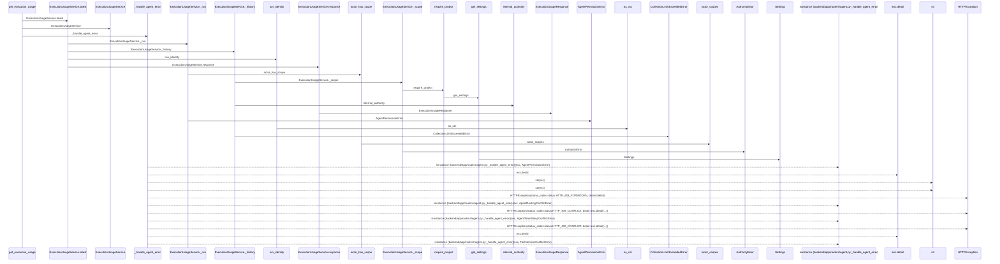
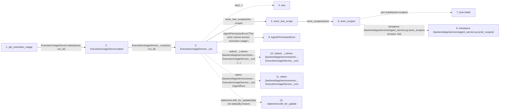

# get_execution_usage

**Entry point:** `get_execution_usage` (`http`)
**Source:** [routers_agent](../modules/routers_agent.md)
**Modules touched:** [agent_service](../modules/agent_service.md), [authority](../modules/authority.md), [config](../modules/config.md), [execution_usage_service](../modules/execution_usage_service.md), and 4 more

**Complete modules touched:**

- [agent_service](../modules/agent_service.md)
- [authority](../modules/authority.md)
- [config](../modules/config.md)
- [execution_usage_service](../modules/execution_usage_service.md)
- [query_limits](../modules/query_limits.md)
- [routers_agent](../modules/routers_agent.md)
- [schemas_execution_usage](../modules/schemas_execution_usage.md)
- [time](../modules/time.md)

## Call sequence

> Static overview in presentation order, not runtime execution order. Arrows retain captured callers; representative internal continuations and boundary examples precede repeated helper detail.

<!-- Auto-generated from static call edges. Dashed arrows are external or unresolved calls. Reviewed runtime conditions and side effects belong in Behavior. -->

> Call sequence diagram shows 30 of 77 interactions; 47 omitted to keep the visualization within the 30-interaction and generated-diagram limits, with uncertain identities omitted rather than inferred.

> Captured boundary calls: external 9 of 32 (23 omitted); unresolved 2 of 21 (19 omitted). These counts cover the captured static trace.

Omitted captured detail, grouped by actual caller occurrence and target module:

| Caller | Parent step | Target module | Kind | Omitted interactions |
| --- | --- | --- | --- | --- |
| `backend/app/services/execution_usage_service.py:ExecutionUsageService._run` | 3 | - | external | 3 |
| `backend/app/services/agent_service.py:actor_scopes` | 6 | - | external | 2 |
| `backend/app/services/execution_usage_service.py:ExecutionUsageService._run` | 3 | - | unresolved | 3 |
| `backend/app/services/execution_usage_service.py:ExecutionUsageService._run` | 3 | [backend/app/services/agent_service.py](../modules/agent_service.md) | internal | 3 |
| `backend/app/authority.py:internal_authority` | 19 | - | unresolved | 1 |
| `backend/app/services/execution_usage_service.py:ExecutionUsageService._history` | 18 | - | external | 3 |
| `backend/app/services/execution_usage_service.py:ExecutionUsageService._history` | 18 | - | unresolved | 5 |
| `backend/app/services/execution_usage_service.py:ExecutionUsageService._scope` | 30 | - | unresolved | 1 |
> Omission summary shows 8 of 16 groups; 8 further groups are not expanded here. Counts above include all omitted interactions.
> Detailed flow queries retain their own coverage and limits; omitted paths may execute at runtime.

## Data flow

<!-- Auto-generated static analysis. Treat values and boundaries as best-effort hints, not runtime proof. -->

### Analysis coverage

**Effect analysis partially available.** Flow assembly and source effect analysis are separate; empty observations do not prove an empty handler body.

Source steps: 25; effect analysis evaluated: 15, partial: 1, unavailable: 9. Counts include steps omitted from the displayed trace.

Collector observations for 16 source steps with known totals: observed: 62, emitted: 58, omitted: 4. Unavailable totals are excluded.

- Callable record unavailable for one or more source steps; those steps have no represented callable body.
- Effect collector omitted observations before flow assembly; displayed effects are partial.
- Effect collector totals unavailable; observed counts cover captured records only.

| Step | Callable record | Effect analysis | Collector totals | Observed | Emitted | Omitted |
|---|---|---|---|---:|---:|---:|
| `get_execution_usage` | `available` | `evaluated` | `available` | `4` | `4` | `0` |
| `ExecutionUsageService.latest` | `available` | `evaluated` | `available` | `3` | `3` | `0` |
| `ExecutionUsageService._run` | `available` | `evaluated` | `available` | `5` | `5` | `0` |
| `any` | `not_applicable` | `not_applicable` | `not_applicable` | — | — | — |
| `actor_has_scope` | `available` | `evaluated` | `available` | `3` | `3` | `0` |
| `actor_scopes` | `available` | `evaluated` | `available` | `3` | `3` | `0` |
| `json.loads` | `not_applicable` | `not_applicable` | `not_applicable` | — | — | — |
| `isinstance (backend/app/services/agent_service.py:actor_scopes)` | `not_applicable` | `not_applicable` | `not_applicable` | — | — | — |
| `AgentPermissionError` | `unavailable` | `unavailable` | `unavailable` | — | — | — |
| `select(…).where (backend/app/services/exec…ExecutionUsageService._run)` | `not_applicable` | `not_applicable` | `not_applicable` | — | — | — |
| `select (backend/app/services/exec…ExecutionUsageService._run)` | `not_applicable` | `not_applicable` | `not_applicable` | — | — | — |
| `statement.with_for_update` | `not_applicable` | `not_applicable` | `not_applicable` | — | — | — |

### Step data

| Step | Inputs | Reads | Writes | Returns |
|---|---|---|---|---|
| `get_execution_usage` | `run_id: int`, `actor: Annotated[AgentActor, Depends(get_agent_actor)]`, `db: Annotated[AsyncSession, Depends(get_db, scope='function')]` | - | - | `...` |
| `ExecutionUsageService.latest` | `actor`, `run_id` | - | - | `...` |
| `ExecutionUsageService._run` | `actor`, `run_id`, `writing` | `AgentRun` | - | `run` |
| `any` | - | - | - | - |
| `actor_has_scope` | `actor: AgentActor`, `scope: str` | - | - | `...` |
| `actor_scopes` | `actor: AgentActor` | `json` | - | `...` |
| `json.loads` | - | - | - | - |
| `isinstance (backend/app/services/agent_service.py:actor_scopes)` | - | - | - | - |
| `AgentPermissionError` | - | - | - | - |
| `select(…).where (backend/app/services/exec…ExecutionUsageService._run)` | - | - | - | - |
| `select (backend/app/services/exec…ExecutionUsageService._run)` | - | - | - | - |
| `statement.with_for_update` | - | - | - | - |

### Call data

| From | To | Line | Call |
|---|---|---:|---|
| get_execution_usage | ExecutionUsageService.latest | 1336 | `ExecutionUsageService(db).latest(actor, run_id)` |
| ExecutionUsageService.latest | ExecutionUsageService._run | 93 | `self._run(actor, run_id)` |
| ExecutionUsageService._run | any | 62 | `any(...)` |
| ExecutionUsageService._run | actor_has_scope | 62 | `actor_has_scope(actor, scope)` |
| actor_has_scope | actor_scopes | 94 | `actor_scopes(actor)` |
| actor_scopes | json.loads | 86 | `json.loads(actor.scopes)` |
| actor_scopes | isinstance (backend/app/services/agent_service.py:actor_scopes) | 89 | `isinstance(scopes, list)` |
| ExecutionUsageService._run | AgentPermissionError | 63 | `AgentPermissionError('The actor cannot access execution usage')` |
| ExecutionUsageService._run | select(…).where (backend/app/services/exec…ExecutionUsageService._run) | 64 | `select(AgentRun).where(...)` |
| ExecutionUsageService._run | select (backend/app/services/exec…ExecutionUsageService._run) | 64 | `select(AgentRun)` |
| ExecutionUsageService._run | statement.with_for_update | 66 | `statement.with_for_update(data not statically known)` |

### Boundary effects

*No boundary-effect observations were captured in this static trace.*

### Static analysis gaps

| Kind | Step | Target | Line |
|---|---|---|---:|
| external_call | `ExecutionUsageService._run` | `any` | 62 |
| external_call | `actor_scopes` | `json.loads` | 86 |
| external_call | `actor_scopes` | `isinstance` | 89 |
| unresolved_call | `ExecutionUsageService._run` | `select(AgentRun).where` | 64 |
| external_call | `ExecutionUsageService._run` | `select` | 64 |
| unresolved_call | `ExecutionUsageService._run` | `statement.with_for_update` | 66 |
| step_limit | `get_execution_usage` | `first 12 steps` | 0 |

## Behavior

This flow starts at `get_execution_usage` and is classified as `http`. The generated call and data-flow sections are bounded static projections; runtime conditions and side effects require source-level confirmation.
