# get_iteration_plan_readiness

**Entry point:** `get_iteration_plan_readiness` (`http`)
**Source:** [routers_agent_planning](../modules/routers_agent_planning.md)
**Modules touched:** [agent_service](../modules/agent_service.md), [authority](../modules/authority.md), [calendar_service](../modules/calendar_service.md), [capacity_service](../modules/capacity_service.md), and 11 more

**Complete modules touched:**

- [agent_service](../modules/agent_service.md)
- [authority](../modules/authority.md)
- [calendar_service](../modules/calendar_service.md)
- [capacity_service](../modules/capacity_service.md)
- [commands](../modules/commands.md)
- [iteration_service](../modules/iteration_service.md)
- [mcp_agent_tools](../modules/mcp_agent_tools.md)
- [plan_checkpoints](../modules/plan_checkpoints.md)
- [query_limits](../modules/query_limits.md)
- [routers_agent_planning](../modules/routers_agent_planning.md)
- [schemas_iteration](../modules/schemas_iteration.md)
- [schemas_team](../modules/schemas_team.md)
- [services_work_metrics](../modules/services_work_metrics.md)
- [team_service](../modules/team_service.md)
- [time](../modules/time.md)

## Call sequence

> Static overview in presentation order, not runtime execution order. Arrows retain captured callers; representative internal continuations and boundary examples precede repeated helper detail.

```mermaid
sequenceDiagram
    participant p0 as get_iteration_plan_readiness (backend/app/routers/agent_planning.py)
    participant p1 as require_scope
    participant p2 as get_iteration_plan_readiness (backend/app/mcp_agent_tools.py)
    participant p3 as _handle_agent_error
    participant p4 as actor_has_scope
    participant p5 as IterationService.get_planning_readiness_summary
    participant p6 as working_today
    participant p7 as included_work_ids
    participant p8 as TeamService.get_by_iteration
    participant p9 as TeamService.calculate_capacity
    participant p10 as CapacityService.schedule_issues
    participant p11 as plan_checkpoints
    participant p12 as TeamService.get_by_id
    participant p13 as CapacityService.calendar_for
    participant p14 as CapacityService.calendar_status
    participant p15 as CapacityService.projection
    participant p16 as CapacityService.absence_ranges
    participant p17 as CapacityService.require_visible
    participant p18 as AgentPermissionError
    participant p19 as IterationService
    participant p20 as _response
    participant p21 as actor_scopes
    participant p22 as IterationService.get_by_id
    participant p23 as TeamService
    participant p24 as CapacityService
    participant p25 as IterationPlanningReadinessSummary
    participant p26 as plan_checkpoints.<locals>.checkpoint
    participant p27 as as_utc
    participant p28 as utc_now
    participant p29 as HTTPException (backend/app/routers/agent…_iteration_plan_readiness)
    participant p30 as exc.detail
    p0->>p1: require_scope
    p0->>p2: get_iteration_plan_readiness (backend/app/mcp_agent_tools.py)
    p0->>p3: _handle_agent_error
    p1->>p4: actor_has_scope
    p2->>p5: IterationService.get_planning_readiness_summary
    p5->>p6: working_today
    p5->>p7: included_work_ids
    p5->>p8: TeamService.get_by_iteration
    p5->>p9: TeamService.calculate_capacity
    p5->>p10: CapacityService.schedule_issues
    p5->>p11: plan_checkpoints
    p9->>p12: TeamService.get_by_id
    p9->>p13: CapacityService.calendar_for
    p9->>p14: CapacityService.calendar_status
    p10->>p15: CapacityService.projection
    p9->>p16: CapacityService.absence_ranges
    p15->>p17: CapacityService.require_visible
    p1->>p18: AgentPermissionError
    p2->>p19: IterationService
    p2->>p20: _response
    p4->>p21: actor_scopes
    p5->>p22: IterationService.get_by_id
    p5->>p23: TeamService
    p5->>p24: CapacityService
    p5->>p25: IterationPlanningReadinessSummary
    p11->>p26: plan_checkpoints.<locals>.checkpoint
    p6->>p27: as_utc
    p6->>p28: utc_now
    p0-->>p29: HTTPException (backend/app/routers/agent…_iteration_plan_readiness)(status_code=status.HTTP_404_NOT_FOUND, detail='Iteration not found')
    p3-->>p30: exc.detail
```

<!-- Auto-generated from static call edges. Dashed arrows are external or unresolved calls. Reviewed runtime conditions and side effects belong in Behavior. -->

> Call sequence diagram shows 30 of 401 interactions; 371 omitted to keep the visualization within the 30-interaction and generated-diagram limits, with uncertain identities omitted rather than inferred.

> Captured boundary calls: external 1 of 174 (173 omitted); unresolved 1 of 160 (159 omitted). These counts cover the captured static trace.

Omitted captured detail, grouped by actual caller occurrence and target module:

| Caller | Parent step | Target module | Kind | Omitted interactions |
| --- | --- | --- | --- | --- |
| `backend/app/services/agent_service.py:actor_scopes` | 4 | - | external | 2 |
| `backend/app/services/iteration_service.py:IterationService.get_by_id` | 10 | - | unresolved | 4 |
| `backend/app/services/iteration_service.py:IterationService.get_by_id` | 10 | - | external | 3 |
| `backend/app/services/work_metrics.py:working_today` | 18 | - | unresolved | 2 |
| `backend/app/utils/time.py:as_utc` | 21 | - | unresolved | 2 |
| `backend/app/utils/time.py:utc_now` | 24 | - | external | 1 |
| `backend/app/services/work_metrics.py:working_today` | 18 | - | external | 1 |
| `backend/app/services/work_metrics.py:included_work_ids` | 27 | - | external | 12 |
> Omission summary shows 8 of 61 groups; 53 further groups are not expanded here. Counts above include all omitted interactions.
> Detailed flow queries retain their own coverage and limits; omitted paths may execute at runtime.

## Data flow

<!-- Auto-generated static analysis. Treat values and boundaries as best-effort hints, not runtime proof. -->

### Analysis coverage

**Effect analysis partially available.** Flow assembly and source effect analysis are separate; empty observations do not prove an empty handler body.

Source steps: 68; effect analysis evaluated: 52, partial: 2, unavailable: 14. Counts include steps omitted from the displayed trace.

Collector observations for 54 source steps with known totals: observed: 265, emitted: 256, omitted: 9. Unavailable totals are excluded.

- Callable record unavailable for one or more source steps; those steps have no represented callable body.
- Effect collector omitted observations before flow assembly; displayed effects are partial.
- Effect collector totals unavailable; observed counts cover captured records only.

| Step | Callable record | Effect analysis | Collector totals | Observed | Emitted | Omitted |
|---|---|---|---|---:|---:|---:|
| `get_iteration_plan_readiness (backend/app/routers/agent_planning.py)` | `available` | `evaluated` | `available` | `5` | `5` | `0` |
| `require_scope` | `available` | `evaluated` | `available` | `2` | `2` | `0` |
| `actor_has_scope` | `available` | `evaluated` | `available` | `3` | `3` | `0` |
| `actor_scopes` | `available` | `evaluated` | `available` | `3` | `3` | `0` |
| `json.loads` | `not_applicable` | `not_applicable` | `not_applicable` | — | — | — |
| `isinstance (backend/app/services/agent_service.py:actor_scopes)` | `not_applicable` | `not_applicable` | `not_applicable` | — | — | — |
| `AgentPermissionError` | `unavailable` | `unavailable` | `unavailable` | — | — | — |
| `get_iteration_plan_readiness (backend/app/mcp_agent_tools.py)` | `available` | `evaluated` | `available` | `4` | `4` | `0` |
| `IterationService.get_planning_readiness_summary` | `available` | `evaluated` | `available` | `9` | `9` | `0` |
| `IterationService.get_by_id` | `available` | `evaluated` | `available` | `3` | `3` | `0` |
| `self.db.execute (backend/app/services/iter…terationService.get_by_id)` | `not_applicable` | `not_applicable` | `not_applicable` | — | — | — |
| `select(…).options(…).where (backend/app/services/iter…terationService.get_by_id)` | `not_applicable` | `not_applicable` | `not_applicable` | — | — | — |

```mermaid
flowchart LR
    s1["1. get_iteration_plan_readiness (backend/app/routers/agent_planning.py)"]
    s2["2. require_scope"]
    s3["3. actor_has_scope"]
    s4["4. actor_scopes"]
    s5["5. json.loads"]
    s6["6. isinstance (backend/app/services/agent_service.py:actor_scopes)"]
    s7["7. AgentPermissionError"]
    s8["8. get_iteration_plan_readiness (backend/app/mcp_agent_tools.py)"]
    s9["9. IterationService.get_planning_readiness_summary"]
    s10["10. IterationService.get_by_id"]
    s11["11. self.db.execute (backend/app/services/iter…terationService.get_by_id)"]
    s12["12. select(…).options(…).where (backend/app/services/iter…terationService.get_by_id)"]
    s1 -->|"require_scope(actor, 'planning:read')"| s2
    s2 -->|"actor_has_scope(actor, scope)"| s3
    s3 -->|"actor_scopes(actor)"| s4
    s4 -. "json.loads(actor.scopes)" .-> s5
    s4 -. "isinstance (backend/app/services/agent_service.py:actor_scopes)(scopes, list)" .-> s6
    s2 -->|"AgentPermissionError(...)"| s7
    s1 -->|"get_iteration_plan_readiness (backend/app/mcp_agent_tools.py)(db, iteration_id)"| s8
    s8 -->|"IterationService.get_planning_readiness_summary(iteration_id)"| s9
    s9 -->|"IterationService.get_by_id(iteration_id)"| s10
    s10 -. "self.db.execute (backend/app/services/iter…terationService.get_by_id)(...)" .-> s11
    s10 -. "select(…).options(…).where (backend/app/services/iter…terationService.get_by_id)(...)" .-> s12
    click s1 "../modules/routers_agent_planning.md"
    click s2 "../modules/agent_service.md"
    click s3 "../modules/agent_service.md"
    click s4 "../modules/agent_service.md"
    click s7 "../modules/agent_service.md"
    click s8 "../modules/mcp_agent_tools.md"
    click s9 "../modules/iteration_service.md"
    click s10 "../modules/iteration_service.md"
```

### Step data

| Step | Inputs | Reads | Writes | Returns |
|---|---|---|---|---|
| `get_iteration_plan_readiness (backend/app/routers/agent_planning.py)` | `iteration_id: int`, `actor: Annotated[AgentActor, Depends(get_agent_actor)]`, `db: Annotated[AsyncSession, Depends(get_db, scope='function')]` | `status` | - | `summary` |
| `require_scope` | `actor: AgentActor`, `scope: str` | - | - | - |
| `actor_has_scope` | `actor: AgentActor`, `scope: str` | - | - | `...` |
| `actor_scopes` | `actor: AgentActor` | `json` | - | `...` |
| `json.loads` | - | - | - | - |
| `isinstance (backend/app/services/agent_service.py:actor_scopes)` | - | - | - | - |
| `AgentPermissionError` | - | - | - | - |
| `get_iteration_plan_readiness (backend/app/mcp_agent_tools.py)` | `db: AsyncSession`, `iteration_id: int` | `IterationPlanningReadinessSummary` | - | `...` |
| `IterationService.get_planning_readiness_summary` | `iteration_id: int` | `self.db`, `Task`, `Task`, `Task`, `Task`, `Task` | - | `None`, `IterationPlanningReadinessSummary(...)` |
| `IterationService.get_by_id` | `iteration_id: int` | `Iteration` | - | `result.scalar_one_or_none(...)` |
| `self.db.execute (backend/app/services/iter…terationService.get_by_id)` | - | - | - | - |
| `select(…).options(…).where (backend/app/services/iter…terationService.get_by_id)` | - | - | - | - |

### Call data

| From | To | Line | Call |
|---|---|---:|---|
| get_iteration_plan_readiness (backend/app/routers/agent_planning.py) | require_scope | 134 | `require_scope(actor, 'planning:read')` |
| require_scope | actor_has_scope | 100 | `actor_has_scope(actor, scope)` |
| actor_has_scope | actor_scopes | 94 | `actor_scopes(actor)` |
| actor_scopes | json.loads | 86 | `json.loads(actor.scopes)` |
| actor_scopes | isinstance (backend/app/services/agent_service.py:actor_scopes) | 89 | `isinstance(scopes, list)` |
| require_scope | AgentPermissionError | 101 | `AgentPermissionError(...)` |
| get_iteration_plan_readiness (backend/app/routers/agent_planning.py) | get_iteration_plan_readiness (backend/app/mcp_agent_tools.py) | 135 | `mcp_agent_tools.get_iteration_plan_readiness(db, iteration_id)` |
| get_iteration_plan_readiness (backend/app/mcp_agent_tools.py) | IterationService.get_planning_readiness_summary | 648 | `IterationService(db).get_planning_readiness_summary(iteration_id)` |
| IterationService.get_planning_readiness_summary | IterationService.get_by_id | 511 | `self.get_by_id(iteration_id)` |
| IterationService.get_by_id | self.db.execute (backend/app/services/iter…terationService.get_by_id) | 323 | `self.db.execute(...)` |
| IterationService.get_by_id | select(…).options(…).where (backend/app/services/iter…terationService.get_by_id) | 324 | `select(Iteration).options(selectinload(Iteration.calendar), selectinload(Iteration.project)).where(...)` |

### Boundary effects

*No boundary-effect observations were captured in this static trace.*

### Static analysis gaps

| Kind | Step | Target | Line |
|---|---|---|---:|
| external_call | `actor_scopes` | `json.loads` | 86 |
| external_call | `actor_scopes` | `isinstance` | 89 |
| unresolved_call | `IterationService.get_by_id` | `self.db.execute` | 323 |
| unresolved_call | `IterationService.get_by_id` | `select(Iteration).options(selectinload(Iteration.calendar), selectinload(Iteration.project)).where` | 324 |
| step_limit | `get_iteration_plan_readiness` | `first 12 steps` | 0 |

## Behavior

This flow starts at `get_iteration_plan_readiness` and is classified as `http`. The generated call and data-flow sections are bounded static projections; runtime conditions and side effects require source-level confirmation.
