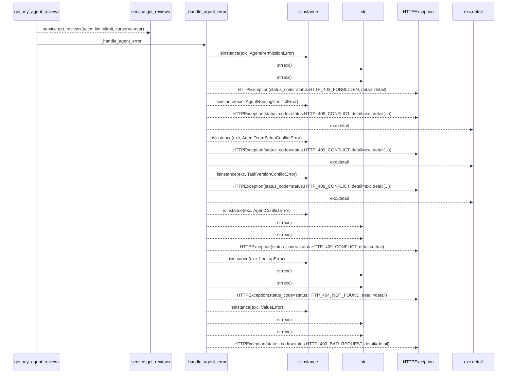
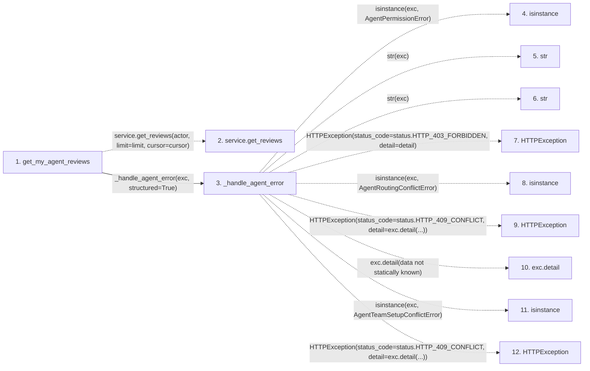

# get_my_agent_reviews

**Entry point:** `get_my_agent_reviews` (`http`)
**Source:** [routers_agent](../modules/routers_agent.md)
**Modules touched:** [routers_agent](../modules/routers_agent.md)

## Call sequence

> Static overview in presentation order, not runtime execution order. Arrows retain captured callers; representative internal continuations and boundary examples precede repeated helper detail.

<!-- Auto-generated from static call edges. Dashed arrows are external or unresolved calls. Reviewed runtime conditions and side effects belong in Behavior. -->

> Call sequence diagram shows 27 of 27 interactions; 0 omitted to keep the visualization within the 30-interaction and generated-diagram limits, with uncertain identities omitted rather than inferred.

> Captured boundary calls: external 22 of 22 (0 omitted); unresolved 4 of 4 (0 omitted). These counts cover the captured static trace.
> Detailed flow queries retain their own coverage and limits; omitted paths may execute at runtime.

## Data flow

<!-- Auto-generated static analysis. Treat values and boundaries as best-effort hints, not runtime proof. -->

### Analysis coverage

**Effect analysis partially available.** Flow assembly and source effect analysis are separate; empty observations do not prove an empty handler body.

Source steps: 2; effect analysis evaluated: 1, partial: 1, unavailable: 0. Counts include steps omitted from the displayed trace.

Collector observations for 2 source steps with known totals: observed: 19, emitted: 15, omitted: 4. Unavailable totals are excluded.

- Effect collector omitted observations before flow assembly; displayed effects are partial.

| Step | Callable record | Effect analysis | Collector totals | Observed | Emitted | Omitted |
|---|---|---|---|---:|---:|---:|
| `get_my_agent_reviews` | `available` | `evaluated` | `available` | `5` | `5` | `0` |
| `service.get_reviews` | `not_applicable` | `not_applicable` | `not_applicable` | — | — | — |
| `_handle_agent_error` | `available` | `partial` | `available` | `14` | `10` | `4` |
| `isinstance` | `not_applicable` | `not_applicable` | `not_applicable` | — | — | — |
| `str` | `not_applicable` | `not_applicable` | `not_applicable` | — | — | — |
| `str` | `not_applicable` | `not_applicable` | `not_applicable` | — | — | — |
| `HTTPException` | `not_applicable` | `not_applicable` | `not_applicable` | — | — | — |
| `isinstance` | `not_applicable` | `not_applicable` | `not_applicable` | — | — | — |
| `HTTPException` | `not_applicable` | `not_applicable` | `not_applicable` | — | — | — |
| `exc.detail` | `not_applicable` | `not_applicable` | `not_applicable` | — | — | — |
| `isinstance` | `not_applicable` | `not_applicable` | `not_applicable` | — | — | — |
| `HTTPException` | `not_applicable` | `not_applicable` | `not_applicable` | — | — | — |

### Step data

| Step | Inputs | Reads | Writes | Returns |
|---|---|---|---|---|
| `get_my_agent_reviews` | `actor: Annotated[AgentActor, Depends(get_agent_actor)]`, `service: Annotated[AgentWorkService, Depends(get_agent_work_service)]`, `limit: int`, `cursor: Optional[str]` | - | - | `...` |
| `service.get_reviews` | - | - | - | - |
| `_handle_agent_error` | `exc: Exception`, `structured: bool` | `AgentPermissionError`, `status`, `AgentRoutingConflictError`, `status`, `AgentTeamSetupConflictError`, `status`, `TaskVersionConflictError`, `status` | - | - |
| `isinstance` | - | - | - | - |
| `str` | - | - | - | - |
| `str` | - | - | - | - |
| `HTTPException` | - | - | - | - |
| `isinstance` | - | - | - | - |
| `HTTPException` | - | - | - | - |
| `exc.detail` | - | - | - | - |
| `isinstance` | - | - | - | - |
| `HTTPException` | - | - | - | - |

### Call data

| From | To | Line | Call |
|---|---|---:|---|
| get_my_agent_reviews | service.get_reviews | 962 | `service.get_reviews(actor, limit=limit, cursor=cursor)` |
| get_my_agent_reviews | _handle_agent_error | 964 | `_handle_agent_error(exc, structured=True)` |
| _handle_agent_error | isinstance | 271 | `isinstance(exc, AgentPermissionError)` |
| _handle_agent_error | str | 273 | `str(exc)` |
| _handle_agent_error | str | 275 | `str(exc)` |
| _handle_agent_error | HTTPException | 277 | `HTTPException(status_code=status.HTTP_403_FORBIDDEN, detail=detail)` |
| _handle_agent_error | isinstance | 278 | `isinstance(exc, AgentRoutingConflictError)` |
| _handle_agent_error | HTTPException | 279 | `HTTPException(status_code=status.HTTP_409_CONFLICT, detail=exc.detail(...))` |
| _handle_agent_error | exc.detail | 279 | `exc.detail(data not statically known)` |
| _handle_agent_error | isinstance | 280 | `isinstance(exc, AgentTeamSetupConflictError)` |
| _handle_agent_error | HTTPException | 281 | `HTTPException(status_code=status.HTTP_409_CONFLICT, detail=exc.detail(...))` |

### Boundary effects

*No boundary-effect observations were captured in this static trace.*

### Static analysis gaps

| Kind | Step | Target | Line |
|---|---|---|---:|
| unresolved_call | `get_my_agent_reviews` | `service.get_reviews` | 962 |
| external_call | `_handle_agent_error` | `isinstance` | 271 |
| external_call | `_handle_agent_error` | `HTTPException` | 277 |
| external_call | `_handle_agent_error` | `isinstance` | 278 |
| external_call | `_handle_agent_error` | `HTTPException` | 279 |
| unresolved_call | `_handle_agent_error` | `exc.detail` | 279 |
| external_call | `_handle_agent_error` | `isinstance` | 280 |
| external_call | `_handle_agent_error` | `HTTPException` | 281 |
| step_limit | `get_my_agent_reviews` | `first 12 steps` | 0 |

## Behavior

This flow starts at `get_my_agent_reviews` and is classified as `http`. The generated call and data-flow sections are bounded static projections; runtime conditions and side effects require source-level confirmation.
