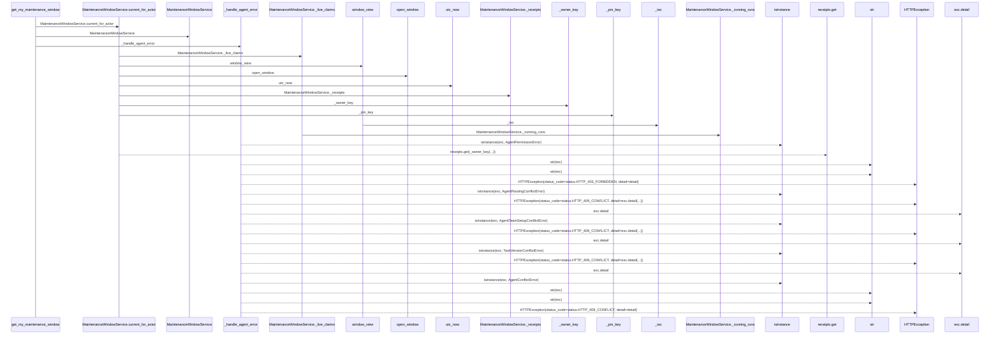
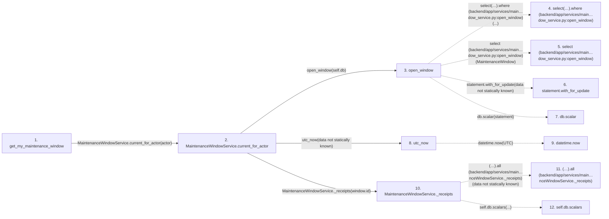

# get_my_maintenance_window

**Entry point:** `get_my_maintenance_window` (`http`)
**Source:** [routers_agent](../modules/routers_agent.md)
**Modules touched:** [maintenance_window_service](../modules/maintenance_window_service.md), [routers_agent](../modules/routers_agent.md), [time](../modules/time.md)

## Call sequence

> Static overview in presentation order, not runtime execution order. Arrows retain captured callers; representative internal continuations and boundary examples precede repeated helper detail.

<!-- Auto-generated from static call edges. Dashed arrows are external or unresolved calls. Reviewed runtime conditions and side effects belong in Behavior. -->

> Call sequence diagram shows 30 of 71 interactions; 41 omitted to keep the visualization within the 30-interaction and generated-diagram limits, with uncertain identities omitted rather than inferred.

> Captured boundary calls: external 14 of 29 (15 omitted); unresolved 4 of 25 (21 omitted). These counts cover the captured static trace.

Omitted captured detail, grouped by actual caller occurrence and target module:

| Caller | Parent step | Target module | Kind | Omitted interactions |
| --- | --- | --- | --- | --- |
| `backend/app/services/maintenance_window_service.py:open_window` | 3 | - | unresolved | 3 |
| `backend/app/services/maintenance_window_service.py:open_window` | 3 | - | external | 1 |
| `backend/app/utils/time.py:utc_now` | 8 | - | external | 1 |
| `backend/app/services/maintenance_window_service.py:MaintenanceWindowService._receipts` | 10 | - | unresolved | 3 |
| `backend/app/services/maintenance_window_service.py:MaintenanceWindowService._receipts` | 10 | - | external | 1 |
| `backend/app/services/maintenance_window_service.py:MaintenanceWindowService._live_claims` | 15 | - | unresolved | 8 |
| `backend/app/services/maintenance_window_service.py:MaintenanceWindowService._live_claims` | 15 | - | external | 2 |
| `backend/app/services/maintenance_window_service.py:MaintenanceWindowService._running_runs` | 24 | - | unresolved | 6 |
> Omission summary shows 8 of 13 groups; 5 further groups are not expanded here. Counts above include all omitted interactions.
> Detailed flow queries retain their own coverage and limits; omitted paths may execute at runtime.

## Data flow

<!-- Auto-generated static analysis. Treat values and boundaries as best-effort hints, not runtime proof. -->

### Analysis coverage

**Effect analysis partially available.** Flow assembly and source effect analysis are separate; empty observations do not prove an empty handler body.

Source steps: 18; effect analysis evaluated: 16, partial: 1, unavailable: 1. Counts include steps omitted from the displayed trace.

Collector observations for 17 source steps with known totals: observed: 61, emitted: 57, omitted: 4. Unavailable totals are excluded.

- Callable record unavailable for one or more source steps; those steps have no represented callable body.
- Effect collector omitted observations before flow assembly; displayed effects are partial.
- Effect collector totals unavailable; observed counts cover captured records only.

| Step | Callable record | Effect analysis | Collector totals | Observed | Emitted | Omitted |
|---|---|---|---|---:|---:|---:|
| `get_my_maintenance_window` | `available` | `evaluated` | `available` | `3` | `3` | `0` |
| `MaintenanceWindowService.current_for_actor` | `available` | `evaluated` | `available` | `6` | `6` | `0` |
| `open_window` | `available` | `evaluated` | `available` | `4` | `4` | `0` |
| `select(…).where (backend/app/services/main…dow_service.py:open_window)` | `not_applicable` | `not_applicable` | `not_applicable` | — | — | — |
| `select (backend/app/services/main…dow_service.py:open_window)` | `not_applicable` | `not_applicable` | `not_applicable` | — | — | — |
| `statement.with_for_update` | `not_applicable` | `not_applicable` | `not_applicable` | — | — | — |
| `db.scalar` | `not_applicable` | `not_applicable` | `not_applicable` | — | — | — |
| `utc_now` | `available` | `evaluated` | `available` | `2` | `2` | `0` |
| `datetime.now` | `not_applicable` | `not_applicable` | `not_applicable` | — | — | — |
| `MaintenanceWindowService._receipts` | `available` | `evaluated` | `available` | `2` | `2` | `0` |
| `(…).all (backend/app/services/main…nceWindowService._receipts)` | `not_applicable` | `not_applicable` | `not_applicable` | — | — | — |
| `self.db.scalars` | `not_applicable` | `not_applicable` | `not_applicable` | — | — | — |

### Step data

| Step | Inputs | Reads | Writes | Returns |
|---|---|---|---|---|
| `get_my_maintenance_window` | `actor: Annotated[AgentActor, Depends(get_agent_actor)]`, `db: Annotated[AsyncSession, Depends(get_db, scope='function')]` | - | - | `...` |
| `MaintenanceWindowService.current_for_actor` | `actor: AgentActor` | `self.db` | `claim[...]`, `claim[...]` | `{...}`, `{...}` |
| `open_window` | `db: AsyncSession`, `lock: bool` | `MaintenanceWindow` | - | `...` |
| `select(…).where (backend/app/services/main…dow_service.py:open_window)` | - | - | - | - |
| `select (backend/app/services/main…dow_service.py:open_window)` | - | - | - | - |
| `statement.with_for_update` | - | - | - | - |
| `db.scalar` | - | - | - | - |
| `utc_now` | - | `UTC` | - | `datetime.now(...)` |
| `datetime.now` | - | - | - | - |
| `MaintenanceWindowService._receipts` | `window_id: int` | - | - | `...` |
| `(…).all (backend/app/services/main…nceWindowService._receipts)` | - | - | - | - |
| `self.db.scalars` | - | - | - | - |

### Call data

| From | To | Line | Call |
|---|---|---:|---|
| get_my_maintenance_window | MaintenanceWindowService.current_for_actor | 1080 | `MaintenanceWindowService(db).current_for_actor(actor)` |
| MaintenanceWindowService.current_for_actor | open_window | 409 | `open_window(self.db)` |
| open_window | select(…).where (backend/app/services/main…dow_service.py:open_window) | 55 | `select(MaintenanceWindow).where(...)` |
| open_window | select (backend/app/services/main…dow_service.py:open_window) | 55 | `select(MaintenanceWindow)` |
| open_window | statement.with_for_update | 57 | `statement.with_for_update(data not statically known)` |
| open_window | db.scalar | 58 | `db.scalar(statement)` |
| MaintenanceWindowService.current_for_actor | utc_now | 412 | `clock.utc_now(data not statically known)` |
| utc_now | datetime.now | 13 | `datetime.now(UTC)` |
| MaintenanceWindowService.current_for_actor | MaintenanceWindowService._receipts | 413 | `self._receipts(window.id)` |
| MaintenanceWindowService._receipts | (…).all (backend/app/services/main…nceWindowService._receipts) | 192 | `(await self.db.scalars(select(MaintenanceWindowReceipt).where(MaintenanceWindowReceipt.window_id == window_id))).all(data not statically known)` |
| MaintenanceWindowService._receipts | self.db.scalars | 192 | `self.db.scalars(...)` |

### Boundary effects

*No boundary-effect observations were captured in this static trace.*

### Static analysis gaps

| Kind | Step | Target | Line |
|---|---|---|---:|
| unresolved_call | `open_window` | `select(MaintenanceWindow).where` | 55 |
| external_call | `open_window` | `select` | 55 |
| unresolved_call | `open_window` | `statement.with_for_update` | 57 |
| unresolved_call | `open_window` | `db.scalar` | 58 |
| external_call | `utc_now` | `datetime.now` | 13 |
| unresolved_call | `MaintenanceWindowService._receipts` | `(await self.db.scalars(select(MaintenanceWindowReceipt).where(MaintenanceWindowReceipt.window_id == window_id))).all` | 192 |
| unresolved_call | `MaintenanceWindowService._receipts` | `self.db.scalars` | 192 |
| step_limit | `get_my_maintenance_window` | `first 12 steps` | 0 |

## Behavior

Returns the open maintenance window and the caller's live claims it covers; it changes nothing. A coordinated control-plane maintenance window has one open window at a time. Announcing it closes admission for new work at once; work already holding a live claim keeps renewing and may finish. The operator can begin only when every live claim owner has acknowledged for the claim's current generation, each lease outlives the bounded outage plus its margin, no running run lacks a live claim and every PM has a notice receipt. A PM notice is recorded evidence of notification, never run-owner consent. Closing or cancelling reopens admission.
