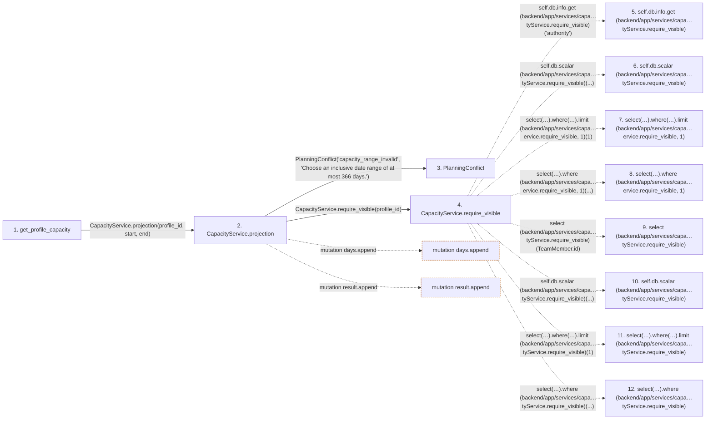

# get_profile_capacity

**Entry point:** `get_profile_capacity` (`http`)
**Source:** [routers_capacity](../modules/routers_capacity.md)
**Modules touched:** [authority](../modules/authority.md), [capacity_service](../modules/capacity_service.md), [commands](../modules/commands.md), [routers_capacity](../modules/routers_capacity.md), and 1 more

**Complete modules touched:**

- [authority](../modules/authority.md)
- [capacity_service](../modules/capacity_service.md)
- [commands](../modules/commands.md)
- [routers_capacity](../modules/routers_capacity.md)
- [services_work_metrics](../modules/services_work_metrics.md)

## Call sequence

> Static overview in presentation order, not runtime execution order. Arrows retain captured callers; representative internal continuations and boundary examples precede repeated helper detail.

```mermaid
sequenceDiagram
    participant p0 as get_profile_capacity
    participant p1 as CapacityService.projection
    participant p2 as CapacityService
    participant p3 as CapacityService.require_visible
    participant p4 as CapacityService.absence_ranges
    participant p5 as included_work_ids
    participant p6 as PlanningConflict
    participant p7 as internal_authority
    participant p8 as calendar_signature
    participant p9 as day_hours
    participant p10 as AuthorityError
    participant p11 as select (backend/app/services/capa…apacityService.projection)
    participant p12 as self.db.info.get (backend/app/services/capa…apacityService.projection)
    participant p13 as self.db.scalar (backend/app/services/capa…apacityService.projection)
    participant p14 as select(…).where (backend/app/services/capa…apacityService.projection)
    participant p15 as self.db.get (backend/app/services/capa…apacityService.projection)
    participant p16 as list (backend/app/services/capa…apacityService.projection)
    participant p17 as (…).all (backend/app/services/capa…cityService.projection, 2)
    participant p18 as self.db.scalars
    participant p19 as select(…).join(…).where(…).options
    participant p20 as select(…).join(…).where (backend/app/services/capa…apacityService.projection)
    participant p21 as select(…).join (backend/app/services/capa…apacityService.projection)
    participant p22 as selectinload(…).selectinload
    participant p23 as selectinload
    participant p24 as len
    participant p25 as (…).all (backend/app/services/capa…apacityService.projection)
    participant p26 as self.db.execute (backend/app/services/capa…apacityService.projection)
    p0->>p1: CapacityService.projection
    p0->>p2: CapacityService
    p1->>p3: CapacityService.require_visible
    p1->>p4: CapacityService.absence_ranges
    p1->>p5: included_work_ids
    p1->>p6: PlanningConflict
    p1->>p7: internal_authority
    p1->>p8: calendar_signature
    p1->>p9: day_hours
    p3->>p10: AuthorityError
    p1-->>p11: select (backend/app/services/capa…apacityService.projection)(PlanningState.revision)
    p1-->>p12: self.db.info.get (backend/app/services/capa…apacityService.projection)('authority')
    p1-->>p13: self.db.scalar (backend/app/services/capa…apacityService.projection)(...)
    p1-->>p14: select(…).where (backend/app/services/capa…apacityService.projection)(...)
    p1-->>p15: self.db.get (backend/app/services/capa…apacityService.projection)(ProfileAvailability, profile_id)
    p1-->>p16: list (backend/app/services/capa…apacityService.projection)(...)
    p1-->>p17: (…).all (backend/app/services/capa…cityService.projection, 2)
    p1-->>p18: self.db.scalars(...)
    p1-->>p19: select(…).join(…).where(…).options(...)
    p1-->>p20: select(…).join(…).where (backend/app/services/capa…apacityService.projection)(..., ..., ...)
    p1-->>p21: select(…).join (backend/app/services/capa…apacityService.projection)(Iteration)
    p1-->>p11: select (backend/app/services/capa…apacityService.projection)(TeamMember)
    p1-->>p22: selectinload(…).selectinload(Iteration.calendar)
    p1-->>p23: selectinload(TeamMember.iteration)
    p1-->>p15: self.db.get (backend/app/services/capa…apacityService.projection)(Calendar, setting.calendar_id)
    p1-->>p24: len(calendars)
    p1-->>p24: len(calendars)
    p1-->>p16: list (backend/app/services/capa…apacityService.projection)(...)
    p1-->>p25: (…).all (backend/app/services/capa…apacityService.projection)
    p1-->>p26: self.db.execute (backend/app/services/capa…apacityService.projection)(...)
```

<!-- Auto-generated from static call edges. Dashed arrows are external or unresolved calls. Reviewed runtime conditions and side effects belong in Behavior. -->

> Call sequence diagram shows 30 of 151 interactions; 121 omitted to keep the visualization within the 30-interaction and generated-diagram limits, with uncertain identities omitted rather than inferred.

> Captured boundary calls: external 7 of 56 (49 omitted); unresolved 13 of 79 (66 omitted). These counts cover the captured static trace.

Omitted captured detail, grouped by actual caller occurrence and target module:

| Caller | Parent step | Target module | Kind | Omitted interactions |
| --- | --- | --- | --- | --- |
| `backend/app/services/capacity_service.py:CapacityService.require_visible` | 4 | - | unresolved | 8 |
| `backend/app/services/capacity_service.py:CapacityService.require_visible` | 4 | - | external | 2 |
| `backend/app/services/capacity_service.py:CapacityService.require_visible` | 4 | [backend/app/authority.py](../modules/authority.md) | internal | 1 |
| `backend/app/authority.py:internal_authority` | 15 | - | unresolved | 1 |
| `backend/app/services/capacity_service.py:CapacityService.require_visible` | 4 | [backend/app/commands.py](../modules/commands.md) | internal | 1 |
| `backend/app/services/capacity_service.py:calendar_signature` | 35 | - | external | 6 |
| `backend/app/services/capacity_service.py:CapacityService.absence_ranges` | 44 | [backend/app/authority.py](../modules/authority.md) | internal | 1 |
| `backend/app/services/capacity_service.py:CapacityService.absence_ranges` | 44 | - | external | 4 |
> Omission summary shows 8 of 17 groups; 9 further groups are not expanded here. Counts above include all omitted interactions.
> Detailed flow queries retain their own coverage and limits; omitted paths may execute at runtime.

## Data flow

<!-- Auto-generated static analysis. Treat values and boundaries as best-effort hints, not runtime proof. -->

### Analysis coverage

**Effect analysis partially available.** Flow assembly and source effect analysis are separate; empty observations do not prove an empty handler body.

Source steps: 17; effect analysis evaluated: 12, partial: 0, unavailable: 5. Counts include steps omitted from the displayed trace.

Collector observations for 12 source steps with known totals: observed: 53, emitted: 53, omitted: 0. Unavailable totals are excluded.

- Callable record unavailable for one or more source steps; those steps have no represented callable body.
- Effect collector totals unavailable; observed counts cover captured records only.

| Step | Callable record | Effect analysis | Collector totals | Observed | Emitted | Omitted |
|---|---|---|---|---:|---:|---:|
| `get_profile_capacity` | `available` | `evaluated` | `available` | `5` | `5` | `0` |
| `CapacityService.projection` | `available` | `evaluated` | `available` | `11` | `11` | `0` |
| `PlanningConflict` | `unavailable` | `unavailable` | `unavailable` | — | — | — |
| `CapacityService.require_visible` | `available` | `evaluated` | `available` | `3` | `3` | `0` |
| `self.db.info.get (backend/app/services/capa…tyService.require_visible)` | `not_applicable` | `not_applicable` | `not_applicable` | — | — | — |
| `self.db.scalar (backend/app/services/capa…tyService.require_visible)` | `not_applicable` | `not_applicable` | `not_applicable` | — | — | — |
| `select(…).where(…).limit (backend/app/services/capa…ervice.require_visible, 1)` | `not_applicable` | `not_applicable` | `not_applicable` | — | — | — |
| `select(…).where (backend/app/services/capa…ervice.require_visible, 1)` | `not_applicable` | `not_applicable` | `not_applicable` | — | — | — |
| `select (backend/app/services/capa…tyService.require_visible)` | `not_applicable` | `not_applicable` | `not_applicable` | — | — | — |
| `self.db.scalar (backend/app/services/capa…tyService.require_visible)` | `not_applicable` | `not_applicable` | `not_applicable` | — | — | — |
| `select(…).where(…).limit (backend/app/services/capa…tyService.require_visible)` | `not_applicable` | `not_applicable` | `not_applicable` | — | — | — |
| `select(…).where (backend/app/services/capa…tyService.require_visible)` | `not_applicable` | `not_applicable` | `not_applicable` | — | — | — |

### Step data

| Step | Inputs | Reads | Writes | Returns |
|---|---|---|---|---|
| `get_profile_capacity` | `profile_id: int`, `start: date`, `end: date`, `db: Database` | - | - | `...` |
| `CapacityService.projection` | `profile_id`, `start`, `end` | `self.db`, `PlanningState`, `ProfileAvailability`, `Calendar`, `self.db` | - | `{...}` |
| `PlanningConflict` | - | - | - | - |
| `CapacityService.require_visible` | `profile_id` | `self.db`, `TeamMemberProfile` | - | - |
| `self.db.info.get (backend/app/services/capa…tyService.require_visible)` | - | - | - | - |
| `self.db.scalar (backend/app/services/capa…tyService.require_visible)` | - | - | - | - |
| `select(…).where(…).limit (backend/app/services/capa…ervice.require_visible, 1)` | - | - | - | - |
| `select(…).where (backend/app/services/capa…ervice.require_visible, 1)` | - | - | - | - |
| `select (backend/app/services/capa…tyService.require_visible)` | - | - | - | - |
| `self.db.scalar (backend/app/services/capa…tyService.require_visible)` | - | - | - | - |
| `select(…).where(…).limit (backend/app/services/capa…tyService.require_visible)` | - | - | - | - |
| `select(…).where (backend/app/services/capa…tyService.require_visible)` | - | - | - | - |

### Call data

| From | To | Line | Call |
|---|---|---:|---|
| get_profile_capacity | CapacityService.projection | 59 | `CapacityService(db).projection(profile_id, start, end)` |
| CapacityService.projection | PlanningConflict | 175 | `PlanningConflict('capacity_range_invalid', 'Choose an inclusive date range of at most 366 days.')` |
| CapacityService.projection | CapacityService.require_visible | 176 | `self.require_visible(profile_id)` |
| CapacityService.require_visible | self.db.info.get (backend/app/services/capa…tyService.require_visible) | 41 | `self.db.info.get('authority')` |
| CapacityService.require_visible | self.db.scalar (backend/app/services/capa…tyService.require_visible) | 43 | `self.db.scalar(...)` |
| CapacityService.require_visible | select(…).where(…).limit (backend/app/services/capa…ervice.require_visible, 1) | 43 | `select(TeamMember.id).where(TeamMember.profile_id == profile_id).limit(1)` |
| CapacityService.require_visible | select(…).where (backend/app/services/capa…ervice.require_visible, 1) | 43 | `select(TeamMember.id).where(...)` |
| CapacityService.require_visible | select (backend/app/services/capa…tyService.require_visible) | 43 | `select(TeamMember.id)` |
| CapacityService.require_visible | self.db.scalar (backend/app/services/capa…tyService.require_visible) | 46 | `self.db.scalar(...)` |
| CapacityService.require_visible | select(…).where(…).limit (backend/app/services/capa…tyService.require_visible) | 46 | `select(Task.id).where(Task.owner_profile_id == profile_id).limit(1)` |
| CapacityService.require_visible | select(…).where (backend/app/services/capa…tyService.require_visible) | 46 | `select(Task.id).where(...)` |

### Boundary effects

| Kind | Target | Step | Line |
|---|---|---|---:|
| mutation | `days.append` | `CapacityService.projection` | 210 |
| mutation | `result.append` | `CapacityService.projection` | 229 |

### Static analysis gaps

| Kind | Step | Target | Line |
|---|---|---|---:|
| unresolved_call | `CapacityService.require_visible` | `self.db.info.get` | 41 |
| unresolved_call | `CapacityService.require_visible` | `self.db.scalar` | 43 |
| unresolved_call | `CapacityService.require_visible` | `select(TeamMember.id).where(TeamMember.profile_id == profile_id).limit` | 43 |
| unresolved_call | `CapacityService.require_visible` | `select(TeamMember.id).where` | 43 |
| external_call | `CapacityService.require_visible` | `select` | 43 |
| unresolved_call | `CapacityService.require_visible` | `self.db.scalar` | 46 |
| unresolved_call | `CapacityService.require_visible` | `select(Task.id).where(Task.owner_profile_id == profile_id).limit` | 46 |
| unresolved_call | `CapacityService.require_visible` | `select(Task.id).where` | 46 |
| step_limit | `get_profile_capacity` | `first 12 steps` | 0 |

## Behavior

Accepts an inclusive range of at most 366 days for a visible person. Authorized allocations expose their factors, private allocations only busy hours. Unknown effort and calendar coverage limitations remain explicit. Saved baseline effort is distributed over working dates for explanation, independently of forecast dates.
