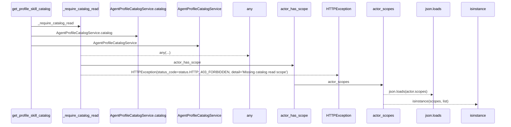
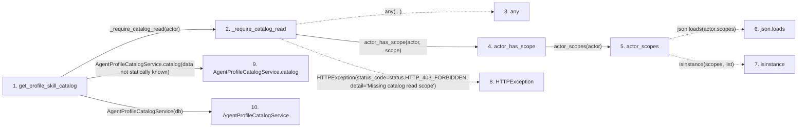

# get_profile_skill_catalog

**Entry point:** `get_profile_skill_catalog` (`http`)
**Source:** [agent_catalog](../modules/agent_catalog.md)
**Modules touched:** [agent_catalog](../modules/agent_catalog.md), [agent_profile_catalog_service](../modules/agent_profile_catalog_service.md), [agent_service](../modules/agent_service.md)

## Call sequence

> Static overview in presentation order, not runtime execution order. Arrows retain captured callers; representative internal continuations and boundary examples precede repeated helper detail.

<!-- Auto-generated from static call edges. Dashed arrows are external or unresolved calls. Reviewed runtime conditions and side effects belong in Behavior. -->

> Call sequence diagram shows 9 of 9 interactions; 0 omitted to keep the visualization within the 30-interaction and generated-diagram limits, with uncertain identities omitted rather than inferred.

> Captured boundary calls: external 4 of 4 (0 omitted); unresolved 0 of 0 (0 omitted). These counts cover the captured static trace.
> Detailed flow queries retain their own coverage and limits; omitted paths may execute at runtime.

## Data flow

<!-- Auto-generated static analysis. Treat values and boundaries as best-effort hints, not runtime proof. -->

### Analysis coverage

**Effect analysis partially available.** Flow assembly and source effect analysis are separate; empty observations do not prove an empty handler body.

Source steps: 6; effect analysis evaluated: 5, partial: 0, unavailable: 1. Counts include steps omitted from the displayed trace.

Collector observations for 5 source steps with known totals: observed: 13, emitted: 13, omitted: 0. Unavailable totals are excluded.

- Callable record unavailable for one or more source steps; those steps have no represented callable body.
- Effect collector totals unavailable; observed counts cover captured records only.

| Step | Callable record | Effect analysis | Collector totals | Observed | Emitted | Omitted |
|---|---|---|---|---:|---:|---:|
| `get_profile_skill_catalog` | `available` | `evaluated` | `available` | `3` | `3` | `0` |
| `_require_catalog_read` | `available` | `evaluated` | `available` | `2` | `2` | `0` |
| `any` | `not_applicable` | `not_applicable` | `not_applicable` | — | — | — |
| `actor_has_scope` | `available` | `evaluated` | `available` | `3` | `3` | `0` |
| `actor_scopes` | `available` | `evaluated` | `available` | `3` | `3` | `0` |
| `json.loads` | `not_applicable` | `not_applicable` | `not_applicable` | — | — | — |
| `isinstance` | `not_applicable` | `not_applicable` | `not_applicable` | — | — | — |
| `HTTPException` | `not_applicable` | `not_applicable` | `not_applicable` | — | — | — |
| `AgentProfileCatalogService.catalog` | `available` | `evaluated` | `available` | `2` | `2` | `0` |
| `AgentProfileCatalogService` | `unavailable` | `unavailable` | `unavailable` | — | — | — |

### Step data

| Step | Inputs | Reads | Writes | Returns |
|---|---|---|---|---|
| `get_profile_skill_catalog` | `actor: Annotated[AgentActor, Depends(get_agent_actor)]`, `db: Annotated[AsyncSession, Depends(get_db, scope='function')]` | - | - | `...` |
| `_require_catalog_read` | `actor: AgentActor` | `status` | - | - |
| `any` | - | - | - | - |
| `actor_has_scope` | `actor: AgentActor`, `scope: str` | - | - | `...` |
| `actor_scopes` | `actor: AgentActor` | `json` | - | `...` |
| `json.loads` | - | - | - | - |
| `isinstance` | - | - | - | - |
| `HTTPException` | - | - | - | - |
| `AgentProfileCatalogService.catalog` | - | `CAPABILITY_SKILLS` | - | `CAPABILITY_SKILLS` |
| `AgentProfileCatalogService` | - | - | - | - |

### Call data

| From | To | Line | Call |
|---|---|---:|---|
| get_profile_skill_catalog | _require_catalog_read | 84 | `_require_catalog_read(actor)` |
| _require_catalog_read | any | 68 | `any(...)` |
| _require_catalog_read | actor_has_scope | 69 | `actor_has_scope(actor, scope)` |
| actor_has_scope | actor_scopes | 94 | `actor_scopes(actor)` |
| actor_scopes | json.loads | 86 | `json.loads(actor.scopes)` |
| actor_scopes | isinstance | 89 | `isinstance(scopes, list)` |
| _require_catalog_read | HTTPException | 72 | `HTTPException(status_code=status.HTTP_403_FORBIDDEN, detail='Missing catalog read scope')` |
| get_profile_skill_catalog | AgentProfileCatalogService.catalog | 85 | `AgentProfileCatalogService(db).catalog(data not statically known)` |
| get_profile_skill_catalog | AgentProfileCatalogService | 85 | `AgentProfileCatalogService(db)` |

### Boundary effects

*No boundary-effect observations were captured in this static trace.*

### Static analysis gaps

| Kind | Step | Target | Line |
|---|---|---|---:|
| external_call | `_require_catalog_read` | `any` | 68 |
| external_call | `actor_scopes` | `json.loads` | 86 |
| external_call | `actor_scopes` | `isinstance` | 89 |
| external_call | `_require_catalog_read` | `HTTPException` | 72 |

## Behavior

This flow starts at `get_profile_skill_catalog` and is classified as `http`. The generated call and data-flow sections are bounded static projections; runtime conditions and side effects require source-level confirmation.
