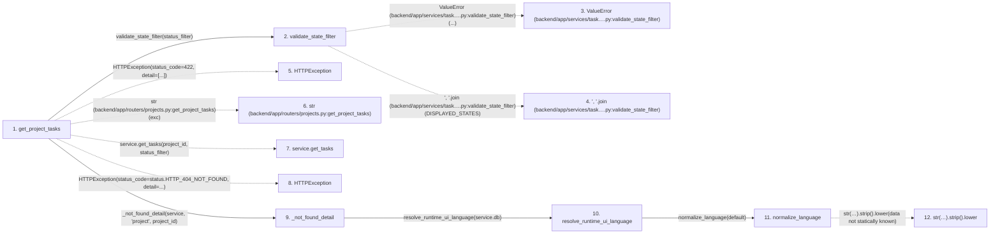

# get_project_tasks

**Entry point:** `get_project_tasks` (`http`)
**Source:** [projects](../modules/projects.md)
**Modules touched:** [agent_readiness](../modules/agent_readiness.md), [commands](../modules/commands.md), [config](../modules/config.md), [external_link_service](../modules/external_link_service.md), and 11 more

**Complete modules touched:**

- [agent_readiness](../modules/agent_readiness.md)
- [commands](../modules/commands.md)
- [config](../modules/config.md)
- [external_link_service](../modules/external_link_service.md)
- [language_service](../modules/language_service.md)
- [projects](../modules/projects.md)
- [schemas_external_link](../modules/schemas_external_link.md)
- [schemas_task](../modules/schemas_task.md)
- [services_work_metrics](../modules/services_work_metrics.md)
- [system_settings_service](../modules/system_settings_service.md)
- [task_brief_service](../modules/task_brief_service.md)
- [task_display_state](../modules/task_display_state.md)
- [task_service](../modules/task_service.md)
- [time](../modules/time.md)
- [url_policy](../modules/url_policy.md)

## Call sequence

> Static overview in presentation order, not runtime execution order. Arrows retain captured callers; representative internal continuations and boundary examples precede repeated helper detail.

```mermaid
sequenceDiagram
    participant p0 as get_project_tasks
    participant p1 as _not_found_detail
    participant p2 as TaskService.task_to_response
    participant p3 as validate_state_filter
    participant p4 as TaskService
    participant p5 as resolve_runtime_ui_language
    participant p6 as entity_not_found_message
    participant p7 as task_signals
    participant p8 as evaluate_agent_readiness
    participant p9 as ExternalLinkService.task_links_to_response
    participant p10 as working_today
    participant p11 as ExternalLinkService.link_to_response
    participant p12 as RuntimeSettingsService.get_app_settings
    participant p13 as localized
    participant p14 as ExternalLinkService.legacy_task_link_response
    participant p15 as _add_criterion
    participant p16 as get_settings
    participant p17 as RuntimeSettingsService.resolve
    participant p18 as RuntimeSettingsService._definition
    participant p19 as RuntimeSettingsService._decrypt_secret
    participant p20 as RuntimeSettingsService._coerce
    participant p21 as current_command
    participant p22 as TaskAssignee
    participant p23 as TaskProject
    participant p24 as TaskMilestone
    participant p25 as TaskClaimedBy
    participant p26 as TaskResponse
    participant p27 as ExternalLinkService
    participant p28 as normalize_language
    participant p29 as HTTPException
    participant p30 as service.get_tasks
    p0->>p1: _not_found_detail
    p0->>p2: TaskService.task_to_response
    p0->>p3: validate_state_filter
    p0->>p4: TaskService
    p1->>p5: resolve_runtime_ui_language
    p1->>p6: entity_not_found_message
    p2->>p7: task_signals
    p2->>p8: evaluate_agent_readiness
    p2->>p9: ExternalLinkService.task_links_to_response
    p7->>p10: working_today
    p9->>p11: ExternalLinkService.link_to_response
    p5->>p12: RuntimeSettingsService.get_app_settings
    p6->>p13: localized
    p9->>p14: ExternalLinkService.legacy_task_link_response
    p8->>p15: _add_criterion
    p5->>p16: get_settings
    p12->>p17: RuntimeSettingsService.resolve
    p17->>p18: RuntimeSettingsService._definition
    p17->>p19: RuntimeSettingsService._decrypt_secret
    p17->>p20: RuntimeSettingsService._coerce
    p2->>p21: current_command
    p2->>p22: TaskAssignee
    p2->>p23: TaskProject
    p2->>p24: TaskMilestone
    p2->>p25: TaskClaimedBy
    p2->>p26: TaskResponse
    p2->>p27: ExternalLinkService
    p5->>p28: normalize_language
    p0-->>p29: HTTPException(status_code=422, detail=[...])
    p0-->>p30: service.get_tasks(project_id, status_filter)
```

<!-- Auto-generated from static call edges. Dashed arrows are external or unresolved calls. Reviewed runtime conditions and side effects belong in Behavior. -->

> Call sequence diagram shows 30 of 211 interactions; 181 omitted to keep the visualization within the 30-interaction and generated-diagram limits, with uncertain identities omitted rather than inferred.

> Captured boundary calls: external 1 of 60 (59 omitted); unresolved 1 of 71 (70 omitted). These counts cover the captured static trace.

Omitted captured detail, grouped by actual caller occurrence and target module:

| Caller | Parent step | Target module | Kind | Omitted interactions |
| --- | --- | --- | --- | --- |
| `backend/app/services/task_display_state.py:validate_state_filter` | 2 | - | external | 1 |
| `backend/app/services/task_display_state.py:validate_state_filter` | 2 | - | unresolved | 1 |
| `backend/app/routers/projects.py:get_project_tasks` | 1 | - | external | 2 |
| `backend/app/services/language_service.py:normalize_language` | 11 | - | unresolved | 2 |
| `backend/app/services/language_service.py:normalize_language` | 11 | - | external | 1 |
| `backend/app/services/system_settings_service.py:RuntimeSettingsService._definition` | 17 | - | unresolved | 1 |
| `backend/app/services/system_settings_service.py:RuntimeSettingsService._definition` | 17 | [backend/app/services/system_settings_service.py](../modules/system_settings_service.md) | internal | 1 |
| `backend/app/services/system_settings_service.py:RuntimeSettingsService.resolve` | 16 | [backend/app/services/system_settings_service.py](../modules/system_settings_service.md) | internal | 3 |
> Omission summary shows 8 of 61 groups; 53 further groups are not expanded here. Counts above include all omitted interactions.
> Detailed flow queries retain their own coverage and limits; omitted paths may execute at runtime.

> Trace truncated at the depth limit; deeper calls are omitted.

## Data flow

<!-- Auto-generated static analysis. Treat values and boundaries as best-effort hints, not runtime proof. -->

### Analysis coverage

**Effect analysis partially available.** Flow assembly and source effect analysis are separate; empty observations do not prove an empty handler body.

Source steps: 81; effect analysis evaluated: 51, partial: 0, unavailable: 30. Counts include steps omitted from the displayed trace.

Collector observations for 51 source steps with known totals: observed: 251, emitted: 251, omitted: 0. Unavailable totals are excluded.

- Callable record unavailable for one or more source steps; those steps have no represented callable body.
- Effect collector totals unavailable; observed counts cover captured records only.

| Step | Callable record | Effect analysis | Collector totals | Observed | Emitted | Omitted |
|---|---|---|---|---:|---:|---:|
| `get_project_tasks` | `available` | `evaluated` | `available` | `5` | `5` | `0` |
| `validate_state_filter` | `available` | `evaluated` | `available` | `4` | `4` | `0` |
| `ValueError (backend/app/services/task….py:validate_state_filter)` | `not_applicable` | `not_applicable` | `not_applicable` | — | — | — |
| `', '.join (backend/app/services/task….py:validate_state_filter)` | `not_applicable` | `not_applicable` | `not_applicable` | — | — | — |
| `HTTPException` | `not_applicable` | `not_applicable` | `not_applicable` | — | — | — |
| `str (backend/app/routers/projects.py:get_project_tasks)` | `not_applicable` | `not_applicable` | `not_applicable` | — | — | — |
| `service.get_tasks` | `not_applicable` | `not_applicable` | `not_applicable` | — | — | — |
| `HTTPException` | `not_applicable` | `not_applicable` | `not_applicable` | — | — | — |
| `_not_found_detail` | `available` | `evaluated` | `available` | `4` | `4` | `0` |
| `resolve_runtime_ui_language` | `available` | `evaluated` | `available` | `5` | `5` | `0` |
| `normalize_language` | `available` | `evaluated` | `available` | `4` | `4` | `0` |
| `str(…).strip().lower` | `not_applicable` | `not_applicable` | `not_applicable` | — | — | — |

### Step data

| Step | Inputs | Reads | Writes | Returns |
|---|---|---|---|---|
| `get_project_tasks` | `project_id: int`, `service: Annotated[ProjectService, Depends(get_project_service)]`, `status_filter: Annotated[Optional[str], Query(alias='status', description='A displayed state: planned, active, resolved, closed, postponed, canceled or superseded. With it the response is a flat list of the tasks at any depth shown in that state, not the tree roots.')]` | `status` | - | `...` |
| `validate_state_filter` | `state` | `DISPLAYED_STATES`, `DISPLAYED_STATES` | - | `state` |
| `ValueError (backend/app/services/task….py:validate_state_filter)` | - | - | - | - |
| `', '.join (backend/app/services/task….py:validate_state_filter)` | - | - | - | - |
| `HTTPException` | - | - | - | - |
| `str (backend/app/routers/projects.py:get_project_tasks)` | - | - | - | - |
| `service.get_tasks` | - | - | - | - |
| `HTTPException` | - | - | - | - |
| `_not_found_detail` | `service: Any`, `entity: str`, `entity_id: int` | - | - | `entity_not_found_message(...)` |
| `resolve_runtime_ui_language` | `db: Any`, `default: LanguageCode \| None` | - | - | `normalize_language(...)`, `normalize_language(...)`, `fallback` |
| `normalize_language` | `value: Any`, `default: LanguageCode` | - | - | `normalized`, `default` |
| `str(…).strip().lower` | - | - | - | - |

### Call data

| From | To | Line | Call |
|---|---|---:|---|
| get_project_tasks | validate_state_filter | 527 | `validate_state_filter(status_filter)` |
| validate_state_filter | ValueError (backend/app/services/task….py:validate_state_filter) | 28 | `ValueError(...)` |
| validate_state_filter | ', '.join (backend/app/services/task….py:validate_state_filter) | 28 | `', '.join(DISPLAYED_STATES)` |
| get_project_tasks | HTTPException | 529 | `HTTPException(status_code=422, detail=[...])` |
| get_project_tasks | str (backend/app/routers/projects.py:get_project_tasks) | 529 | `str(exc)` |
| get_project_tasks | service.get_tasks | 530 | `service.get_tasks(project_id, status_filter)` |
| get_project_tasks | HTTPException | 532 | `HTTPException(status_code=status.HTTP_404_NOT_FOUND, detail=...)` |
| get_project_tasks | _not_found_detail | 534 | `_not_found_detail(service, 'project', project_id)` |
| _not_found_detail | resolve_runtime_ui_language | 73 | `resolve_runtime_ui_language(service.db)` |
| resolve_runtime_ui_language | normalize_language | 406 | `normalize_language(default)` |
| normalize_language | str(…).strip().lower | 35 | `str(value or '').strip().lower(data not statically known)` |

### Boundary effects

*No boundary-effect observations were captured in this static trace.*

### Static analysis gaps

| Kind | Step | Target | Line |
|---|---|---|---:|
| external_call | `validate_state_filter` | `ValueError` | 28 |
| unresolved_call | `validate_state_filter` | `', '.join` | 28 |
| external_call | `get_project_tasks` | `HTTPException` | 529 |
| unresolved_call | `get_project_tasks` | `service.get_tasks` | 530 |
| external_call | `get_project_tasks` | `HTTPException` | 532 |
| unresolved_call | `normalize_language` | `str(value or '').strip().lower` | 35 |
| step_limit | `get_project_tasks` | `first 12 steps` | 0 |
| truncated_flow | `get_project_tasks` | `depth limit` | 0 |

## Behavior

This flow starts at `get_project_tasks` and is classified as `http`. The generated call and data-flow sections are bounded static projections; runtime conditions and side effects require source-level confirmation.
