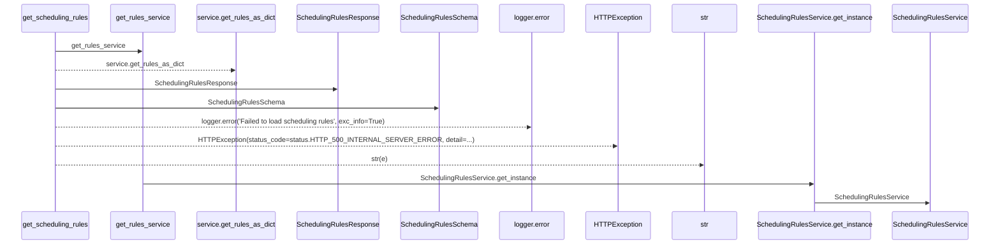
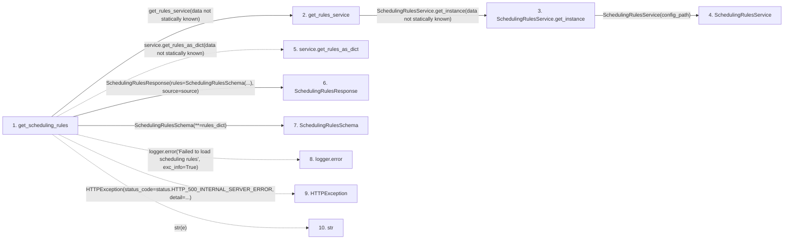

# get_scheduling_rules

**Entry point:** `get_scheduling_rules` (`http`)
**Source:** [routers_scheduling_rules](../modules/routers_scheduling_rules.md)
**Modules touched:** [routers_scheduling_rules](../modules/routers_scheduling_rules.md), [scheduling_rules_service](../modules/scheduling_rules_service.md), [schemas_scheduling_rules](../modules/schemas_scheduling_rules.md)

## Call sequence

> Static overview in presentation order, not runtime execution order. Arrows retain captured callers; representative internal continuations and boundary examples precede repeated helper detail.

<!-- Auto-generated from static call edges. Dashed arrows are external or unresolved calls. Reviewed runtime conditions and side effects belong in Behavior. -->

> Call sequence diagram shows 9 of 9 interactions; 0 omitted to keep the visualization within the 30-interaction and generated-diagram limits, with uncertain identities omitted rather than inferred.

> Captured boundary calls: external 2 of 2 (0 omitted); unresolved 2 of 2 (0 omitted). These counts cover the captured static trace.
> Detailed flow queries retain their own coverage and limits; omitted paths may execute at runtime.

## Data flow

<!-- Auto-generated static analysis. Treat values and boundaries as best-effort hints, not runtime proof. -->

### Analysis coverage

**Effect analysis partially available.** Flow assembly and source effect analysis are separate; empty observations do not prove an empty handler body.

Source steps: 6; effect analysis evaluated: 3, partial: 0, unavailable: 3. Counts include steps omitted from the displayed trace.

Collector observations for 3 source steps with known totals: observed: 8, emitted: 8, omitted: 0. Unavailable totals are excluded.

- Callable record unavailable for one or more source steps; those steps have no represented callable body.
- Effect collector totals unavailable; observed counts cover captured records only.

| Step | Callable record | Effect analysis | Collector totals | Observed | Emitted | Omitted |
|---|---|---|---|---:|---:|---:|
| `get_scheduling_rules` | `available` | `evaluated` | `available` | `2` | `2` | `0` |
| `get_rules_service` | `available` | `evaluated` | `available` | `1` | `1` | `0` |
| `SchedulingRulesService.get_instance` | `available` | `evaluated` | `available` | `5` | `5` | `0` |
| `SchedulingRulesService` | `unavailable` | `unavailable` | `unavailable` | — | — | — |
| `service.get_rules_as_dict` | `not_applicable` | `not_applicable` | `not_applicable` | — | — | — |
| `SchedulingRulesResponse` | `unavailable` | `unavailable` | `unavailable` | — | — | — |
| `SchedulingRulesSchema` | `unavailable` | `unavailable` | `unavailable` | — | — | — |
| `logger.error` | `not_applicable` | `not_applicable` | `not_applicable` | — | — | — |
| `HTTPException` | `not_applicable` | `not_applicable` | `not_applicable` | — | — | — |
| `str` | `not_applicable` | `not_applicable` | `not_applicable` | — | — | — |

### Step data

| Step | Inputs | Reads | Writes | Returns |
|---|---|---|---|---|
| `get_scheduling_rules` | - | `status` | - | `SchedulingRulesResponse(...)` |
| `get_rules_service` | - | - | - | `SchedulingRulesService.get_instance(...)` |
| `SchedulingRulesService.get_instance` | `config_path: Optional[Path]` | `cls._instance`, `cls._instance` | `cls._instance` | `cls._instance` |
| `SchedulingRulesService` | - | - | - | - |
| `service.get_rules_as_dict` | - | - | - | - |
| `SchedulingRulesResponse` | - | - | - | - |
| `SchedulingRulesSchema` | - | - | - | - |
| `logger.error` | - | - | - | - |
| `HTTPException` | - | - | - | - |
| `str` | - | - | - | - |

### Call data

| From | To | Line | Call |
|---|---|---:|---|
| get_scheduling_rules | get_rules_service | 26 | `get_rules_service(data not statically known)` |
| get_rules_service | SchedulingRulesService.get_instance | 20 | `SchedulingRulesService.get_instance(data not statically known)` |
| SchedulingRulesService.get_instance | SchedulingRulesService | 105 | `cls(config_path)` |
| get_scheduling_rules | service.get_rules_as_dict | 29 | `service.get_rules_as_dict(data not statically known)` |
| get_scheduling_rules | SchedulingRulesResponse | 32 | `SchedulingRulesResponse(rules=SchedulingRulesSchema(...), source=source)` |
| get_scheduling_rules | SchedulingRulesSchema | 33 | `SchedulingRulesSchema(**=rules_dict)` |
| get_scheduling_rules | logger.error | 37 | `logger.error('Failed to load scheduling rules', exc_info=True)` |
| get_scheduling_rules | HTTPException | 38 | `HTTPException(status_code=status.HTTP_500_INTERNAL_SERVER_ERROR, detail=...)` |
| get_scheduling_rules | str | 40 | `str(e)` |

### Boundary effects

*No boundary-effect observations were captured in this static trace.*

### Static analysis gaps

| Kind | Step | Target | Line |
|---|---|---|---:|
| unresolved_call | `get_scheduling_rules` | `service.get_rules_as_dict` | 29 |
| unresolved_call | `get_scheduling_rules` | `logger.error` | 37 |
| external_call | `get_scheduling_rules` | `HTTPException` | 38 |

## Behavior

This flow starts at `get_scheduling_rules` and is classified as `http`. The generated call and data-flow sections are bounded static projections; runtime conditions and side effects require source-level confirmation.
